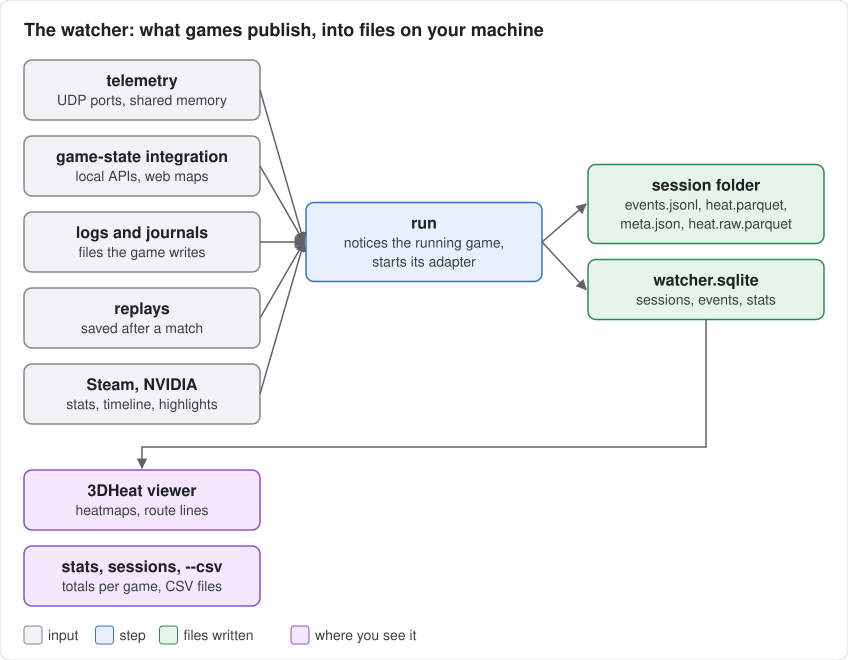
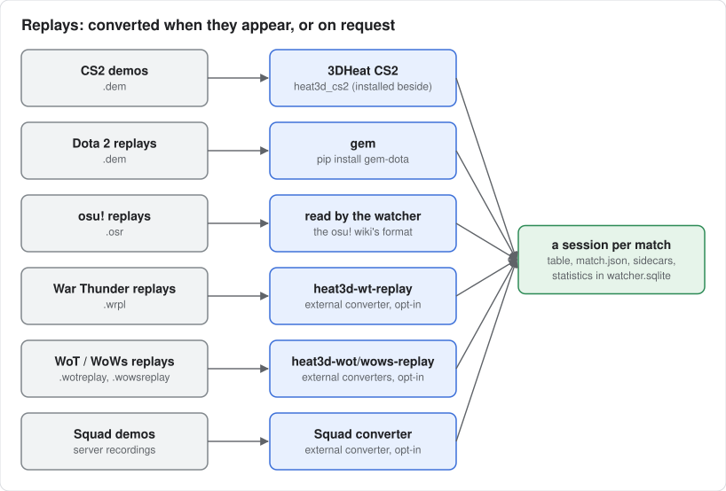

# 3DHeat Watcher

**What is it?** You play a game. This program quietly writes down where you
went and what happened. Later you can look at it as a coloured map in the
3DHeat viewer.

**Why would I use it?** To keep your own record of every sitting - where you
drove, flew or fought, what happened where, your totals per game - without
any website and without changing the game.

**Example:** you drive a few laps in a racing game with the watcher running;
afterwards `sessions/<game>/<date>_<source>/heat.parquet` holds your line,
and the viewer draws it.

In more detail: a background tool that records what games publish about your play - where you
went, what happened where, and the numbers behind it - into files on your own
machine, for your own statistics and for the heatmaps of the
[3DHeat viewer](https://github.com/Holdi601/3DHeat) ([documentation](https://holdi601.github.io/3DHeat/)).

It runs quietly, notices which game you started, and reads that game's own
outputs: a telemetry port, a game-state integration, the journal or log the
game writes, the replay it saves after a match, the statistics Steam keeps, the
highlights your graphics driver records. Nothing is sent anywhere.

**Documentation: <https://holdi601.github.io/3DHeat-Watcher/>** - a page per game
(50 of them), per command and per output.



## In 3DHeat

Install it from the Games page of 3DHeat: 3DHeat installs it and runs it for you. The manifest
[`plugin.json`](plugin.json) in this repository, also beside the program in every release, tells 3DHeat
what the tool does, which games it is for and how to call it.

## The standalone program

No Python needed: download the file for your system (Windows, Linux, macOS) from the
[latest release](https://github.com/Holdi601/3DHeat-Watcher/releases/latest), check it against
`SHA256SUMS`, unpack it and start `heat3d-watcher`. Its window starts and stops watching, opens the
sessions folder, says which games are running and what each game gives, and asks before it updates
itself. `heat3d-watcher --help` lists its commands; `heat3d-watcher heat3d-watch <command>` (or simply
`heat3d-watcher <command>`) runs every command below unchanged. The 3DHeat app's Extractors panel can
install and update it for you. See [Before you start](https://holdi601.github.io/3DHeat-Watcher/before-you-start.html).

The window walks through four steps (find the game, choose, work, done) in the 3DHeat look, dark or light. On Windows the program opens only its window, with no console window; in a terminal it prints as usual, and `heat3d-watcher-cli.cmd` in the same folder makes the terminal wait for it and pass on its exit code.

While it records, an icon by the clock (Windows) says what it is recording; its menu opens the window, pauses or resumes the recording, or quits. Closing the window during a recording keeps it recording in the background.

## Quick start for new users

You need: Windows, [Python](https://www.python.org/downloads/) 3.10 or later
("Add python.exe to PATH" ticked in its installer), and the games you play.
No Git is needed.

1. Download the release,
   <https://github.com/Holdi601/3DHeat-Watcher/archive/refs/tags/v1.0.3.zip>,
   and unpack it. Open PowerShell in the unpacked folder (`3DHeat-Watcher-1.0.3`;
   in File Explorer, type `powershell` in the address bar) and install what it
   needs; run every command from that folder:

   ```bash
   python -m pip install -r requirements.txt
   ```

   Some games want an extra package or a reader of their own; `games` says
   which, and `requirements-optional.txt` lists them.
2. See what each game gives, switch a game's own output on where it needs it
   (`setup <id>` shows the change, `--apply` makes it, the original file is
   backed up), then watch while you play:

   ```bash
   python -m heat3d_watch games
   python -m heat3d_watch setup all
   python -m heat3d_watch setup <id> --apply
   python -m heat3d_watch run
   ```

3. `run` keeps going until you press Ctrl+C or close the window. Everything
   lands in `%LOCALAPPDATA%\3DHeat\Watcher`: one folder per sitting,
   `sessions\<game>\<date>_<source>\`, with `heat.parquet` (the rows with a
   position), `events.jsonl` and `meta.json`; converted replays write their
   table and `<match>.match.json` there too. `python -m heat3d_watch stats`
   prints the totals per game.
4. Open it in the [3DHeat viewer](https://github.com/Holdi601/3DHeat#quick-start):
   download the viewer (**Code -> Download ZIP**, unpack) and double-click
   `start.bat`; it offers to install [Node.js](https://nodejs.org/) when it is
   missing and opens Chrome or Edge at `http://127.0.0.1:5273`. There,
   **Source -> Files...** and pick a session's `heat.parquet` (or drop it on
   the Source panel); it opens with nothing to set. A replay's
   `<match>.match.json` goes in the **Match** tab's **Load match files...**.

When a new release is out, the watcher says so when it starts and offers to
update the folder from the release (`python -m heat3d_watch update` does the
same).

## Install and quick start

New to the command line? Read [Before you start](https://holdi601.github.io/3DHeat-Watcher/before-you-start.html) first.

Windows and Python 3.10 or later. Download the zip from
[Releases](https://github.com/Holdi601/3DHeat-Watcher/releases) and unpack it (or,
if you have Git, `git clone https://github.com/Holdi601/3DHeat-Watcher.git`), open a
terminal in that folder (in File Explorer, type `powershell` in the address bar), then:

```bash
pip install -r requirements.txt
python -m heat3d_watch games          # what each game gives, and from where
python -m heat3d_watch setup all      # what would have to be switched on (add --apply to do it)
python -m heat3d_watch run            # watch; leave it running
python -m heat3d_watch stats          # totals per game
python -m heat3d_watch stats --csv out   # sessions, events and stats as CSV files
python -m heat3d_watch replays cs2-demos # convert the demos already on disk (new ones are converted by `run`)
python -m heat3d_watch replays warthunder-replays [folder]  # War Thunder replays, through the external converter (see below)
python -m heat3d_watch replays wot-replays [folder]   # World of Tanks replays, through the external converter (see below)
python -m heat3d_watch replays wows-replays [folder]  # World of Warships replays, likewise
python -m heat3d_watch replays dota-replays [folder]  # Dota 2 replays, through the 3DHeat-Ext-DotaReplay reader (see below)
python -m heat3d_watch replays lol-replays [folder]   # League of Legends replays, through the 3DHeat-Ext-Riot reader
python -m heat3d_watch dota-replay <match id> --convert  # fetch a public Dota 2 match's replay from Valve and convert it (needs internet)
python -m heat3d_watch dota-map -o dota.glb      # the Dota 2 map from your install as a 3D level (needs the 3DHeat-Ext-Dota tool)
```

`<...>` are placeholders. After `games` you should see a table of games, one line
each; `run` keeps going until you press Ctrl+C or close the window. If `python` is not recognised or
says `No module named ...`, see [Before you start](https://holdi601.github.io/3DHeat-Watcher/before-you-start.html#common-errors).

## Commands

| Command | Options | Does |
|---|---|---|
| `run` | `--once` one look, then stop; `-v` verbose | watch in the background: record every game that is running |
| `games` | `--markdown` the table for the docs | what each game gives and from where |
| `setup <id \| all>` | `--apply` make the changes (backups kept) | switch a game's own output on |
| `status` | | which games are running now, and what would be recorded |
| `sessions` | `--game NAME`, `--limit N` | the recordings so far |
| `stats` | `--game NAME`; `--csv DIR` write sessions, events and stats as CSV | totals per game |
| `table <session folder>` | | rebuild a session's `heat.parquet` from its `events.jsonl` |
| `replays <adapter id> [folder]` | `-v` | convert the replays already on disk |
| `dota-replay <match id> ...` | `-o DIR` where to save; `--convert`; `-v` | download a public Dota 2 match's replay |
| `dota-map [map] -o FILE` | `--game DIR`; `--source2viewer EXE`; `--detail UNITS` | the Dota 2 map as a 3D level, by the separate 3DHeat-Ext-Dota tool |
| `update` | `--check` only ask | update to the newest release |
| `config` | `--set KEY=VALUE ...` (`KEY.ID=VALUE` for one entry of a dictionary) | show or change the settings |

`python -m heat3d_watch --version` prints the version; `<command> --help` the options. Every
command with examples: [Commands](https://holdi601.github.io/3DHeat-Watcher/commands.html).


## Output


Everything goes to `%LOCALAPPDATA%\3DHeat\Watcher` (set `HEAT3D_WATCH_HOME`, or
`python -m heat3d_watch config --set data=D:\somewhere`):

- `sessions/<game>/<date>_<source>/` - one folder per sitting:
  - `events.jsonl` - every event the moment it happens: time, event, position,
    player, team, match, and whatever else the game said
  - `heat.parquet` - the rows with a position, as a table the 3DHeat viewer
    opens directly (heatmaps, and the line mode that draws each player's routes
    between spawn and death)
  - `meta.json` - the game, the source, the axes and units, the counts and the
    statistics of the sitting
  - `heat.raw.parquet` - everything the source sent, kept whole (live feeds);
    converted replays write their table, `<match>.match.json` and sidecars here
- `watcher.sqlite` - the statistics of every session, in three plain tables
  (`sessions`, `events`, `stats`) any SQL tool or spreadsheet reads
- `watcher.log` - what the watcher did

`heat.parquet` has `time`, `ms`, `event`, `x`, `y`, `z`, `player`, `team`, `session` and the
game's own fields as columns; its footer tells the viewer the axes and units, so it opens
with nothing to set. Every file and column: [The data](https://holdi601.github.io/3DHeat-Watcher/the-data.html).
The viewer's one-file-a-match format, which the replay converters can write, is its
[`.3dheat` container](https://holdi601.github.io/3DHeat/container.html)
([spec source](https://github.com/Holdi601/3DHeat/blob/main/docs/container.md)).


## What it may and may not do

- **Only what games publish.** Telemetry ports and shared memory the game
  creates for dashboards and motion rigs, game-state integrations and local APIs
  the game serves, files the game writes, replays the game saves, what Steam and
  the graphics driver keep. The watcher injects nothing into a game, hooks
  nothing, changes nothing in a game. The one exception is your choice: the
  recorder mod for Gunner, HEAT, PC! (a single-player game with no replays or
  telemetry), which you install into the game's mod loader; it only reads and
  changes nothing in play ([mods/ghpc](mods/ghpc/README.md)).
- **Multiplayer games: never their memory.** Reading a game's memory is allowed
  only for single-player games, only for builds a profile was checked on, only
  with no anti-cheat installed with the game or running on the machine, and only
  while the game has no connection out. It is off by default
  (`config --set memory=true`), it can only read, and no profiles ship with the
  tools. See [`docs/watcher.md`](docs/watcher.md#reading-memory).
- **Nothing protected is broken open.** Where a replay protects its game stream
  against cheating (League of Legends, VALORANT), only what it carries in the
  open is read - the end-of-game score, the event timeline. Replays encrypted
  with a key are not read by the watcher: Fortnite's are declined, and World
  of Tanks' and World of Warships' are left to separate converters a player
  installs by choice (below).
- **Switching a source on is your decision.** `setup` says which file it would
  change and how; only `setup --apply` changes it, and the original is kept as
  `<file>.heat3d-backup`.

**War Thunder replays** (`.wrpl`) are read by a separate converter, not by the
watcher: [3DHeat-Ext-WarThunder](https://github.com/Holdi601/3DHeat-Ext-WarThunder)
(`exporters/ext/warthunder-replay` in 3DHeat), which installs the
`heat3d-wt-replay` command (`pip install -e <3DHeat>/exporters/ext/warthunder-replay`).
It is a project of its own: without it the watcher runs as before and says once
that it is missing. With it, each new replay in `<War Thunder>/Replays` becomes
a session with every aircraft's track, the kills and hits where they happened,
and who was who where the replay says so. What it reads and does not read is in
its own README.

**World of Tanks and World of Warships replays** (`.wotreplay`, `.wowsreplay`)
are read the same way, by a converter of each outside the watcher:
[3DHeat-Ext-WoT](https://github.com/Holdi601/3DHeat-Ext-WoT) (`heat3d-wot-replay`) and
[3DHeat-Ext-WoWs](https://github.com/Holdi601/3DHeat-Ext-WoWs) (`heat3d-wows-replay`), each installed with `pip install -e` on its folder.
Each is a project of its own, like the War Thunder converter. With them, each
new replay in the game's `replays` folder
becomes a session with every tank's or ship's position while the recording
player's client knew of it - its own team throughout, enemies while spotted -
and the kills where they happened. Their READMEs say what they read, on which
game versions, and what they do not.

**Squad demos** (server recordings) are read the same way by
[3DHeat-Ext-Squad](https://github.com/Holdi601/3DHeat-Ext-Squad) (`heat3d-squad-demo`), when it is
installed. **CS2 demos** go through [3DHeat CS2](https://github.com/Holdi601/3DHeat-CS2). **League of
Legends and VALORANT replays** (`.rofl`, `.vrf`) go through [3DHeat-Ext-Riot](https://github.com/Holdi601/3DHeat-Ext-Riot)
(`heat3d-riot-replays`), which reads only what each file carries in the open - never the encrypted,
obfuscated game data; the watcher adds a League match's official timeline from Riot's API when you give
it your own Riot developer key.



**Dota 2 replays** (`.dem`) are read by
[3DHeat-Ext-DotaReplay](https://github.com/Holdi601/3DHeat-Ext-DotaReplay) (`heat3d-dota-replay`,
which reads through gem-dota, MIT): each replay in `<Dota>/game/dota/replays` becomes a session with
every hero's track, the kills, objectives, wards and combat log. `dota-replay <match id>` downloads one public
match's replay (it needs internet; the match id is the number on the match's
page in the Dota client or on OpenDota). Details:
[Dota 2 replays](https://holdi601.github.io/3DHeat-Watcher/game-dota-replays.html).
With Dota 2 installed, the separate tool
[3DHeat-Ext-Dota](https://github.com/Holdi601/3DHeat-Ext-Dota) makes the map itself
a 3D level under those tables - ground, cliffs, water, trees and buildings - from
the game's own files; once it is installed, `dota-map -o dota.glb` runs it:
[Dota 2 map](https://holdi601.github.io/3DHeat-Watcher/dota-map.html).

While no game is running the watcher looks for a newer release and announces it once
(log and notification). It installs it and starts again only when you chose automatic updates
(`--auto-update`, the window's *Update automatically*, or `HEAT3D_AUTO_UPDATE=1`) - never in the middle of a game; otherwise update with `update` or from the window.
`config --set auto_update=false` stops the looking.

Which game is recorded how, and from where: [all games in one table](https://holdi601.github.io/3DHeat-Watcher/watcher.html)
and a [page per game](https://holdi601.github.io/3DHeat-Watcher/games.html).

**Arma 3 and Arma Reforger servers** can record whole missions with the server mods in
[`mods/`](mods/) (untested in the games so far): [Server recorder mods](https://holdi601.github.io/3DHeat-Watcher/server-mods.html),
and the [Gunner, HEAT, PC! recorder](https://holdi601.github.io/3DHeat-Watcher/ghpc-recorder.html).

Every adapter and replay decoder keeps everything its source holds: what it reads goes into the table and `meta.json`, everything it sent stays whole beside it (`heat.raw.parquet` for live feeds, the replay sidecars for replays), counted in `selfCheck.completeness` - [Converters keep everything](https://github.com/Holdi601/3DHeat/blob/main/docs/converters.md); each game's page has a Completeness section.

---

## Part of 3DHeat

3DHeat Watcher is one of the free tools around the 3DHeat viewer. Each is its
own project, with its own releases and licence:

| Tool | What it does | Docs |
|---|---|---|
| [3DHeat](https://github.com/Holdi601/3DHeat) | the viewer: heatmaps, race analysis and match review in 3D | [site](https://holdi601.github.io/3DHeat/) |
| [GameFiles](https://github.com/Holdi601/3DHeat-GameFiles) | courses and levels out of the files games ship, as 3D models | [site](https://holdi601.github.io/3DHeat-GameFiles/) |
| [GameCapture](https://github.com/Holdi601/3DHeat-GameCapture) | lap telemetry from racing games; levels rebuilt from gameplay video | [site](https://holdi601.github.io/3DHeat-GameCapture/) |
| [Unreal Exporter](https://github.com/Holdi601/3DHeat-UnrealExporter) | an Unreal Editor plugin that exports a level as one 3D model | [site](https://holdi601.github.io/3DHeat-UnrealExporter/) |
| [CS2](https://github.com/Holdi601/3DHeat-CS2) | Counter-Strike 2 demos into tables and match documents; maps into 3D models | [site](https://holdi601.github.io/3DHeat-CS2/) |
| [Watcher](https://github.com/Holdi601/3DHeat-Watcher) | records what games publish about your play, in the background | [site](https://holdi601.github.io/3DHeat-Watcher/) |
| [Ext-WarThunder](https://github.com/Holdi601/3DHeat-Ext-WarThunder) | War Thunder replays into tables and match documents | [site](https://holdi601.github.io/3DHeat-Ext-WarThunder/) |
| [Ext-WoT](https://github.com/Holdi601/3DHeat-Ext-WoT) | World of Tanks replays into tables and match documents | [site](https://holdi601.github.io/3DHeat-Ext-WoT/) |
| [Ext-WoWs](https://github.com/Holdi601/3DHeat-Ext-WoWs) | World of Warships replays into tables and match documents | [site](https://holdi601.github.io/3DHeat-Ext-WoWs/) |
| [Ext-Squad](https://github.com/Holdi601/3DHeat-Ext-Squad) | Squad server demos into tables and match documents | [site](https://holdi601.github.io/3DHeat-Ext-Squad/) |
| [Ext-DCS](https://github.com/Holdi601/3DHeat-Ext-DCS) | DCS World maps into 3D models | [site](https://holdi601.github.io/3DHeat-Ext-DCS/) |
| [Ext-IL2](https://github.com/Holdi601/3DHeat-Ext-IL2) | IL-2 Sturmovik maps into 3D models | [site](https://holdi601.github.io/3DHeat-Ext-IL2/) |
| [Ext-DotaReplay](https://github.com/Holdi601/3DHeat-Ext-DotaReplay) | Dota 2 replays into tables and match documents | [site](https://holdi601.github.io/3DHeat-Ext-DotaReplay/) |
| [Ext-Riot](https://github.com/Holdi601/3DHeat-Ext-Riot) | what League of Legends and VALORANT replays carry in the open | [site](https://holdi601.github.io/3DHeat-Ext-Riot/) |
| [Ext-Dota](https://github.com/Holdi601/3DHeat-Ext-Dota) | the Dota 2 map from your own install as a 3D level | [site](https://holdi601.github.io/3DHeat-Ext-Dota/) |
| [Ext-Forza](https://github.com/Holdi601/3DHeat-Ext-Forza) | Forza courses, races and cars from your own install | [site](https://holdi601.github.io/3DHeat-Ext-Forza/) |
| [Ext-Battlefield](https://github.com/Holdi601/3DHeat-Ext-Battlefield) | Battlefield levels (Frostbite) as 3D levels | [site](https://holdi601.github.io/3DHeat-Ext-Battlefield/) |
| [Ext-BeamNG](https://github.com/Holdi601/3DHeat-Ext-BeamNG) | BeamNG.drive courses | [site](https://holdi601.github.io/3DHeat-Ext-BeamNG/) |
| [Ext-ACRally](https://github.com/Holdi601/3DHeat-Ext-ACRally) | Assetto Corsa Rally stages as courses | [site](https://holdi601.github.io/3DHeat-Ext-ACRally/) |
| [Ext-Reforger](https://github.com/Holdi601/3DHeat-Ext-Reforger) | Arma Reforger worlds (Enfusion) as 3D levels | [site](https://holdi601.github.io/3DHeat-Ext-Reforger/) |
| [Ext-R6](https://github.com/Holdi601/3DHeat-Ext-R6) | Rainbow Six Siege match replays | [site](https://holdi601.github.io/3DHeat-Ext-R6/) |

Each game reader is its own small project with its own licence file, releases
and issue tracker, so it can be installed, updated, maintained - or withdrawn on
a rights holder's request - on its own, without affecting the viewer or the
other tools. 3DHeat is not affiliated with or endorsed by the publishers of the
games it reads; the games and related names and trademarks belong to their
owners. Rights holders: open an issue at
[3DHeat-Watcher/issues](https://github.com/Holdi601/3DHeat-Watcher/issues) - we
respond quickly and remove anything on request.

## Updates

3DHeat Watcher checks this repository's releases when it starts (at most every few
hours, never holding it up for more than a few seconds), says when a newer
version is out with its notes, and asks before it updates (update now, later, or skip this
version; by itself only when you chose automatic updates): a clone with `git pull` when it has no
local changes, a downloaded copy by replacing its files from the release archive,
after checking the archive is the version it claims. Your own files - recordings,
settings, exports - are never touched. To update on request: `python -m heat3d_watch update`.
`HEAT3D_NO_UPDATE=1` switches the check off.

## Licence

MIT - see [`LICENSE`](LICENSE), and [`LICENSES.md`](LICENSES.md) for the
third-party packages it uses and what the games it reads oblige.

Documentation: <https://holdi601.github.io/3DHeat-Watcher/> (the source pages are in
[`docs/`](docs/)).
