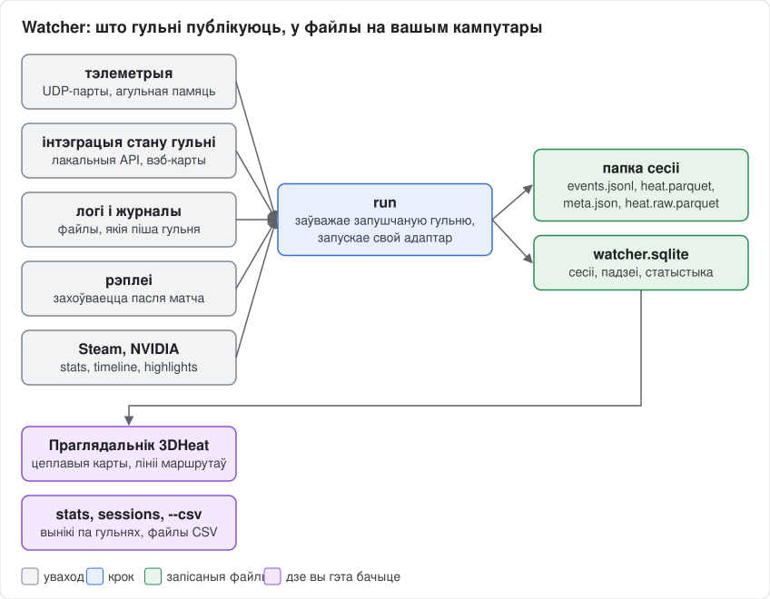

# 3DHeat Watcher {#dheat-watcher}

**Што гэта?** Вы гуляеце ў гульню. Гэта праграма ціха запісвае, дзе вы былі і што адбывалася.
Пазней вы можаце паглядзець гэта як каляровую карту ў праглядальніку 3DHeat.

**Навошта гэта мне?** Каб весці ўласны запіс кожнага сеанса - дзе вы ехалі, ляцелі або ваявалі,
вашы вынікі па гульнях - без якога-небудзь сайта і без змены гульні.

**Прыклад:** вы едзеце круг у гоначнай гульні з запушчаным watcher; пасля гэтага файл у
`sessions\<game>\` змяшчае вашу лінію, а праглядальнік яе малюе.

Больш падрабязна: 3DHeat Watcher — гэта фонавая праграма, якая запісвае тое, што гульні публікуюць пра вашу гульню: куды вы
хадзілі, што і дзе адбывалася, і лічбы за гэтым - у файлы на вашым кампутары. Файлы
прызначаны для вашай уласнай статыстыкі і для цеплавых карт і ліній маршрутаў праглядальніка 3DHeat.

Яна працуе ціха, заўважае, якую гульню вы запусцілі, і чытае ўласныя вывады гэтай гульні: порт
тэлеметрыі або агульную памяць, якую гульня публікуе для панэляў, інтэграцыю стану гульні, журнал або лог,
які піша гульня, рэплей, што яна захоўвае пасля матча, статыстыку, якую вядзе Steam, кліпы, што
захоўвае праграма NVIDIA. Запісы застаюцца на вашым кампутары. Праграма звяртаецца толькі да двух вонкавых сэрвісаў, і толькі
у гэтых выпадках: GitHub, каб шукаць новы выпуск (гл. [Абнаўленні](../updates.md)), і API Match-V5 ад Riot,
і толькі калі вы ўводзіце ўласны ключ Riot API (гл. [Рэплеі League of Legends](../game-lol-replays.md)).



## Што ён запісвае {#what-it-records}

- **Пазіцыі**: аўтамабіль, самалёт, герой або гулец, некалькі разоў за секунду, дзе гульня іх
  публікуе, з хуткасцю, курсам і ўсім, што гульня адпраўляе разам.
- **Падзеі**: з'яўленні, смерці, забойствы, кругі, этапы, раунды, галы, заданні, ўзлёты і пасадкі, змены
  зон, дасягненні, гучныя моманты. Кожная падзея захоўваецца са сваім часам і, калі
  гульня яго дае, са сваім месцам.
- **Статыстыка па сесіі**: забойствы, смерці, кругі, найлепшы круг, адлегласць, максімальная хуткасць, час гульні
  і ўласная статыстыка гульні, дзе яна яе вядзе.

Што дае кожная гульня і адкуль, апісана на яе ўласнай старонцы ў раздзеле [Гульні](../games.md). Адна крыніца не можа
запісаць усё: шматкарыстальніцкія гульні запісваюцца толькі праз тое, што яны публікуюць, а watcher
ніколі не чытае іх памяць (гл. [Крыніцы і правілы](../sources-and-rules.md)).

## Усталёўка {#install}

Упершыню ў камандным радку? Спачатку прачытайце [Перад пачаткам](before-you-start.md).

Watcher — гэта праграма на Python для Windows (Python 3.10 або навейшы). Многія яго крыніцы існуюць толькі ў Windows: агульная
памяць, рэестр, паведамленні Windows.

```bash
git clone https://github.com/Holdi601/3DHeat-Watcher.git
cd 3DHeat-Watcher
pip install -r requirements.txt
```

Спампаваны архіў выпуску працуе гэтак жа: распакуйце яго, потым выканайце `pip install -r requirements.txt`
у гэтай папцы. Падрабязнасці і дадаткі, патрэбныя некаторым гульням, ёсць у
[Усталёўка і запуск](../installing-and-running.md).

## Хуткі старт {#quick-start}

```bash
python -m heat3d_watch games            # what each game gives, and from where
python -m heat3d_watch setup all        # what would have to be switched on (nothing is changed)
python -m heat3d_watch setup f1-25 --apply   # switch one game's output on (the original file is backed up)
python -m heat3d_watch run              # watch; leave it running while you play
python -m heat3d_watch stats            # totals per game
python -m heat3d_watch stats --csv out  # sessions, events and stats as CSV files
```

Вы ўбачыце: пасля `games` табліцу з радком на кожную гульню; `run` працягваецца, пакуль вы не націснеце
Ctrl+C або не зачыніце акно.

Усё запісваецца ў `%LOCALAPPDATA%\3DHeat\Watcher`. Каб выкарыстаць іншую папку, задайце зменную асяроддзя
`HEAT3D_WATCH_HOME` або выканайце `python -m heat3d_watch config --set data=D:\somewhere`.

- `sessions\<game>\<date>_<adapter>\` - па папцы на сеанс, у якой ёсць `events.jsonl` (кожная падзея
  па меры яе з'яўлення), `heat.parquet` (радкі з пазіцыяй, гатовыя для праглядальніка 3DHeat) і
  `meta.json` (гульня, крыніца, восі, лічбы, статыстыка)
- `watcher.sqlite` - статыстыка кожнай сесіі ў трох простых табліцах
- `watcher.log` - што рабіў watcher

Праглядальнік адкрывае `heat.parquet` сесіі наўпрост, нічога не наладжваючы (яго восі і адзінкі ёсць у
файле). Сканвертаваныя рэплеі запісваюцца як табліцы і дакументы матчаў побач; уласны фармат
праглядальніка «адзін файл на матч» апісаны на яго старонцы пра [кантэйнер `.3dheat`](https://holdi601.github.io/3DHeat/container.html),
а слупкі кожнай табліцы — у [Даныя](../the-data.md).

## Дакументацыя {#the-documentation}

| Старонка | Пра што яна |
|---|---|
| [Перад пачаткам](before-you-start.md) | Python, тэрмінал, запаўняльнікі, як выглядаюць поспех і частыя памылкі |
| [Усталёўка і запуск](../installing-and-running.md) | патрабаванні, запуск у фоне, запуск разам з Windows, файл блакіроўкі, лог, кожная налада і зменная асяроддзя |
| [Гульні](../games.md) | па старонцы на гульню: што запісваецца, адкуль, як уключыць, як працуе, восі, статыстыка, што правярана |
| [Даныя](../the-data.md) | папкі сесій, `events.jsonl`, `heat.parquet` і яго калонтытул, `meta.json`, `watcher.sqlite`, аднаўленне пасля збою, экспарт CSV, адкрыццё сесіі ў праглядальніку 3DHeat |
| [Каманды](../commands.md) | кожная каманда і опцыя `python -m heat3d_watch` |
| [Крыніцы і правілы](../sources-and-rules.md) | шэсць відаў крыніц, правілы для шматкарыстальніцкіх гульняў, якія гульні прапушчаны і чаму |
| [NVIDIA Highlights](../nvidia-highlights.md) | што NVIDIA Highlights можа і не можа даць, і як гучны момант атрымлівае пазіцыю |
| [Серверныя моды-запісвальнікі](../server-mods.md) | серверныя моды Arma 3 і Arma Reforger, што запісваюць цэлыя місіі для праглядальніка |
| [Чытанне памяці](../memory-reading.md) | профілі памяці аднакарыстальніцкіх гульняў: фармат, праверкі, як напісаць і праверыць профіль |
| [Абнаўленні](../updates.md) | як watcher шукае новыя выпускі і абнаўляецца сам |
| [Распрацоўка](../development.md) | напісанне адаптара: API, тэсты, сумленнае `verified`, стварэнне старонак гульняў нанова |
| [Усе гульні ў адной табліцы](../watcher.md) | усе гульні ў адной табліцы, як друкуе `games --markdown`, плюс гульні, даследаваныя, але яшчэ не пабудаваныя |
| [Даведнік каманд](../cli-reference.md) | `--help` кожнай каманды, створаны з кода |
| [Падтрымка](../maintaining.md) | спіс для выпуску гэтых старонак |

## Частка 3DHeat {#part-of-3dheat}

3DHeat Watcher — адзін з бясплатных інструментаў вакол праглядальніка 3DHeat (watcher выкарыстоўвае 3DHeat CS2
для канвертавання дэма CS2). Кожны — асобны праект са сваімі выпускамі і ліцэнзіяй:

| Інструмент | Што ён робіць | Дакументацыя |
|---|---|---|
| [3DHeat](https://github.com/Holdi601/3DHeat) | праглядальнік: цеплавыя карты, аналіз гонак і разбор матчаў у 3D | [сайт](https://holdi601.github.io/3DHeat/) |
| [GameFiles](https://github.com/Holdi601/3DHeat-GameFiles) | трасы і ўзроўні з файлаў, што пастаўляюць гульні, як 3D-мадэлі | [сайт](https://holdi601.github.io/3DHeat-GameFiles/) |
| [GameCapture](https://github.com/Holdi601/3DHeat-GameCapture) | тэлеметрыя кругоў з гоначных гульняў; узроўні, узноўленыя з відэа гульні | [сайт](https://holdi601.github.io/3DHeat-GameCapture/) |
| [Unreal Exporter](https://github.com/Holdi601/3DHeat-UnrealExporter) | убудова Unreal Editor, што экспартуе ўзровень як адну 3D-мадэль | [сайт](https://holdi601.github.io/3DHeat-UnrealExporter/) |
| [CS2](https://github.com/Holdi601/3DHeat-CS2) | дэма Counter-Strike 2 у табліцы і дакументы матчаў; карты ў 3D-мадэлі | [сайт](https://holdi601.github.io/3DHeat-CS2/) |
| [Watcher](https://github.com/Holdi601/3DHeat-Watcher) | запісвае ў фоне тое, што гульні публікуюць пра вашу гульню | [сайт](https://holdi601.github.io/3DHeat-Watcher/) |
| [Ext-WarThunder](https://github.com/Holdi601/3DHeat-Ext-WarThunder) | рэплеі War Thunder у табліцы і дакументы матчаў | [сайт](https://holdi601.github.io/3DHeat-Ext-WarThunder/) |
| [Ext-WoT](https://github.com/Holdi601/3DHeat-Ext-WoT) | рэплеі World of Tanks у табліцы і дакументы матчаў | [сайт](https://holdi601.github.io/3DHeat-Ext-WoT/) |
| [Ext-WoWs](https://github.com/Holdi601/3DHeat-Ext-WoWs) | рэплеі World of Warships у табліцы і дакументы матчаў | [сайт](https://holdi601.github.io/3DHeat-Ext-WoWs/) |
| [Ext-Squad](https://github.com/Holdi601/3DHeat-Ext-Squad) | дэма сервераў Squad у табліцы і дакументы матчаў | [сайт](https://holdi601.github.io/3DHeat-Ext-Squad/) |
| [Ext-DCS](https://github.com/Holdi601/3DHeat-Ext-DCS) | карты DCS World у 3D-мадэлі | [сайт](https://holdi601.github.io/3DHeat-Ext-DCS/) |
| [Ext-IL2](https://github.com/Holdi601/3DHeat-Ext-IL2) | карты IL-2 Sturmovik у 3D-мадэлі | [сайт](https://holdi601.github.io/3DHeat-Ext-IL2/) |

Ліцэнзія: MIT ([LICENSE](https://github.com/Holdi601/3DHeat-Watcher/blob/main/LICENSE)). Ліцэнзіі
староніх пакетаў, якія ён выкарыстоўвае, і тое, што патрабуюць гульні, якія ён чытае, пералічаны ў
[LICENSES.md](https://github.com/Holdi601/3DHeat-Watcher/blob/main/LICENSES.md).
