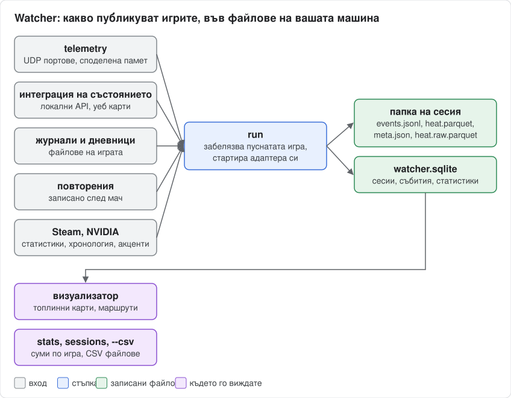
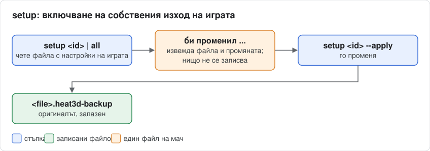
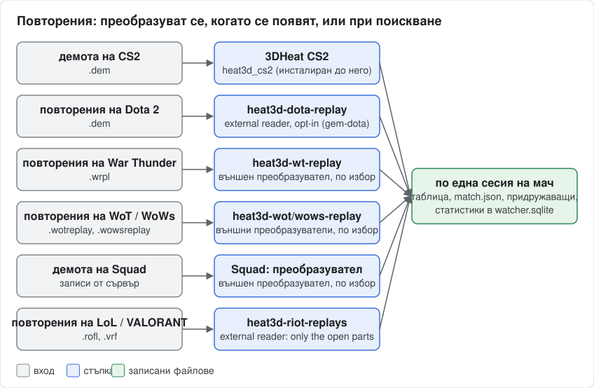
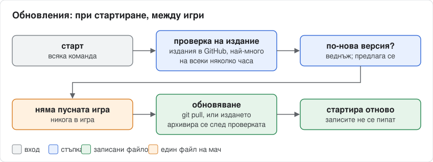

# Команди {#commands}

Нови ли сте в командния ред? Първо прочетете [Преди да започнете](before-you-start.md). Всяка команда се пише в терминал, отворен в папката, където сте разархивирали или клонирали програмата (в File Explorer напишете `powershell` в адресния ред), така:

```bash
python -m heat3d_watch <command> [options]
```


| Команда | Какво прави |
|---|---|
| [`run`](#run) | наблюдава във фонов режим и записва всяка игра, която се стартира |
| [`games`](#games) | какво дава всяка игра и откъде |
| [`setup`](#setup) | включва собствения изход на една игра |
| [`status`](#status) | кои игри работят сега и кои адаптери биха се стартирали |
| [`sessions`](#sessions) | досегашните записи |
| [`stats`](#stats) | общи суми по игра или таблиците като CSV |
| [`table`](#table) | изгражда отново `heat.parquet` на една сесия от нейния `events.jsonl` |
| [`replays`](#replays) | конвертира реплеите, които вече са на диска |
| [`dota-replay`](#dota-replay) | сваля реплея на публичен мач от Dota 2 по неговия идентификатор |
| [`dota-map`](#dota-map) | картата на Dota 2 от вашата инсталация като 3D ниво за визуализатора |
| [`update`](#update) | обновява до най-новата версия |
| [`config`](#config) | показва или променя настройките |

Опции за всяка команда: `-h` / `--help` показва помощта, а `python -m heat3d_watch --version` показва версията (файла `VERSION`).

Снимките на тази страница са от работа върху синтетични примерни сесии (`Example Racer`, `Example Arena`), а не върху истински записи.

Всяка команда, без `update`, първо проверява дали има по-нова версия (най-много на всеки шест часа; проверката се пропуска с `HEAT3D_NO_UPDATE=1`, вижте [Обновявания](updates.md)). `run` само показва известие. Останалите команди питат `Update now? [Y/n]`, когато работят в терминал, и показват как да се обновят, когато не работят в терминал. Изходът е в UTF-8, така че имената на игри на всеки език се показват правилно в която и да е конзола.

## run {#run}

```bash
python -m heat3d_watch run [--once] [-v]
```



Наблюдава, докато не бъде спряно (Ctrl+C): на всеки `scan_seconds` чете списъка с процесите и пуска адаптер за всяка открита игра, плюс адаптерите, които работят винаги. Преди първата проверка довършва сесиите, които предишно изпълнение е оставило отворени. Докато не работи нито една игра, може да се обнови само (при включена настройка `auto_update`). Подробностите са в [Инсталиране и стартиране](installing-and-running.md#running).

| Опция | Действие |
|---|---|
| `--once` | една проверка на игрите, които работят в момента, после изход. Стартират се адаптерите за игрите, които работят сега (и за тези, които работят винаги), всеки проверява веднъж (чака се най-много 10 секунди), после всички се спират така, както се спира при край на игра: сесиите им се затварят, записват се и се броят. За проверка на откриването, не за запис. |
| `-v`, `--verbose` | редове за отстраняване на грешки в `watcher.log` и в конзолата |

`run` записва `<data>\watcher.lock` и отказва да стартира втори път за същата папка с данни (код на изход 1); вижте [Файлът за заключване](installing-and-running.md#the-lock-file).

## games {#games}

```bash
python -m heat3d_watch games [--markdown]
```


Изброява всеки адаптер, подреден по игра: името му, идентификатор и вид, откъде чете, какво записва и как се включва. Адаптер, който не може да работи на тази машина, е маркиран с `[unavailable: <why>]` - няма SimConnect.dll, няма папка на Minecraft, няма инсталиран 3DHeat CS2, няма намерен Steam или NVIDIA App. Модул на адаптер, който не се е заредил, се назовава в края заедно с грешката.

```text
EA SPORTS F1 25  (f1-25, telemetry)
    from: UDP telemetry 127.0.0.1:20777 (Documents\My Games\F1 25\hardwaresettings\hardware_settings_config.xml)
    - every car's position (world XYZ, m) at 10 Hz, by driver name, team, own car marked, ...
    switch on: In the game: Settings > Telemetry Settings > UDP Telemetry On, IP 127.0.0.1, port 20777 - ...
```

`--markdown` извежда същото като една таблица в Markdown (игра, какво се записва, откъде, как се включва, онлайн игра, проверено). Таблицата в [Всички игри в една таблица](watcher.md) е точно този изход. Клетките са екранирани за Markdown: текстът в обратни кавички остава кодов фрагмент, а извън тях `<`, `>`, `&`, `*`, `|` и обратната наклонена черта пред пунктуация са записани така, че да се виждат както са написани (иначе `<CS2>` би изчезнал като HTML таг в kramdown). Единственият HTML е `<br>` между елементите в „Какво се записва“.

## setup {#setup}

```bash
python -m heat3d_watch setup <adapter id | all> [--apply]
```




Включва собствения изход на играта там, където тя изисква да се промени файл за това. Без `--apply` нищо не се променя: всеки ред казва какво би се променило, а когато има какво да се промени, последният ред казва `Nothing was changed. Run again with --apply to make these changes.` Когато няма нищо за промяна, се показва `<id>: nothing to change` (`Nothing to change.` за `all`). С `--apply` промените се правят, а преди файл да се промени за първи път, оригиналът му се запазва като `<file>.heat3d-backup`. Вече съществуващ резервен файл никога не се презаписва, така че винаги съдържа файла такъв, какъвто е бил преди watcher-а да го докосне за първи път.

```text
f1-25: would change: hardware_settings_config.xml <udp>: enabled="false" -> "true"
Nothing was changed. Run again with --apply to make these changes.
```

`all` изпълнява настройката на всеки адаптер, който има такава. Адаптер без настройка, посочен сам по себе си, показва `<id>: nothing for setup to change; ` и после как се включва играта (текстът му `enable`, или че не се нуждае от нищо). Непознат идентификатор показва `no adapter '<id>'; games lists them` и излиза с код 2. Адаптерите, които имат какво да се настрои:

| Адаптер | Какво променя `--apply` |
|---|---|
| `beamng` | инсталира протоколния мод `heat3d` в папката `mods` на потребителя на BeamNG (само ако го няма); после в играта включете Options > Other > Protocols > "others" |
| `cs2-gsi` | записва `<CS2>\game\csgo\cfg\gamestate_integration_heat3d.cfg`: изпраща състоянието на играта към `http://127.0.0.1:3311/` със случаен токен, който watcher-ът после изисква (токен, който вече е във файла, се запазва); CS2 го чете при стартиране |
| `dota2-gsi` | същото за Dota 2: `<Dota>\game\dota\cfg\gamestate_integration\gamestate_integration_heat3d.cfg`, порт 3312 |
| `dcs` | добавя `Scripts\Hooks\heat3d-watch.lua` във всяка папка `%USERPROFILE%\Saved Games\DCS*`. Негово по-старо копие се обновява; файл с това име, който watcher-ът не е написал, се оставя на мира. Рестартирайте DCS. |
| `dirt-rally-2` | `hardware_settings_config.xml`: `<udp enabled="true" extradata="3" ip="127.0.0.1" port="20777">`; първо стартирайте играта веднъж, за да съществува файлът |
| `ea-wrc` | `Documents\My Games\WRC\telemetry\config.json`: пакетът `session_update` на структурата `wrc` се включва, към тази машина |
| `f1-23`, `f1-24`, `f1-25` | `hardware_settings_config.xml`: `<udp enabled="true" ip="127.0.0.1" port="20777">`; играта трябва да е затворена |
| `hearthstone` | добавя секция `[Power]` (`LogLevel=1`, `FilePrinting=true`) в `%LOCALAPPDATA%\Blizzard\Hearthstone\log.config`; рестартирайте играта |
| `il2` | `<game>\data\startup.cfg`, `[KEY = telemetrydevice]`: още една цел `addrN = "127.0.0.1:41995"` и `enable = true` (секцията се добавя, на 10 Hz, когато липсва); рестартирайте IL-2 |
| `il2-tacview` | `<game>\data\startup.cfg`, `[KEY = track_record]`: `tacviewrecord = 1` |
| `rocketleague-stats` | `TAStatsAPI.ini` (или `DefaultStatsAPI.ini`, когато първият не съществува) в `<RL>\TAGame\Config`: `PacketSendRate=30`, когато API-то е изключено, и `Port`, когато няма зададен; чете се при стартиране на Rocket League |

`richard-burns-rally` няма настройка: телеметрията му е на плъгина RSF/NGP, който се включва на ръка в `RichardBurnsRally.ini` (вижте [неговата страница](game-richard-burns-rally.md)); `setup richard-burns-rally` го казва. Всяка друга игра или не се нуждае от нищо, или се включва в самата игра; страницата на всяка игра казва как.

## status {#status}

```bash
python -m heat3d_watch status
```

```text
3DHeat Watcher 1.0.2; data in C:\Users\...\AppData\Local\3DHeat\Watcher
Games running: EA SPORTS F1 25 (f1-25)
Always on: il2-tacview, steam-stats, steam-timeline, nvidia-highlights, cs2-demos, osu-replays, lol-replays, valorant-replays
```

Казва кои адаптери би стартирало `run` сега, по същите правила: процесът на играта работи, адаптерът не е в `disabled`, нищо от нужното за него не липсва, адаптерите за реплеи работят само при включено `replays`, адаптерите за памет - само при включено `memory` и когато всички проверки за памет са минали. Нищо не стартира.

## sessions {#sessions}

```bash
python -m heat3d_watch sessions [--game NAME] [--limit N]
```


Най-новите сесии от `watcher.sqlite`, по един ред за всяка: начало (местно време), игра, минути, събития, позиции, папка.

| Опция | Действие |
|---|---|
| `--game NAME` | само тази игра, по точното ѝ име както е в списъка (`"EA SPORTS F1 25"`) |
| `--limit N` | най-много N сесии (по подразбиране 40) |

## stats {#stats}

```bash
python -m heat3d_watch stats [--game NAME] [--csv DIR]
```


Без опции: таблица за всяка игра (сесии, часове, събития, позиции, последно играна), най-често играните първи, после за всяка игра 25-те най-чести събития и всяка числова статистика с броя на сесиите, които я имат, общата сума, най-добрата стойност (`best`) и средната. `best` знае в коя посока е по-добре: най-ниската стойност за времената, пазени като най-добри (`best_lap`, `best_stage` и всеки друг ключ, който започва с `best_`), и за местата (`race_position`, `grid_position`, всеки ключ, който завършва на `_position`), а най-високата за всичко останало (убивания, разстояние, най-висока скорост, собствените броячи на играта).

| Опция | Действие |
|---|---|
| `--game NAME` | само събитията и статистиката на тази игра, без общия преглед |
| `--csv DIR` | записва `sessions.csv`, `events.csv` и `stats.csv` (всеки ред от трите таблици) в `DIR` вместо това; `--game` не го ограничава |

## table {#table}

```bash
python -m heat3d_watch table <session folder>
```


Изгражда отново `heat.parquet` в папка на сесия от нейния `events.jsonl`, с осите от нейния `meta.json`. Показва пътя до таблицата или `no positions in this session`. Използвайте го за сесия, записана докато липсваше `pyarrow`, или след ръчно редактиране на `events.jsonl`.

## replays {#replays}

```bash
python -m heat3d_watch replays <adapter id> [folder] [-v]
```



Конвертира реплеите, които вече са на диска, сега, един след друг, всеки в сесия, както би я направил watch-ът за папката. Първия път, когато watcher-ът види папка с реплеи, той само отбелязва какво има в нея (вижте [Инсталиране и стартиране](installing-and-running.md#replays-already-on-disk)); така се конвертират те при поискване. Без `folder` се четат папките на адаптера (на играта, плюс `replay_folders`); с нея - реплеите в тази папка. Всеки конвертиран реплей се отбелязва като видян, така че работещият watcher не го конвертира отново. Реплей, който не може да се конвертира, се записва в журнала и се пропуска.

| Адаптер | Реплеи |
|---|---|
| `cs2-demos` | демота на Counter-Strike 2 (`*.dem`), през 3DHeat CS2 |
| `lol-replays` | реплеи на League of Legends (`*.rofl`) |
| `osu-replays` | реплеи на osu! (`*.osr`) |
| `valorant-replays` | реплеи на VALORANT (`*.vrf`) |
| `warthunder-replays` | реплеи на War Thunder (`*.wrpl`), през външния конвертор `heat3d-wt-replay` (exporters/ext/warthunder-replay) |
| `wot-replays` | реплеи на World of Tanks (`*.wotreplay`), през външния конвертор `heat3d-wot-replay` (exporters/ext/wot-replay) |
| `wows-replays` | реплеи на World of Warships (`*.wowsreplay`), през външния конвертор `heat3d-wows-replay` (exporters/ext/wows-replay) |
| `dota-replays` | реплеи на Dota 2 (`*.dem`), през gem (`pip install gem-dota`) |

```text
osu-replays: converted 12 replay(s); `sessions --game` lists them
```

Идентификатор, който не е от тези, показва `no replay adapter '<id>'` със списъка и излиза с код 2; същото е и с `folder`, който не съществува. Адаптер, който не може да работи тук (няма инсталиран 3DHeat CS2), показва защо и излиза с код 1. Записите от Tacview на IL-2 ги няма в списъка: този адаптер конвертира сам всеки завършен запис, който намери.

## dota-replay {#dota-replay}

```bash
python -m heat3d_watch dota-replay <match id> [<match id> ...] [-o FOLDER] [--convert] [-v]
```

Сваля реплея на публичен мач от Dota 2 от сървърите за реплеи на Valve. Нужен е интернет. Идентификаторът на мача е числото на страницата на мача в клиента на Dota (подробностите за мача) или на сайта на OpenDota; Valve пази реплей няколко седмици, след което свалянето се проваля. Сървърът и солта на реплея идват от записа на OpenDota за мача (`api.opendota.com/api/matches/<id>`, без нужен ключ), файлът - от `replay<cluster>.valve.net/570/<id>_<salt>.dem.bz2`; разпакетира се още докато пристига (Valve раздава под това име и bzip2, и Zstandard) и се записва като `<match id>.dem`. Без `-o` отива в папката с реплеи на Dota, когато Dota 2 е инсталирана - там, където работещият watcher го конвертира - а иначе в `<data>/replays/dota`. Файл, който вече е там, се запазва. `--convert` конвертира свалените реплеи веднага, както би ги конвертирала `replays dota-replays`, и ги отбелязва като видени.

```text
match 9000000000: C:\Program Files (x86)\Steam\steamapps\common\dota 2 beta\game\dota\replays\9000000000.dem
```

Valve пази реплеите няколко седмици; по-стар мач показва `Valve no longer has the replay of match <id>` и излиза с код 1. Мач, който OpenDota още не е видял, няма сол: съобщението казва да се помоли OpenDota за нея (`curl -X POST https://api.opendota.com/api/request/<id>`) и да се опита отново след няколко минути. Частните лобита и мачовете със скрит профил изобщо не са на сървърите за реплеи.

## dota-map {#dota-map}

```bash
python -m heat3d_watch dota-map [<map>] -o <file.glb> [--game FOLDER] [--source2viewer EXE] [--detail UNITS]
```

Записва картата на Dota 2 - терена, скалите, водата, дърветата и сградите - като `.glb` ниво във фрейма, в който се рисуват таблиците на реплеите на Dota, от вашата собствена инсталация на Dota 2, прочетена от командния ред на Source2Viewer. Нищо не се сваля. `<map>` е по подразбиране `dota`; `--game` е папката на Dota 2, когато тя не е в библиотека на Steam; `--source2viewer` е пътят до командния ред, когато той не е нито в `HEAT3D_SOURCE2VIEWER`, нито в `PATH`; `--detail` е размерът на клетката за групиране на върховете за сградите, в единици на играта (по подразбиране 8, 0 запазва всеки триъгълник). Излиза с код 1 и `dota-map: <why>`, когато не е намерена Dota 2, картата или Source2Viewer. Всяка стъпка, частите на файла и как е проверен: [Картата на Dota 2](dota-map.md).

## update {#update}

```bash
python -m heat3d_watch update [--check]
```



Пита GitHub за най-новата версия, без да използва запазения отговор, и обновява това копие, ако е по-ново (вижте [Обновявания](updates.md)). `--check` само казва дали има по-нова версия. Тази команда работи дори когато `HEAT3D_NO_UPDATE` е зададена: самото искане е решението. `python -m heat3d_update [--check]` прави същото.

## config {#config}

```bash
python -m heat3d_watch config [--set KEY=VALUE ...]
```


Показва всяка настройка като `key = value`. С `--set` първо променя дадените и записва `settings.json` (`saved <path>`). Стойностите се четат според типа на настройката:

- настройки да/не (true/false): `1`, `true`, `yes`, `on` или `ja` означава да; `0`, `false`, `no`, `off`, `nein` или нищо означава не;
- числа: десетично число (`scan_seconds=5`);
- списъци: разделени със запетая или JSON списък (`disabled=steam-stats,steam-timeline`; празна стойност изчиства списъка);
- речници (`replay_folders`, `player_names`): целият речник като JSON, или един запис като `KEY.ID=VALUE` - `replay_folders.cs2-demos=D:\Demos,E:\More Demos` задава папките на този адаптер (разделени със запетая), `player_names.warthunder-webmap=Name` - името на този адаптер; празна стойност премахва записа;
- текст: както е дадено (`data=D:\Heat`, `riot_id=Name#TAG`).

```bash
python -m heat3d_watch config --set memory=true scan_seconds=5
python -m heat3d_watch config --set riot_id=Name#TAG riot_platform=EUW1
python -m heat3d_watch config --set replay_folders.cs2-demos=D:\Demos player_names.rocketleague-stats=Name
```

Непознат ключ показва `no setting '<key>'`, а стойност, която не е от типа на настройката (`memory=perhaps`, `scan_seconds=often`, речник, който не е JSON), показва `not saved: ...`; и двете излизат с код 2, без да запишат нищо. `settings.json`, редактиран на ръка, се чете по същия начин: стойност, дадена като текст там, където настройката е число, настройка да/не или речник, се чете както е написана, а такава, която не може да се прочете, остава на стойността си по подразбиране. Всяка настройка е описана в [Инсталиране и стартиране](installing-and-running.md#settings).
