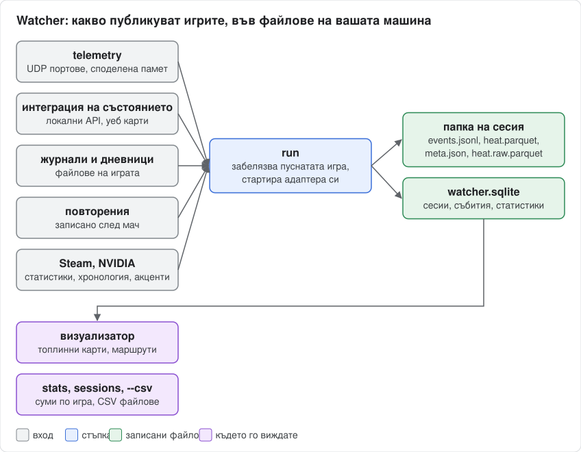

# 3DHeat Watcher {#dheat-watcher}

**Какво е?** Вие играете игра. Тази програма тихо записва къде сте отишли и какво се е случило.
После можете да го разгледате като цветна карта във визуализатора 3DHeat.

**Защо да я използвам?** За да пазите собствен запис на всяка сесия - къде сте карали, летели или се
сражавали, и общите си суми за всяка игра - без никакъв сайт и без да променяте играта.

**Пример:** карате обиколка в състезателна игра, докато Watcher работи; после файл в
`sessions\<game>\` съдържа линията, по която сте минали, и визуализаторът я рисува.

По-подробно: 3DHeat Watcher е програма на заден план, която записва какво публикуват игрите за вашата игра - къде
сте били, какво се е случило къде, и числата зад това - във файлове на вашата собствена машина. Файловете са
за вашата собствена статистика и за топлинните карти и линиите на маршрута на визуализатора 3DHeat.

Работи тихо, забелязва коя игра сте стартирали и чете собствените изходи на тази игра: телеметричен порт
или споделена памет, които играта публикува за табла, интеграция на състоянието на играта, журнала или
дневника, който играта записва, повторението, което запазва след мач, статистиките, които Steam пази, клиповете, които
NVIDIA App запазва. Записите остават на вашата машина. Програмата се свързва с външни услуги само в два случая: GitHub,
за да търси по-нова версия (вижте [Обновления](updates.md)), и Riot Match-V5 API,
и то само ако въведете собствен ключ за Riot API (вижте [Повторения на League of Legends](game-lol-replays.md)).



## Какво записва {#what-it-records}

- **Позиции**: колата, самолетът, героят или играчът, няколко пъти в секунда там, където играта ги публикува, със скорост, посока и
  каквото друго играта изпраща заедно с тях.
- **Събития**: появявания, смърти, убийства, обиколки, етапи, рундове, голове, задачи, излитания и кацания, смени на
  зони, постижения, акценти. Всяко събитие се пази с времето си и с мястото си, когато играта го дава.
- **Статистика по сесия**: убийства, смъртни случаи, обиколки, най-добра обиколка, разстояние, най-висока скорост, времетраене на играта и
  статистиките на играта, където тя ги пази.

Какво дава всяка игра и откъде, е на собствена страница в [Игри](games.md). Един източник не може да запише
всичко: игрите с много играчи се записват само чрез онова, което публикуват, а Watcher никога не чете
паметта им (вижте [Източници и правила](sources-and-rules.md)).

## Инсталиране {#install}

Нов ли сте в командния ред? Първо прочетете [Преди да започнете](before-you-start.md).

Watcher е програма на Python за Windows (Python 3.10 или по-нов). Много от източниците му съществуват само на Windows: споделена
памет, регистърът, известията на Windows.

```bash
git clone https://github.com/Holdi601/3DHeat-Watcher.git
cd 3DHeat-Watcher
pip install -r requirements.txt
```

Свален архив с издание работи по същия начин: разархивирайте, после `pip install -r requirements.txt`
в папката. Подробностите и допълнителните пакети, които някои игри изискват, са в
[Инсталиране и пускане](installing-and-running.md).

## Бърз старт {#quick-start}

```bash
python -m heat3d_watch games            # какво дава всяка игра и откъде
python -m heat3d_watch setup all        # какво би трябвало да се включи (нищо не се променя)
python -m heat3d_watch setup f1-25 --apply   # включва изхода на една игра (оригиналният файл се архивира)
python -m heat3d_watch run              # наблюдава; оставете го да работи, докато играете
python -m heat3d_watch stats            # общи суми по игра
python -m heat3d_watch stats --csv out  # сесии, събития и статистики като CSV файлове
```

Трябва да видите: след `games` - таблица с по един ред за всяка игра; `run` продължава, докато не натиснете
Ctrl+C или не затворите прозореца.

Всичко се записва в `%LOCALAPPDATA%\3DHeat\Watcher`. За друга папка задайте
променливата на средата `HEAT3D_WATCH_HOME` или пуснете `python -m heat3d_watch config --set data=D:\somewhere`.

- `sessions\<game>\<date>_<adapter>\` - по една папка за всяка сесия, с `events.jsonl` (всяко събитие
  както се случва), `heat.parquet` (редовете с позиция, готови за визуализатора 3DHeat) и
  `meta.json` (игра, източник, оси, броения, статистики)
- `watcher.sqlite` - статистиките на всяка сесия, в три обикновени таблици
- `watcher.log` - какво е направил watcher

Визуализаторът отваря `heat.parquet` на сесия директно, без каквато и да е настройка (осите и мерните единици са във
файла). Преобразуваните повторения се записват като таблици и документи за мачове до него; собственият формат на
визуализатора с един файл на мач е описан на страницата му [`.3dheat` контейнер](https://holdi601.github.io/3DHeat/container.html),
а колоните на всяка таблица - в [Данните](the-data.md).

## Документацията {#the-documentation}

| Страница | Какво съдържа |
|---|---|
| [Преди да започнете](before-you-start.md) | Python, терминал, места за попълване, как изглеждат успехът и честите грешки |
| [Инсталиране и пускане](installing-and-running.md) | изисквания, пускане на заден план, стартиране с Windows, заключващият файл, журналът, всяка настройка и променлива на средата |
| [Игри](games.md) | по една страница за всяка игра: какво се записва, откъде, как се включва, как работи, оси, статистики, какво е проверено |
| [Данните](the-data.md) | папки на сесии, `events.jsonl`, `heat.parquet` и неговият колонтитул, `meta.json`, `watcher.sqlite`, възстановяване след срив, CSV експорт, отваряне на сесия във визуализатора 3DHeat |
| [Команди](commands.md) | всяка команда и опция на `python -m heat3d_watch` |
| [Източници и правила](sources-and-rules.md) | шестте вида източници, правилата за игри с много играчи, кои игри са пропуснати и защо |
| [NVIDIA Highlights](nvidia-highlights.md) | какво могат и какво не могат да доставят NVIDIA Highlights и как един акцент получава позиция |
| [Модове за сървърни записвачи](server-mods.md) | модовете за сървър на Arma 3 и Arma Reforger, които записват цели мисии за визуализатора |
| [Четене на паметта](memory-reading.md) | профили на паметта за една игра: форматът, проверките, как се пише и проверява един |
| [Обновления](updates.md) | как Watcher търси нови издания и се обновява сам |
| [Разработка](development.md) | писане на адаптер: API, тестове, честно `verified`, регенериране на страниците за игрите |
| [Всички игри в една таблица](watcher.md) | всяка игра в една таблица, както я извежда `games --markdown`, плюс игрите, проучени, но още не изградени |
| [Справка за командите](../cli-reference.md) | `--help` на всяка команда, генериран от кода |
| [Поддръжка](maintaining.md) | списъкът за издаване на тези страници |

## Част от 3DHeat {#part-of-3dheat}

3DHeat Watcher е един от безплатните инструменти около визуализатора 3DHeat (Watcher използва 3DHeat CS2,
за да преобразува демотата на CS2). Всеки е собствен проект със собствени издания и лиценз:

| Инструмент | Какво прави | Документация |
|---|---|---|
| [3DHeat](https://github.com/Holdi601/3DHeat) | визуализаторът: топлинни карти, анализ на състезания и преглед на мачове в 3D | [сайт](https://holdi601.github.io/3DHeat/) |
| [GameFiles](https://github.com/Holdi601/3DHeat-GameFiles) | трасета и нива от файловете, които игрите доставят, като триизмерни модели | [сайт](https://holdi601.github.io/3DHeat-GameFiles/) |
| [GameCapture](https://github.com/Holdi601/3DHeat-GameCapture) | телеметрия от обиколки в състезателни игри; нива, възстановени от видеозапис на игра | [сайт](https://holdi601.github.io/3DHeat-GameCapture/) |
| [Unreal Exporter](https://github.com/Holdi601/3DHeat-UnrealExporter) | приставка за Unreal Editor, която експортира ниво като един триизмерен модел | [сайт](https://holdi601.github.io/3DHeat-UnrealExporter/) |
| [CS2](https://github.com/Holdi601/3DHeat-CS2) | демота на Counter-Strike 2 в таблици и документи за мачове; карти в триизмерни модели | [сайт](https://holdi601.github.io/3DHeat-CS2/) |
| [Watcher](https://github.com/Holdi601/3DHeat-Watcher) | записва какво публикуват игрите за вашата игра, на заден план | [сайт](https://holdi601.github.io/3DHeat-Watcher/) |
| [Ext-WarThunder](https://github.com/Holdi601/3DHeat-Ext-WarThunder) | повторения на War Thunder в таблици и документи за мачове | [сайт](https://holdi601.github.io/3DHeat-Ext-WarThunder/) |
| [Ext-WoT](https://github.com/Holdi601/3DHeat-Ext-WoT) | повторения на World of Tanks в таблици и документи за мачове | [сайт](https://holdi601.github.io/3DHeat-Ext-WoT/) |
| [Ext-WoWs](https://github.com/Holdi601/3DHeat-Ext-WoWs) | повторения на World of Warships в таблици и документи за мачове | [сайт](https://holdi601.github.io/3DHeat-Ext-WoWs/) |
| [Ext-Squad](https://github.com/Holdi601/3DHeat-Ext-Squad) | демота от сървъри на Squad в таблици и документи за мачове | [сайт](https://holdi601.github.io/3DHeat-Ext-Squad/) |
| [Ext-DCS](https://github.com/Holdi601/3DHeat-Ext-DCS) | карти на DCS World в триизмерни модели | [сайт](https://holdi601.github.io/3DHeat-Ext-DCS/) |
| [Ext-IL2](https://github.com/Holdi601/3DHeat-Ext-IL2) | карти на IL-2 Sturmovik в триизмерни модели | [сайт](https://holdi601.github.io/3DHeat-Ext-IL2/) |

Всеки четец на игра е малък самостоятелен проект със собствен лицензен файл, издания и система за проблеми, така че
може да бъде инсталиран, обновяван, поддържан - или оттеглен по искане на притежател на права - отделно, без да засяга
визуализатора или другите инструменти.

Лиценз: MIT ([LICENSE](https://github.com/Holdi601/3DHeat-Watcher/blob/main/LICENSE)). Лицензите
на пакетите на трети страни, които използва, и какво изискват игрите, които чете, са изброени в
[LICENSES.md](https://github.com/Holdi601/3DHeat-Watcher/blob/main/LICENSES.md).
