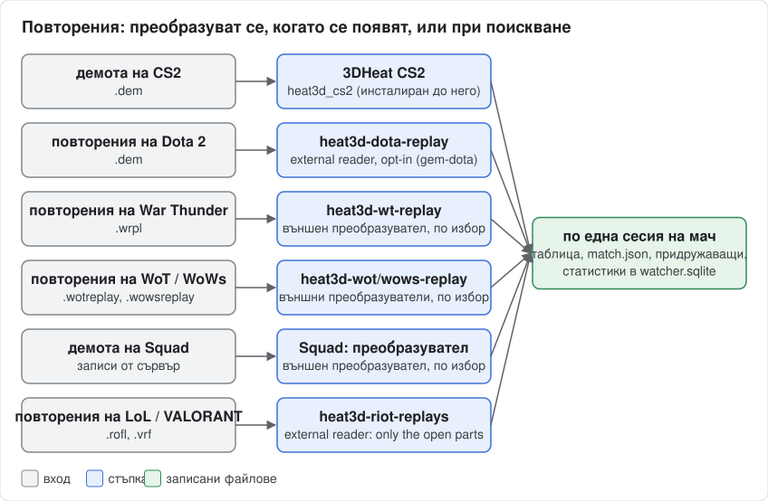

# Инсталиране и стартиране {#installing-and-running}

## Изисквания {#requirements}

- **Windows.** Watcher-ът е написан за Windows, а повечето от източниците му съществуват само там: споделената памет, която игрите създават (`Local\...` картографирания), регистърът (където е Steam), известията на Windows, списъкът с процеси с пътища до изпълнимите файлове. На друга система програмата се стартира, но тези източници не намират нищо, известията само се записват в журнала, а четенето на памет отказва („only implemented on Windows“).
- **Python 3.10 или по-нов**, от <https://www.python.org/downloads/>: в инсталатора отметнете **Add python.exe to PATH**, после проверете с `python --version` в нов терминал. Нови ли сте в това? Първо прочетете [Преди да започнете](before-you-start.md).
- **Пакети** (`requirements.txt`): `psutil>=6.0` (кои игри работят, коя програма държи даден порт, връзките на играта; по-стара psutil пак работи, през старото ѝ име за връзките на процес), `pyarrow>=15` (записване на `heat.parquet`), `numpy>=1.24` и `pytest>=8.0` за тестовете. `requirements-optional.txt` засега не изброява пакети.

Без `pyarrow` сесиите пак се записват: `events.jsonl` е записът, а таблицата може да се изгради по-късно с [`table`](commands.md#table).

### Допълнения, които някои игри изискват {#extras-some-games-need}

| Игра | Какво изисква |
|---|---|
| Counter-Strike 2 демота | [3DHeat CS2](https://github.com/Holdi601/3DHeat-CS2) и неговите изисквания (`demoparser2`). Watcher-ът го търси в `HEAT3D_CS2`, после в папка `3DHeat-CS2` или `cs2` до собствената папка на watcher-а, после където и да е, откъдето Python може да импортира `heat3d_cs2`. Без него `games` показва адаптера като недостъпен. |
| Microsoft Flight Simulator 2020 / 2024 | `SimConnect.dll` - не е included. MSFS 2020 има такъв в папката си с инсталацията; за MSFS 2024 инсталирайте SDK на MSFS 2024. `MSFS_SDK` / `MSFS2024_SDK` сочат папката на SDK. |
| Euro Truck Simulator 2, American Truck Simulator | плъгинът `scs-telemetry.dll` (ревизия 12) на RenCloud в `<game>\bin\win_x64\plugins` |
| BeamNG.drive | протоколният мод `heat3d`, инсталиран с `python -m heat3d_watch setup beamng --apply` |
| League of Legends (на живо) | по желание: коренният сертификат на Riot като `<data>\riotgames.pem`, за да се проверява локалната връзка |
| Minecraft | папка `%APPDATA%\.minecraft` (Java Edition) |

Страницата на всяка игра в [Игри](games.md) казва какво трябва да се включи в самата игра. `python -m heat3d_watch games` маркира адаптер с `[unavailable: ...]`, когато нещо, от което се нуждае, липсва на тази машина.

## Инсталиране {#installing}

Нови ли сте в командния ред? Първо прочетете [Преди да започнете](before-you-start.md). Ако `pip` не се намира, използвайте `python -m pip install -r requirements.txt`.

От клониране:

```bash
git clone https://github.com/Holdi601/3DHeat-Watcher.git
cd 3DHeat-Watcher
pip install -r requirements.txt
```

От издание: изтеглете архива от изданията на хранилището, разархивирайте го и в папката пуснете `pip install -r requirements.txt`. И двата вида копия се обновяват сами (вижте [Обновявания](updates.md)).

Пускайте всяка команда от папката на хранилището: `python -m heat3d_watch` импортира пакета оттам, а обновителят (`heat3d_update`) е до него.

## Стартиране {#running}

```bash
python -m heat3d_watch run        # watch until stopped
python -m heat3d_watch run -v     # the same, with debug lines in the log
python -m heat3d_watch run --once # one look at the games running now, then stop and exit
```

При старт `run`:

1. записва [файла за заключване](#the-lock-file);
2. довършва сесиите, които предишно изпълнение е оставило отворени, например след срив (вижте [Възстановяване](the-data.md#recovery-after-a-crash));
3. на всеки `scan_seconds` (2 s) чете списъка с процеси (само имена и пътища, никой процес не се отваря) и стартира адаптер, в собствена нишка, за всяка открита игра. Когато процесът на игра изчезне, нейният адаптер се спира и сесиите, които е имал отворени, се затварят, което записва техните таблици и редовете им в статистиката. Адаптерите, които не чакат игра (статистиката на Steam, Steam Timeline, NVIDIA highlights, папките с реплеи), работят през цялото време;
4. докато няма работеща игра, търси по-нова версия най-много веднъж на час (самият отговор се пази в кеш шест часа) и, при включено `auto_update`, я инсталира и стартира сам себе си отново (вижте [Обновявания](updates.md)).

Адаптер, който се провали, се записва в журнала и не спира останалите. Ако проверката на адаптер се провали 20 пъти поред или стартирането му се провали, адаптерът се спира и не се стартира отново, докато играта не се стартира пак (нов идентификатор на процес).

Спрете watcher-а с Ctrl+C. Адаптерите затварят сесиите си, преди той да излезе. Ако watcher-ът бъде убит вместо това (Task Manager, срив, токов удар), нищо вече записано не се губи: следващият `run` довършва тези сесии.

`--once` прави една проверка: стартира адаптерите за игрите, които работят в този момент (и за тези, които работят винаги), оставя всеки да провери веднъж - като чака най-много 10 секунди за това - и после ги спира така, както би ги спряло приключване на играта, така че сесиите, които са отворили, се затварят, таблиците им се записват, а редовете им се броят в статистиката, преди да излезе. Използвайте го, за да проверите, че играта се открива, не за запис.

### Реплеи, които вече са на диска {#replays-already-on-disk}



Първия път, когато адаптер за реплеи види някоя от папките си, той само отбелязва реплеите, които вече има в нея: играч с години демота иначе би намерил watcher-а зает с конвертиране цял ден. Оттам нататък всеки нов реплей се конвертира веднъж, след като играта приключи с писането му. Старите се конвертират при поискване с [`replays`](commands.md#replays):

```bash
python -m heat3d_watch replays cs2-demos              # every demo in CS2's folders and replay_folders
python -m heat3d_watch replays osu-replays D:\Old     # the replays in one folder
```

### Работа във фонов режим {#running-in-the-background}

Watcher-ът няма собствен прозорец; той е конзолна програма, която работи, докато не бъде спряна. Той записва всичко в `watcher.log`, така че не се нуждае от видима конзола. Начини да го държите настрана:

- стартирайте го в конзола и я минимизирайте: `start "" /min python -m heat3d_watch run` от `cmd`, в папката на хранилището;
- стартирайте го без конзола: `pythonw -m heat3d_watch run`. Изходът на конзолата се губи, но `watcher.log` пак се пише. За да го спрете, приключете процеса `pythonw.exe`; следващият старт довършва сесиите, които е оставил отворени. Проектът не е тествал този начин на работа.

### Стартиране с Windows (идея) {#starting-with-windows-an-idea}

Watcher-ът не се инсталира сам да стартира с Windows. За да стартира автоматично:

- **Task Scheduler** (Планировчик на задачи): създайте задача с тригер *At log on* (При влизане) и действие *Start a program* (Стартиране на програма), програма `pythonw.exe` (или `python.exe`), аргументи `-m heat3d_watch run`, *Start in* (Начална папка), зададена на папката на хранилището;
- **папка Startup**: сложете пряк път в `shell:startup` със същата програма, аргументи и папка *Start in*.

Нито едното не е част от watcher-а или е тествано от него. [Файлът за заключване](#the-lock-file) гарантира, че второ копие, стартирано по погрешка, излиза веднага.

## Файлът за заключване {#the-lock-file}

`<data>\watcher.lock` пази идентификатора на процеса на работещия watcher. Когато `run` стартира и файлът за заключване назовава процес, който още съществува и чието име съдържа `python`, той показва

```text
A watcher is already running (process 12345) for C:\Users\...\3DHeat\Watcher.
```

и излиза с код 1. Два watcher-а върху една папка с данни биха записвали всяка игра два пъти, а вторият би взел отворените сесии на първия за останки от срив. Файл за заключване, чийто процес вече не съществува или принадлежи на друга програма, се презаписва. Когато `run` приключи, той премахва файла за заключване, ако файлът все още назовава собствения му процес.

## Журналът {#the-log}

`<data>\watcher.log` се пише само от `run`; другите команди показват всичко в конзолата. Всеки ред съдържа времето, нивото и съобщение:

```text
2026-05-01 20:15:01,123 INFO watching; data in C:\Users\...\AppData\Local\3DHeat\Watcher
2026-05-01 20:15:03,456 INFO f1-25: starting (EA SPORTS F1 25)
2026-05-01 21:02:11,789 INFO f1-25: stopping
```

Адаптерите записват какво не могат да направят и защо: „UDP 20777 is in use by ...; not taking it from that program“, „not reading memory: the game is played online“, „could not start“, „poll failed (3)“ с проследяването на грешката. `run -v` добавя редове за отстраняване на грешки. Файлът само се допълва и никога не се ротира или изпразва от watcher-а; изтрийте го, когато поискате. Същите редове отиват и в конзолата.

## Къде е всичко {#where-everything-is}

Начална папка е `%LOCALAPPDATA%\3DHeat\Watcher`, или `HEAT3D_WATCH_HOME`, когато е зададена (без `LOCALAPPDATA`, например на друга система, `~/.local/share/3DHeat/Watcher`). `settings.json` е винаги в началната папка. Всичко останало отива в папката с данни, която е началната папка, освен ако настройката `data` не посочва друга:

| Път | Какво е |
|---|---|
| `<home>\settings.json` | настройките |
| `<data>\sessions\` | записите, по една папка за всяко седене ([Данните](the-data.md)) |
| `<data>\watcher.sqlite` | базата данни със статистиката |
| `<data>\watcher.log` | журналът на `run` |
| `<data>\watcher.lock` | файлът за заключване, докато `run` работи |
| `<data>\state\` | какво са видели адаптерите, които работят винаги, и адаптерите за реплеи (`steam-stats.json`, `replays-cs2-demos.json`, ...), за да не се записва нищо два пъти след рестарт |
| `<data>\profiles\*.json` | профили за памет, които сте написали ([Четене на памет](memory-reading.md)) |
| `<data>\riotgames.pem` | по желание: коренният сертификат на Riot за адаптера на League of Legends на живо |
| `%LOCALAPPDATA%\3DHeat\update-check-3DHeat-Watcher.json` | кешираният отговор на последната проверка за версия |

Watcher-ът не изтрива нищо в тези папки, освен папка на сесия, в която нищо не е записано (игра, оставена в менютата).

## Настройки {#settings}

`python -m heat3d_watch config` показва настройките; `config --set key=value ...` ги променя и записва `settings.json` (вижте [config](commands.md#config)). Файлът е обикновен JSON и може да се редактира и на ръка, докато watcher-ът не работи. Непознатите ключове в него се пропускат. Настройките се четат, когато започне команда, затова рестартирайте `run` след промяна.

| Настройка | По подразбиране | Какво прави |
|---|---|---|
| `data` | `""` | Папката с данни. Празно: началната папка. |
| `disabled` | `[]` | Идентификатори на адаптери, които никога не работят, например `config --set disabled=steam-stats,nvidia-highlights`. Всеки друг адаптер работи, когато намери играта си. |
| `auto_update` | `true` | Докато няма работеща игра, инсталира по-нова версия и се рестартира (вижте [Обновявания](updates.md)). `false`: само известие в журнала. |
| `scan_seconds` | `2.0` | Секунди между проверките на списъка с процеси. |
| `memory` | `false` | Разрешава адаптерите за памет (еднопотребителски игри с профил, който сте написали) да работят. По подразбиране изключено; вижте [Четене на памет](memory-reading.md). |
| `replays` | `true` | Пуска адаптерите за `replay`: всички (вижте `python -m heat3d_watch replays` и [Игри](games.md)) - демата на CS2, Dota 2, osu!, War Thunder, World of Tanks, World of Warships, Squad, реплеите на League of Legends и VALORANT, записите от Tacview на IL-2. |
| `replay_folders` | `{}` | Допълнителни папки по идентификатор на адаптер, например `{"cs2-demos": ["D:\\Demos"]}`. Адаптерите за реплеи наблюдават и тях, освен собствените папки на играта; `il2-tacview` приема и папки на инсталации (тогава търси в техния `data\Tracks`); за `elite` първата папка заменя папката на журнала. Една папка на адаптер се задава с `config --set replay_folders.cs2-demos=D:\Demos,E:\More`, или целият речник като JSON. |
| `riot_id` | `""` | Вашият Riot ID (`Name#TAG`), за да стане вашият собствен ред в реплей на League of Legends ваша статистика. Празно: записва се редът на всеки играч, никой не е отбелязан като ваш. |
| `riot_api_key` | `""` | Вашият собствен ключ за програмисти на Riot, за да се вземе официалната хронология на всеки реплейнат мач от League (позициите всяка минута, убийствата там, където са станали). Празно: нищо не се взима. |
| `riot_platform` | `"EUW1"` | Идентификаторът на платформата на вашия сървър на League (`EUW1`, `EUN1`, `NA1`, `KR`, ...), използван за намиране на регионалния хост Match-V5. |
| `player_names` | `{}` | Вашето име в игри, чийто интерфейс назовава всеки играч, но не казва кой сте вие, по идентификатор на адаптер: `warthunder-webmap` (редовете за вас в убийствения поток стават вашите убийства и смърти) и `rocketleague-stats` (вашите редове стават `me`; без това - играчът, който камерата на играта следва). Задава се с `config --set player_names.warthunder-webmap=Name`. |

`settings.json` с всички стойности по подразбиране:

```json
{
  "data": "",
  "disabled": [],
  "auto_update": true,
  "scan_seconds": 2.0,
  "memory": false,
  "replays": true,
  "replay_folders": {},
  "riot_id": "",
  "riot_api_key": "",
  "riot_platform": "EUW1",
  "player_names": {}
}
```

## Променливи на средата {#environment-variables}

| Променлива | Действие |
|---|---|
| `HEAT3D_WATCH_HOME` | началната папка (настройките и данните, освен ако `data` не казва друго) |
| `HEAT3D_NO_UPDATE` | всяка стойност, различна от празна, `0`, `false` или `no`, изключва проверката за версия и автоматичното обновяване |
| `HEAT3D_NO_TOAST` | всяка непразна стойност: без известия на Windows, само редове в журнала |
| `HEAT3D_CS2` | папката на 3DHeat CS2, за демата на CS2 |
| `HEAT3D_CS2_GSI_PORT` | портът за състоянието на играта на CS2 (по подразбиране 3311); файлът cfg, който записва `setup`, го ползва |
| `HEAT3D_DOTA_GSI_PORT` | портът за състоянието на играта на Dota 2 (по подразбиране 3312) |
| `MSFS_SDK`, `MSFS2024_SDK` | папките на SDK на MSFS, където се търси `SimConnect SDK\lib\SimConnect.dll` |

Известията на Windows се ползват само за обновявания: „Updating to 1.2.0“, или „1.2.0 is out; not updated: ...“, когато обновяването не е могло да се приложи. Показват се чрез собствения програмен интерфейс за известия на PowerShell, така че нищо не трябва да се инсталира. Заглавието и текстът се подават на PowerShell като променливи на средата, никога като част от скрипта.
