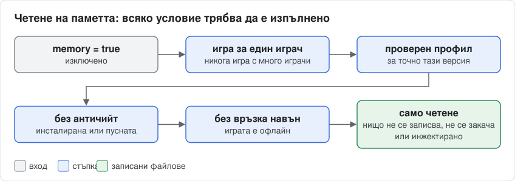

# Четене на памет {#reading-memory}

Някои еднопотребителски игри не казват нищо на други програми. За тях watcher-ът може - ако го включите и напишете профил сами - да намира позицията ви в паметта на играта, само за четене.

За еднопотребителски игри, които не публикуват нищо, watcher-ът може да чете позиции и стойности от паметта на играта, през **профил**, който написвате сами за вашата собствена версия на играта. От всички източници това е единственият, който играта не е предоставила сама, затова е оградено повече от останалите:

- е **изключено по подразбиране** (`python -m heat3d_watch config --set memory=true` го включва);
- чете, и няма начин да пише;
- **никакви профили не се доставят с инструментите.**

Профилите не се доставят, защото отместването е вярно само за версията, на която е намерено. След пач профил, който е бил верен преди, чете боклук, а боклукът прилича точно на числа. Профилът трябва да се проверява на версията, която има играчът, от самия играч.

## Проверките, по ред {#the-checks-in-order}


Всяка проверка по-долу трябва да премине. Първите четири се правят **преди** играта да бъде отворена, защото отварянето на защитена игра за четене е именно това, което античийт системата забелязва, и отказ след това би бил твърде късно.

1. **Настройката**: `memory` е истина. Иначе адаптерите за памет никога не се стартират.
2. **Профил за играта**, чието `exe` назовава работещия процес. Профилът казва дали играта може да се играе онлайн изобщо (`"online"`); профил, който пропуска това, се отхвърля.
3. **Няма античийт наблизо**:
   - няма античийт файл в папката на играта или до три папки над нея (спира се при папката `common` на библиотека на Steam или при папка със `steamapps`, защото други игри са над нея): `EasyAntiCheat`, `EasyAntiCheat_EOS_Setup.exe`, `start_protected_game.exe`, `BattlEye`, `BEClient_x64.dll`, `BEService_x64.exe`, `EAAntiCheat.GameServiceLauncher.exe`, `AntiCheatExpert`, `SGuard64.exe`, `GameGuard`, `GameMon.des`, `XIGNCODE`, `xhunter1.sys`, `Vanguard`, `FACEIT` (сравнява се с малки букви, също и като начало на име). Ако папката на играта е неизвестна, играта се отказва;
   - няма античийт драйвер или услуга, която работи на машината, както ги показват `sc query type= driver state= active` и `sc query type= service state= active`: EasyAntiCheat, EasyAntiCheat_EOS, BEService, BEDaisy, vgk, vgc, ACE-BASE, ACE-GAME, xhunter1, FACEIT, FACEITService, EAAntiCheatService, Denuvo Anti-Cheat, npggsvc, Ricochet. Античийт на ниво ядро, инсталиран за друга игра, пак следи всеки процес. Ако услугите не могат да се изброят, играта се отказва.
4. **Не е онлайн**: игра, чийто профил казва `"online": true`, се чете само докато няма връзка с нищо друго освен тази машина (всеки отдалечен адрес, различен от `127.x`, `::1`). Ако връзките ѝ не могат да се прочетат, тя се отказва.
5. После, когато адаптерът стартира:
   - **точната версия**: размерът на изпълнимия файл или неговият SHA-256 трябва да съвпадне с версия, която профилът изброява. Непозната версия не се чете;
   - **модулите още веднъж**: зареденият модули на играта се изброяват (снимка на Toolhelp, която не иска собствени права за достъп) и се проверяват за клиент на античийт (`BEClient_x64.dll`, `BEClient.dll`, `EasyAntiCheat_x64.dll`, `EasyAntiCheat.dll`, `EOSAntiCheat...`). Защитен процес отказва снимката, което също е отказ;
   - едва тогава процесът се отваря, с `PROCESS_VM_READ | PROCESS_QUERY_LIMITED_INFORMATION` и нищо друго.

Проверки 1 до 4 се повтарят при всяко сканиране (на всеки 2 s), докато играта работи. Ако една започне да се проваля (играта се свърже със сървър, стартира услуга на античийт), адаптерът се спира при следващото сканиране. Отказът се записва в журнала: `mem-<id>: not reading memory: <reason>`. Неуспех при стартиране (непозната версия, модул на античийт, шаблон не е намерен) се записва като `mem-<id>: could not start`, и адаптерът не се пробва отново, докато играта не се стартира пак.

Няма запис, няма заделяне на памет в другия процес, няма нишка, стартирана в него, няма библиотека, заредена в него, няма привилегия за отстраняване на грешки и няма повишаване на правата. Тест (`test_memory_reading_cannot_write` в `tests/test_core.py`) се проваля, ако някое извикване, което пише в друг процес, заделя памет в него или изпълнява код в него - `WriteProcessMemory`, `VirtualAllocEx`, `CreateRemoteThread`, `PROCESS_VM_WRITE`, `SeDebugPrivilege`, `LoadLibrary`, ... - се появи някъде в пакета.

Никога не се чете, каквото и да казва профил: игри, които се играят онлайн, и игри, чийто еднопотребителски режим работи под античийт, като GTA V или Elden Ring, стартиран през своя launcher. Проверките по-горе ги отказват така или иначе.

## Форматът на профила {#the-profile-format}

Профилът е JSON файл в `<data>\profiles\` (`<data>` е папката с данни, вижте [Инсталиране и стартиране](installing-and-running.md#where-everything-is)), по един за игра, с каквото и да е име на файл, което завършва на `.json`. Синтетичен пример:

```json
{
  "schema": "heat3d.memprofile/1",
  "id": "mygame",
  "game": "My Game",
  "exe": "MyGame.exe",
  "online": false,
  "versions": [ { "label": "1.06", "size": 123456789 } ],
  "anchors": {
    "World": { "aob": "48 8B 05 ?? ?? ?? ?? 48 85 C0", "rip": [3, 7] }
  },
  "values": {
    "pos": { "type": "vec3f", "base": "World", "chain": ["0x10", "0x68", "0x70"] },
    "hp":  { "type": "i32",   "base": "World", "chain": ["0x10", "0x138"] },
    "map": { "type": "u32",   "base": "World", "chain": ["0x10", "0x1C0"] }
  },
  "events": [
    { "event": "death", "value": "hp",  "when": "to_zero" },
    { "event": "zone",  "value": "map", "when": "change" }
  ],
  "axes": { "up": "y", "units": "metres" },
  "rate": 10,
  "provenance": [ { "source": "https://example.com/my-notes", "verified_on": "1.06" } ]
}
```

| Ключ | Задължителен | Какво е |
|---|---|---|
| `schema` | да | точно `heat3d.memprofile/1` |
| `id` | да | кратко и постоянно; адаптерът се нарича `mem-<id>` |
| `game` | да | името на играта, по което се именува папката на сесията |
| `exe` | да | името на файла на изпълнимия файл, което също казва, че играта работи |
| `online` | да | `true`, ако играта може да се играе онлайн изобщо; тогава се чете само докато е офлайн |
| `versions` | да | версиите, на които профилът е проверен: всяка с `label`, и с `size` (размера на изпълнимия файл в байтове) и/или `sha256`. Когато са дадени и двете, трябва да съвпаднат и двете. Запис без нито едно не съвпада с нищо. |
| `anchors` | да | именувани адреси в основния модул. `aob`: шаблон от байтове, шестнадесетични байтове, разделени с интервали, `?` или `??` за всеки байт; той трябва да се появи **точно веднъж** в образа на модула (няколко съвпадения се броят за неуспех, както и нито едно). `rip: [d, n]`: шаблонът сочи към инструкция с 32-битово RIP-относително изместване на байт `d` с дължина `n`; котвата става адресът, към който инструкцията сочи. `offset`: прибавя се след това (шестнадесетичен или десетичен текст). Вместо `aob`, `module_offset` дава фиксирано отместване от базата на модула. |
| `values` | да | какво се чете при всяка проверка: `type` (`i32`, `u32`, `i64`, `u64`, `u8`, `f32`, `f64`, `vec3f`, `vec3d`), `base` (име на котва), `chain` (отмествания като шестнадесетичен или десетичен текст) |
| `events` | не | правила, които превръщат промените в събития: `when` `change` (стойността се различава от последната проверка) или `to_zero` (число пада от над 0 до 0 или под 0) |
| `axes` | не | `up` (по подразбиране `y`), `units` (по подразбиране `game units`), `scale` (мащабът на единиците за визуализатора, който умножава всяка позиция; по подразбиране 1, единиците на играта) |
| `rate` | не | проверки в секунда, от 1 до 60 (по подразбиране 10) |
| `provenance` | не | откъде идват отместванията и на коя версия сте ги проверили; копира се в `meta.json` на всяка сесия |

**Как се чете стойност.** Адресът на котвата е началото. Ако `chain` е празен, стойността се чете точно там. Иначе първо се чете указателят, записан в котвата. После, за всяко отместване, освен последното, се чете указателят на `address + offset`. Последното отместване се прибавя, за да се получи адресът на стойността. Нулев указател по пътя (играта е между нива или в меню) оставя стойността празна за тази проверка.

**Какво се записва.** Стойност с име `pos` (`vec3f` или `vec3d`) става ред `position` на играч `me` при всяка проверка. Всяко правило за събитие записва реда на своето `event`, с новата стойност и, където `pos` е известна, позицията, и прибавя 1 към статистика с същото име. Файлът на образа на модула се чете веднъж при старт, за да се намерят котвите, на блокове по 64 KiB; блокове, които не могат да се прочетат, се броят като нули. `meta.json` на сесията назовава профила, етикета на версията и `provenance`.

Профил, който не може да се ползва (невалиден JSON, грешен `schema`, липсващ задължителен ключ), се пропуска и се записва като `profile <file> not used: <reason>`. Профилите се зареждат при стартиране на watcher-а, затова рестартирайте `run` след добавяне или промяна.

## Писане и проверка на профил {#writing-and-verifying-a-profile}

1. **Само за еднопотребителска игра без античийт.** Ако играта има античийт или я играете онлайн, спрете тук: watcher-ът ще я откаже, и трябва да я откаже.
2. **Намерете стойностите на собствената си версия.** Работете офлайн. Използвайте собствените си инструменти за отстраняване на грешки или публикувани бележки за играта, за да намерите позицията на играча и стойностите, които ви интересуват, и пътя на указатели до всяка от статичен адрес в изпълнимия файл. Предпочитайте шаблон от байтове (`aob`) пред фиксирано `module_offset`: шаблонът все още намира мястото си, когато кодът се премести малко.
3. **Направете шаблона уникален.** Той трябва да съвпадне точно веднъж в модула. Заменете с `??` байтовете, които се променят (адреси, измествания), и запазете достатъчно фиксирани байтове около тях.
4. **Закрепете версията.** Сложете точния размер на изпълнимия файл в `versions`; PowerShell командата `(Get-Item .\MyGame.exe).Length` го дава, а `Get-FileHash .\MyGame.exe -Algorithm SHA256` дава хеша. След пач профилът просто спира да се ползва, докато не го проверите отново и не добавите новата версия.
5. **Кажете дали играта е онлайн** (`online`), честно.
6. **Пробвайте**: включете четенето (`config --set memory=true`), сложете файла в `<data>\profiles\` и проверете, че `python -m heat3d_watch games` показва `mem-<id>`. Стартирайте играта и пуснете `python -m heat3d_watch run -v`. В `watcher.log` търсете `mem-<id>: starting`, или причината, поради която е отказан или не е стартирал.
7. **Проверете числата спрямо играта.** Отидете до познато място и погледнете редовете `position` в `events.jsonl` на сесията. Движат ли се, когато вие се движите, с правилното разстояние, по правилните оси? Отворете `heat.parquet` във визуализатора и проверете, че маршрутът съвпада с мястото, където сте били. Предизвикайте всяко събитие (загубете цялото здраве, сменете зоната) и проверете, че се появява веднъж. Боклукът прилича на числа, и само това сравнение различава двете.
8. **Запишете какво сте проверили** в `provenance`: източника на отместванията и версията, на която сте ги проверили.

Текстът `verified` на адаптер за памет, както го показва `games`, винаги е „by the profile's author, for the builds it lists“. Watcher-ът не може да знае повече от това.
