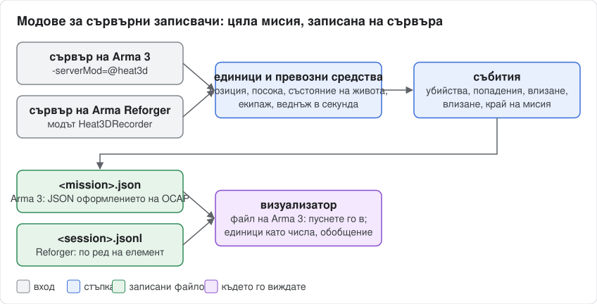

# Сървърни записващи модове (Arma 3, Arma Reforger) {#server-recorder-mods-arma-3-arma-reforger}

Повечето игри се записват от watcher-а на компютъра на самия играч. Arma е различна: сървър може да запише цяла мисия - всяка единица и машина, не само вашата - с мод, който работи на сървъра. Играчите не настройват нищо: модът за Arma 3 е само за сървъра, а Reforger сам сваля модовете на сървъра към играчите, когато се присъединят (модът не прави нищо на техните компютри). Репозиторито съдържа два такива мода в
[`mods/arma3`](https://github.com/Holdi601/3DHeat-Watcher/tree/main/mods/arma3)
и [`mods/reforger`](https://github.com/Holdi601/3DHeat-Watcher/tree/main/mods/reforger).
Техните README файлове са пълната документация; тази страница е общ преглед.

**Статус: и двата са непроверени в играта.** Разширението за Arma 3 е създадено и задействано така, както Arma извиква разширенията, и изходът му е четен от 3DHeat; неговите SQF скриптове още не са работили в Arma 3. Модът за Reforger е написан по публикувания от Bohemia API за скриптове и никога не е бил компилиран. Не слагайте нито един от двата на публичен сървър, преди да са минали стъпките за проверка в README-то му.

## Arma 3 {#arma-3}

1. Създайте разширението веднъж за всяка платформа (`mods/arma3/extension`). Нужен е C компилатор: Visual Studio Build Tools на Windows, gcc на Linux; ако никога не сте компилирали нищо, попитайте хоста на сървъра си.
   - Windows, в „x64 Native Tools Command Prompt for VS“:
     `cl /nologo /O2 /LD heat3d.c /Fe:heat3d_x64.dll`
   - Linux: `gcc -O2 -shared -fPIC -o heat3d_x64.so heat3d.c -ldl`
2. Създайте мода: `python mods/arma3/build.py` записва `mods/arma3/@heat3d/` (не са нужни Arma 3 Tools).
3. Копирайте `@heat3d` в папката на сървъра и стартирайте сървъра с `-serverMod=@heat3d`.
4. `.rpt` журналът на сървъра казва `Heat3D recorder 0.1.0: recording <file> every 1 s`.

| Настройка | По подразбиране | Какво прави |
|---|---|---|
| `captureDelay` | 1 | секунди между кадрите |
| `recordHits` | 1 | 0 изключва събитията за попадения |
| `recordShots` | 1 | 0 изключва броенето на изстрели |
| `minPlayers` | 0 | записва само когато са включени толкова играчи |

Мисия може да я промени в собствения си `init.sqf` (`heat3d_captureDelay = 0.5;`).
Записите отиват в `recordings/` в `@heat3d` или в `HEAT3D_DIR`.

**Изход:** един файл на мисия в JSON формата на OCAP (формата на записващия OCAP2), наречен `<date>__<time>_<mission>.json`. По време на мисията той е журнал (`.heat3d.part`), записван при всеки запис; журналът на мисия, която е спряла внезапно, се довършва при следващото стартиране на мисия.

## Arma Reforger {#arma-reforger}

Модът (`Heat3DRecorder.gproj`) се отваря и се създава в Workbench на Bohemia (Arma Reforger Tools), проверява се на локален изделен сървър, публикува се от Workbench (несписъчен, докато се тества) и се добавя към списъка `mods` в `config.json` на сървъра - стъпка по стъпка в README-то му. Всяка секунда записва позицията, посоката, състоянието на живота, машината и идентификатора на играча на всеки герой, както и позицията, посоката, състоянието и екипажа на всяка машина; а също убийствата (убиец, оръжие, разстояние), попаденията, влизането и излизането от машини, присъединяването и напускането на играчи и края на мисията.

**Изход:** по един JSON обект на ред, `$profile:heat3d/<UTC date>_<UTC time>_<world>.jsonl`: ред `header` (формат `heat3d-reforger`, оси x на изток, y нагоре, z на север), после редове `entity`, `frame` и `event` при настъпването им, и ред `end`. Редовете на единиците са `[id, x, y, z, dir, alive, vehicleId, playerId]`, редовете на машините `[id, x, y, z, dir, alive, [crew ids]]`; събитията следват формата на събитията на OCAP2.

## Във визуализатора {#in-the-viewer}

Пуснете запис от Arma 3 върху [3DHeat визуализатора](https://holdi601.github.io/3DHeat/): една мисия е една сесия, единиците стават войници, машините - техния вид, а убийствата и попаденията отиват в списъка за обзор. Уеб плейърът на OCAP2 също го възпроизвежда. Файлът на Reforger е собственият линеен формат на мода със събитията във формата на OCAP2.
