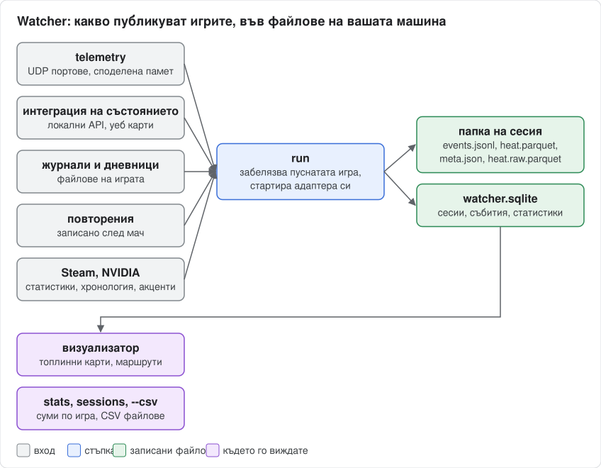

# Източници и правила {#sources-and-rules}

Watcher-ът записва само това, което игрите и платформите предоставят на играча. Тази страница обяснява кои източници обхваща това, какво може да прави watcher-ът с всеки от тях, и кои игри или части от игри оставя извън записа нарочно.

## Шестте вида източници {#the-six-kinds-of-source}

Всеки адаптер има `kind` (вид), а видът решава какво може да прави адаптерът:

| Вид | Какво е | Мултиплейър игри |
|---|---|---|
| `telemetry` | UDP порт или споделена памет, които играта публикува за табла, моторни платформи и волани (Forza Data Out, F1 UDP, споделената памет на Kunos и iRacing, SimConnect, UDP интерфейсът на X-Plane, добавката за SCS SDK) | да - това е собственият изход на играта |
| `gsi` | game-state интеграция или локален уеб API, който играта предоставя на собствения компютър на играча (Valve GSI, Live Client Data API на League, Stats API на Rocket League, уеб картата на War Thunder) | да, в рамките на това, което API-то показва на играча |
| `log` | файлове, които играта записва, докато работи: дневници, логове, статистики, запазени игри (Elite Dangerous, Minecraft, Path of Exile, Hearthstone, Star Citizen, EVE Online) | да |
| `replay` | демота и реплеи, които играта запазва за своите играчи, превърнати след мача (CS2, Dota 2, osu!, War Thunder, World of Tanks, World of Warships, Squad, League of Legends, VALORANT, IL-2 Tacview) | да, освен ако са шифровани, и само частите, които са на открито |
| `platform` | това, което Steam и графичният драйвер пазят: статистики, постижения, хронологии, клипове и акценти | да |
| `memory` | паметта на играта, само за четене, от профил, който сте написали | **никога** - само за игра на един играч |

Само `memory` отваря друг процес, и то само за четене. Другите пет вида четат само това, което играта, Steam или NVIDIA App вече са записали или изпращат навън.

## Как се четат източниците {#how-the-sources-are-read}

- **Нищо не се инжектира, не се закачва и не се променя в играта.** В играта не се зарежда код, не се закачат прозорци или вход, не се пипат игрови файлове. Единствените файлове извън папката с данни на watcher-а са тези, които [`setup --apply`](commands.md#setup) записва, когато го поискате: собственият файл с настройки на играта (с оригинала, запазен като `<file>.heat3d-backup`), файл с настройки за game-state интеграция, скриптът-кука на DCS, модът за протокола на BeamNG.
- **Споделената памет се отваря само за четене и никога не се създава.** Обичайният начин в Python за отваряне на именувано съпоставяне го създава, когато още не съществува. Игра, стартирана след това, би намерила празното, само за четене съпоставяне на watcher-а вместо своето собствено и телеметрията ѝ би била мъртва. Watcher-ът отваря съпоставянията само с `OpenFileMappingW` (който намира само съществуващо), ги съпоставя с `FILE_MAP_READ` и опитва пак по-късно, ако играта още не ги е създала.
- **Портовете се заемат под наем, никога не се отнемат.** UDP телеметричен порт, който друга програма вече слуша (FH Companion, SimHub, приложение за табло), се оставя на тази програма. Ако друга програма започне да слуша порт, който watcher-ът държи, той го пуска в рамките на няколко секунди. Адаптерите за Forza чакат 15 s след стартиране на играта, преди да вземат порт 5300, и предават всеки пакет непроменен към 127.0.0.1:5301, така че второ приложение за Data Out пак може да записва.
- **Само локално.** Локалните сървъри за game-state, които watcher-ът пуска (CS2, Dota 2), слушат на 127.0.0.1 и никъде другаде. Когато cfg файлът на играта съдържа токен (този, който записва `setup`), всяка заявка трябва да го носи; заявките без него се броят като `bad_auth` и се изхвърлят. Без cfg файл с токен всяка локална заявка се приема и дневникът казва така. Локалните API-та, които watcher-ът пита (League на порт 2999, War Thunder на 8111, Rocket League на 49123, X-Plane на 49000), са на 127.0.0.1.
- **Файловете с дневници се споделят, никога не се заключват.** Всяко четене отваря файла с всички флагове за споделяне, които Windows има, и го затваря отново, така че играта може да продължава да пише, да го преименува или да го замени.
- **Две външни услуги, и само в тези случаи.** Проверката за издание пита GitHub (`api.github.com`) най-много на всеки шест часа и може да се изключи (вижте [Обновления](updates.md)). Адаптерът за реплеи на League пита Match-V5 API на Riot само когато сте въвели собствения си `riot_api_key`. Нищо друго не се изпраща никъде.
- **Включването на източник е ваше решение.** `setup` без `--apply` казва само какво би променил.

## Правила за мултиплейър {#multiplayer-rules}

- Игра, играна онлайн, се записва само чрез това, което публикува: телеметрия, game-state API-та, дневници, реплеи, платформени файлове. Вътре в тях watcher-ът записва това, което играта показва на играча, и нищо, изчислено отгоре ѝ:
  - **game-state интеграцията на CS2** изпраща наблюдавания играч (вас, докато сте живи, или съотборник след смърт). Позициите на другите играчи (`allplayers_*`) се изпращат само на наблюдатели и GOTV, затова watcher-ът не ги заявява.
  - **Live Client Data API на League of Legends** няма позиции. Политиката на Riot позволява на инструментите да показват това, което играчът може да знае от самата игра, и нищо, изчислено отгоре (без таймери на противника). Watcher-ът записва килфийда и таблото, които вижда играчът, и собствените му числа.
  - **Stats API на Rocket League** няма позиции на колите (състоянието на колата се изпраща само на наблюдатели). Това, което има място, е топката - къде е била ударена, вкарана или ударила напречната греда.
  - **Уеб картата на War Thunder** показва това, което показва миникартата, без имена или идентификатори.
  - **F1 23/24/25** поставят позицията на всяка кола в своя Motion пакет, и онлайн. Играта сама ги предава и задържа само данните на играчи, чиято "Your Telemetry" е ограничена.
  - **DCS World**: мултиплейър сървър може да забрани експорта на данните на собствения самолет; сесията тогава има събития, но няма позиции, и го казва.
- **Паметта никога не се чете в мултиплейър игра.** Адаптер на памет за игра, маркирана като играна онлайн, се отхвърля, а профилът трябва да казва дали играта може изобщо да се играе онлайн. Игра за един играч, която има и онлайн режим, се чете само докато няма връзка с нищо друго освен този компютър. Игри, чийто режим за един играч работи под античийт система, също никога не се четат. Вижте [Четене на памет](memory-reading.md).
- Флагът `multiplayer` на адаптер (показан като "Online play" от `games --markdown`) решава само четенето на памет. Той не спира другите видове да записват игра онлайн.

## Какво се отказва и защо {#what-is-declined-and-why}

Някои игри и някои части от игри не се записват: данните им са защитени, не се публикуват или изобщо ги няма на компютъра на играча:

| Игра | Какво се пропуска | Защо |
|---|---|---|
| VALORANT | позиции, имена, резултати в реплеи; крайните точки на lockfile на клиента | игровият поток на реплея е обфусциран със стойности, взети от изпълнимия файл на всяка версия. Играта работи под Vanguard. Крайните точки на lockfile на Riot клиента не са част от публичния API. **Чете се:** това, което реплеят носи на видимо - карта, идентификатор на мач, агенти, хронологията на убийствата и рундовете от сървъра. |
| League of Legends | частта от `.rofl` реплеите, която е миг по миг; крайните точки на lockfile на клиента | обфусцирано срещу измама, различно при всяка версия, и не се декодира. **Чете се:** таблото в края на мача, което всеки реплей носи като прости JSON данни, Live Client Data API по време на мач и - с вашия собствен ключ за разработчици - официалната хронология Match-V5 (позиции веднъж в минута, убийства там, където са станали). |
| Fortnite | реплеи | шифровани. |
| World of Tanks, World of Warships | реплеи, в watcher-а | шифровани. Watcher-ът не ги чете; отделни конвертори извън него ги четат (`exporters/ext/wot-replay`, `exporters/ext/wows-replay`), всеки от тях самостоятелен проект. **Чете се, с инсталиран конвертор:** позицията на всеки танк или кораб, докато записващият клиент го е знаел, и убийствата. |
| Gran Turismo 7 | телеметрия | само за конзола, а телеметрията ѝ е шифрована с ключ, възстановен от играта. |
| Apex Legends | всичко | LiveAPI ѝ изпраща пълни събития само в частни и персонализирани лобита; иначе нищо не е налично локално. |
| Overwatch 2, Call of Duty, Battlefield 6, Hunt: Showdown 1896 | данни на живо | няма локален реплей, дневник или изход на game-state, който да се чете. Статистиките им идват там, където Steam ги пази ([Статистики на Steam](game-steam-stats.md), [Steam Timeline](game-steam-timeline.md)), а клиповете им - като [акценти на NVIDIA](nvidia-highlights.md). |
| Star Citizen | всичко извън `Game.log` | работи с Easy Anti-Cheat; watcher-ът чете само файла с дневника, който играта записва, и никога не се доближава до процеса на играта. |
| osu!lazer | реплеи | пазят се в собственото хранилище на играта; чете се само osu! (stable) `.osr` файлове. |
| Всяка мултиплейър игра | памет | никога. Игри за един играч, чийто режим работи под античийт система (GTA V, Elden Ring през launcher-а му), също не се четат. |

Шифрованите реплеи не се отварят: четецът за VALORANT проверява флага за шифроване на реплея и отхвърля шифрован файл ("this replay is encrypted; it is not read").

Игри, проучени, но още не създадени (реплеи на Deadlock, файлове `.replay` на Rocket League, StarCraft II, Team Fortress 2, Rainbow Six Siege, Beat Saber, Trackmania, няколко състезателни симулатора), са изброени с източниците си в [Всички игри в една таблица](watcher.md#researched-not-yet-built). Всяка от тях се нуждае от примерни файлове, за да бъде проверена, преди да се издаде.
