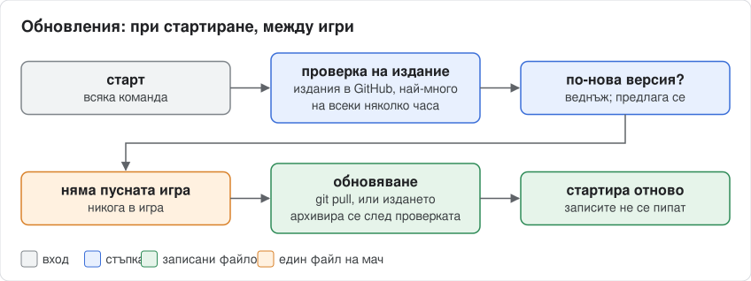

# Обновления {#updates}

Watcher-ът се поддържа актуален от версиите на [Holdi601/3DHeat-Watcher](https://github.com/Holdi601/3DHeat-Watcher/releases). Обновителят е пакетът `heat3d_update`, до `heat3d_watch` в репозиторито.

## Проверката {#the-check}

- **Кога**: всяка команда, освен `update`, проверява при стартиране. `run` проверява и докато работи, най-много веднъж на час и само когато никоя игра не върви.
- **Как**: една HTTPS заявка към `https://api.github.com/repos/Holdi601/3DHeat-Watcher/releases/latest`, със срок от 5 секунди. Отговорът се пази шест часа в `%LOCALAPPDATA%\3DHeat\update-check-3DHeat-Watcher.json`, така че повечето стартирания не питат нищо. „Още няма версия“ (HTTP 404) се пази като всеки друг отговор. При липса на връзка, ограничение на заявките или зад прокси проверката се проваля тихо и командата продължава с версията, която има.
- **Версии**: инсталираната версия е файлът `VERSION` в папката на репозиторито. Таг на версия (`v1.2.0` или `1.2.0`) се сравнява като числа, част по част; всичко след `-` или `+` се пренебрегва.
- **Изключено**: `HEAT3D_NO_UPDATE=1` (всяка стойност, освен празна, `0`, `false` или `no`) изключва и проверката, и автоматичното обновяване. Всеки инструмент на 3DHeat пази собствен файл с кеш, така че отговорът на един инструмент никога не заменя този на друг.

## Какво става, когато има по-нова версия {#what-happens-when-a-newer-release-is-out}

- **`run`** показва известие при стартиране и продължава да работи: `[heat3d_watch] 3DHeat Watcher 1.2.0 is out (this is 1.0.2). <release page>`. Докато работи, при включено `auto_update` (по подразбиране) и без работеща игра, той след това се обновява сам: ред в журнала `3DHeat Watcher 1.2.0 is out (this is 1.0.2); updating`, известие на Windows „Updating to 1.2.0“, самото обновяване, всеки адаптер спрян и сесиите му затворени, и същата команда стартирана отново с новия код. Watcher-ът никога не се обновява по средата на игра. Ако обновяването не може да се приложи, известието казва това („1.2.0 is out; not updated: ...“) и watcher-ът продължава да работи със старата версия. При изключено `auto_update` има само известието.
- **Другите команди** питат `Update now? [Y/n]`, когато работят в терминал. Enter, `y`, `yes`, `j` или `ja` обновява и после пуска същата команда отново с новата версия. Без терминал (планирано пускане, тръба) те показват как да се обнови и продължават.
- **При поискване**: `python -m heat3d_watch update` (или `python -m heat3d_update`) пита GitHub без кеша и обновява. `--check` само казва дали има по-нова версия. Това работи дори когато е зададено `HEAT3D_NO_UPDATE`.

## Как се прилага обновление {#how-an-update-is-applied}

Зависи от начина, по който е инсталирано копието:

- **Git клониране** (папката има `.git` и `git` е в PATH): `git pull --ff-only`. Това се отказва, докато клонирането има промени в проследявани файлове (`git status --porcelain --untracked-files=no` не е празно): тези промени са нечия работа, а обновлението не решава какво да стане с тях. Запазете ги с commit или stash, после направете pull.
- **Свалено копие**: архивът с изходния код на версията се сваля и се разопакова във временна папка. Записите, които биха попаднали извън нея, се пропускат. `VERSION` в архива трябва да е версията, която версията твърди, иначе нищо не се копира. После файловете му се копират върху папката на репозиторито. Файловете, които не са част от версия - записи, настройки, виртуални среди, експорти, всичко, което сте създали - не се пипат. Модул на Python, който по-стара версия е имала, а новата е премахнала, се маха от пакетите на версията (`heat3d_watch`, `heat3d_update`), така че след обновяването да не се зарежда остарял модул на адаптер; извън тези пакети нищо не се маха.

Записите и настройките обикновено са извън папката на репозиторито (`%LOCALAPPDATA%\3DHeat\Watcher`), така че обновяването никога не ги доближава.

След обновяване същата команда се стартира отново. На Windows watcher-ът стартира новия процес, изчаква го и предава кода му на изход, така че конзолата се държи, сякаш първият процес е свършил работата.
