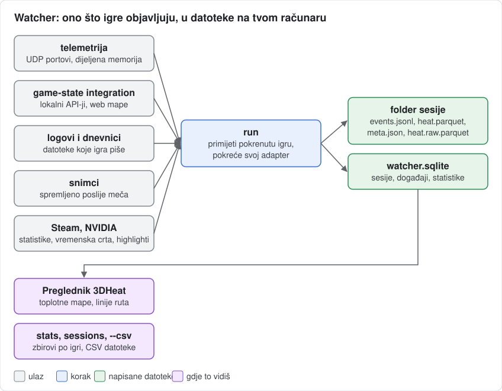
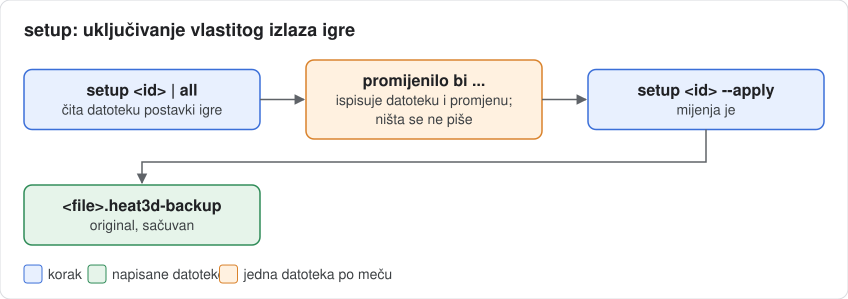
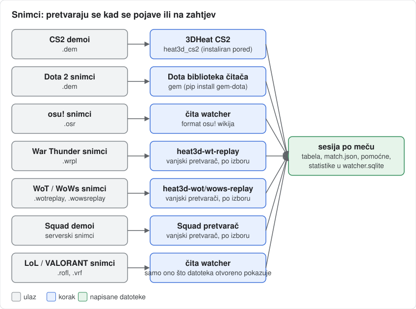
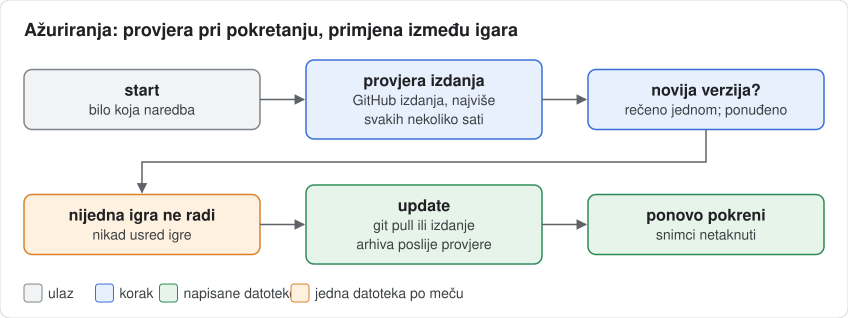

# Komande {#commands}

Komandna linija vam je nova? Prvo pročitajte [Prije nego počnete](before-you-start.md). Svaka komanda se kuca
u terminalu otvorenom u folderu koji ste raspakovali ili klonirali (u File Exploreru upišite `powershell` u
adresnu traku), ovako:

```bash
python -m heat3d_watch <command> [options]
```


| Komanda | Šta radi |
|---|---|
| [`run`](#run) | prati u pozadini i snima svaku igru koja radi |
| [`games`](#games) | šta daje svaka igra i odakle |
| [`setup`](#setup) | uključuje vlastiti izlaz igre |
| [`status`](#status) | koje igre trenutno rade i koji bi se adapteri pokrenuli |
| [`sessions`](#sessions) | dosadašnji snimci |
| [`stats`](#stats) | zbirovi po igri ili tabele kao CSV |
| [`table`](#table) | ponovo gradi `heat.parquet` sesije iz njenog `events.jsonl` |
| [`replays`](#replays) | pretvara snimke (replays) koji su već na disku |
| [`dota-replay`](#dota-replay) | preuzima snimak javnog Dota 2 meča prema njegovom id-u |
| [`dota-map`](#dota-map) | Dota 2 mapa iz vaše instalacije kao 3D nivo za preglednik |
| [`update`](#update) | ažurira na najnovije izdanje |
| [`config`](#config) | prikazuje ili mijenja postavke |

Opcije za svaku komandu: `-h` / `--help` ispisuje pomoć, a `python -m heat3d_watch --version`
ispisuje verziju (datoteka `VERSION`).

Slike na ovoj stranici su pokretanja na sintetičkim primjerima sesija (`Example Racer`, `Example Arena`),
a ne pravi snimci.

Svaka komanda osim `update` prvo traži noviju verziju izdanja (najviše svakih šest sati; preskače se s
`HEAT3D_NO_UPDATE=1`, vidite [Ažuriranja](updates.md)). `run` samo ispiše obavijest. Ostale komande pitaju
`Update now? [Y/n]` kad rade u terminalu, a kad ne rade, ispisuju kako se ažurira. Izlaz je
UTF-8, pa se nazivi igara na bilo kojem pismu ispisuju u svakoj konzoli.

## run {#run}

```bash
python -m heat3d_watch run [--once] [-v]
```



Prati dok se ne zaustavi (Ctrl+C): svakih `scan_seconds` čita listu procesa i pokreće adapter za
svaku igru koju nađe, plus adaptere koji su uvijek uključeni. Prije prvog pregleda zatvara sesije koje je
raniji `run` ostavio otvorenim. Dok nijedna igra ne radi, može sam sebe ažurirati (kad je `auto_update` uključen).
Detalji su u [Instalacija i pokretanje](installing-and-running.md#running).

| Opcija | Efekat |
|---|---|
| `--once` | jedan pregled igara koje rade, pa izlaz. Pokreću se adapteri za igre koje trenutno rade (i oni koji su uvijek uključeni), svaki jednom očita podatke (čeka se najviše 10 sekundi), a zatim se svi zaustave onako kako ih zaustavlja kraj igre: njihove sesije se zatvore, zapišu i prebroje. Za provjeru prepoznavanja, ne za snimanje. |
| `-v`, `--verbose` | debug linije u `watcher.log` i na konzoli |

`run` piše `<data>\watcher.lock` i odbija da se pokrene drugi put za isti folder s podacima (izlazni
kod 1); vidite [Lock datoteka](installing-and-running.md#the-lock-file).

## games {#games}

```bash
python -m heat3d_watch games [--markdown]
```


Ispisuje svaki adapter poredan po igri: njegov naziv, id i vrstu, odakle čita, šta snima i
kako se uključuje. Adapter koji ne može raditi na ovom računaru označen je kao
`[unavailable: <why>]` - SimConnect.dll nije nađen, nema Minecraft foldera, 3DHeat CS2 nije instaliran,
Steam ili NVIDIA App nisu nađeni. Modul adaptera koji se nije uspio učitati navodi se na kraju s
greškom.

```text
EA SPORTS F1 25  (f1-25, telemetry)
    from: UDP telemetry 127.0.0.1:20777 (Documents\My Games\F1 25\hardwaresettings\hardware_settings_config.xml)
    - every car's position (world XYZ, m) at 10 Hz, by driver name, team, own car marked, ...
    switch on: In the game: Settings > Telemetry Settings > UDP Telemetry On, IP 127.0.0.1, port 20777 - ...
```

`--markdown` ispisuje isto kao jednu Markdown tabelu (igra, šta se snima, odakle, kako se uključuje,
online igra, provjereno). Tabela u [Sve igre u jednoj tabeli](watcher.md) je taj izlaz. Ćelije
su escapeovane za Markdown: tekst u backtickovima ostaje kod, a izvan njih se `<`, `>`, `&`, `*`, `|`
i obrnuta kosa crta ispred interpunkcije pišu tako da se prikažu kako su otkucani (`<CS2>` bi inače nestao kao
HTML oznaka u kramdownu). Jedini HTML je `<br>` između stavki u "What is recorded".

## setup {#setup}

```bash
python -m heat3d_watch setup <adapter id | all> [--apply]
```




Uključuje vlastiti izlaz igre, tamo gdje igra za to traži promjenu datoteke. Bez `--apply`
ništa se ne mijenja: svaka linija kaže šta bi se promijenilo, a kad ima šta mijenjati, posljednja
linija kaže `Nothing was changed. Run again with --apply to make these changes.` Kad nema šta
mijenjati, piše `<id>: nothing to change` (`Nothing to change.` za `all`). S `--apply` se promjene
izvrše, a prije prve promjene datoteke njen original se sprema kao
`<file>.heat3d-backup`. Backup koji već postoji nikad se ne prepisuje, pa uvijek drži
datoteku onakvu kakva je bila prije nego što ju je watcher prvi put dotakao.

```text
f1-25: would change: hardware_settings_config.xml <udp>: enabled="false" -> "true"
Nothing was changed. Run again with --apply to make these changes.
```

`all` pokreće setup svakog adaptera koji ga ima. Adapter bez setupa, naveden sam, ispisuje
`<id>: nothing for setup to change; ` iza čega slijedi kako se igra uključuje (njegov `enable` tekst ili
da mu ništa ne treba). Nepoznat id ispisuje `no adapter '<id>'; games lists them` i izlazi s kodom
2. Adapteri koji imaju šta podesiti:

| Adapter | Šta `--apply` mijenja |
|---|---|
| `beamng` | instalira `heat3d` protokol mod u korisnički `mods` folder BeamNG-a (samo kad ga tamo nema); zatim u igri uključite Options > Other > Protocols > "others" |
| `cs2-gsi` | piše `<CS2>\game\csgo\cfg\gamestate_integration_heat3d.cfg`: šalje stanje igre na `http://127.0.0.1:3311/` sa nasumičnim tokenom koji watcher zatim traži (token koji je već u datoteci ostaje); CS2 je čita pri pokretanju |
| `dota2-gsi` | isto za Dota 2: `<Dota>\game\dota\cfg\gamestate_integration\gamestate_integration_heat3d.cfg`, port 3312 |
| `dcs` | dodaje `Scripts\Hooks\heat3d-watch.lua` u svaki folder `%USERPROFILE%\Saved Games\DCS*`. Njegova starija kopija se ažurira; datoteka tog imena koju watcher nije napisao ostavlja se na miru. Ponovo pokrenite DCS. |
| `dirt-rally-2` | `hardware_settings_config.xml`: `<udp enabled="true" extradata="3" ip="127.0.0.1" port="20777">`; prvo jednom pokrenite igru da datoteka postoji |
| `ea-wrc` | `Documents\My Games\WRC\telemetry\config.json`: uključuje paket `session_update` strukture `wrc`, prema ovom računaru |
| `f1-23`, `f1-24`, `f1-25` | `hardware_settings_config.xml`: `<udp enabled="true" ip="127.0.0.1" port="20777">`; igra mora biti zatvorena |
| `hearthstone` | dodaje sekciju `[Power]` (`LogLevel=1`, `FilePrinting=true`) u `%LOCALAPPDATA%\Blizzard\Hearthstone\log.config`; ponovo pokrenite igru |
| `il2` | `<game>\data\startup.cfg`, `[KEY = telemetrydevice]`: još jedna meta `addrN = "127.0.0.1:41995"` i `enable = true` (sekcija se dodaje, na 10 Hz, kad je nema); ponovo pokrenite IL-2 |
| `il2-tacview` | `<game>\data\startup.cfg`, `[KEY = track_record]`: `tacviewrecord = 1` |
| `rocketleague-stats` | `TAStatsAPI.ini` (ili `DefaultStatsAPI.ini` kad on ne postoji) u `<RL>\TAGame\Config`: `PacketSendRate=30` kad je API isključen, i `Port` kad nijedan nije postavljen; čita se kad se Rocket League pokrene |

`richard-burns-rally` nema setup: njegova telemetrija je od RSF/NGP plugina, uključuje se ručno u
`RichardBurnsRally.ini` (vidite [njegovu stranicu](game-richard-burns-rally.md)); `setup richard-burns-rally` to
i kaže. Svaka druga igra ili ne treba ništa ili se uključuje u igri; stranica svake igre kaže kako.

## status {#status}

```bash
python -m heat3d_watch status
```

```text
3DHeat Watcher 1.0.2; data in C:\Users\...\AppData\Local\3DHeat\Watcher
Games running: EA SPORTS F1 25 (f1-25)
Always on: il2-tacview, steam-stats, steam-timeline, nvidia-highlights, cs2-demos, osu-replays, lol-replays, valorant-replays
```

Kaže koje bi adaptere `run` sada pokrenuo, po istim pravilima: proces igre radi, adapter nije u
`disabled`, ništa što mu treba ne nedostaje, adapteri za snimke (replays) samo s uključenim `replays`, memorijski
adapteri samo s uključenim `memory` i uz sve prođene memorijske provjere. Ne pokreće ništa.

## sessions {#sessions}

```bash
python -m heat3d_watch sessions [--game NAME] [--limit N]
```


Najnovije sesije iz `watcher.sqlite`, jedna linija po sesiji: početak (lokalno vrijeme), igra, minute, događaji,
pozicije, folder.

| Opcija | Efekat |
|---|---|
| `--game NAME` | samo ova igra, po tačnom nazivu kao na listi (`"EA SPORTS F1 25"`) |
| `--limit N` | najviše N sesija (zadano 40) |

## stats {#stats}

```bash
python -m heat3d_watch stats [--game NAME] [--csv DIR]
```


Bez opcija: tabela svake igre (sesije, sati, događaji, pozicije, zadnji put igrano), najviše igrana
prva, zatim za svaku igru njenih 25 najčešćih događaja i svaka numerička statistika s brojem
sesija koje je imaju, zbirom, najboljom vrijednošću (`best`) i prosjekom. `best` zna u kojem je smjeru
bolje: najniža vrijednost za vremena koja se čuvaju kao najbolja (`best_lap`, `best_stage` i svaki drugi ključ koji
počinje s `best_`) i za mjesta (`race_position`, `grid_position`, svaki ključ koji završava na `_position`),
a najviša za sve ostalo (ubistva, udaljenost, najveća brzina, vlastiti brojači igre).

| Opcija | Efekat |
|---|---|
| `--game NAME` | samo događaji i statistike ove igre, bez pregleda |
| `--csv DIR` | umjesto toga upiše `sessions.csv`, `events.csv` i `stats.csv` (svaki red triju tabela) u `DIR`; `--game` ga ne sužava |

## table {#table}

```bash
python -m heat3d_watch table <session folder>
```


Ponovo gradi `heat.parquet` u folderu sesije iz njenog `events.jsonl`, s osama iz njenog
`meta.json`. Ispisuje putanju tabele ili `no positions in this session`. Koristite ga za sesiju snimljenu
dok je `pyarrow` nedostajao, ili poslije ručnog uređivanja `events.jsonl`.

## replays {#replays}

```bash
python -m heat3d_watch replays <adapter id> [folder] [-v]
```



Pretvara snimke (replays) koji su već na disku, odmah, jedan za drugim, svaki u sesiju kao što bi to uradilo
praćenje foldera. Kad watcher prvi put vidi folder sa snimcima, samo zabilježi šta je u njemu (vidite
[Instalacija i pokretanje](installing-and-running.md#replays-already-on-disk)); ovako se oni na zahtjev
pretvaraju. Bez `folder` čitaju se adapterovi vlastiti folderi (folderi igre, plus `replay_folders`); s
njim, snimci u tom folderu. Svaki pretvoreni bilježi se kao viđen, pa ga watcher koji radi ne
pretvara ponovo. Snimak koji se ne uspije pretvoriti zapisuje se u log i preskače.

| Adapter | Snimci |
|---|---|
| `cs2-demos` | Counter-Strike 2 demoi (`*.dem`), preko 3DHeat CS2 |
| `lol-replays` | League of Legends snimci (`*.rofl`) |
| `osu-replays` | osu! snimci (`*.osr`) |
| `valorant-replays` | VALORANT snimci (`*.vrf`) |
| `warthunder-replays` | War Thunder snimci (`*.wrpl`), preko vanjskog konvertera `heat3d-wt-replay` (exporters/ext/warthunder-replay) |
| `wot-replays` | World of Tanks snimci (`*.wotreplay`), preko vanjskog konvertera `heat3d-wot-replay` (exporters/ext/wot-replay) |
| `wows-replays` | World of Warships snimci (`*.wowsreplay`), preko vanjskog konvertera `heat3d-wows-replay` (exporters/ext/wows-replay) |
| `dota-replays` | Dota 2 snimci (`*.dem`), preko gem (`pip install gem-dota`) |

```text
osu-replays: converted 12 replay(s); `sessions --game` lists them
```

Id koji nije među ovima ispisuje `no replay adapter '<id>'` s listom i izlazi s kodom 2;
isto čini i `folder` koji ne postoji. Adapter koji ovdje ne može raditi (3DHeat CS2 nije instaliran)
ispisuje zašto i izlazi s kodom 1. Tacview tragovi iz IL-2 nisu na listi: taj adapter sam pretvara svaki
završeni trag koji nađe.

## dota-replay {#dota-replay}

```bash
python -m heat3d_watch dota-replay <match id> [<match id> ...] [-o FOLDER] [--convert] [-v]
```

Preuzima snimak javnog Dota 2 meča sa Valveovih servera za snimke. Treba internet. Id
meča je broj na stranici meča u Dota klijentu (detalji meča) ili na OpenDota web-stranici; Valve čuva snimak nekoliko
sedmica, nakon čega preuzimanje ne uspijeva. Server i salt snimka dolaze iz OpenDotinog zapisa o meču
(`api.opendota.com/api/matches/<id>`, ključ ne treba), datoteka sa
`replay<cluster>.valve.net/570/<id>_<salt>.dem.bz2`; raspakuje se dok stiže (Valve
pod tim imenom služi i bzip2 i Zstandard) i sprema kao `<match id>.dem`. Bez `-o` ide
u Dotin vlastiti folder sa snimcima kad je Dota 2 instalirana - gdje ga watcher koji radi pretvara - a inače u
`<data>/replays/dota`. Datoteka koja je već tamo ostaje. `--convert` odmah pretvara preuzete
snimke, kao što bi uradio `replays dota-replays`, i bilježi ih kao viđene.

```text
match 9000000000: C:\Program Files (x86)\Steam\steamapps\common\dota 2 beta\game\dota\replays\9000000000.dem
```

Valve čuva snimke nekoliko sedmica; stariji meč ispisuje `Valve no longer has the replay of match
<id>` i izlazi s kodom 1. Meč koji OpenDota još nije vidio nema salt: poruka kaže da ga zatražite od
OpenDote (`curl -X POST https://api.opendota.com/api/request/<id>`) i pokušate ponovo nekoliko
minuta kasnije. Privatne lobije i mečeve sa skrivenim profilom uopće nema na serverima za snimke.

## dota-map {#dota-map}

```bash
python -m heat3d_watch dota-map [<map>] -o <file.glb> [--game FOLDER] [--source2viewer EXE] [--detail UNITS]
```

Piše Dota 2 mapu - tlo, litice, vodu, drveće i zgrade - kao `.glb` nivo u okviru u kojem
se crtaju tabele Dota snimaka, iz vaše vlastite Dota 2 instalacije, koju čita komandna linija
Source2Viewera. Ništa se ne preuzima. `<map>` je zadano `dota`; `--game` je Dota 2 folder kad
nije u Steam biblioteci; `--source2viewer` je putanja CLI-ja kad nije ni u `HEAT3D_SOURCE2VIEWER`
ni u `PATH`; `--detail` je ćelija grupiranja vrhova za zgrade u jedinicama igre (zadano 8, 0 zadržava
svaki trougao). Izlazi s kodom 1 i `dota-map: <why>` kad Dota 2, mapa ili Source2Viewer nisu
nađeni. Svaki korak, dijelovi datoteke i kako je provjerena: [Dota 2 mapa](dota-map.md).

## update {#update}

```bash
python -m heat3d_watch update [--check]
```



Pita GitHub za najnovije izdanje, ignorirajući spremljen odgovor, i ažurira ovu kopiju ako je novije
(vidite [Ažuriranja](updates.md)). `--check` samo kaže je li izašlo novije izdanje. Ova komanda radi čak
i kad je `HEAT3D_NO_UPDATE` postavljen: njeno traženje je odluka. `python -m heat3d_update [--check]` radi
isto.

## config {#config}

```bash
python -m heat3d_watch config [--set KEY=VALUE ...]
```


Ispisuje svaku postavku kao `key = value`. Sa `--set` prvo mijenja zadane i sprema
`settings.json` (`saved <path>`). Vrijednosti se čitaju prema tipu postavke:

- postavke tipa da/ne: `1`, `true`, `yes`, `on` ili `ja` je tačno; `0`, `false`, `no`, `off`, `nein` ili
  ništa je netačno;
- brojevi: decimalni broj (`scan_seconds=5`);
- liste: odvojene zarezima ili JSON lista (`disabled=steam-stats,steam-timeline`; prazna vrijednost briše
  listu);
- rječnici (`replay_folders`, `player_names`): cijeli rječnik kao JSON, ili jedan unos kao
  `KEY.ID=VALUE` - `replay_folders.cs2-demos=D:\Demos,E:\More Demos` postavlja foldere tog adaptera
  (odvojene zarezima), `player_names.warthunder-webmap=Name` ime tog adaptera; prazna vrijednost uklanja
  unos;
- tekst: kako je dat (`data=D:\Heat`, `riot_id=Name#TAG`).

```bash
python -m heat3d_watch config --set memory=true scan_seconds=5
python -m heat3d_watch config --set riot_id=Name#TAG riot_platform=EUW1
python -m heat3d_watch config --set replay_folders.cs2-demos=D:\Demos player_names.rocketleague-stats=Name
```

Nepoznat ključ ispisuje `no setting '<key>'`, a vrijednost koja nije tipa postavke (`memory=perhaps`,
`scan_seconds=often`, rječnik koji nije JSON) ispisuje `not saved: ...`; oboje izlazi s kodom 2
bez spremanja ičega. Ručno uređen `settings.json` čita se na isti način: vrijednost data kao tekst
tamo gdje je postavka broj, da/ne ili rječnik čita se kako je otkucana, a ona koja se ne može
pročitati ostavlja se na zadanoj vrijednosti. Svaka postavka je opisana u
[Instalacija i pokretanje](installing-and-running.md#settings).
