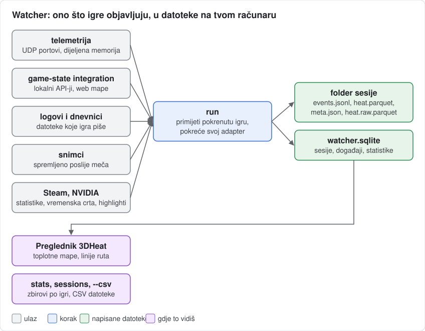

# 3DHeat Watcher {#dheat-watcher}

**Šta je to?** Vi igrate igru. Ovaj program tiho zapisuje kamo ste išli i šta se dogodilo.
Kasnije to možete pogledati kao obojenu mapu u pregledniku 3DHeat.

**Zašto bih ga koristio?** Da vodite vlastitu evidenciju svake sesije - gdje ste vozili, letjeli ili se borili,
vaši ukupni zbirovi po igri - bez ikakve web stranice i bez mijenjanja igre.

**Primjer:** vozite krug u trkaćoj igri dok watcher radi; poslije toga datoteka u
`sessions\<game>\` drži liniju kojom ste išli, a preglednik je crta.

Detaljnije: 3DHeat Watcher je program u pozadini koji bilježi ono što igre objavljuju o vašem igranju - kamo ste
išli, šta se gdje dogodilo i brojeve iza toga - u datoteke na vašem vlastitom računaru. Datoteke su
za vašu vlastitu statistiku te za toplotne mape i linije ruta preglednika 3DHeat.

Radi tiho, primijeti koju ste igru pokrenuli i čita vlastite izlaze te igre: telemetrijski port
ili dijeljenu memoriju koju igra objavljuje za dashboarde, game-state integration, dnevnik ili log koji
igra piše, snimak koji sprema poslije meča, statistiku koju čuva Steam, klipove koje
sprema NVIDIA App. Snimci ostaju na vašem računaru. Program kontaktira samo dva vanjska servisa, i to samo u
ovim slučajevima: GitHub, da potraži noviju verziju (vidite [Ažuriranja](updates.md)), i Riotov Match-V5 API,
i to samo ako unesete vlastiti Riot API ključ (vidite [Snimci League of Legends](game-lol-replays.md)).



## Šta bilježi {#what-it-records}

- **Pozicije**: automobil, letjelica, heroj ili igrač, nekoliko puta u sekundi gdje ih igra objavljuje,
  s brzinom, smjerom i svim ostalim što igra šalje uz to.
- **Događaji**: spawnovi, smrti, ubistva, krugovi, etape, runde, golovi, poslovi, polijetanja i slijetanja, promjene
  zone, postignuća, highlighti. Svaki događaj se pohranjuje sa svojim vremenom, a s mjestom kad ga
  igra daje.
- **Statistike po sesiji**: ubistva, smrti, krugovi, najbolji krug, udaljenost, najveća brzina, vrijeme igranja i
  vlastita statistika igre gdje je vodi.

Šta daje svaka igra, i odakle, nalazi se na njenoj stranici pod [Igre](games.md). Jedan izvor ne može
zabilježiti sve: multiplayer igre se bilježe samo preko onoga što objavljuju, a watcher
nikad ne čita njihovu memoriju (vidite [Izvori i pravila](sources-and-rules.md)).

## Instalacija {#install}

Komandna linija vam je nova? Prvo pročitajte [Prije nego počnete](before-you-start.md).

Watcher je Python program za Windows (Python 3.10 ili noviji). Mnogi njegovi izvori postoje samo na Windowsu: dijeljena
memorija, registar, Windows obavijesti.

```bash
git clone https://github.com/Holdi601/3DHeat-Watcher.git
cd 3DHeat-Watcher
pip install -r requirements.txt
```

Preuzeta arhiva izdanja radi isto: raspakujte je, pa pokrenite `pip install -r requirements.txt`
unutar foldera. Detalji i dodaci koje trebaju neke igre nalaze se u
[Instalacija i pokretanje](installing-and-running.md).

## Brzi početak {#quick-start}

```bash
python -m heat3d_watch games            # what each game gives, and from where
python -m heat3d_watch setup all        # what would have to be switched on (nothing is changed)
python -m heat3d_watch setup f1-25 --apply   # switch one game's output on (the original file is backed up)
python -m heat3d_watch run              # watch; leave it running while you play
python -m heat3d_watch stats            # totals per game
python -m heat3d_watch stats --csv out  # sessions, events and stats as CSV files
```

Trebali biste vidjeti: poslije `games` tabelu s jednim redom po igri; `run` radi dok ne pritisnete
Ctrl+C ili zatvorite prozor.

Sve se piše u `%LOCALAPPDATA%\3DHeat\Watcher`. Da koristite drugi folder, postavite
varijablu okruženja `HEAT3D_WATCH_HOME` ili pokrenite `python -m heat3d_watch config --set data=D:\somewhere`.

- `sessions\<game>\<date>_<adapter>\` - jedan folder po sesiji, koji drži `events.jsonl` (svaki događaj
  kako se događa), `heat.parquet` (redovi s pozicijom, spremni za preglednik 3DHeat) i
  `meta.json` (igra, izvor, osi, brojevi, statistike)
- `watcher.sqlite` - statistike svake sesije, u tri obične tabele
- `watcher.log` - šta je watcher radio

Preglednik otvara `heat.parquet` sesije direktno, bez ičeg za podešavanje (njegove osi i jedinice su u
datoteci). Pretvoreni snimci pišu se kao tabele i dokumenti mečeva pored njega; vlastiti format
preglednika s jednom datotekom po meču opisan je na stranici o njegovom [`.3dheat` spremniku](https://holdi601.github.io/3DHeat/container.html),
a kolone svake tabele u [Podaci](the-data.md).

## Dokumentacija {#the-documentation}

| Stranica | Šta pokriva |
|---|---|
| [Prije nego počnete](before-you-start.md) | Python, terminal, rezervirana mjesta, kako izgledaju uspjeh i česte greške |
| [Instalacija i pokretanje](installing-and-running.md) | zahtjevi, rad u pozadini, pokretanje s Windowsom, lock datoteka, log, svaka postavka i varijabla okruženja |
| [Igre](games.md) | jedna stranica po igri: šta se bilježi, odakle, kako uključiti, kako radi, osi, statistike, šta je provjereno |
| [Podaci](the-data.md) | folderi sesija, `events.jsonl`, `heat.parquet` i njegovo podnožje, `meta.json`, `watcher.sqlite`, oporavak poslije rušenja, CSV izvoz, otvaranje sesije u pregledniku 3DHeat |
| [Komande](commands.md) | svaka komanda i opcija `python -m heat3d_watch` |
| [Izvori i pravila](sources-and-rules.md) | šest vrsta izvora, multiplayer pravila, koje su igre izostavljene i zašto |
| [NVIDIA Highlights](nvidia-highlights.md) | šta NVIDIA Highlights može i ne može isporučiti i kako highlight dobija poziciju |
| [Modovi za snimanje na serveru](server-mods.md) | serverski modovi za Arma 3 i Arma Reforger koji snimaju cijele misije za preglednik |
| [Čitanje memorije](memory-reading.md) | memorijski profili za single-player: format, provjere, kako napisati i provjeriti jedan |
| [Ažuriranja](updates.md) | kako watcher traži nova izdanja i sam se ažurira |
| [Razvoj](development.md) | pisanje adaptera: API, testovi, iskren `verified`, regeneriranje stranica igara |
| [Sve igre u jednoj tabeli](watcher.md) | sve igre u jednoj tabeli, kako ih ispisuje `games --markdown`, plus istražene igre koje još nisu izgrađene |
| [Referenca komandi](../cli-reference.md) | `--help` svake komande, generiran iz koda |
| [Održavanje](maintaining.md) | lista za provjeru pri izdanju ovih stranica |

## Dio 3DHeat-a {#part-of-3dheat}

3DHeat Watcher je jedan od besplatnih alata oko preglednika 3DHeat (watcher koristi 3DHeat CS2
za pretvaranje CS2 demoa). Svaki je zaseban projekat, s vlastitim izdanjima i licencom:

| Alat | Šta radi | Dokumentacija |
|---|---|---|
| [3DHeat](https://github.com/Holdi601/3DHeat) | preglednik: toplotne mape, analiza utrka i pregled mečeva u 3D | [stranica](https://holdi601.github.io/3DHeat/) |
| [GameFiles](https://github.com/Holdi601/3DHeat-GameFiles) | staze i nivoi iz datoteka koje igre isporučuju, kao 3D modeli | [stranica](https://holdi601.github.io/3DHeat-GameFiles/) |
| [GameCapture](https://github.com/Holdi601/3DHeat-GameCapture) | telemetrija krugova iz trkaćih igara; nivoi rekonstruirani iz video snimka igranja | [stranica](https://holdi601.github.io/3DHeat-GameCapture/) |
| [Unreal Exporter](https://github.com/Holdi601/3DHeat-UnrealExporter) | dodatak za Unreal Editor koji izvozi nivo kao jedan 3D model | [stranica](https://holdi601.github.io/3DHeat-UnrealExporter/) |
| [CS2](https://github.com/Holdi601/3DHeat-CS2) | Counter-Strike 2 demoi u tabele i dokumente mečeva; mape u 3D modele | [stranica](https://holdi601.github.io/3DHeat-CS2/) |
| [Watcher](https://github.com/Holdi601/3DHeat-Watcher) | u pozadini bilježi ono što igre objavljuju o vašem igranju | [stranica](https://holdi601.github.io/3DHeat-Watcher/) |
| [Ext-WarThunder](https://github.com/Holdi601/3DHeat-Ext-WarThunder) | War Thunder snimci u tabele i dokumente mečeva | [stranica](https://holdi601.github.io/3DHeat-Ext-WarThunder/) |
| [Ext-WoT](https://github.com/Holdi601/3DHeat-Ext-WoT) | World of Tanks snimci u tabele i dokumente mečeva | [stranica](https://holdi601.github.io/3DHeat-Ext-WoT/) |
| [Ext-WoWs](https://github.com/Holdi601/3DHeat-Ext-WoWs) | World of Warships snimci u tabele i dokumente mečeva | [stranica](https://holdi601.github.io/3DHeat-Ext-WoWs/) |
| [Ext-Squad](https://github.com/Holdi601/3DHeat-Ext-Squad) | Squad serverski demoi u tabele i dokumente mečeva | [stranica](https://holdi601.github.io/3DHeat-Ext-Squad/) |
| [Ext-DCS](https://github.com/Holdi601/3DHeat-Ext-DCS) | DCS World mape u 3D modele | [stranica](https://holdi601.github.io/3DHeat-Ext-DCS/) |
| [Ext-IL2](https://github.com/Holdi601/3DHeat-Ext-IL2) | IL-2 Sturmovik mape u 3D modele | [stranica](https://holdi601.github.io/3DHeat-Ext-IL2/) |

Svaki čitač igre je zaseban mali projekat s vlastitom datotekom licence, izdanjima i praćenjem
problema, pa se može instalirati, ažurirati, održavati - ili povući na zahtjev nosioca prava -
zasebno, bez uticaja na preglednik i ostale alate.

Licenca: MIT ([LICENSE](https://github.com/Holdi601/3DHeat-Watcher/blob/main/LICENSE)). Licence
paketa trećih strana koje koristi i ono što zahtijevaju igre koje čita navedene su u
[LICENSES.md](https://github.com/Holdi601/3DHeat-Watcher/blob/main/LICENSES.md).
