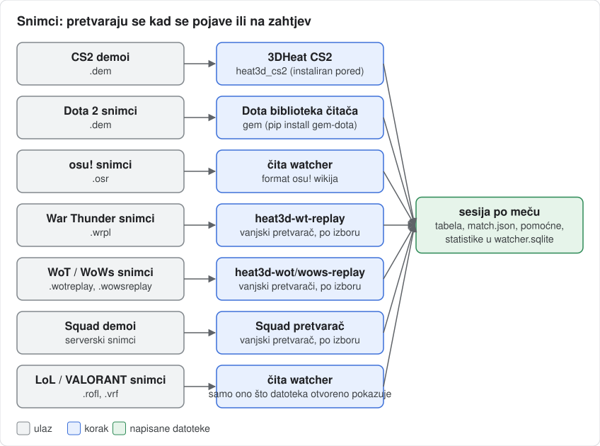

# Instalacija i pokretanje {#installing-and-running}

## Zahtjevi {#requirements}

- **Windows.** Watcher je pisan za Windows, a većina njegovih izvora postoji samo tamo: dijeljena
  memorija koju igre stvaraju (mapiranja `Local\...`), registar (gdje je Steam), Windows
  obavijesti, lista procesa s putanjama izvršnih datoteka. Na drugom sistemu program se pokreće, ali
  ti izvori ne nalaze ništa, obavijesti se samo zapisuju u log, a čitanje memorije odbija ("only
  implemented on Windows").
- **Python 3.10 ili noviji**, sa <https://www.python.org/downloads/>: u instalateru označite **Add python.exe to PATH**,
  pa provjerite s `python --version` u novom terminalu. Ovo vam je novo? Prvo pročitajte
  [Prije nego počnete](before-you-start.md).
- **Paketi** (`requirements.txt`): `psutil>=6.0` (koje igre rade, koji program drži
  port, veze igre; stariji psutil i dalje radi, preko svog starijeg imena za veze procesa),
  `pyarrow>=15` (pisanje `heat.parquet`), `numpy>=1.24` i
  `pytest>=8.0` za testove. `requirements-optional.txt` trenutno ne navodi nijedan paket.

Bez `pyarrow` sesije se i dalje snimaju: `events.jsonl` je zapis, a tabela se može
napraviti kasnije s [`table`](commands.md#table).

### Dodaci koje trebaju neke igre {#extras-some-games-need}

| Igra | Šta treba |
|---|---|
| Counter-Strike 2 demoi | [3DHeat CS2](https://github.com/Holdi601/3DHeat-CS2) i njegovi zahtjevi (`demoparser2`). Watcher ga traži u `HEAT3D_CS2`, zatim u folderu `3DHeat-CS2` ili `cs2` pored watcherovog vlastitog foldera, zatim bilo gdje odakle Python može uvesti `heat3d_cs2`. Bez njega `games` navodi adapter kao nedostupan. |
| Microsoft Flight Simulator 2020 / 2024 | `SimConnect.dll` - ne isporučuje se. MSFS 2020 ga ima u svom instalacijskom folderu; za MSFS 2024 instalirajte MSFS 2024 SDK. `MSFS_SDK` / `MSFS2024_SDK` pokazuju na folder SDK-a. |
| Euro Truck Simulator 2, American Truck Simulator | RenCloud plugin `scs-telemetry.dll` (revizija 12) u `<game>\bin\win_x64\plugins` |
| BeamNG.drive | `heat3d` protokol mod, koji instalira `python -m heat3d_watch setup beamng --apply` |
| League of Legends (uživo) | opcionalno: Riotov korijenski certifikat kao `<data>\riotgames.pem`, da se lokalna veza provjerava |
| Minecraft | folder `%APPDATA%\.minecraft` (Java Edition) |

Stranica svake igre pod [Igre](games.md) kaže šta se mora uključiti u samoj igri.
`python -m heat3d_watch games` označava adapter kao `[unavailable: ...]` kad nešto što mu treba nedostaje
na ovom računaru.

## Instalacija {#installing}

Komandna linija vam je nova? Prvo pročitajte [Prije nego počnete](before-you-start.md). Ako se `pip` ne nađe,
umjesto toga koristite `python -m pip install -r requirements.txt`.

Iz klona:

```bash
git clone https://github.com/Holdi601/3DHeat-Watcher.git
cd 3DHeat-Watcher
pip install -r requirements.txt
```

Iz izdanja: preuzmite arhivu iz izdanja repozitorija, raspakujte je, pa pokrenite
`pip install -r requirements.txt` unutar foldera. Obje vrste kopije same se ažuriraju
(vidite [Ažuriranja](updates.md)).

Svaku komandu pokrećite iz foldera repozitorija: `python -m heat3d_watch` odatle uvozi paket,
a program za ažuriranje (`heat3d_update`) je pored njega.

## Pokretanje {#running}

```bash
python -m heat3d_watch run        # watch until stopped
python -m heat3d_watch run -v     # the same, with debug lines in the log
python -m heat3d_watch run --once # one look at the games running now, then stop and exit
```

Pri pokretanju `run`:

1. piše [lock datoteku](#the-lock-file);
2. zatvara sve sesije koje je raniji `run` ostavio otvorenim, na primjer poslije rušenja
   (vidite [Oporavak](the-data.md#recovery-after-a-crash));
3. svakih `scan_seconds` (2 s) čita listu procesa (samo imena i putanje, nijedan proces se ne otvara)
   i pokreće adapter, u vlastitoj niti, za svaku igru koju nađe. Kad procesa igre nema više,
   njen adapter se zaustavlja, a sesije koje je imao otvorene zatvaraju se, što upisuje njihovu tabelu i
   njihovu liniju u statistiku. Adapteri koji ne čekaju igru (Steam statistika, Steam
   Timeline, NVIDIA highlighti, folderi sa snimcima) rade cijelo vrijeme;
4. dok nijedna igra ne radi, traži novije izdanje najviše jednom na sat (sam odgovor se sprema šest sati) i, uz uključen `auto_update`,
   instalira ga i sam se ponovo pokreće (vidite [Ažuriranja](updates.md)).

Adapter koji ne uspije zapisuje se u log i ne zaustavlja ostale. Ako očitavanje adaptera ne uspije 20 puta
zaredom, ili mu ne uspije pokretanje, adapter se zaustavlja i ne pokreće se ponovo dok se igra opet ne
pokrene (novi id procesa).

Watcher zaustavite s Ctrl+C. Adapteri zatvaraju svoje sesije prije izlaza. Ako se watcher
umjesto toga ubije (Task Manager, rušenje, nestanak struje), ništa što je već upisano nije izgubljeno: sljedeći
`run` zatvara te sesije.

`--once` pravi jedan pregled: pokreće adaptere za igre koje u tom trenutku rade (i one koji su uvijek
uključeni), pušta svakog da jednom očita podatke - čekajući na to najviše 10 sekundi - a zatim ih zaustavlja onako
kako bi ih zaustavio kraj igre, tako da se sesije koje su otvorili zatvore, njihove tabele upišu, a linije
prebroje u statistici prije izlaza. Koristite ga da provjerite prepoznaje li se igra, a ne za snimanje.

### Snimci (replays) koji su već na disku {#replays-already-on-disk}



Kad adapter za snimke prvi put vidi neki od svojih foldera, samo zabilježi snimke koji su već u njemu:
igrač s godinama demoa inače bi našao watcher zaposlen pretvaranjem čitav dan. Od tada
se svaki novi snimak pretvara čim ga igra završi pisati. Stari se pretvaraju na
zahtjev komandom [`replays`](commands.md#replays):

```bash
python -m heat3d_watch replays cs2-demos              # every demo in CS2's folders and replay_folders
python -m heat3d_watch replays osu-replays D:\Old     # the replays in one folder
```

### Rad u pozadini {#running-in-the-background}

Watcher nema vlastiti prozor; to je konzolni program koji radi dok se ne zaustavi. Sve
piše u `watcher.log`, pa mu ne treba vidljiva konzola. Načini da se drži po strani:

- pokrenite ga u konzoli i minimizirajte konzolu: `start "" /min python -m heat3d_watch run` iz
  `cmd`, u folderu repozitorija;
- pokrenite ga bez konzole: `pythonw -m heat3d_watch run`. Izlaz na konzoli se gubi, ali se `watcher.log`
  i dalje piše. Da ga zaustavite, završite proces `pythonw.exe`; sljedeće pokretanje tada zatvara
  sesije koje je ostavio otvorenim. Projekat nije testirao ovaj način rada.

### Pokretanje s Windowsom (ideja) {#starting-with-windows-an-idea}

Watcher se ne instalira sam da se pokreće s Windowsom. Da ga pokrenete automatski:

- **Task Scheduler**: napravite zadatak s okidačem *At log on* i radnjom *Start a program*,
  program `pythonw.exe` (ili `python.exe`), argumenti `-m heat3d_watch run`, *Start in* postavljen na
  folder repozitorija;
- **Startup folder**: stavite prečicu u `shell:startup` s istim programom, argumentima i *Start in*
  folderom.

Ništa od toga nije dio watchera niti ga on testira. [Lock datoteka](#the-lock-file) osigurava da se druga kopija
pokrenuta greškom odmah zatvori.

## Lock datoteka {#the-lock-file}

`<data>\watcher.lock` drži id procesa watchera koji radi. Kad se `run` pokrene, a lock datoteka
imenuje proces koji još postoji i čije ime sadrži `python`, ispisuje

```text
A watcher is already running (process 12345) for C:\Users\...\3DHeat\Watcher.
```

i izlazi s kodom 1. Dva watchera na jednom folderu s podacima snimila bi svaku igru dvaput, a drugi
bi otvorene sesije prvog tretirao kao ostatke rušenja. Lock datoteka čijeg procesa
nema, ili pripada drugom programu, prepisuje se. Kad `run` završi, uklanja lock datoteku ako
datoteka još imenuje njegov vlastiti proces.

## Log {#the-log}

`<data>\watcher.log` piše samo `run`; ostale komande ispisuju na konzolu. Svaka linija ima
vrijeme, nivo i poruku:

```text
2026-05-01 20:15:01,123 INFO watching; data in C:\Users\...\AppData\Local\3DHeat\Watcher
2026-05-01 20:15:03,456 INFO f1-25: starting (EA SPORTS F1 25)
2026-05-01 21:02:11,789 INFO f1-25: stopping
```

Adapteri zapisuju šta ne mogu i zašto: "UDP 20777 is in use by ...; not taking it from that program",
"not reading memory: the game is played online", "could not start", "poll failed (3)" s
tragom greške (traceback). `run -v` dodaje debug linije. U datoteku se dopisuje i watcher je nikad ne rotira
niti prazni; obrišite je kad god želite. Iste linije idu i na konzolu.

## Gdje je šta {#where-everything-is}

Početni folder je `%LOCALAPPDATA%\3DHeat\Watcher`, ili `HEAT3D_WATCH_HOME` kad je postavljen (bez
`LOCALAPPDATA`, na primjer na drugom sistemu, `~/.local/share/3DHeat/Watcher`). `settings.json` je
uvijek u početnom folderu. Sve ostalo ide u folder s podacima, koji je početni folder osim ako
postavka `data` ne imenuje drugi:

| Putanja | Šta je to |
|---|---|
| `<home>\settings.json` | postavke |
| `<data>\sessions\` | snimci, jedan folder po sjedenju ([Podaci](the-data.md)) |
| `<data>\watcher.sqlite` | baza statistika |
| `<data>\watcher.log` | log komande `run` |
| `<data>\watcher.lock` | lock datoteka, dok `run` radi |
| `<data>\state\` | šta su uvijek uključeni adapteri i adapteri za snimke već vidjeli (`steam-stats.json`, `replays-cs2-demos.json`, ...), pa ponovno pokretanje ništa ne snima dvaput |
| `<data>\profiles\*.json` | memorijski profili koje ste napisali ([Čitanje memorije](memory-reading.md)) |
| `<data>\riotgames.pem` | opcionalno, Riotov korijenski certifikat za League of Legends adapter uživo |
| `%LOCALAPPDATA%\3DHeat\update-check-3DHeat-Watcher.json` | spremljen odgovor zadnje provjere izdanja |

Watcher ne briše ništa u ovim folderima, osim foldera sesije u kojem ništa nije snimljeno
(igra ostavljena u menijima).

## Postavke {#settings}


`python -m heat3d_watch config` prikazuje postavke; `config --set key=value ...` ih mijenja i sprema
`settings.json` (vidite [config](commands.md#config)). Datoteka je običan JSON i može se urediti i ručno
dok watcher ne radi. Nepoznati ključevi u njoj se ignoriraju. Postavke se čitaju kad se komanda
pokrene, zato ponovo pokrenite `run` nakon njihove promjene.

| Postavka | Zadano | Šta radi |
|---|---|---|
| `data` | `""` | Folder s podacima. Prazno: početni folder. |
| `disabled` | `[]` | Id-ovi adaptera koji nikad ne rade, na primjer `config --set disabled=steam-stats,nvidia-highlights`. Svaki drugi adapter radi kad nađe svoju igru. |
| `auto_update` | `true` | Dok nijedna igra ne radi, instalira novije izdanje i ponovo se pokreće (vidite [Ažuriranja](updates.md)). `false`: samo obavijest u logu. |
| `scan_seconds` | `2.0` | Sekunde između pregleda liste procesa. |
| `memory` | `false` | Dopušta rad memorijskim adapterima (single-player igre s profilom koji ste napisali). Zadano isključeno; vidite [Čitanje memorije](memory-reading.md). |
| `replays` | `true` | Pokreće `replay` adaptere: sve njih (vidite `python -m heat3d_watch replays` i [Igre](games.md)) - snimke CS2 demoa, Dota 2, osu!, War Thunder, World of Tanks, World of Warships, Squad, League of Legends i VALORANT, IL-2 Tacview snimke. |
| `replay_folders` | `{}` | Dodatni folderi po id-u adaptera, na primjer `{"cs2-demos": ["D:\\Demos"]}`. Adapteri za snimke prate ih uz folder same igre; `il2-tacview` prihvata i instalacijske foldere (tada traži u njihovom `data\Tracks`); za `elite` prvi folder zamjenjuje folder dnevnika. Folder jednog adaptera postavite s `config --set replay_folders.cs2-demos=D:\Demos,E:\More`, ili cijeli rječnik kao JSON. |
| `riot_id` | `""` | Vaš Riot ID (`Name#TAG`), da vaša vlastita linija u League of Legends snimku postane vaša statistika. Prazno: čuva se linija svakog igrača, nijedna nije označena kao vaša. |
| `riot_api_key` | `""` | Vaš vlastiti Riot developer API ključ, za preuzimanje službene vremenske linije svakog ponovljenog League meča (pozicije svake minute, ubistva tamo gdje su se desila). Prazno: ništa se ne preuzima. |
| `riot_platform` | `"EUW1"` | Id platforme vašeg League servera (`EUW1`, `EUN1`, `NA1`, `KR`, ...), koristi se za nalaženje regionalnog Match-V5 hosta. |
| `player_names` | `{}` | Vaše ime u igrama čiji interfejs imenuje svakog igrača, ali ne kaže koji ste vi, po id-u adaptera: `warthunder-webmap` (linije kill feeda o vama postaju vaša ubistva i smrti) i `rocketleague-stats` (vaši redovi postaju `me`; bez toga, igrač kojeg prati kamera igre). Postavlja se s `config --set player_names.warthunder-webmap=Name`. |

`settings.json` sa svim zadanim vrijednostima:

```json
{
  "data": "",
  "disabled": [],
  "auto_update": true,
  "scan_seconds": 2.0,
  "memory": false,
  "replays": true,
  "replay_folders": {},
  "riot_id": "",
  "riot_api_key": "",
  "riot_platform": "EUW1",
  "player_names": {}
}
```

## Varijable okruženja {#environment-variables}

| Varijabla | Efekat |
|---|---|
| `HEAT3D_WATCH_HOME` | početni folder (postavke, i podaci osim ako `data` ne kaže drugačije) |
| `HEAT3D_NO_UPDATE` | bilo koja vrijednost osim praznog, `0`, `false` ili `no` isključuje provjeru izdanja i automatsko ažuriranje |
| `HEAT3D_NO_TOAST` | bilo koja neprazna vrijednost: nema Windows obavijesti, samo linije u logu |
| `HEAT3D_CS2` | folder 3DHeat CS2, za CS2 demoe |
| `HEAT3D_CS2_GSI_PORT` | CS2 game-state port (zadano 3311); cfg datoteka koju piše `setup` koristi ga |
| `HEAT3D_DOTA_GSI_PORT` | Dota 2 game-state port (zadano 3312) |
| `MSFS_SDK`, `MSFS2024_SDK` | folderi MSFS SDK-a, gdje se traži `SimConnect SDK\lib\SimConnect.dll` |

Windows obavijesti koriste se samo za ažuriranja: "Updating to 1.2.0", ili "1.2.0 is out; not updated:
..." kad se ažuriranje nije moglo primijeniti. Prikazuju se preko PowerShellovog vlastitog API-ja za obavijesti,
pa ništa ne treba instalirati. Naslov i tekst prosljeđuju se PowerShellu kao varijable okruženja,
nikad kao dio skripte.
