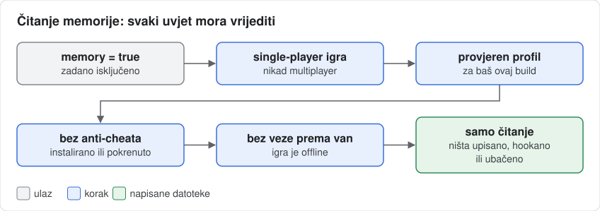

# Čitanje memorije {#reading-memory}

Neke single-player igre ne govore ništa drugim programima. Za njih watcher može - ako ga uključite i sam
napišete profil - potražiti gdje ste u memoriji igre, samo čitanjem.

Za single-player igre koje ne objavljuju ništa, watcher može čitati pozicije i vrijednosti iz
memorije igre, preko **profila** koji napišete za svoju verziju igre (build). Od svih izvora
ovo je jedini koji igra nije sama dala, pa je ograđen više od ostalih:

- **zadano je isključeno** (`python -m heat3d_watch config --set memory=true` ga uključuje);
- samo čita i nema način da piše;
- **uz alate se ne isporučuju profili.**

Profili se ne isporučuju jer je ofset ispravan samo za verziju na kojoj je nađen. Poslije patcha
profil koji je ranije bio ispravan čita smeće, a smeće izgleda baš kao brojevi. Profil se mora
provjeriti na verziji koju igrač ima, i to ga mora provjeriti taj igrač.

## Provjere, redom {#the-checks-in-order}



Svaka provjera ispod mora proći. Prve četiri rade se **prije** otvaranja igre, jer je otvaranje
zaštićene igre za čitanje upravo ono što anti-cheat primijeti, a odbijanje poslije bilo bi
prekasno.

1. **Postavka**: `memory` je tačno. Inače se memorijski adapteri nikad ne pokreću.
2. **Profil za igru**, čiji `exe` imenuje proces koji radi. Profil navodi može li se
   igra uopće igrati online (`"online"`); onaj koji ovo izostavlja se odbija.
3. **Nikakav anti-cheat u blizini**:
   - nijedna anti-cheat datoteka u folderu igre ili do tri foldera iznad njega (zaustavlja se na `common`
     folderu Steam biblioteke, ili na folderu u kojem je `steamapps`, jer iznad toga žive druge igre):
     `EasyAntiCheat`, `EasyAntiCheat_EOS_Setup.exe`, `start_protected_game.exe`, `BattlEye`,
     `BEClient_x64.dll`, `BEService_x64.exe`, `EAAntiCheat.GameServiceLauncher.exe`, `AntiCheatExpert`,
     `SGuard64.exe`, `GameGuard`, `GameMon.des`, `XIGNCODE`, `xhunter1.sys`, `Vanguard`, `FACEIT`
     (uspoređuje se malim slovima, također kao početak imena). Ako folder igre nije poznat, igra se
     odbija;
   - nijedan anti-cheat driver ili servis ne radi na računaru, kako ih navode
     `sc query type= driver state= active` i `sc query type= service state= active`: EasyAntiCheat,
     EasyAntiCheat_EOS, BEService, BEDaisy, vgk, vgc, ACE-BASE, ACE-GAME, xhunter1, FACEIT,
     FACEITService, EAAntiCheatService, Denuvo Anti-Cheat, npggsvc, Ricochet. Kernel anti-cheat
     instaliran za drugu igru i dalje nadzire svaki proces. Ako se servisi ne mogu navesti,
     igra se odbija.
4. **Ne online**: igra čiji profil kaže `"online": true` čita se samo dok nema veze ni s čim osim
   s ovim računarom (bilo koja udaljena adresa osim `127.x`, `::1`). Ako se njene veze
   ne mogu pročitati, odbija se.
5. Zatim, dok se adapter pokreće:
   - **tačna verzija (build)**: veličina izvršne datoteke, ili njen SHA-256, mora se poklapati s verzijom koju
     profil navodi. Nepoznata verzija se ne čita;
   - **moduli još jednom**: učitani moduli igre se navode (Toolhelp snapshot, koji ne traži
     nikakva vlastita prava pristupa) i provjeravaju na anti-cheat klijent (`BEClient_x64.dll`,
     `BEClient.dll`, `EasyAntiCheat_x64.dll`, `EasyAntiCheat.dll`, `EOSAntiCheat...`). Zaštićeni
     proces odbija snapshot, što je također odbijanje;
   - tek tada se proces otvara, s `PROCESS_VM_READ | PROCESS_QUERY_LIMITED_INFORMATION` i
     ničim drugim.

Provjere 1 do 4 ponavljaju se pri svakom pregledu (svake 2 s) dok igra radi. Ako jedna počne padati (igra
se spoji na server, pokrene se anti-cheat servis), adapter se zaustavlja pri sljedećem pregledu. Odbijanje
se zapisuje: `mem-<id>: not reading memory: <reason>`. Neuspjeh pri pokretanju (nepoznata verzija,
anti-cheat modul, obrazac nije nađen) zapisuje se kao `mem-<id>: could not start`, a adapter
se ne pokušava ponovo dok se igra opet ne pokrene.

Nema pisanja, nema alokacije u drugom procesu, nema niti pokrenute u njemu, nema biblioteke učitane u
njega, nema debug privilegije i nema podizanja prava. Test (`test_memory_reading_cannot_write` u
`tests/test_core.py`) pada ako se bilo koji poziv koji piše u drugi proces, alocira u njemu ili u njemu pokreće kod -
`WriteProcessMemory`, `VirtualAllocEx`, `CreateRemoteThread`, `PROCESS_VM_WRITE`, `SeDebugPrivilege`,
`LoadLibrary`, ... - pojavi igdje u paketu.

Nikad se ne čita, šta god profil kaže: igre koje se igraju online i igre čiji single-player način radi
pod anti-cheatom, kao GTA V, ili Elden Ring pokrenut preko svog launchera. Gornje provjere ih
ionako odbijaju.

## Format profila {#the-profile-format}

Profil je JSON datoteka u `<data>\profiles\` (`<data>` je folder s podacima, vidite
[Instalacija i pokretanje](installing-and-running.md#where-everything-is)), jedna po igri, bilo koje ime datoteke
koje završava na `.json`. Sintetički primjer:

```json
{
  "schema": "heat3d.memprofile/1",
  "id": "mygame",
  "game": "My Game",
  "exe": "MyGame.exe",
  "online": false,
  "versions": [ { "label": "1.06", "size": 123456789 } ],
  "anchors": {
    "World": { "aob": "48 8B 05 ?? ?? ?? ?? 48 85 C0", "rip": [3, 7] }
  },
  "values": {
    "pos": { "type": "vec3f", "base": "World", "chain": ["0x10", "0x68", "0x70"] },
    "hp":  { "type": "i32",   "base": "World", "chain": ["0x10", "0x138"] },
    "map": { "type": "u32",   "base": "World", "chain": ["0x10", "0x1C0"] }
  },
  "events": [
    { "event": "death", "value": "hp",  "when": "to_zero" },
    { "event": "zone",  "value": "map", "when": "change" }
  ],
  "axes": { "up": "y", "units": "metres" },
  "rate": 10,
  "provenance": [ { "source": "https://example.com/my-notes", "verified_on": "1.06" } ]
}
```

| Ključ | Obavezan | Šta je to |
|---|---|---|
| `schema` | da | tačno `heat3d.memprofile/1` |
| `id` | da | kratko i stabilno; adapter se zove `mem-<id>` |
| `game` | da | naziv igre, po kojem se zove folder sesije |
| `exe` | da | ime datoteke izvršne datoteke, koje također kaže da igra radi |
| `online` | da | `true` ako se igra uopće može igrati online; tada se čita samo dok je offline |
| `versions` | da | verzije (buildovi) na kojima je profil provjeren: svaka s `label`, i `size` (veličina izvršne datoteke u bajtima) i/ili `sha256`. Kad su date obje, moraju se poklapati obje. Unos bez ijedne ne poklapa ništa. |
| `anchors` | da | imenovane adrese u glavnom modulu. `aob`: bajtni obrazac, heksadecimalni bajtovi odvojeni razmacima, `?` ili `??` za bilo koji bajt; mora se pojaviti **tačno jednom** u slici modula (više poklapanja se računa kao neuspjeh, kao i nijedno). `rip: [d, n]`: obrazac pokazuje na instrukciju s 32-bitnim RIP-relativnim pomakom na bajtu `d` i dužine `n`; sidro postaje adresa na koju ta instrukcija upućuje. `offset`: dodaje se poslije (heksadecimalni ili decimalni tekst). Umjesto `aob`, `module_offset` daje stalan ofset od baze modula. |
| `values` | da | šta se čita pri svakom očitavanju: `type` (`i32`, `u32`, `i64`, `u64`, `u8`, `f32`, `f64`, `vec3f`, `vec3d`), `base` (ime sidra), `chain` (ofseti kao heksadecimalni ili decimalni tekst) |
| `events` | ne | pravila koja promjene pretvaraju u događaje: `when` je `change` (vrijednost se razlikuje od zadnjeg očitavanja) ili `to_zero` (broj pada s iznad 0 na 0 ili ispod) |
| `axes` | ne | `up` (zadano `y`), `units` (zadano `game units`), `scale` (skala jedinice preglednika, koja množi svaku poziciju; zadano 1, igrine vlastite jedinice) |
| `rate` | ne | očitavanja u sekundi, 1 do 60 (zadano 10) |
| `provenance` | ne | odakle ofseti dolaze i na kojoj verziji ste ih provjerili; kopira se u `meta.json` svake sesije |

**Kako se čita vrijednost.** Adresa sidra je početak. Ako je `chain` prazan, vrijednost se čita
odmah tamo. Inače se prvo čita pokazivač pohranjen na sidru. Zatim se, za svaki ofset osim
posljednjeg, čita pokazivač na `address + offset`. Posljednji ofset se dodaje da se dobije adresa vrijednosti.
Null pokazivač na putu (igra je između nivoa ili u meniju) ostavlja vrijednost praznom za to
očitavanje.

**Šta se snima.** Vrijednost po imenu `pos` (`vec3f` ili `vec3d`) postaje red `position` igrača
`me` pri svakom očitavanju. Svako pravilo događaja piše svoj red `event`, s novom vrijednošću i, gdje je `pos`
poznat, pozicijom, i dodaje 1 statistici istog imena. Slika modula se čita jednom pri pokretanju
da se nađu sidra, u blokovima od 64 KiB; blokovi koji se ne mogu pročitati računaju se kao nule. `meta.json`
sesije imenuje profil, oznaku verzije i provenance.

Profil koji se ne može koristiti (loš JSON, pogrešan `schema`, nedostaje obavezan ključ) preskače se
i zapisuje kao `profile <file> not used: <reason>`. Profili se učitavaju kad se watcher pokrene, zato ponovo pokrenite
`run` nakon dodavanja ili mijenjanja jednog.

## Pisanje i provjera profila {#writing-and-verifying-a-profile}

1. **Samo za single-player igru bez anti-cheata.** Ako igra ima anti-cheat, ili je igrate
   online, stanite ovdje: watcher će je odbiti, i treba.
2. **Nađite vrijednosti na vlastitoj verziji.** Radite offline. Koristite vlastite alate za debugiranje, ili objavljene bilješke
   o igri, da nađete igračevu poziciju i vrijednosti koje vas zanimaju, i put pokazivača do
   svake od statičnog mjesta u izvršnoj datoteci. Radije bajtni obrazac (`aob`) nego stalan
   `module_offset`: obrazac i dalje nalazi svoje mjesto kad se kod malo pomakne.
3. **Napravite obrazac jedinstvenim.** Mora se poklopiti tačno jednom u modulu. Zamijenite džokerima bajte koji
   se mijenjaju (adrese, pomaci) i zadržite dovoljno stalnih bajtova oko njih.
4. **Prikvačite verziju.** Stavite tačnu veličinu izvršne datoteke u `versions`; PowerShell
   `(Get-Item .\MyGame.exe).Length` je daje, a `Get-FileHash .\MyGame.exe -Algorithm SHA256` daje
   hash. Poslije patcha profil se jednostavno prestaje koristiti dok ga ponovo ne provjerite i dodate
   novu verziju.
5. **Recite ide li igra online** (`online`), iskreno.
6. **Probajte**: uključite čitanje (`config --set memory=true`), stavite datoteku u `<data>\profiles\` i
   provjerite da `python -m heat3d_watch games` navodi `mem-<id>`. Pokrenite igru i izvršite
   `python -m heat3d_watch run -v`. U `watcher.log` potražite `mem-<id>: starting`, ili razlog
   zašto je odbijen ili se nije mogao pokrenuti.
7. **Provjerite brojeve prema igri.** Dođite do poznatog mjesta i pogledajte redove `position` u
   `events.jsonl` sesije. Pomiču li se kako se vi pomičete, za pravu količinu, po pravim osama? Otvorite
   `heat.parquet` u pregledniku i provjerite da ruta odgovara tome kuda ste išli. Pokrenite svaki događaj
   (izgubi sve zdravlje, promijeni zonu) i provjerite da se pojavi jednom. Smeće izgleda kao brojevi, a samo
   ovo poređenje razlikuje jedno od drugog.
8. **Zapišite šta ste provjerili** u `provenance`: izvor ofseta i verziju na kojoj ste ih
   provjerili.

Tekst `verified` memorijskog adaptera, kako ga ispisuje `games`, uvijek je "by the profile's author, for the
builds it lists". Watcher ne može znati više od toga.
