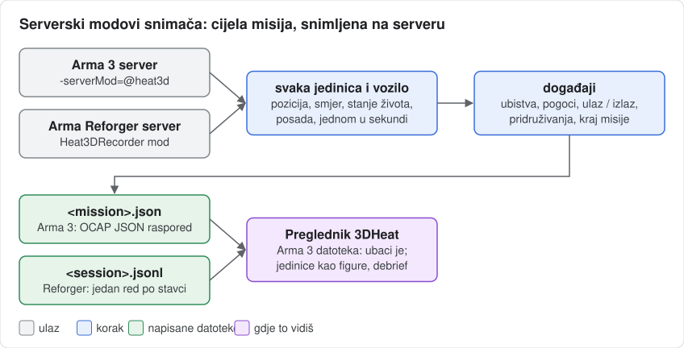

# Modovi za snimanje na serveru (Arma 3, Arma Reforger) {#server-recorder-mods-arma-3-arma-reforger}

Većinu igara watcher snima na igračevom vlastitom računaru. Arma je
drugačija: server može snimiti cijelu misiju - svaku jedinicu i vozilo, ne
samo vaše - modom koji radi na serveru. Igrači ne podešavaju ništa:
mod za Arma 3 je samo za server, a Reforger sam preuzima modove servera
igračima kad se pridruže (mod ništa ne radi na njihovim računarima). Repozitorij sadrži dva takva moda, u
[`mods/arma3`](https://github.com/Holdi601/3DHeat-Watcher/tree/main/mods/arma3)
i [`mods/reforger`](https://github.com/Holdi601/3DHeat-Watcher/tree/main/mods/reforger).
Njihovi README-ji su puna dokumentacija; ova stranica je pregled.

**Status: oba su neprovjerena u igri.** Ekstenzija za Arma 3 je izgrađena i
pokretana onako kako je Arma poziva, a 3DHeat je pročitao njen izlaz; njene
SQF skripte još nisu pokrenute u Armi 3. Mod za Reforger napisan je iz
Bohemijinog objavljenog API-ja za skripte i nikad nije kompajliran. Ne stavljajte nijedan
na javni server dok koraci za testiranje u njegovom README-u ne prođu.

## Arma 3 {#arma-3}

1. Izgradite ekstenziju jednom po platformi (`mods/arma3/extension`). Za to treba C kompajler: Visual
   Studio Build Tools na Windowsu, gcc na Linuxu; ako nikad niste ništa kompajlirali, pitajte svog
   hosta servera.
   - Windows, u "x64 Native Tools Command Prompt for VS":
     `cl /nologo /O2 /LD heat3d.c /Fe:heat3d_x64.dll`
   - Linux: `gcc -O2 -shared -fPIC -o heat3d_x64.so heat3d.c -ldl`
2. Izgradite mod: `python mods/arma3/build.py` piše `mods/arma3/@heat3d/`
   (Arma 3 Tools nisu potrebni).
3. Kopirajte `@heat3d` u folder servera i pokrenite server s
   `-serverMod=@heat3d`.
4. `.rpt` log servera kaže `Heat3D recorder 0.1.0: recording <file> every 1 s`.

| Postavka | Zadano | Šta radi |
|---|---|---|
| `captureDelay` | 1 | sekunde između frejmova |
| `recordHits` | 1 | 0 isključuje događaje pogodaka |
| `recordShots` | 1 | 0 isključuje brojanje hitaca |
| `minPlayers` | 0 | snima tek kad je toliko igrača na serveru |

Misija može nadjačati postavku u svom `init.sqf` (`heat3d_captureDelay = 0.5;`).
Snimci idu u `recordings/` unutar `@heat3d`, ili u `HEAT3D_DIR`.

**Izlaz:** jedna datoteka po misiji u OCAP-ovom JSON rasporedu (format
OCAP2 snimača), nazvana `<date>__<time>_<mission>.json`. Tokom misije je
to dnevnik (`.heat3d.part`), ispražnjen pri svakom upisu; dnevnik misije koja je pala
dovršava se sljedeći put kad se pokrene misija.

## Arma Reforger {#arma-reforger}

Mod (`Heat3DRecorder.gproj`) se otvara i gradi u Bohemijinom Workbenchu
(Arma Reforger Tools), testira na lokalnom dedicated serveru, objavljuje iz
Workbencha (nenavedeno dok se testira) i dodaje na listu `mods` u `config.json` servera -
korak po korak u njegovom README-u. Svake sekunde piše poziciju, smjer,
stanje života, vozilo i id igrača svakog lika, te poziciju, smjer,
stanje i posadu svakog vozila; i ubistva (ubica, oružje, udaljenost), pogotke, ulazak u vozilo
i izlazak, ulazak i izlazak igrača, te kraj misije.

**Izlaz:** jedan JSON objekt po liniji, `$profile:heat3d/<UTC date>_<UTC time>_<world>.jsonl`:
linija `header` (format `heat3d-reforger`, ose x istok, y gore, z sjever), zatim
linije `entity`, `frame` i `event` kako se dešavaju, i linija `end`. Redovi jedinica
su `[id, x, y, z, dir, alive, vehicleId, playerId]`, redovi vozila
`[id, x, y, z, dir, alive, [crew ids]]`; događaji slijede OCAP2-ov raspored događaja.

## U pregledniku {#in-the-viewer}

Ubacite snimak Arme 3 u [preglednik 3DHeat](https://holdi601.github.io/3DHeat/):
jedna misija je jedna sesija, jedinice postaju vojnici, vozila svoj tip, a
ubistva i pogodci idu na listu debrifinga. OCAP2-ov web player ga takođe reproducira. Datoteka
Reforgera je vlastiti linijski format moda, s OCAP2-ovim rasporedom događaja.
