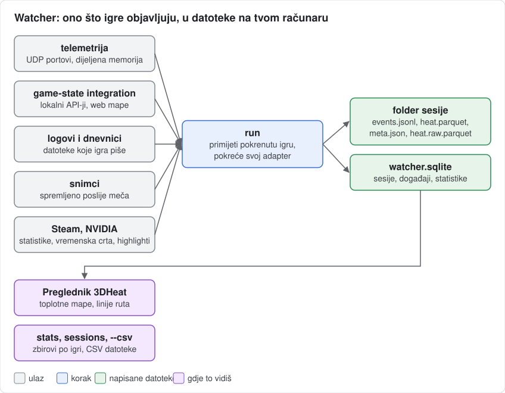

# Izvori i pravila {#sources-and-rules}

Watcher snima samo ono što igre i platforme daju igraču. Ova stranica objašnjava koje
izvore to pokriva, šta watcher smije raditi sa svakim, i koje igre ili dijelove igara namjerno
izostavlja.

## Šest vrsta izvora {#the-six-kinds-of-source}

Svaki adapter ima `kind`, a vrsta odlučuje šta adapter smije raditi:

| Vrsta | Šta je to | Multiplayer igre |
|---|---|---|
| `telemetry` | UDP port ili dijeljena memorija koju igra objavljuje za dashboarde, motion rigove i baze volana (Forza Data Out, F1 UDP, Kunosova i iRacing dijeljena memorija, SimConnect, X-Planeov UDP interfejs, SCS SDK plugin) | da - to je igrin vlastiti izlaz |
| `gsi` | game-state integracija ili lokalni web API koji igra služi igračevom vlastitom računaru (Valve GSI, Leagueov Live Client Data API, Rocket Leagueov Stats API, War Thunderova web mapa) | da, u granicama onoga što API pokazuje igraču |
| `log` | datoteke koje igra piše dok radi: dnevnici, logovi, statistike, spremanja (Elite Dangerous, Minecraft, Path of Exile, Hearthstone, Star Citizen, EVE Online) | da |
| `replay` | demoi i snimci koje igra sprema za svoje igrače, pretvoreni poslije meča (CS2, Dota 2, osu!, War Thunder, World of Tanks, World of Warships, Squad, League of Legends, VALORANT, IL-2 Tacview) | da, osim ako su šifrirani, i samo dijelovi koji su otvoreni |
| `platform` | ono što čuvaju Steam i grafički driver: statistike, postignuća, vremenske linije, klipovi i highlighti | da |
| `memory` | memorija igre, samo čitanje, po profilu koji ste vi napisali | **nikad** - samo single-player |

Samo `memory` otvara drugi proces, i to samo za čitanje. Ostalih pet vrsta čita ono što su igra,
Steam ili NVIDIA App već ispisali ili šalju.

## Kako se izvori čitaju {#how-the-sources-are-read}

- **Ništa se ne injektira, ne hookuje i ne mijenja u igri.** Nikakav kod se ne učitava u igru, nikakav prozor ili
  unos se ne hookuje, nijedna datoteka igre se ne patchira. Jedine datoteke koje watcher piše izvan svog foldera s podacima
  su one koje [`setup --apply`](commands.md#setup) piše kad to zatražite: igrina vlastita datoteka
  postavki (s originalom sačuvanim kao `<file>.heat3d-backup`), cfg datoteka game-statea, DCS hook skripta,
  BeamNG protokol mod.
- **Dijeljena memorija se otvara samo za čitanje i nikad se ne stvara.** Uobičajeni Pythonov način otvaranja imenovanog
  mapiranja stvara ga kad još ne postoji. Igra pokrenuta poslije toga našla bi watcherovo
  prazno mapiranje samo za čitanje umjesto da napravi vlastito, i njena telemetrija bi bila mrtva. Watcher
  otvara mapiranja samo s `OpenFileMappingW` (koji nalazi samo postojeće), mapira ih s
  `FILE_MAP_READ` i pokušava ponovo kasnije ako ih igra još nije napravila.
- **Portovi se posuđuju, nikad ne preuzimaju.** UDP telemetrijski port na kojem već sluša drugi program
  (FH Companion, SimHub, dashboard aplikacija) ostavlja se tom programu. Ako drugi program počne
  slušati na portu koji watcher drži, watcher ga pušta u roku od nekoliko sekundi. Forza
  adapteri čekaju 15 s nakon starta igre prije nego što uzmu port 5300 i prosljeđuju svaki paket nepromijenjen
  na 127.0.0.1:5301, pa druga Data Out aplikacija i dalje može snimati.
- **Samo lokalno.** Game-state serveri koje watcher pokreće (CS2, Dota 2) slušaju na 127.0.0.1 i nigdje
  drugdje. Kad cfg datoteka igre drži token (onaj koji `setup` piše ga ima), svaki post mora ga nositi;
  postovi bez njega broje se kao `bad_auth` i odbacuju. Bez cfg datoteke s tokenom prihvata se svaki
  lokalni post, a log to kaže. Lokalni API-ji koje pita (League na portu 2999, War Thunder na
  8111, Rocket League na 49123, X-Plane na 49000) su na 127.0.0.1.
- **Log datoteke se dijele, nikad ne zaključavaju.** Svako čitanje otvara datoteku sa svim share zastavicama koje Windows ima
  i opet je zatvara, pa igra može nastaviti pisati, preimenovati ili zamijeniti svoj log.
- **Dvije vanjske usluge, i samo u ovim slučajevima.** Provjera izdanja pita GitHub
  (`api.github.com`) najviše svakih šest sati i može se isključiti (vidite [Ažuriranja](updates.md)).
  Adapter snimaka League of Legends pita Riotov Match-V5 API samo kad ste unijeli vlastiti `riot_api_key`.
  Ništa drugo se nigdje ne šalje.
- **Uključivanje izvora je vaša odluka.** `setup` bez `--apply` samo kaže šta bi
  promijenio.

## Multiplayer pravila {#multiplayer-rules}

- Igra koja se igra online snima se samo kroz ono što objavljuje: telemetriju, game-state API-je, logove,
  snimke, datoteke platforme. U tim granicama watcher snima ono što igra pokazuje igraču, i
  ništa izračunato preko toga:
  - **CS2 game-state integracija** šalje igrača koji se gleda (vi sami dok ste živi, saigrač
    nakon smrti). Pozicije drugih igrača (`allplayers_*`) šalju se samo gledaocima i GOTV-u, pa
    ih watcher ne traži.
  - **Leagueov Live Client Data API** nema pozicija. Riotova politika dopušta alatima da prikažu
    ono što igrač može znati iz same igre, i ništa izračunato preko toga (nema tajmera neprijatelja).
    Watcher snima kill feed i tabelu rezultata koje igrač vidi, i igračeve vlastite brojeve.
  - **Rocket Leagueov Stats API** nema pozicija automobila (stanje automobila šalje se samo gledaocima). Ono što
    ima mjesto je lopta, gdje je udarena, dala gol ili udarila u prečku.
  - **War Thunderova web mapa** pokazuje ono što pokazuje minimapa, bez imena i id-ova.
  - **F1 23/24/25** stavljaju poziciju svakog automobila u svoj Motion paket, i online. Igra to
    sama daje, i zadržava samo podatke igrača kojima je "Your Telemetry" ograničen.
  - **DCS World**: multiplayer server može zabraniti izvoz podataka vlastite letjelice; sesija
    tada ima događaje, ali ne i pozicije, i to kaže.
- **Memorija se nikad ne čita u multiplayer igri.** Memory adapter za igru označenu kao igranu online
  se odbija, a profil mora navesti može li se njegova igra uopće igrati online. Single-player
  igra koja ima i online način čita se samo dok nema veze ni s čim osim s ovim
  računarom. Igre čiji single-player način radi pod anti-cheatom također se nikad ne čitaju. Vidite
  [Čitanje memorije](memory-reading.md).
- Zastavica `multiplayer` na adapteru (prikazana kao "Online igra" u `games --markdown`) odlučuje samo
  o čitanju memorije. Ne sprečava ostale vrste da snimaju online igru.

## Šta se odbija i zašto {#what-is-declined-and-why}

Neke igre, i neki dijelovi igara, ne snimaju se jer bi jedini način da se dobiju prekršio
zaštitu ili uvjete igre:

| Igra | Šta je izostavljeno | Zašto |
|---|---|---|
| VALORANT | pozicije, imena, rezultati u snimcima; lockfile endpointi klijenta | Tok igre u snimku je obfusciran vrijednostima uzetim iz izvršne datoteke svakog builda. Njihovo vraćanje znači reverzni inženjering igre, što Riotovi uvjeti korištenja zabranjuju (odjeljci 3.1 i 7.1), a igra radi pod Vanguardom. Lockfile endpointi Riot klijenta nisu objavljeni API. **Čita se:** ono što snimak nosi otvoreno - mapa, id meča, agenti, serverska vremenska linija ubistava i rundi. |
| League of Legends | dio `.rofl` snimaka trenutak po trenutak; lockfile endpointi klijenta | Obfusciran protiv varanja, drugačije svakog patcha; njegovo dekodiranje znači rastavljanje igre, što Riotovi uvjeti zabranjuju. **Čita se:** tabela rezultata kraja igre koju svaki snimak nosi kao običan JSON, Live Client Data API tokom meča i - s vašim vlastitim developerskim ključem - službena Match-V5 vremenska linija (pozicije jednom u minuti, ubistva gdje su se desila). |
| Fortnite | snimci | Šifrirani, a Epicovi uvjeti zabranjuju njihov reverzni inženjering. |
| World of Tanks, World of Warships | snimci, u watcheru | Šifrirani, ključem koji igra nosi i koji su alati zajednice godinama objavljivali. Watcher ih ne čita; odvojeni konverteri izvan njega čitaju (`exporters/ext/wot-replay`, `exporters/ext/wows-replay`), pa se problem s Wargaming uvjetima - njegova licenca zabranjuje reverzni inženjering (5.3 b) i neovlašteni softver koji komunicira s njegovim proizvodima (12.1 k) - tiče samo njih. **Čita se, uz instaliran konverter:** pozicija svakog vozila ili broda dok je za njega znao klijent koji snima, i ubistva. |
| Gran Turismo 7 | telemetrija | Samo konzola, a njena telemetrija je šifrirana ključem izvučenim iz igre. |
| Apex Legends | sve | Njegov LiveAPI šalje pune događaje samo u privatnim i custom lobijima; inače lokalno nije dostupno ništa. |
| Overwatch 2, Call of Duty, Battlefield 6, Hunt: Showdown 1896 | podaci uživo | Nema lokalnog snimka, loga ni game-state izlaza za čitanje. Njihove statistike dolaze odatle gdje ih čuva Steam ([Steam statistike](game-steam-stats.md), [Steam Timeline](game-steam-timeline.md)), a klipovi kao [NVIDIA highlights](nvidia-highlights.md). |
| Star Citizen | sve osim `Game.log` | Radi s Easy Anti-Cheat; watcher čita samo log datoteku koju igra piše i nikad se ne približava procesu igre. |
| osu!lazer | snimci | Čuvaju se u igrinom vlastitom spremištu; čitaju se samo osu! (stable) `.osr` datoteke. |
| Bilo koja multiplayer igra | memorija | Nikad. Single-player igre čiji način radi pod anti-cheatom (GTA V, Elden Ring preko svog launchera) također se ne čitaju. |

Šifrirani snimci se ne otvaraju: VALORANT čitač provjerava zastavicu šifriranja snimka i
odbija šifriranu datoteku ("this replay is encrypted; it is not read").

Igre istražene, ali još ne izgrađene (Deadlock snimci, Rocket League `.replay` datoteke,
StarCraft II, Team Fortress 2, Rainbow Six Siege, Beat Saber, Trackmania, nekoliko trkaćih simulatora)
navedene su sa svojim izvorima u [Sve igre u jednoj tabeli](watcher.md#researched-not-yet-built). Svaka
treba uzorke datoteka naspram kojih se provjerava prije isporuke.
