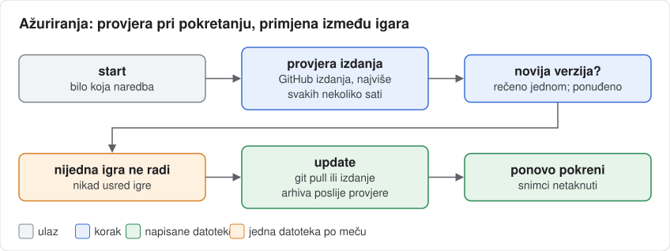

# Ažuriranja {#updates}

Watcher se sam održava aktuelnim iz izdanja repozitorija
[Holdi601/3DHeat-Watcher](https://github.com/Holdi601/3DHeat-Watcher/releases). Updater je
paket `heat3d_update` pored `heat3d_watch` u repozitoriju.

## Provjera {#the-check}

- **Kada**: svaka komanda osim `update` provjerava pri pokretanju. `run` provjerava i dok radi,
  najviše jednom na sat i samo dok nijedna igra ne radi.
- **Kako**: jedan HTTPS zahtjev na `https://api.github.com/repos/Holdi601/3DHeat-Watcher/releases/latest`,
  s istekom od 5 sekundi. Odgovor se kešira šest sati u
  `%LOCALAPPDATA%\3DHeat\update-check-3DHeat-Watcher.json`, pa većina pokretanja ništa ne pita. "Još nema
  izdanja" (HTTP 404) se kešira kao odgovor. Offline, uz ograničenje broja zahtjeva ili iza proxyja, provjera tiho
  ne uspije i komanda nastavlja s verzijom koju ima.
- **Verzije**: instalirana verzija je datoteka `VERSION` u folderu repozitorija.
  Oznaka izdanja (`v1.2.0` ili `1.2.0`) uspoređuje se kao brojevi, dio po dio; sve
  poslije `-` ili `+` se ignorira.
- **Isključeno**: `HEAT3D_NO_UPDATE=1` (bilo koja vrijednost osim praznog, `0`, `false` ili `no`) isključuje i
  provjeru i automatsko ažuriranje. Svaki 3DHeat alat ima svoju keš datoteku, pa odgovor jednog alata nikad
  ne zamjenjuje odgovor drugog.

## Šta se dešava kad izađe novije izdanje {#what-happens-when-a-newer-release-is-out}

- **`run`** ispiše obavijest pri pokretanju i nastavi raditi:
  `[heat3d_watch] 3DHeat Watcher 1.2.0 is out (this is 1.0.2). <release page>`. Dok radi,
  uz uključen `auto_update` (zadano) i bez pokrenute igre, zatim sam sebe ažurira: linija loga
  `3DHeat Watcher 1.2.0 is out (this is 1.0.2); updating`, Windows obavijest "Updating to 1.2.0",
  ažuriranje, zaustavljanje svakog adaptera i zatvaranje njegovih sesija, te ista komanda pokrenuta ponovo na
  novom kodu. Watcher se nikad ne ažurira usred igre. Ako se ažuriranje
  ne može primijeniti, obavijest to kaže ("1.2.0 is out; not updated: ...") i watcher nastavlja
  raditi sa starom verzijom. Uz isključen `auto_update` postoji samo obavijest.
- **Ostale komande** pitaju `Update now? [Y/n]` kad rade u terminalu. Enter, `y`, `yes`, `j` ili
  `ja` ažurira, pa ponovo pokrene istu komandu na novoj verziji. Bez terminala (zakazano
  pokretanje, pipe), ispišu kako se ažurira i nastave dalje.
- **Na zahtjev**: `python -m heat3d_watch update` (ili `python -m heat3d_update`) pita GitHub bez
  keša i ažurira. `--check` samo kaže izlazi li novije izdanje. Ovo radi i uz postavljen
  `HEAT3D_NO_UPDATE`.

## Kako se ažuriranje primjenjuje {#how-an-update-is-applied}

Zavisi od toga kako je kopija instalirana:

- **Git klon** (folder ima `.git` i `git` je na PATH-u): `git pull --ff-only`. Ovo se odbija
  dok klon ima promjene u praćenim datotekama (`git status --porcelain --untracked-files=no` nije
  prazan): te promjene su nečiji rad, a ažuriranje ne odlučuje šta će biti s njima. Commitajte
  ih ili ih stashajte, pa povucite.
- **Preuzeta kopija**: izvorna arhiva izdanja se preuzme i raspakira u privremeni
  folder. Unosi koji bi završili izvan njega se preskaču. `VERSION` arhive mora biti verzija
  koju izdanje tvrdi, inače se ništa ne kopira. Zatim se njene datoteke kopiraju preko foldera repozitorija.
  Datoteke koje nisu dio izdanja - snimci, postavke, virtualna okruženja, izvozi, sve što ste
  sami napravili - ne diraju se. Python modul koji je starije izdanje imalo, a novo ga je izbacilo, uklanja se
  iz vlastitih paketa izdanja (`heat3d_watch`, `heat3d_update`), pa se nijedan zastarjeli adapter
  modul ne učitava poslije ažuriranja; ništa izvan tih paketa se ne uklanja.

Snimci i postavke ionako obično žive izvan foldera repozitorija
(`%LOCALAPPDATA%\3DHeat\Watcher`), pa ih ažuriranje nikad ne dotiče.

Poslije ažuriranja ista komanda se pokreće ponovo. Na Windowsu watcher pokreće novi proces,
čeka ga i prosljeđuje njegov izlazni kod, pa se konzola ponaša kao da je prvi proces
obavio posao.
