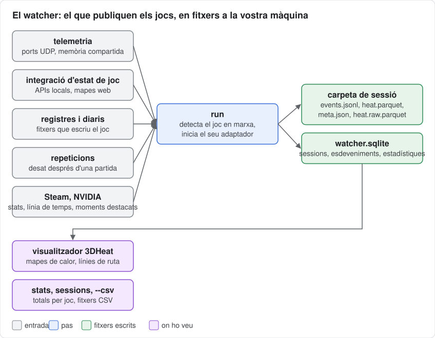

# 3DHeat Watcher {#dheat-watcher}

**Què és?** Tu jugues a un joc. Aquest programa anota en silenci on has anat i què ha passat.
Més tard, pot veure-ho com un mapa de colors al visualitzador de 3DHeat.

**Per a què el faria servir?** Per tenir el seu propi registre de cada sessió (on has conduït, volat o
lluitat, els teus totals per joc) sense cap pàgina web i sense canviar el joc.

**Exemple:** condueix una volta en un joc de carreres amb el watcher en marxa; després, un fitxer a
`sessions\<joc>\` conté la línia que has seguit, i el visualitzador la dibuixa.

Amb més detall: 3DHeat Watcher és un programa en segon pla que registra el que publiquen els jocs sobre la teva partida
—on has anat, què ha passat en cada lloc, i les xifres que hi ha darrere— en fitxers a la teva
pròpia màquina. Els fitxers són per a les teves estadístiques i per als mapes de calor i les línies de
ruta del visualitzador de 3DHeat.

Funciona en silenci, detecta quin joc has obert, i llegeix les sortides pròpies d'aquest joc: un port de
telemetria o una memòria compartida que el joc publica per als tauler de control, una integració d'estat de
joc, el diari o el registre que escriu el joc, la repetició que desa després d'una partida, les estadístiques
que guarda Steam, els clips que desa l'NVIDIA App. Les gravacions es queden a la teva màquina. El programa
només es comunica amb dos serveis externs, i només en aquests casos: GitHub, per buscar una versió més nova
(mira [Actualitzacions](../updates.md)), i l'API Match-V5 de Riot, i només si introduïu la teva pròpia clau
d'API de Riot (mira [Repeticions de League of Legends](../game-lol-replays.md)).



## Què registra {#what-it-records}

- **Posicions**: el cotxe, l'avió, l'heroi o el jugador, diverses vegades per segon quan el joc les publica,
  amb velocitat, rumb i tot el que el joc n'envia alhora.
- **Esdeveniments**: aparicions, morts, baixes, voltes, etapes, rondes, gols, feines, enlairaments i aterratges,
  canvis de zona, assoliments, moments destacats. Cada esdeveniment s'emmagatzema amb el seu temps, i amb el seu
  lloc quan el joc el dona.
- **Estadístiques per sessió**: baixes, morts, voltes, millor volta, distància, velocitat màxima, temps de joc, i
  les estadístiques pròpies del joc quan les guarda.

El que dona cada joc, i d'on, és a la seva pròpia pàgina dins de [Jocs](../games.md). Una sola font no pot
registrar-ho tot: els jocs multijugador només es registren mitjançant el que publiquen, i el watcher
mai no llegeix la seva memòria (mira [Fonts i regles](../sources-and-rules.md)).

## Instal·lació {#install}

Si ets nou amb la línia d'ordres, llegeix primer [Abans de començar](before-you-start.md).

El watcher és un programa de Python per a Windows (Python 3.10 o posterior). Moltes de les seves fonts només
existeixen a Windows: la memòria compartida, el registre, les notificacions de Windows.

```bash
git clone https://github.com/Holdi601/3DHeat-Watcher.git
cd 3DHeat-Watcher
pip install -r requirements.txt
```

Un arxiu de versió descarregat funciona de la mateixa manera: descomprimeix'l, i després executa
`pip install -r requirements.txt` dins de la carpeta. Els detalls, i els extres que necessiten alguns jocs,
són a [Instal·lar i executar](../installing-and-running.md).

## Inici ràpid {#quick-start}

```bash
python -m heat3d_watch games            # què dona cada joc, i d'on
python -m heat3d_watch setup all        # què caldria activar (no es canvia res)
python -m heat3d_watch setup f1-25 --apply   # activar la sortida d'un joc (l'arxiu original es guarda com a còpia)
python -m heat3d_watch run              # vigilar; deixa-ho en marxa mentre juga
python -m heat3d_watch stats            # totals per joc
python -m heat3d_watch stats --csv out  # sessions, esdeveniments i estadístiques en fitxers CSV
```

Hauries de veure: després de `games`, una taula amb una línia per joc; `run` continua fins que prem
Ctrl+C o tanca la finestra.

Tot s'escriu a `%LOCALAPPDATA%\3DHeat\Watcher`. Per usar una altra carpeta, definiu la variable d'entorn
`HEAT3D_WATCH_HOME` o executa `python -m heat3d_watch config --set data=D:\somewhere`.

- `sessions\<joc>\<data>_<adaptador>\` - una carpeta per sessió, que conté `events.jsonl` (cada esdeveniment
  en el moment en què passa), `heat.parquet` (les files amb una posició, a punt per al visualitzador de 3DHeat) i
  `meta.json` (joc, font, eixos, recomptes, estadístiques)
- `watcher.sqlite` - les estadístiques de cada sessió, en tres taules senzilles
- `watcher.log` - què ha fet el watcher

El visualitzador obre directament el `heat.parquet` d'una sessió, sense cap configuració (els seus eixos i
unitats són al fitxer). Les repeticions convertides s'escriuen com a taules i documents de partida al costat;
el format propi del visualitzador d'un fitxer per partida es descriu a la seva pàgina de
[contenidor `.3dheat`](https://holdi601.github.io/3DHeat/container.html), i les columnes de cada taula a
[Les dades](../the-data.md).

## La documentació {#the-documentation}

| Pàgina | Què cobreix |
|---|---|
| [Abans de començar](before-you-start.md) | Python, una terminal, marcadors de posició, com es veuen l'èxit i els errors habituals |
| [Instal·lar i executar](../installing-and-running.md) | requisits, execució en segon pla, arrencada amb Windows, el fitxer de bloqueig, el registre, cada configuració i variable d'entorn |
| [Jocs](../games.md) | una pàgina per joc: què es registra, d'on, com activar-ho, com funciona, eixos, estadístiques, què s'ha comprovat |
| [Les dades](../the-data.md) | carpetes de sessió, `events.jsonl`, `heat.parquet` i el seu peu, `meta.json`, `watcher.sqlite`, recuperació després d'un error, exportació CSV, obertura d'una sessió al visualitzador de 3DHeat |
| [Ordres](../commands.md) | cada ordre i opció de `python -m heat3d_watch` |
| [Fonts i regles](../sources-and-rules.md) | els sis tipus de font, les regles multijugador, quins jocs queden fora i per què |
| [NVIDIA Highlights](../nvidia-highlights.md) | què poden i què no poden lliurar NVIDIA Highlights, i com un moment destacat obté una posició |
| [Mods de servidor enregistrador](../server-mods.md) | els mods de servidor d'Arma 3 i Arma Reforger que graven missions senceres per al visualitzador |
| [Llegir la memòria](../memory-reading.md) | perfils de memòria d'un jugador: el format, les comprovacions, com escriure'n i verificar-ne un |
| [Actualitzacions](../updates.md) | com busca el watcher versions noves i s'actualitza ell mateix |
| [Desenvolupament](../development.md) | escriure un adaptador: l'API, les proves, un `verified` honest, regenerar les pàgines de jocs |
| [Tots els jocs en una taula](../watcher.md) | cada joc en una sola taula, tal com l'imprimeix `games --markdown`, més els jocs investigats però encara no construïts |
| [Referència de l'ordre](../cli-reference.md) | el `--help` de cada ordre, generat a partir del codi |
| [Manteniment](../maintaining.md) | la llista de comprovació de publicació d'aquestes pàgines |

## Part de 3DHeat {#part-of-3dheat}

3DHeat Watcher és una de les eines lliures que envolten el visualitzador de 3DHeat (el watcher fa servir 3DHeat CS2
per convertir les demos de CS2). Cada una és un projecte propi, amb les seves versions i la seva llicència:

| Eina | Què fa | Documentació |
|---|---|---|
| [3DHeat](https://github.com/Holdi601/3DHeat) | el visualitzador: mapes de calor, anàlisi de curses i revisió de partides en 3D | [lloc](https://holdi601.github.io/3DHeat/) |
| [GameFiles](https://github.com/Holdi601/3DHeat-GameFiles) | circuits i nivells dels fitxers que envien els jocs, com a models 3D | [lloc](https://holdi601.github.io/3DHeat-GameFiles/) |
| [GameCapture](https://github.com/Holdi601/3DHeat-GameCapture) | telemetria de voltes de jocs de carreres; nivells reconstruïts a partir de vídeo de joc | [lloc](https://holdi601.github.io/3DHeat-GameCapture/) |
| [Unreal Exporter](https://github.com/Holdi601/3DHeat-UnrealExporter) | un connector per a l'editor d'Unreal que exporta un nivell com un model 3D | [lloc](https://holdi601.github.io/3DHeat-UnrealExporter/) |
| [CS2](https://github.com/Holdi601/3DHeat-CS2) | demos de Counter-Strike 2 en taules i documents de partida; mapes en models 3D | [lloc](https://holdi601.github.io/3DHeat-CS2/) |
| [Watcher](https://github.com/Holdi601/3DHeat-Watcher) | registra el que publiquen els jocs sobre la teva partida, en segon pla | [lloc](https://holdi601.github.io/3DHeat-Watcher/) |
| [Ext-WarThunder](https://github.com/Holdi601/3DHeat-Ext-WarThunder) | repeticions de War Thunder en taules i documents de partida | [lloc](https://holdi601.github.io/3DHeat-Ext-WarThunder/) |
| [Ext-WoT](https://github.com/Holdi601/3DHeat-Ext-WoT) | repeticions de World of Tanks en taules i documents de partida | [lloc](https://holdi601.github.io/3DHeat-Ext-WoT/) |
| [Ext-WoWs](https://github.com/Holdi601/3DHeat-Ext-WoWs) | repeticions de World of Warships en taules i documents de partida | [lloc](https://holdi601.github.io/3DHeat-Ext-WoWs/) |
| [Ext-Squad](https://github.com/Holdi601/3DHeat-Ext-Squad) | demos de servidors de Squad en taules i documents de partida | [lloc](https://holdi601.github.io/3DHeat-Ext-Squad/) |
| [Ext-DCS](https://github.com/Holdi601/3DHeat-Ext-DCS) | mapes de DCS World en models 3D | [lloc](https://holdi601.github.io/3DHeat-Ext-DCS/) |
| [Ext-IL2](https://github.com/Holdi601/3DHeat-Ext-IL2) | mapes d'IL-2 Sturmovik en models 3D | [lloc](https://holdi601.github.io/3DHeat-Ext-IL2/) |

Llicència: MIT ([LICENSE](https://github.com/Holdi601/3DHeat-Watcher/blob/main/LICENSE)). Les llicències
dels paquets de tercers que fa servir, i el que exigeixen els jocs que llegeix, figuren a
[LICENSES.md](https://github.com/Holdi601/3DHeat-Watcher/blob/main/LICENSES.md).
