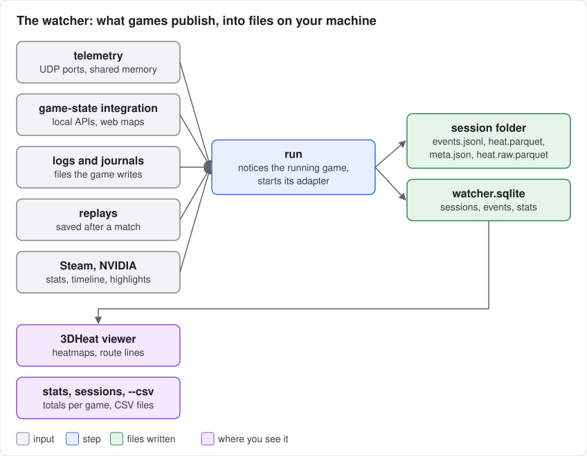
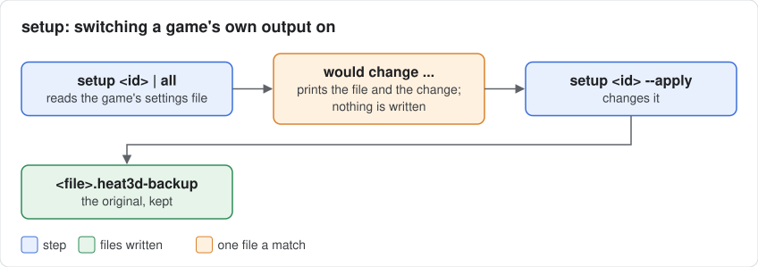
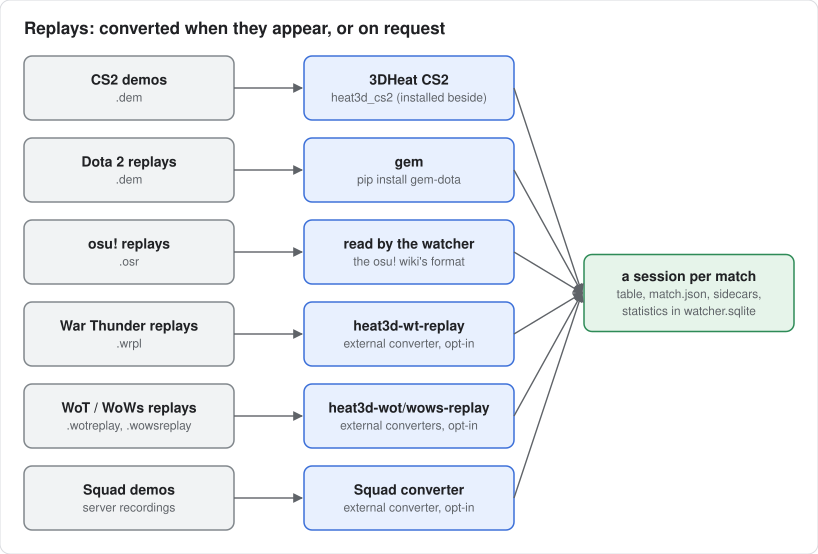
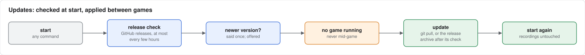

# Commands

New to the command line? Read [Before you start](before-you-start.md) first. Every command is typed
in a terminal opened in the folder you unpacked or cloned (in File Explorer, type `powershell` in the
address bar), as

```bash
python -m heat3d_watch <command> [options]
```


| Command | What it does |
|---|---|
| [`run`](#run) | watch in the background and record every game that runs |
| [`games`](#games) | what each game gives and from where |
| [`setup`](#setup) | switch a game's own output on |
| [`status`](#status) | which games are running now, and which adapters would run |
| [`sessions`](#sessions) | the recordings so far |
| [`stats`](#stats) | totals per game, or the tables as CSV |
| [`table`](#table) | rebuild a session's `heat.parquet` from its `events.jsonl` |
| [`replays`](#replays) | convert the replays already on disk |
| [`dota-replay`](#dota-replay) | download a public Dota 2 match's replay by its id |
| [`dota-map`](#dota-map) | the Dota 2 map from your install as a 3D level, by the separate 3DHeat Dota tool |
| [`update`](#update) | update to the newest release |
| [`config`](#config) | show or change the settings |

Options for every command: `-h` / `--help` prints the help, and `python -m heat3d_watch --version`
prints the version (the `VERSION` file).

The pictures on this page are runs on synthetic example sessions (`Example Racer`, `Example Arena`),
not real recordings.

Every command except `update` first looks for a newer release (at most every six hours; skipped with
`HEAT3D_NO_UPDATE=1`, see [Updates](updates.md)). `run` only prints a notice. The other commands ask
`Update now? [Y/n]` when they run in a terminal, and print how to update when they do not. Output is
UTF-8, so game names in any script print in any console.

## run

```bash
python -m heat3d_watch run [--once] [-v]
```



Watches until stopped (Ctrl+C): every `scan_seconds` it reads the process list and runs an adapter for
each game it finds, plus the always-on adapters. Before the first look it finishes the sessions an
earlier run left open. While no game runs, it looks for a newer release and announces it; it installs it only when automatic updates were chosen (`--auto-update`, the window's *Update automatically*, or `HEAT3D_AUTO_UPDATE=1`). `stop` asks a running watcher to end cleanly, `open` opens the sessions folder. The details
are in [Installing and running](installing-and-running.md#running).

| Option | Effect |
|---|---|
| `--once` | one look at the running games, then exit. The adapters for the games running now (and the always-on ones) are started, each polls once (at most 10 seconds are waited for that), and then all are stopped the way a game ending stops them: their sessions are closed, written and counted. For checking detection, not for recording. |
| `-v`, `--verbose` | debug lines in `watcher.log` and on the console |

`run` writes `<data>\watcher.lock` and refuses to start a second time for the same data folder (exit
code 1); see [The lock file](installing-and-running.md#the-lock-file).

## games

```bash
python -m heat3d_watch games [--markdown]
```


Lists every adapter sorted by game: its name, id and kind, where it reads from, what it records, and
how to switch it on. An adapter that cannot run on this machine is marked
`[unavailable: <why>]` - SimConnect.dll not found, no Minecraft folder, 3DHeat CS2 not installed,
Steam or the NVIDIA App not found. An adapter module that failed to import is named at the end with the
error.

```text
EA SPORTS F1 25  (f1-25, telemetry)
    from: UDP telemetry 127.0.0.1:20777 (Documents\My Games\F1 25\hardwaresettings\hardware_settings_config.xml)
    - every car's position (world XYZ, m) at 10 Hz, by driver name, team, own car marked, ...
    switch on: In the game: Settings > Telemetry Settings > UDP Telemetry On, IP 127.0.0.1, port 20777 - ...
```

`--markdown` prints the same as one Markdown table (game, what is recorded, from where, to switch it
on, online play, checked). The table in [All games in one table](watcher.md) is that output. The cells
are escaped for Markdown: text in backticks stays a code span, and outside them `<`, `>`, `&`, `*`, `|`
and a backslash before punctuation are written so they show as typed (`<CS2>` would otherwise vanish as
an HTML tag in kramdown). The one piece of HTML is the `<br>` between the items of "What is recorded".

## setup

```bash
python -m heat3d_watch setup <adapter id | all> [--apply]
```




Switches a game's own output on, where the game needs a file changed for it. Without `--apply`
nothing is changed: each line says what would change, and when there is anything to change the last
line says `Nothing was changed. Run again with --apply to make these changes.` When there is nothing to
change it says `<id>: nothing to change` (`Nothing to change.` for `all`). With `--apply` the changes are
made, and before a file is changed for the first time its original is saved as
`<file>.heat3d-backup`. A backup that already exists is never overwritten, so it always holds the
file as it was before the watcher first touched it.

```text
f1-25: would change: hardware_settings_config.xml <udp>: enabled="false" -> "true"
Nothing was changed. Run again with --apply to make these changes.
```

`all` runs the setup of every adapter that has one. An adapter without one, named on its own, prints
`<id>: nothing for setup to change; ` followed by how the game is switched on (its `enable` text, or
that it needs nothing). An unknown id prints `no adapter '<id>'; games lists them` and exits with code
2. The adapters that have something to set up:

| Adapter | What `--apply` changes |
|---|---|
| `beamng` | installs the `heat3d` protocol mod into BeamNG's user `mods` folder (only when it is not there); then switch Options > Other > Protocols > "others" on in the game |
| `cs2-gsi` | writes `<CS2>\game\csgo\cfg\gamestate_integration_heat3d.cfg`: send the game state to `http://127.0.0.1:3311/` with a random token the watcher then requires (a token already in the file is kept); CS2 reads it when it starts |
| `dota2-gsi` | the same for Dota 2: `<Dota>\game\dota\cfg\gamestate_integration\gamestate_integration_heat3d.cfg`, port 3312 |
| `dcs` | adds `Scripts\Hooks\heat3d-watch.lua` to every `%USERPROFILE%\Saved Games\DCS*` folder. Its own older copy is updated; a file of that name the watcher did not write is left alone. Restart DCS. |
| `dirt-rally-2` | `hardware_settings_config.xml`: `<udp enabled="true" extradata="3" ip="127.0.0.1" port="20777">`; start the game once first so the file exists |
| `ea-wrc` | `Documents\My Games\WRC\telemetry\config.json`: the `wrc` structure's `session_update` packet on, to this machine |
| `f1-23`, `f1-24`, `f1-25` | `hardware_settings_config.xml`: `<udp enabled="true" ip="127.0.0.1" port="20777">`; the game must be closed |
| `hearthstone` | adds a `[Power]` section (`LogLevel=1`, `FilePrinting=true`) to `%LOCALAPPDATA%\Blizzard\Hearthstone\log.config`; restart the game |
| `il2` | `<game>\data\startup.cfg`, `[KEY = telemetrydevice]`: one more target `addrN = "127.0.0.1:41995"` and `enable = true` (the section is added, at 10 Hz, when there is none); restart IL-2 |
| `il2-tacview` | `<game>\data\startup.cfg`, `[KEY = track_record]`: `tacviewrecord = 1` |
| `rocketleague-stats` | `TAStatsAPI.ini` (or `DefaultStatsAPI.ini` when that does not exist) in `<RL>\TAGame\Config`: `PacketSendRate=30` when the API is off, and `Port` when none is set; read when Rocket League starts |

`richard-burns-rally` has no setup: its telemetry is the RSF/NGP plugin's, switched on by hand in
`RichardBurnsRally.ini` (see [its page](game-richard-burns-rally.md)); `setup richard-burns-rally` says
so. Every other game either needs nothing or is switched on in the game; each game's page says how.

## status

```bash
python -m heat3d_watch status
```

```text
3DHeat Watcher 1.0.2; data in C:\Users\...\AppData\Local\3DHeat\Watcher
Games running: EA SPORTS F1 25 (f1-25)
Always on: il2-tacview, steam-stats, steam-timeline, nvidia-highlights, cs2-demos, lol-replays, valorant-replays
```

Says which adapters a `run` would start now, by the same rules: the game's process is running, the
adapter is not in `disabled`, nothing it needs is missing, replay adapters only with `replays` on, memory
adapters only with `memory` on and every memory check passed. It does not start anything.

## sessions

```bash
python -m heat3d_watch sessions [--game NAME] [--limit N]
```


The newest sessions from `watcher.sqlite`, one line each: start (local time), game, minutes, events,
positions, folder.

| Option | Effect |
|---|---|
| `--game NAME` | only this game, by its exact name as in the list (`"EA SPORTS F1 25"`) |
| `--limit N` | at most N sessions (default 40) |

## stats

```bash
python -m heat3d_watch stats [--game NAME] [--csv DIR]
```


Without options: a table of every game (sessions, hours, events, positions, last played), most played
first, then for each game its 25 most frequent events and every numeric statistic with the number of
sessions that have it, the total, the best value (`best`) and the average. `best` knows which way is
better: the lowest value for the times kept as a best (`best_lap`, `best_stage` and any other key that
starts with `best_`) and for places (`race_position`, `grid_position`, any key ending in `_position`),
the highest for everything else (kills, distance, top speed, a game's own counters).

| Option | Effect |
|---|---|
| `--game NAME` | only this game's events and statistics, without the overview |
| `--csv DIR` | write `sessions.csv`, `events.csv` and `stats.csv` (every row of the three tables) to `DIR` instead; `--game` does not narrow it |

## table

```bash
python -m heat3d_watch table <session folder>
```


Rebuilds `heat.parquet` in a session folder from its `events.jsonl`, with the axes from its
`meta.json`. Prints the table's path, or `no positions in this session`. Use it for a session recorded
while `pyarrow` was missing, or after editing `events.jsonl` by hand.

## replays

```bash
python -m heat3d_watch replays <adapter id> [folder] [-v]
```



Converts the replays already on disk, now, one after another, each into a session as the folder watch
would. The first time the watcher sees a replay folder it only notes what is in it (see
[Installing and running](installing-and-running.md#replays-already-on-disk)); this is how those are converted on
request. Without `folder` the adapter's own folders are read (the game's, plus `replay_folders`); with
it, the replays in that folder. Each one converted is noted as seen, so the running watcher does not
convert it again. A replay that fails to convert is logged and skipped.

| Adapter | Replays |
|---|---|
| `cs2-demos` | Counter-Strike 2 demos (`*.dem`), through 3DHeat CS2 |
| `lol-replays` | League of Legends replays (`*.rofl`), through the external reader `heat3d-riot-replays` (3DHeat-Ext-Riot) |
| `valorant-replays` | VALORANT replays (`*.vrf`), through the external reader `heat3d-riot-replays` (3DHeat-Ext-Riot) |
| `warthunder-replays` | War Thunder replays (`*.wrpl`), through the external converter `heat3d-wt-replay` (exporters/ext/warthunder-replay) |
| `wot-replays` | World of Tanks replays (`*.wotreplay`), through the external converter `heat3d-wot-replay` (exporters/ext/wot-replay) |
| `wows-replays` | World of Warships replays (`*.wowsreplay`), through the external converter `heat3d-wows-replay` (exporters/ext/wows-replay) |
| `dota-replays` | Dota 2 replays (`*.dem`), through the external reader `heat3d-dota-replay` (3DHeat-Ext-DotaReplay) |

```text
lol-replays: converted 12 replay(s); `sessions --game` lists them
```

An id that is not one of these prints `no replay adapter '<id>'` with the list and exits with code 2;
so does a `folder` that does not exist. An adapter that cannot run here (3DHeat CS2 or the game's
reader not installed) prints why - where to get the reader and how to install it - and exits with
code 1. IL-2's Tacview tracks are not in the list: that adapter converts every
finished track it finds by itself.

## dota-replay

```bash
python -m heat3d_watch dota-replay <match id> [<match id> ...] [-o FOLDER] [--convert] [-v]
```

Downloads the replay of a public Dota 2 match from Valve's replay servers. It needs internet. The
match id is the number on the match's page in the Dota client (the match details) or on OpenDota's
website; Valve keeps a replay for a few weeks, after which the download fails. The server and the replay's
salt come from OpenDota's record of the match (`api.opendota.com/api/matches/<id>`, no key needed), the
file from `replay<cluster>.valve.net/570/<id>_<salt>.dem.bz2`; it is unpacked as it arrives (Valve
serves both bzip2 and Zstandard under that name) and saved as `<match id>.dem`. Without `-o` it goes
to Dota's own replays folder when Dota 2 is installed - where a running watcher converts it - and to
`<data>/replays/dota` otherwise. A file already there is kept. `--convert` converts the downloaded
replays at once, as `replays dota-replays` would, and notes them as seen; it needs the Dota 2 replay
reader ([3DHeat-Ext-DotaReplay](https://github.com/Holdi601/3DHeat-Ext-DotaReplay), `heat3d-dota-replay`)
and, without it, says where to get it and exits with code 1 before downloading anything. The download
itself needs only the watcher.

```text
match 9000000000: C:\Program Files (x86)\Steam\steamapps\common\dota 2 beta\game\dota\replays\9000000000.dem
```

Valve keeps replays for a few weeks; an older match prints `Valve no longer has the replay of match
<id>` and exits with code 1. A match OpenDota has not seen yet has no salt: the message says to ask
OpenDota for it (`curl -X POST https://api.opendota.com/api/request/<id>`) and try again a few
minutes later. Private lobbies and matches with a hidden profile are not on the replay servers at all.

## dota-map

```bash
python -m heat3d_watch dota-map [<map>] -o <file.glb> [--game FOLDER] [--source2viewer EXE] [--detail UNITS]
```

Writes the Dota 2 map - ground, cliffs, water, trees and buildings - as a `.glb` level in the frame
the Dota replay tables are drawn in, from your own Dota 2 install. The watcher does not read the game's
files itself: it runs the separate tool **3DHeat Dota** (`heat3d-dota-maps level`,
[3DHeat-Ext-Dota](https://github.com/Holdi601/3DHeat-Ext-Dota)) with these options and passes its output
and exit status through. `<map>` is `dota` by default; `--game` is the Dota 2 folder when it is not in a
Steam library; `--source2viewer` the path of Source2Viewer's CLI, which that tool needs; `--detail` the
vertex clustering cell for buildings in game units (default 8, 0 keeps every triangle). When the tool is
not installed it prints `dota-map: the Dota 2 map converter is not installed: ...` with where to get it
and exits with code 2. Details: [Dota 2 map](dota-map.md).

## ghpc

```bash
python -m heat3d_watch ghpc [status|install|update|remove] [--game-dir FOLDER] [--yes] [--build] [--json]
```

Looks after the [Gunner, HEAT, PC! recorder](ghpc-recorder.md), the MelonLoader mod that writes each
mission into one `.3dheat` file.

- `status` (the default) says where the game is, whether MelonLoader is installed, and whether the
  recorder is installed and current. With `--json` it says the same as JSON.
- `install` (or `update`) says what it will copy into the game's `Mods` folder and asks first. It does it
  without asking with `--yes`, or when automatic updates are on.
- `remove` takes the mod out again.

The game is looked for in every Steam library. Use `--game-dir` (the folder with `Bin\GHPC.exe`) or
`HEAT3D_GHPC_DIR` when it is somewhere else.

Nothing is changed while the game runs. Nothing is installed without MelonLoader: the command then says
where to get it (<https://github.com/LavaGang/MelonLoader/releases>). A DLL that is replaced or removed
is kept in `<game>\Bin\UserData\Heat3DRecorder\backup\`. `--build` builds the mod from `mods/ghpc`
first, which needs the .NET SDK; a release of the watcher already carries it.

## update

```bash
python -m heat3d_watch update [--check]
```



Asks GitHub for the newest release, ignoring the cached answer, and updates this copy when it is newer
(see [Updates](updates.md)). `--check` only says whether a newer release is out. This command runs even
with `HEAT3D_NO_UPDATE` set: asking for it is the decision. `python -m heat3d_update [--check]` does the
same.

## config

```bash
python -m heat3d_watch config [--set KEY=VALUE ...]
```


Prints every setting as `key = value`. With `--set`, changes the given ones first and saves
`settings.json` (`saved <path>`). Values are read by the setting's type:

- true/false settings: `1`, `true`, `yes`, `on` or `ja` is true; `0`, `false`, `no`, `off`, `nein` or
  nothing is false;
- numbers: a decimal number (`scan_seconds=5`);
- lists: comma-separated or a JSON list (`disabled=steam-stats,steam-timeline`; an empty value clears
  the list);
- dictionaries (`replay_folders`, `player_names`): the whole dictionary as JSON, or one entry as
  `KEY.ID=VALUE` - `replay_folders.cs2-demos=D:\Demos,E:\More Demos` sets that adapter's folders
  (comma-separated), `player_names.warthunder-webmap=Name` that adapter's name; an empty value removes
  the entry;
- text: as given (`data=D:\Heat`, `riot_id=Name#TAG`).

```bash
python -m heat3d_watch config --set memory=true scan_seconds=5
python -m heat3d_watch config --set riot_id=Name#TAG riot_platform=EUW1
python -m heat3d_watch config --set replay_folders.cs2-demos=D:\Demos player_names.rocketleague-stats=Name
```

An unknown key prints `no setting '<key>'`, and a value that is not of the setting's type (`memory=perhaps`,
`scan_seconds=often`, a dictionary that is not JSON) prints `not saved: ...`; both exit with code 2
without saving anything. A `settings.json` edited by hand is read the same way: a value given as text
where the setting is a number, a true/false or a dictionary is read as typed, and one that cannot be
read is left at its default. Every setting is described in
[Installing and running](installing-and-running.md#settings).
