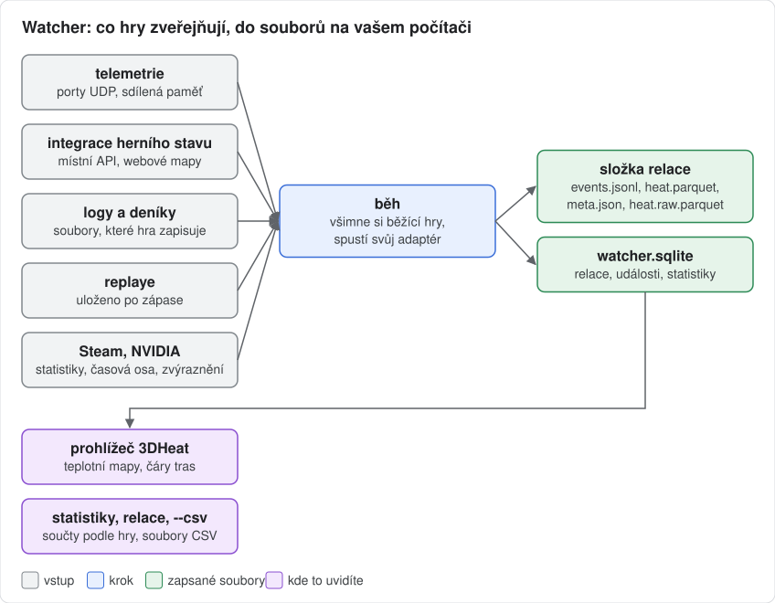
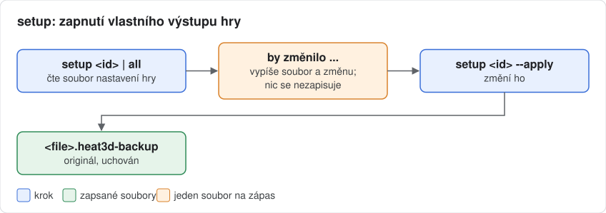
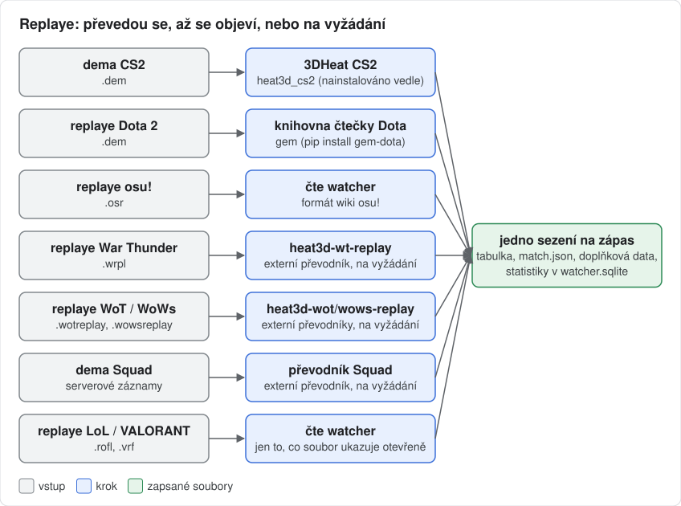
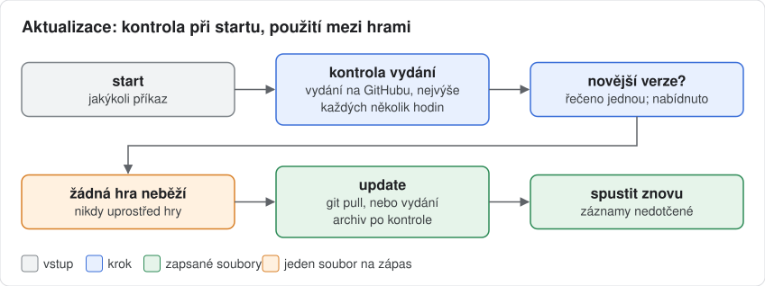

# Příkazy {#commands}

Nikdy jste nepracovali s příkazovým řádkem? Nejdřív si přečtěte [Než začnete](before-you-start.md). Každý příkaz se píše do terminálu otevřeného ve složce, kam jste program rozbalili nebo naklonovali (v Průzkumníkovi napište do adresního řádku `powershell`), takto:

```bash
python -m heat3d_watch <command> [options]
```


| Příkaz | Co dělá |
|---|---|
| [`run`](#run) | běží na pozadí a zaznamenává každou hru, která se spustí |
| [`games`](#games) | co každá hra dává a odkud |
| [`setup`](#setup) | zapne vlastní výstup hry |
| [`status`](#status) | které hry běží teď a které adaptéry by se spustily |
| [`sessions`](#sessions) | dosavadní záznamy |
| [`stats`](#stats) | součty podle hry, nebo tabulky jako CSV |
| [`table`](#table) | znovu sestaví `heat.parquet` relace z jejího `events.jsonl` |
| [`replays`](#replays) | převede replaye, které už jsou na disku |
| [`dota-replay`](#dota-replay) | stáhne replay veřejného zápasu Dota 2 podle jeho id |
| [`dota-map`](#dota-map) | mapa Dota 2 z vaší instalace jako 3D úroveň pro prohlížeč |
| [`update`](#update) | aktualizuje na nejnovější vydání |
| [`config`](#config) | zobrazí nebo změní nastavení |

Volby platné pro každý příkaz: `-h` / `--help` vypíše nápovědu a `python -m heat3d_watch --version` vypíše verzi (soubor `VERSION`).

Obrázky na této stránce jsou ukázky běhu na smyšlených příkladových relacích (`Example Racer`, `Example Arena`), ne na skutečných záznamech.

Každý příkaz kromě `update` nejdřív hledá novější vydání (nejvýš jednou za šest hodin; přeskočí se s `HEAT3D_NO_UPDATE=1`, viz [Aktualizace](updates.md)). `run` jen vypíše upozornění. Ostatní příkazy se při běhu v terminálu zeptají `Update now? [Y/n]`, a když v terminálu neběží, vypíšou, jak se aktualizovat. Výstup je v UTF-8, takže názvy her v libovolném písmu se vypíšou v jakékoli konzoli.

## run {#run}

```bash
python -m heat3d_watch run [--once] [-v]
```



Běží, dokud ho nezastavíte (Ctrl+C): každých `scan_seconds` sekund přečte seznam procesů a pro každou nalezenou hru spustí adaptér, k tomu spouští i adaptéry, které běží vždy. Před první kontrolou dokončí relace, které nechal otevřené předchozí běh. Když neběží žádná hra, může se sám aktualizovat (je-li zapnuto `auto_update`). Podrobnosti jsou v [Instalace a spuštění](installing-and-running.md#running).

| Volba | Účinek |
|---|---|
| `--once` | jeden pohled na běžící hry, pak skončí. Spustí se adaptéry pro hry, které právě běží (a ty, které běží vždy); každý jednou načte data (čeká se nejvýš 10 sekund), pak se všechny zastaví stejně, jako když hra skončí: jejich relace se uzavřou, zapíšou a započítají. Slouží ke kontrole rozpoznání, ne k nahrávání. |
| `-v`, `--verbose` | ladicí řádky v `watcher.log` a v konzoli |

`run` zapíše `<data>\watcher.lock` a podruhé pro stejnou datovou složku nespustí (skončí s kódem 1); viz [Zamykací soubor](installing-and-running.md#the-lock-file).

## games {#games}

```bash
python -m heat3d_watch games [--markdown]
```


Vypíše všechny adaptéry seřazené podle hry: jméno, id a druh, odkud čtou, co zaznamenávají a jak se zapínají. Adaptér, který na tomto počítači nejde spustit, je označen `[unavailable: <why>]` – nenalezen SimConnect.dll, chybí složka Minecraftu, není nainstalováno 3DHeat CS2, nenalezen Steam nebo NVIDIA App. Modul adaptéru, který se nepodařilo načíst, je na konci uveden i s chybou.

```text
EA SPORTS F1 25  (f1-25, telemetry)
    from: UDP telemetry 127.0.0.1:20777 (Documents\My Games\F1 25\hardwaresettings\hardware_settings_config.xml)
    - every car's position (world XYZ, m) at 10 Hz, by driver name, team, own car marked, ...
    switch on: In the game: Settings > Telemetry Settings > UDP Telemetry On, IP 127.0.0.1, port 20777 - ...
```

`--markdown` vypíše totéž jako jednu Markdown tabulku (hra, co se zaznamenává, odkud, jak se zapne, online hra, ověřeno). Tabulka v [Všechny hry v jedné tabulce](watcher.md) je tento výstup. Buňky jsou upravené pro Markdown: text v zpětných apostrofech zůstane kódem a mimo něj se znaky `<`, `>`, `&`, `*`, `|` a zpětné lomítko před interpunkcí zapíší tak, aby se zobrazily přesně tak, jak jsou psané (`<CS2>` by jinak v kramdownu zmizel jako HTML značka). Jediný kus HTML je značka `<br>` mezi položkami ve sloupci „Co se zaznamenává“.

## setup {#setup}

```bash
python -m heat3d_watch setup <adapter id | all> [--apply]
```




Zapne vlastní výstup hry tam, kde hra potřebuje, aby se pro ni změnil soubor. Bez `--apply` se nic nemění: každý řádek říká, co by se změnilo, a pokud je co měnit, poslední řádek vypíše `Nothing was changed. Run again with --apply to make these changes.` (nic se nezměnilo; spusťte znovu s `--apply`, aby se změny provedly). Když není co měnit, vypíše `<id>: nothing to change` (`Nothing to change.` u `all`). S `--apply` se změny provedou; a než se soubor změní poprvé, uloží se jeho původní verze jako `<file>.heat3d-backup`. Existující záloha se nikdy nepřepíše, takže vždy obsahuje soubor tak, jak byl předtím, než ho Watcher poprvé upravil.

```text
f1-25: would change: hardware_settings_config.xml <udp>: enabled="false" -> "true"
Nothing was changed. Run again with --apply to make these changes.
```

`all` spustí nastavení každého adaptéru, který nějaké má. Adaptér bez nastavení, zadaný samostatně, vypíše `<id>: nothing for setup to change; ` a za tím, jak se hra zapíná (jeho text `enable`, nebo že nic nepotřebuje). Neznámé id vypíše `no adapter '<id>'; games lists them` a skončí s kódem 2. Adaptéry, které mají co nastavit:

| Adaptér | Co změní `--apply` |
|---|---|
| `beamng` | nainstaluje modifikaci protokolu `heat3d` do uživatelské složky `mods` v BeamNG (jen když tam není); pak ve hře zapněte v Options > Other > Protocols položku „others“ |
| `cs2-gsi` | zapíše `<CS2>\game\csgo\cfg\gamestate_integration_heat3d.cfg`: posílat stav hry na `http://127.0.0.1:3311/` s náhodným tokenem, který Watcher pak vyžaduje (token, který už v souboru je, se ponechá); CS2 ho načte při startu |
| `dota2-gsi` | totéž pro Dota 2: `<Dota>\game\dota\cfg\gamestate_integration\gamestate_integration_heat3d.cfg`, port 3312 |
| `dcs` | přidá `Scripts\Hooks\heat3d-watch.lua` do každé složky `%USERPROFILE%\Saved Games\DCS*`. Jeho starší vlastní kopie se aktualizuje; soubor stejného jména, který Watcher nezapsal, se nechá být. Restartujte DCS. |
| `dirt-rally-2` | `hardware_settings_config.xml`: `<udp enabled="true" extradata="3" ip="127.0.0.1" port="20777">`; hru nejdřív jednou spusťte, aby soubor existoval |
| `ea-wrc` | `Documents\My Games\WRC\telemetry\config.json`: zapne paket `session_update` ze struktury `wrc`, pro tento počítač |
| `f1-23`, `f1-24`, `f1-25` | `hardware_settings_config.xml`: `<udp enabled="true" ip="127.0.0.1" port="20777">`; hra musí být zavřená |
| `hearthstone` | přidá do `%LOCALAPPDATA%\Blizzard\Hearthstone\log.config` sekci `[Power]` (`LogLevel=1`, `FilePrinting=true`); restartujte hru |
| `il2` | `<game>\data\startup.cfg`, `[KEY = telemetrydevice]`: jeden další cíl `addrN = "127.0.0.1:41995"` a `enable = true` (sekce se přidá, s 10 Hz, když tam není); restartujte IL-2 |
| `il2-tacview` | `<game>\data\startup.cfg`, `[KEY = track_record]`: `tacviewrecord = 1` |
| `rocketleague-stats` | `TAStatsAPI.ini` (nebo `DefaultStatsAPI.ini`, když ten neexistuje) v `<RL>\TAGame\Config`: `PacketSendRate=30`, když je API vypnuté, a `Port`, když žádný není nastavený; čte se při startu Rocket League |

`richard-burns-rally` nemá nastavení: jeho telemetrie patří pluginu RSF/NGP, zapíná se ručně v `RichardBurnsRally.ini` (viz [jeho stránka](game-richard-burns-rally.md)); `setup richard-burns-rally` to řekne. Každá jiná hra buď nic nepotřebuje, nebo se zapíná ve hře; na stránce každé hry je uvedeno jak.

## status {#status}

```bash
python -m heat3d_watch status
```

```text
3DHeat Watcher 1.0.2; data in C:\Users\...\AppData\Local\3DHeat\Watcher
Games running: EA SPORTS F1 25 (f1-25)
Always on: il2-tacview, steam-stats, steam-timeline, nvidia-highlights, cs2-demos, osu-replays, lol-replays, valorant-replays
```

Vypíše, které adaptéry by `run` spustil právě teď, podle stejných pravidel: běží proces hry, adaptér není v `disabled`, nechybí mu nic, co potřebuje, adaptéry replayů jen při zapnutém `replays`, paměťové adaptéry jen při zapnutém `memory` a když prošla každá kontrola paměti. Nic nespouští.

## sessions {#sessions}

```bash
python -m heat3d_watch sessions [--game NAME] [--limit N]
```


Nejnovější relace z `watcher.sqlite`, jeden řádek na relaci: začátek (místní čas), hra, minuty, události, pozice, složka.

| Volba | Účinek |
|---|---|
| `--game NAME` | jen tato hra, podle přesného názvu jako v seznamu (`"EA SPORTS F1 25"`) |
| `--limit N` | nejvýš N relací (výchozí 40) |

## stats {#stats}

```bash
python -m heat3d_watch stats [--game NAME] [--csv DIR]
```


Bez voleb: tabulka každé hry (relace, hodiny, události, pozice, naposledy hráno), nejhranější první; potom pro každou hru jejích 25 nejčastějších událostí a každou číselnou statistiku s počtem relací, které ji mají, součtem, nejlepší hodnotou (`best`) a průměrem. `best` ví, kterým směrem je lepší: nejnižší hodnota u časů, které se drží jako nejlepší (`best_lap`, `best_stage` a každý další klíč začínající na `best_`), a u umístění (`race_position`, `grid_position`, každý klíč končící na `_position`); nejvyšší u všeho ostatního (zabití, vzdálenost, nejvyšší rychlost, vlastní počítadla hry).

| Volba | Účinek |
|---|---|
| `--game NAME` | jen události a statistiky této hry, bez přehledu |
| `--csv DIR` | místo toho zapíše do `DIR` soubory `sessions.csv`, `events.csv` a `stats.csv` (každý řádek ze tří tabulek); `--game` to nezúží |

## table {#table}

```bash
python -m heat3d_watch table <session folder>
```


Znovu sestaví `heat.parquet` ve složce relace z jejího `events.jsonl`, s osami z jejího `meta.json`. Vypíše cestu k tabulce, nebo `no positions in this session` (v této relaci nejsou pozice). Použijte, když byla relace zaznamenána bez `pyarrow`, nebo po ručním úpravě `events.jsonl`.

## replays {#replays}

```bash
python -m heat3d_watch replays <adapter id> [folder] [-v]
```



Převede replaye, které už jsou na disku, hned, jeden za druhým, každý do relace stejně, jako by to udělalo sledování složky. Když Watcher poprvé uvidí složku s replaye, jen si poznamená, co v ní je (viz [Instalace a spuštění](installing-and-running.md#replays-already-on-disk)); tímto příkazem se takové replaye převedou na žádost. Bez `folder` se čtou vlastní složky adaptéru (hry a `replay_folders`); se `folder` replaye v této složce. Každý převedený se označí jako viděný, takže běžící Watcher ho nepřevádí znovu. Replay, který se nepodaří převést, se zapíše do logu a přeskočí.

| Adaptér | Replaye |
|---|---|
| `cs2-demos` | dema Counter-Strike 2 (`*.dem`), přes 3DHeat CS2 |
| `lol-replays` | replaye League of Legends (`*.rofl`) |
| `osu-replays` | replaye osu! (`*.osr`) |
| `valorant-replays` | replaye VALORANT (`*.vrf`) |
| `warthunder-replays` | replaye War Thunder (`*.wrpl`), přes externí převodník `heat3d-wt-replay` (exporters/ext/warthunder-replay) |
| `wot-replays` | replaye World of Tanks (`*.wotreplay`), přes externí převodník `heat3d-wot-replay` (exporters/ext/wot-replay) |
| `wows-replays` | replaye World of Warships (`*.wowsreplay`), přes externí převodník `heat3d-wows-replay` (exporters/ext/wows-replay) |
| `dota-replays` | replaye Dota 2 (`*.dem`), přes gem (`pip install gem-dota`) |

```text
osu-replays: converted 12 replay(s); `sessions --game` lists them
```

Id, které není mezi těmito, vypíše `no replay adapter '<id>'` se seznamem a skončí s kódem 2; stejně tak `folder`, který neexistuje. Adaptér, který tady nejde spustit (není nainstalováno 3DHeat CS2), vypíše proč a skončí s kódem 1. Tratě Tacview z IL-2 v seznamu nejsou: tento adaptér převádí každou dokončenou trať, kterou najde, sám.

## dota-replay {#dota-replay}

```bash
python -m heat3d_watch dota-replay <match id> [<match id> ...] [-o FOLDER] [--convert] [-v]
```

Stáhne replay veřejného zápasu Dota 2 z replay serverů Valve. Potřebuje internet. Id zápasu je číslo na stránce zápasu v klientovi Dota (podrobnosti zápasu) nebo na webu OpenDota; Valve drží replay několik týdnů, potom stahování selže. Server a salt replaye se berou z OpenDota záznamu zápasu (`api.opendota.com/api/matches/<id>`, klíč není potřeba), soubor z `replay<cluster>.valve.net/570/<id>_<salt>.dem.bz2`; rozbalí se za běhu, jak přichází (Valve pod tímto názvem posílá bzip2 i Zstandard), a uloží se jako `<match id>.dem`. Bez `-o` jde do vlastní složky replayů Dota 2, když je Dota 2 nainstalovaná – kde ji běžící Watcher převede –, jinak do `<data>/replays/dota`. Soubor, který tam už je, se ponechá. `--convert` převede stažené replaye hned, jako by to udělal `replays dota-replays`, a označí je jako viděné.

```text
match 9000000000: C:\Program Files (x86)\Steam\steamapps\common\dota 2 beta\game\dota\replays\9000000000.dem
```

Valve drží replaye několik týdnů; starší zápas vypíše `Valve no longer has the replay of match <id>` a skončí s kódem 1. Zápas, který OpenDota ještě neviděla, nemá salt: hlášení říká, ať si o něj OpenDota řekne (`curl -X POST https://api.opendota.com/api/request/<id>`), a zkuste to o pár minut později. Soukromé lobby a zápasy se skrytým profilem na replay serverech vůbec nejsou.

## dota-map {#dota-map}

```bash
python -m heat3d_watch dota-map [<map>] -o <file.glb> [--game FOLDER] [--source2viewer EXE] [--detail UNITS]
```

Zapíše mapu Dota 2 – zemi, útesy, vodu, stromy a budovy – jako úroveň `.glb` v souřadnicové soustavě, do které se kreslí tabulky replayů Dota, z vaší vlastní instalace Dota 2; čte ji příkazová řádka Source2Viewer. Nic se nestahuje. `<map>` je ve výchozím stavu `dota`; `--game` je složka Dota 2, když není v knihovně Steamu; `--source2viewer` je cesta k CLI, když není ani v `HEAT3D_SOURCE2VIEWER`, ani na `PATH`; `--detail` je velikost buňky, ve které se pro budovy v herních jednotkách slučují vrcholy (výchozí 8, 0 ponechá každý trojúhelník). Když se nenajde Dota 2, mapa nebo Source2Viewer, skončí s kódem 1 a `dota-map: <why>`. Každý krok, části souboru a způsob ověření: [Mapa Dota 2](dota-map.md).

## update {#update}

```bash
python -m heat3d_watch update [--check]
```



Zeptá se GitHubu na nejnovější vydání, ignoruje uloženou odpověď, a pokud je novější, aktualizuje tuto kopii (viz [Aktualizace](updates.md)). `--check` jen řekne, jestli je vydáno novější. Tento příkaz běží i s nastaveným `HEAT3D_NO_UPDATE`: žádost o něj je rozhodnutí. `python -m heat3d_update [--check]` dělá totéž.

## config {#config}

```bash
python -m heat3d_watch config [--set KEY=VALUE ...]
```


Vypíše každé nastavení jako `key = value`. S `--set` nejdřív změní zadaná a uloží `settings.json` (`saved <path>`). Hodnoty se čtou podle typu nastavení:

- nastavení ano/ne: `1`, `true`, `yes`, `on` nebo `ja` znamená ano; `0`, `false`, `no`, `off`, `nein` nebo nic znamená ne;
- čísla: desetinné číslo (`scan_seconds=5`);
- seznamy: oddělené čárkou nebo jako seznam JSON (`disabled=steam-stats,steam-timeline`; prázdná hodnota seznam vyprázdní);
- slovníky (`replay_folders`, `player_names`): celý slovník jako JSON, nebo jedna položka jako `KEY.ID=VALUE` – `replay_folders.cs2-demos=D:\Demos,E:\More Demos` nastaví složky tohoto adaptéru (oddělené čárkou), `player_names.warthunder-webmap=Name` jméno tohoto adaptéru; prázdná hodnota položku odstraní;
- text: tak, jak je zadán (`data=D:\Heat`, `riot_id=Name#TAG`).

```bash
python -m heat3d_watch config --set memory=true scan_seconds=5
python -m heat3d_watch config --set riot_id=Name#TAG riot_platform=EUW1
python -m heat3d_watch config --set replay_folders.cs2-demos=D:\Demos player_names.rocketleague-stats=Name
```

Neznámý klíč vypíše `no setting '<key>'` a hodnota, která neodpovídá typu nastavení (`memory=perhaps`, `scan_seconds=often`, slovník, který není JSON), vypíše `not saved: ...`; obojí skončí s kódem 2 a nic neuloží. `settings.json` upravený ručně se čte stejně: hodnota zadaná jako text tam, kde má být číslo, ano/ne nebo slovník, se přečte tak, jak je napsaná, a takovou, kterou nejde přečíst, se nechá na výchozí hodnotě. Každé nastavení je popsáno v [Instalace a spuštění](installing-and-running.md#settings).
