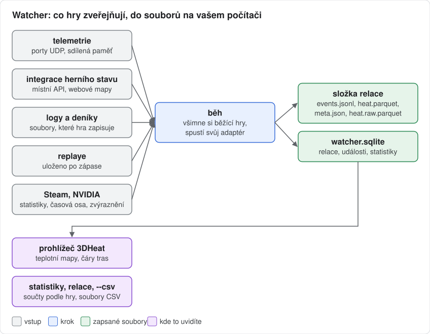

# 3DHeat Watcher {#dheat-watcher}

**Co to je?** Hrajete hru. Tento program tiše zapisuje, kam jste jeli a co se stalo.
Později to můžete prohlédnout jako barevnou mapu v prohlížeči 3DHeat.

**Proč ho používat?** Abyste si vedli vlastní záznam každého sezení – kde jste jeli, letěli
nebo bojovali, své součty pro každou hru – bez jakékoli webové stránky a bez změny hry.

**Příklad:** s běžícím Watcherem ujedete kolo v závodní hře; potom soubor v
`sessions\<game>\` obsahuje čáru, kterou jste jeli, a prohlížeč ji vykreslí.

Podrobněji: 3DHeat Watcher je program běžící na pozadí, který do souborů na vašem počítači zaznamenává,
co hry zveřejňují o vaší hře – kde jste byli, co se kde stalo a čísla, na kterých to stojí. Soubory
slouží k vašim vlastním statistikám a k teplotním mapám a čarám tras prohlížeče 3DHeat.

Běží nenápadně, všimne si, kterou hru jste spustili, a čte výstupy té hry: telemetrický port nebo
sdílenou paměť, které hra zveřejňuje pro panely, integraci herního stavu, deník nebo log, který
hra zapisuje, replay uložený po zápase, statistiky, které drží Steam, a klipy, které ukládá
NVIDIA App. Záznamy zůstávají na vašem počítači. Program kontaktuje jen dvě externí služby a jen
v těchto případech: GitHub, aby hledal novější vydání (viz [Aktualizace](../updates.md)), a
Riot Match-V5 API, a to jen tehdy, když zadáte svůj vlastní klíč Riot API (viz
[Replaye League of Legends](../game-lol-replays.md)).



## Co zaznamenává {#what-it-records}

- **Polohy**: auto, letadlo, hrdina nebo hráč, několikrát za sekundu tam, kde je hra zveřejňuje,
  s rychlostí, směrem a vším dalším, co hra posílá spolu s tím.
- **Události**: vznik, smrti, zabití, kola, etapy, rundy, góly, úkoly, vzlety a přistání, změny
  zón, úspěchy, zvýrazněné momenty. Každá událost se ukládá s časem a s místem, pokud ji hra udá.
- **Statistiky pro každé sezení**: zabití, smrti, kola, nejlepší kolo, vzdálenost, nejvyšší rychlost,
  čas hraní a vlastní statistiky hry, pokud je hra vede.

Co každá hra dává a odkud, je na její vlastní stránce v části [Hry](../games.md). Jeden zdroj nemůže
zaznamenat všechno: hry pro více hráčů se zaznamenávají jen přes to, co zveřejňují, a watcher
jejich paměť nikdy nečte (viz [Zdroje a pravidla](../sources-and-rules.md)).

## Instalace {#install}

Nikdy jste nepracovali s příkazovým řádkem? Nejdřív si přečtěte [Než začnete](before-you-start.md).

Watcher je program v Pythonu pro Windows (Python 3.10 nebo novější). Mnohé jeho zdroje existují jen
na Windows: sdílená paměť, registr, oznámení Windows.

```bash
git clone https://github.com/Holdi601/3DHeat-Watcher.git
cd 3DHeat-Watcher
pip install -r requirements.txt
```

Stažený archiv vydání funguje stejně: rozbalte ho a uvnitř složky spusťte `pip install -r requirements.txt`.
Podrobnosti a doplňky, které některé hry potřebují, jsou na stránce
[Instalace a spuštění](../installing-and-running.md).

## Rychlý start {#quick-start}

```bash
python -m heat3d_watch games            # what each game gives, and from where
python -m heat3d_watch setup all        # what would have to be switched on (nothing is changed)
python -m heat3d_watch setup f1-25 --apply   # switch one game's output on (the original file is backed up)
python -m heat3d_watch run              # watch; leave it running while you play
python -m heat3d_watch stats            # totals per game
python -m heat3d_watch stats --csv out  # sessions, events and stats as CSV files
```

Měli byste vidět: po `games` tabulku s jedním řádkem na každou hru; `run` běží, dokud nestisknete
Ctrl+C nebo nezavřete okno.

Všechno se zapisuje do `%LOCALAPPDATA%\3DHeat\Watcher`. Chcete-li jinou složku, nastavte
proměnnou prostředí `HEAT3D_WATCH_HOME` nebo spusťte `python -m heat3d_watch config --set data=D:\somewhere`.

- `sessions\<game>\<date>_<adapter>\` – jedna složka na sezení, která obsahuje `events.jsonl` (každou
  událost v okamžiku, kdy nastane), `heat.parquet` (řádky s polohou, připravené pro prohlížeč 3DHeat)
  a `meta.json` (hra, zdroj, osy, počty, statistiky)
- `watcher.sqlite` – statistiky každého sezení ve třech prostých tabulkách
- `watcher.log` – co watcher dělal

Prohlížeč otevře `heat.parquet` sezení přímo, bez jakéhokoli nastavování (jeho osy a jednotky jsou
v souboru). Převedené replaye se zapisují jako tabulky a dokumenty zápasů vedle něj; formát prohlížeče
pro jeden soubor na zápas je popsán na stránce
[kontejner `.3dheat`](https://holdi601.github.io/3DHeat/container.html) a sloupce každé tabulky na stránce
[Data](../the-data.md).

## Dokumentace {#the-documentation}

| Stránka | Co obsahuje |
|---|---|
| [Než začnete](before-you-start.md) | Python, terminál, zástupné texty, jak vypadá úspěch a časté chyby |
| [Instalace a spuštění](../installing-and-running.md) | požadavky, běh na pozadí, spuštění s Windows, zámkový soubor, log, každé nastavení a proměnná prostředí |
| [Hry](../games.md) | stránka pro každou hru: co se zaznamenává, odkud, jak to zapnout, jak to funguje, osy, statistiky, co bylo ověřeno |
| [Data](../the-data.md) | složky sezení, `events.jsonl`, `heat.parquet` a jeho patička, `meta.json`, `watcher.sqlite`, obnova po pádu, export CSV, otevření sezení v prohlížeči 3DHeat |
| [Příkazy](../commands.md) | každý příkaz a možnost `python -m heat3d_watch` |
| [Zdroje a pravidla](../sources-and-rules.md) | šest druhů zdrojů, pravidla pro hry pro více hráčů, které hry jsou vynechány a proč |
| [NVIDIA Highlights](../nvidia-highlights.md) | co NVIDIA Highlights umí a neumí doručit a jak zvýrazněný moment dostane polohu |
| [Serverové nahrávací mody](../server-mods.md) | mody serveru pro Arma 3 a Arma Reforger, které nahrávají celé mise pro prohlížeč |
| [Čtení paměti](../memory-reading.md) | profily paměti pro jednoho hráče: formát, kontroly, jak ho napsat a ověřit |
| [Aktualizace](../updates.md) | jak watcher hledá nová vydání a sám se aktualizuje |
| [Vývoj](../development.md) | psaní adaptéru: API, testy, poctivé `verified`, regenerace stránek her |
| [Všechny hry v jedné tabulce](../watcher.md) | každá hra v jedné tabulce, jak ji vypisuje `games --markdown`, plus hry prozkoumané, ale zatím nezpracované |
| [Přehled příkazů](../cli-reference.md) | `--help` každého příkazu, vygenerováno z kódu |
| [Údržba](../maintaining.md) | kontrolní seznam vydání pro tyto stránky |

## Součást 3DHeat {#part-of-3dheat}

3DHeat Watcher je jeden z bezplatných nástrojů kolem prohlížeče 3DHeat (watcher pro převod dem CS2
používá 3DHeat CS2). Každý je samostatný projekt s vlastními vydáními a licencí:

| Nástroj | Co dělá | Dokumentace |
|---|---|---|
| [3DHeat](https://github.com/Holdi601/3DHeat) | prohlížeč: teplotní mapy, analýza závodů a přehled zápasů ve 3D | [web](https://holdi601.github.io/3DHeat/) |
| [GameFiles](https://github.com/Holdi601/3DHeat-GameFiles) | tratě a úrovně ze souborů, které hry dodávají, jako 3D modely | [web](https://holdi601.github.io/3DHeat-GameFiles/) |
| [GameCapture](https://github.com/Holdi601/3DHeat-GameCapture) | telemetrie kol ze závodních her; úrovně přestavěné z videa hry | [web](https://holdi601.github.io/3DHeat-GameCapture/) |
| [Unreal Exporter](https://github.com/Holdi601/3DHeat-UnrealExporter) | zásuvný modul pro Unreal Editor, který exportuje úroveň jako jeden 3D model | [web](https://holdi601.github.io/3DHeat-UnrealExporter/) |
| [CS2](https://github.com/Holdi601/3DHeat-CS2) | dema Counter-Strike 2 do tabulek a dokumentů zápasů; mapy do 3D modelů | [web](https://holdi601.github.io/3DHeat-CS2/) |
| [Watcher](https://github.com/Holdi601/3DHeat-Watcher) | na pozadí zaznamenává, co hry zveřejňují o vaší hře | [web](https://holdi601.github.io/3DHeat-Watcher/) |
| [Ext-WarThunder](https://github.com/Holdi601/3DHeat-Ext-WarThunder) | replaye War Thunder do tabulek a dokumentů zápasů | [web](https://holdi601.github.io/3DHeat-Ext-WarThunder/) |
| [Ext-WoT](https://github.com/Holdi601/3DHeat-Ext-WoT) | replaye World of Tanks do tabulek a dokumentů zápasů | [web](https://holdi601.github.io/3DHeat-Ext-WoT/) |
| [Ext-WoWs](https://github.com/Holdi601/3DHeat-Ext-WoWs) | replaye World of Warships do tabulek a dokumentů zápasů | [web](https://holdi601.github.io/3DHeat-Ext-WoWs/) |
| [Ext-Squad](https://github.com/Holdi601/3DHeat-Ext-Squad) | dema serverů Squad do tabulek a dokumentů zápasů | [web](https://holdi601.github.io/3DHeat-Ext-Squad/) |
| [Ext-DCS](https://github.com/Holdi601/3DHeat-Ext-DCS) | mapy DCS World do 3D modelů | [web](https://holdi601.github.io/3DHeat-Ext-DCS/) |
| [Ext-IL2](https://github.com/Holdi601/3DHeat-Ext-IL2) | mapy IL-2 Sturmovik do 3D modelů | [web](https://holdi601.github.io/3DHeat-Ext-IL2/) |

Licence: MIT ([LICENSE](https://github.com/Holdi601/3DHeat-Watcher/blob/main/LICENSE)). Licence
balíčků třetích stran, které používá, a to, co vyžadují hry, které čte, jsou uvedeny v
[LICENSES.md](https://github.com/Holdi601/3DHeat-Watcher/blob/main/LICENSES.md).
