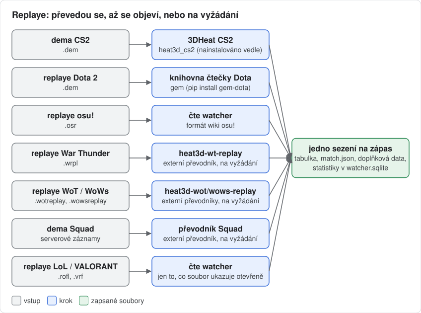

# Instalace a spuštění {#installing-and-running}

## Požadavky {#requirements}

- **Windows.** Watcher je napsaný pro Windows a většina jeho zdrojů existuje jen tam: sdílená paměť, kterou hry vytvářejí (mapování `Local\...`), registr (kde je Steam), oznámení Windows, seznam procesů s cestami ke spustitelným souborům. Na jiném systému program běží, ale tyto zdroje nic nenajdou, oznámení se jen zapisují do logu a čtení paměti odmítne („only implemented on Windows“).
- **Python 3.10 nebo novější**, z <https://www.python.org/downloads/>: při instalaci zaškrtněte **Add python.exe to PATH**, pak ověřte příkazem `python --version` v novém terminálu. Jste v tom nováčci? Nejdřív si přečtěte [Než začnete](before-you-start.md).
- **Balíčky** (`requirements.txt`): `psutil>=6.0` (které hry běží, který program drží port, spojení hry; starší psutil funguje také, přes svůj starší název pro spojení procesu), `pyarrow>=15` (zápis `heat.parquet`), `numpy>=1.24` a `pytest>=8.0` pro testy. `requirements-optional.txt` zatím žádné balíčky neuvádí.

Bez `pyarrow` se záznamy stále pořizují: `events.jsonl` je záznam a tabulku lze sestavit později příkazem [`table`](commands.md#table).

### Doplňky, které některé hry potřebují {#extras-some-games-need}

| Hra | Co potřebuje |
|---|---|
| Counter-Strike 2 dema | [3DHeat CS2](https://github.com/Holdi601/3DHeat-CS2) a jeho požadavky (`demoparser2`). Watcher ho hledá v `HEAT3D_CS2`, pak ve složce `3DHeat-CS2` nebo `cs2` vedle vlastní složky Watcheru, pak kdekoli, kde Python umí naimportovat `heat3d_cs2`. Bez něj ho `games` uvede jako nedostupný. |
| Microsoft Flight Simulator 2020 / 2024 | `SimConnect.dll` – nedodává se. MSFS 2020 ho má ve své instalační složce; pro MSFS 2024 nainstalujte SDK MSFS 2024. `MSFS_SDK` / `MSFS2024_SDK` ukazují na složku SDK. |
| Euro Truck Simulator 2, American Truck Simulator | plugin RenCloud `scs-telemetry.dll` (revize 12) v `<game>\bin\win_x64\plugins` |
| BeamNG.drive | protokolový mod `heat3d`, nainstalovaný příkazem `python -m heat3d_watch setup beamng --apply` |
| League of Legends (živě) | volitelné: kořenový certifikát Riotu jako `<data>\riotgames.pem`, aby se místní spojení ověřovalo |
| Minecraft | složka `%APPDATA%\.minecraft` (Java Edition) |

Stránka každé hry na [Hry](games.md) říká, co je třeba zapnout ve hře samé. `python -m heat3d_watch games` označí adaptér jako `[unavailable: ...]`, když na tomto počítači chybí něco, co potřebuje.

## Instalace {#installing}

Jste v tom nováčci? Nejdřív si přečtěte [Než začnete](before-you-start.md). Když `pip` nenajdete, použijte místo něj `python -m pip install -r requirements.txt`.

Z klonu:

```bash
git clone https://github.com/Holdi601/3DHeat-Watcher.git
cd 3DHeat-Watcher
pip install -r requirements.txt
```

Z vydání: stáhněte archiv z vydání repozitáře, rozbalte ho a uvnitř složky spusťte `pip install -r requirements.txt`. Obě podoby kopie se aktualizují samy (viz [Aktualizace](updates.md)).

Všechny příkazy spouštějte ze složky repozitáře: `python -m heat3d_watch` naimportuje balíček odtud a aktualizátor (`heat3d_update`) je vedle něj.

## Spuštění {#running}

```bash
python -m heat3d_watch run        # watch until stopped
python -m heat3d_watch run -v     # the same, with debug lines in the log
python -m heat3d_watch run --once # one look at the games running now, then stop and exit
```

Při startu `run`:

1. zapíše [zamykací soubor](#the-lock-file);
2. dokončí záznamy, které nechal otevřené předchozí běh, třeba po pádu (viz [Obnova po pádu](the-data.md#recovery-after-a-crash));
3. každých `scan_seconds` (2 s) přečte seznam procesů (jen názvy a cesty, žádný proces se neotevírá) a pro každou nalezenou hru spustí adaptér ve vlastním vlákně. Když proces hry zmizí, adaptér se zastaví a záznamy, které měl otevřené, se uzavřou; zapíše se jejich tabulka a řádek ve statistikách. Adaptéry, které na hře nečekají (statistiky Steamu, Steam Timeline, zvýraznění NVIDIA, složky replayů), běží pořád;
4. dokud neběží žádná hra, hledá novější vydání nejvýš jednou za hodinu (odpověď sama se ukládá na šest hodin) a když je zapnuto `auto_update`, nainstaluje ho a znovu se spustí (viz [Aktualizace](updates.md)).

Adaptér, který selže, se zaloguje a neohrozí ostatní. Když selže dotaz adaptéru 20krát v řadě, nebo jeho start, adaptér se zastaví a nespustí se znovu, dokud se hra nespustí znovu (nové id procesu).

Watcher zastavíte klávesami Ctrl+C. Adaptéry uzavřou své záznamy, než skončí. Když se Watcher ukončí jinak (Správce úloh, pád, výpadek proudu), nic, co už bylo zapsáno, se neztratí: další `run` ty záznamy dokončí.

`--once` udělá jediný pohled: spustí adaptéry pro hry, které v ten okamžik běží (a pro ty, které běží pořád), nechá každý jednou dotázat – čeká nejvýš 10 sekund – a pak je zastaví tak, jak by je zastavil konec hry. Záznamy, které otevřely, se tedy uzavřou, jejich tabulky se zapíšou a řádky se započítají do statistik, a pak program skončí. Slouží ke kontrole, že se hra rozpoznává, ne k nahrávání.

### Replaye už na disku {#replays-already-on-disk}



Když adaptér replayů poprvé uvidí jednu ze svých složek, jen zaznamená replaye, které v ní už jsou: hráč s lety nahraných dem by jinak našel Watcher zaneprázdněný převodem na celý den. Od té doby se každý nový replay převede, jakmile hra dopíše jeho zápis. Staré se převádějí na vyžádání příkazem [`replays`](commands.md#replays):

```bash
python -m heat3d_watch replays cs2-demos              # every demo in CS2's folders and replay_folders
python -m heat3d_watch replays osu-replays D:\Old     # the replays in one folder
```

### Běh na pozadí {#running-in-the-background}

Watcher nemá vlastní okno; je to konzolový program, který běží, dokud ho nezastavíte. Všechno zapisuje do `watcher.log`, takže nepotřebuje viditelnou konzoli. Způsoby, jak ho mít z cesty:

- spusťte ho v konzoli a konzoli minimalizujte: `start "" /min python -m heat3d_watch run` z `cmd`, ve složce repozitáře;
- spusťte ho bez konzole: `pythonw -m heat3d_watch run`. Výstup do konzole se ztratí, ale `watcher.log` se stále zapisuje. Zastavíte ho ukončením procesu `pythonw.exe`; další start pak dokončí záznamy, které nechal otevřené. Projekt tento způsob běhu netestoval.

### Spuštění se systémem Windows (nápad) {#starting-with-windows-an-idea}

Watcher se sám do spouštění se systémem neinstaluje. Aby se spouštěl automaticky:

- **Plánovač úloh**: vytvořte úlohu s spouštěčem *At log on* (Při přihlášení) a akcí *Start a program* (Spustit program), program `pythonw.exe` (nebo `python.exe`), argumenty `-m heat3d_watch run`, *Start in* (Spustit v) nastavené na složku repozitáře;
- **složka Po spuštění**: dejte zástupce do `shell:startup` se stejným programem, argumenty a složkou *Start in*.

Ani jedno není součástí Watcheru ani jím netestováno. [Zamykací soubor](#the-lock-file) zajistí, že druhá kopie spuštěná omylem se hned ukončí.

## Zamykací soubor {#the-lock-file}

`<data>\watcher.lock` drží id procesu běžícího Watcheru. Když se `run` spustí a zamykací soubor označuje proces, který ještě existuje a jehož název obsahuje `python`, vypíše

```text
A watcher is already running (process 12345) for C:\Users\...\3DHeat\Watcher.
```

a skončí s kódem 1. Dvě spuštění Watcheru na jedné datové složce by nahrávala každou hru dvakrát a druhé by považovalo otevřené záznamy prvního za zbytky po pádu. Zamykací soubor, jehož proces už neexistuje, nebo patří jinému programu, se přepíše. Když `run` skončí, odstraní zamykací soubor, pokud v něm stále stojí jeho vlastní proces.

## Protokol {#the-log}

`<data>\watcher.log` zapisuje jen `run`; ostatní příkazy vypisují do konzole. Každý řádek má čas, úroveň a zprávu:

```text
2026-05-01 20:15:01,123 INFO watching; data in C:\Users\...\AppData\Local\3DHeat\Watcher
2026-05-01 20:15:03,456 INFO f1-25: starting (EA SPORTS F1 25)
2026-05-01 21:02:11,789 INFO f1-25: stopping
```

Adaptéry zaznamenávají, co nemohou udělat a proč: „UDP 20777 is in use by ...; not taking it from that program“, „not reading memory: the game is played online“, „could not start“, „poll failed (3)“ se stopou. `run -v` přidává ladicí řádky. Soubor se jen připisuje a Watcher ho nikdy neotáčí ani nevyprazdňuje; smažte ho, kdy chcete. Stejné řádky jdou i do konzole.

## Kde je všechno {#where-everything-is}

Domovská složka je `%LOCALAPPDATA%\3DHeat\Watcher`, nebo `HEAT3D_WATCH_HOME`, je-li nastaveno (bez `LOCALAPPDATA`, třeba na jiném systému, `~/.local/share/3DHeat/Watcher`). `settings.json` je vždy v domovské složce. Všechno ostatní jde do datové složky, což je domovská složka, pokud nastavení `data` neuvádí jinou:

| Cesta | Co je to |
|---|---|
| `<home>\settings.json` | nastavení |
| `<data>\sessions\` | záznamy, jedna složka na relaci ([Data](the-data.md)) |
| `<data>\watcher.sqlite` | databáze statistik |
| `<data>\watcher.log` | protokol `run` |
| `<data>\watcher.lock` | zamykací soubor, dokud běží `run` |
| `<data>\state\` | co už viděly adaptéry, které běží pořád, a adaptéry replayů (`steam-stats.json`, `replays-cs2-demos.json`, ...), takže restart nic nezaznamená dvakrát |
| `<data>\profiles\*.json` | profily paměti, které jste napsali ([Čtení paměti](memory-reading.md)) |
| `<data>\riotgames.pem` | volitelné, kořenový certifikát Riotu pro živý adaptér League of Legends |
| `%LOCALAPPDATA%\3DHeat\update-check-3DHeat-Watcher.json` | uložená odpověď poslední kontroly vydání |

Watcher v těchto složkách nic nemaže, kromě složky záznamu, ve které se nic nezaznamenalo (hra zůstala v menu).

## Nastavení {#settings}


`python -m heat3d_watch config` ukáže nastavení; `config --set key=value ...` je změní a uloží `settings.json` (viz [config](commands.md#config)). Soubor je prostý JSON a dá se upravit i ručně, když Watcher neběží. Neznámé klíče v něm se ignorují. Nastavení se čtou při startu příkazu, takže po změně restartujte `run`.

| Nastavení | Výchozí | Co dělá |
|---|---|---|
| `data` | `""` | Datová složka. Prázdné: domovská složka. |
| `disabled` | `[]` | Id adaptérů, které nikdy neběží, například `config --set disabled=steam-stats,nvidia-highlights`. Každý jiný adaptér běží, když najde svou hru. |
| `auto_update` | `true` | Když neběží žádná hra, nainstaluje novější vydání a restartuje se (viz [Aktualizace](updates.md)). `false`: jen upozornění v logu. |
| `scan_seconds` | `2.0` | Sekundy mezi pohledy na seznam procesů. |
| `memory` | `false` | Povolí běh paměťových adaptérů (jednohráčové hry s profilem, který jste napsali). Ve výchozím stavu vypnuto; viz [Čtení paměti](memory-reading.md). |
| `replays` | `true` | Spouští adaptéry `replay`: všechny (viz `python -m heat3d_watch replays` a [Hry](games.md)) – dema CS2, Dota 2, osu!, War Thunder, World of Tanks, World of Warships, Squad, replaye League of Legends a VALORANTu, záznamy Tacview z IL-2. |
| `replay_folders` | `{}` | Dodatečné složky podle id adaptéru, například `{"cs2-demos": ["D:\\Demos"]}`. Adaptéry replayů je sledují vedle vlastních složek hry; `il2-tacview` přijímá i instalační složky (pak hledá v jejich `data\Tracks`); u `elite` první složka nahrazuje složku deníku. Složky jednoho adaptéru nastavíte `config --set replay_folders.cs2-demos=D:\Demos,E:\More`, nebo celý slovník jako JSON. |
| `riot_id` | `""` | Váš Riot ID (`Name#TAG`), aby se váš vlastní řádek v replayi League of Legends stal vašimi statistikami. Prázdné: každý řádek hráče se ponechá a nikdo není označen jako vy. |
| `riot_api_key` | `""` | Váš vlastní vývojářský klíč API Riotu, aby se stáhla oficiální časová osa každého přehraného zápasu League (pozice každou minutu, zabití tam, kde se staly). Prázdné: nic se nestahuje. |
| `riot_platform` | `"EUW1"` | Id platformy vašeho serveru League (`EUW1`, `EUN1`, `NA1`, `KR`, ...), použité k nalezení regionálního serveru Match-V5. |
| `player_names` | `{}` | Vaše jméno ve hrách, jejichž rozhraní jmenuje každého hráče, ale neříká, který jste vy, podle id adaptéru: `warthunder-webmap` (řádky o vás v killfeedu se stanou vašimi zabitími a smrtmi) a `rocketleague-stats` (vaše řádky se stanou `me`; bez něj hráč, kterého sleduje kamera hry). Nastavte `config --set player_names.warthunder-webmap=Name`. |

`settings.json` se všemi výchozími hodnotami:

```json
{
  "data": "",
  "disabled": [],
  "auto_update": true,
  "scan_seconds": 2.0,
  "memory": false,
  "replays": true,
  "replay_folders": {},
  "riot_id": "",
  "riot_api_key": "",
  "riot_platform": "EUW1",
  "player_names": {}
}
```

## Proměnné prostředí {#environment-variables}

| Proměnná | Účinek |
|---|---|
| `HEAT3D_WATCH_HOME` | domovská složka (nastavení a data, pokud `data` neříká jinak) |
| `HEAT3D_NO_UPDATE` | jakákoli hodnota kromě prázdné, `0`, `false` nebo `no` vypne kontrolu vydání i automatickou aktualizaci |
| `HEAT3D_NO_TOAST` | jakákoli neprázdná hodnota: žádná oznámení Windows, jen řádky logu |
| `HEAT3D_CS2` | složka 3DHeat CS2, pro dema CS2 |
| `HEAT3D_CS2_GSI_PORT` | port stavu hry CS2 (výchozí 3311); cfg soubor, který `setup` zapíše, ho používá |
| `HEAT3D_DOTA_GSI_PORT` | port stavu hry Dota 2 (výchozí 3312) |
| `MSFS_SDK`, `MSFS2024_SDK` | složky SDK MSFS, kde se hledá `SimConnect SDK\lib\SimConnect.dll` |

Oznámení Windows se používají jen pro aktualizace: „Updating to 1.2.0“, nebo „1.2.0 is out; not updated: ...“, když aktualizaci nešlo použít. Zobrazují se přes vlastní API oznámení PowerShellu, takže není potřeba nic instalovat. Název a text se PowerShellu předávají jako proměnné prostředí, nikdy jako součást skriptu.
