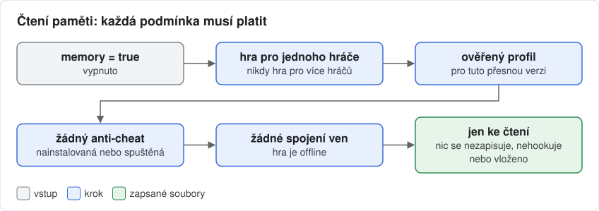

# Čtení paměti {#reading-memory}

Některé jednohráčové hry nic nesdělují jiným programům. Pro ně může Watcher – pokud to zapnete a napíšete si profil sami – vyhledat, kde ve hře jste, v paměti hry, pouze pro čtení.

U jednohráčových her, které nic nezveřejňují, může Watcher číst pozice a hodnoty z paměti hry podle **profilu**, který napíšete pro svou vlastní verzi hry. Ze všech zdrojů je to jediný, který hra sama nevydala, proto je oplocený víc než ostatní:

- je **ve výchozím stavu vypnuté** (`python -m heat3d_watch config --set memory=true` ho zapne);
- čte a nemá způsob, jak zapisovat;
- **žádné hotové profily se nedodávají.**

Profily se nedodávají, protože offset platí jen pro verzi, na které byl nalezen. Po záplatě profil, který byl předtím správný, čte nesmysly, a nesmysly vypadají přesně jako čísla. Profil musí zkontrolovat hráč sám na verzi hry, kterou má.

## Kontroly v pořadí {#the-checks-in-order}



Každá kontrola níže musí projít. První čtyři se dělají **před** otevřením hry, protože otevření chráněné hry pro čtení je samo o sobě to, co si všimne anti-cheat, a odmítnout to až potom by bylo pozdě.

1. **Nastavení**: `memory` je pravda. Jinak se paměťové adaptéry nikdy nespustí.
2. **Profil pro hru**, jehož `exe` odpovídá běžícímu procesu. Profil uvádí, zda hru lze vůbec hrát online (`"online"`); profil, který to vynechá, se odmítne.
3. **Žádný anti-cheat v okolí**:
   - žádný soubor anti-cheatu ve složce hry ani nejvýš tři složky nad ní (zastaví se u složky `common` v knihovně Steamu nebo u složky s `steamapps`, protože nad ní jsou jiné hry): `EasyAntiCheat`, `EasyAntiCheat_EOS_Setup.exe`, `start_protected_game.exe`, `BattlEye`, `BEClient_x64.dll`, `BEService_x64.exe`, `EAAntiCheat.GameServiceLauncher.exe`, `AntiCheatExpert`, `SGuard64.exe`, `GameGuard`, `GameMon.des`, `XIGNCODE`, `xhunter1.sys`, `Vanguard`, `FACEIT` (porovnáváno malými písmeny, také jako začátek názvu). Když složka hry není známa, hra se odmítne;
   - na počítači neběží žádný ovladač nebo služba anti-cheatu, jak je vypíše `sc query type= driver state= active` a `sc query type= service state= active`: EasyAntiCheat, EasyAntiCheat_EOS, BEService, BEDaisy, vgk, vgc, ACE-BASE, ACE-GAME, xhunter1, FACEIT, FACEITService, EAAntiCheatService, Denuvo Anti-Cheat, npggsvc, Ricochet. Kernelový anti-cheat nainstalovaný pro jinou hru stále sleduje každý proces. Když se služby nedají vypsat, hra se odmítne.
4. **Ne online**: hra, jejíž profil říká `"online": true`, se čte jen tehdy, když nemá spojení s ničím jiným než s tímto počítačem (jakákoli vzdálená adresa kromě `127.x`, `::1`). Když se její spojení nedají přečíst, odmítne se.
5. Pak, jak se adaptér spouští:
   - **přesná verze**: velikost spustitelného souboru nebo jeho SHA-256 se musí shodovat s verzí, kterou profil uvádí. Neznámá verze se nečte;
   - **moduly ještě jednou**: seznam načtených modulů hry (snímek Toolhelp, který nevyžaduje žádná vlastní přístupová práva) se prohledá na klienta anti-cheatu (`BEClient_x64.dll`, `BEClient.dll`, `EasyAntiCheat_x64.dll`, `EasyAntiCheat.dll`, `EOSAntiCheat...`). Chráněný proces snímek odmítne, což je také odmítnutí;
   - teprve potom se proces otevře, s `PROCESS_VM_READ | PROCESS_QUERY_LIMITED_INFORMATION` a ničím dalším.

Kontroly 1 až 4 se opakují při každém průchodu (každé 2 s), dokud hra běží. Když některá začne selhávat (hra se připojí k serveru, spustí se služba anti-cheatu), adaptér se zastaví při nejbližším průchodu. Odmítnutí se zaloguje: `mem-<id>: not reading memory: <reason>`. Selhání při startu (neznámá verze, modul anti-cheatu, vzor nenalezen) se zaloguje jako `mem-<id>: could not start` a adaptér se nezkusí znovu, dokud se hra znovu nespustí.

Žádný zápis, žádná alokace v jiném procesu, žádné vlákno v něm spuštěné, žádná knihovna do něj načtená, žádné právo ladění, žádné zvýšení oprávnění. Test (`test_memory_reading_cannot_write` v `tests/test_core.py`) selže, pokud se v balíčku objeví jakékoli volání, které zapisuje do jiného procesu, v něm alokuje nebo v něm spouští kód – `WriteProcessMemory`, `VirtualAllocEx`, `CreateRemoteThread`, `PROCESS_VM_WRITE`, `SeDebugPrivilege`, `LoadLibrary`, ...

Nikdy se nečte, ať profil říká cokoli: hry hrané online a hry, jejichž jednohráčový režim běží pod anti-cheatem, jako GTA V nebo Elden Ring spuštěný přes spouštěč. Uvedené kontroly je odmítnou tak či tak.

## Formát profilu {#the-profile-format}

Profil je soubor JSON ve složce `<data>\profiles\` (`<data>` je datová složka, viz [Instalace a spuštění](installing-and-running.md#where-everything-is)), jeden na hru, s libovolným názvem souboru končícím na `.json`. Syntetický příklad:

```json
{
  "schema": "heat3d.memprofile/1",
  "id": "mygame",
  "game": "My Game",
  "exe": "MyGame.exe",
  "online": false,
  "versions": [ { "label": "1.06", "size": 123456789 } ],
  "anchors": {
    "World": { "aob": "48 8B 05 ?? ?? ?? ?? 48 85 C0", "rip": [3, 7] }
  },
  "values": {
    "pos": { "type": "vec3f", "base": "World", "chain": ["0x10", "0x68", "0x70"] },
    "hp":  { "type": "i32",   "base": "World", "chain": ["0x10", "0x138"] },
    "map": { "type": "u32",   "base": "World", "chain": ["0x10", "0x1C0"] }
  },
  "events": [
    { "event": "death", "value": "hp",  "when": "to_zero" },
    { "event": "zone",  "value": "map", "when": "change" }
  ],
  "axes": { "up": "y", "units": "metres" },
  "rate": 10,
  "provenance": [ { "source": "https://example.com/my-notes", "verified_on": "1.06" } ]
}
```

| Klíč | Povinný | Co je to |
|---|---|---|
| `schema` | ano | přesně `heat3d.memprofile/1` |
| `id` | ano | krátké a stálé; adaptér se jmenuje `mem-<id>` |
| `game` | ano | název hry, podle kterého se pojmenuje složka záznamu |
| `exe` | ano | název spustitelného souboru, který také říká, že hra běží |
| `online` | ano | `true`, pokud se hra vůbec dá hrát online; pak se čte jen když je offline |
| `versions` | ano | verze, na kterých byl profil ověřen: každá s `label` a s `size` (velikost spustitelného souboru v bajtech) a/nebo `sha256`. Když jsou uvedeny obě, musí se shodovat obě. Položka bez obojího neodpovídá žádné verzi. |
| `anchors` | ano | pojmenované adresy v hlavním modulu. `aob`: vzor bajtů, hexadecimální bajty oddělené mezerami, `?` nebo `??` pro libovolný bajt; musí se vyskytnout **právě jednou** v obrazu modulu (více shod se počítá jako chyba, stejně jako žádná). `rip: [d, n]`: vzor ukazuje na instrukci s 32bitovým posunem relativním k RIP na bajtu `d` a délky `n`; kotva se stane adresou, na kterou ta instrukce odkazuje. `offset`: přičte se potom (hex nebo desítkový text). Místo `aob` dává `module_offset` pevný offset od základu modulu. |
| `values` | ano | co se čte při každém dotazu: `type` (`i32`, `u32`, `i64`, `u64`, `u8`, `f32`, `f64`, `vec3f`, `vec3d`), `base` (název kotvy), `chain` (offsety jako hex nebo desítkový text) |
| `events` | ne | pravidla, která mění změny na události: `when` `change` (hodnota se liší od posledního dotazu), nebo `to_zero` (číslo klesne z nad 0 na 0 nebo níž) |
| `axes` | ne | `up` (výchozí `y`), `units` (výchozí `game units`), `scale` (měřítko jednotek prohlížeče, které násobí každou pozici; výchozí 1, jednotky samotné hry) |
| `rate` | ne | dotazy za sekundu, 1 až 60 (výchozí 10) |
| `provenance` | ne | odkud pochází offsety a na které verzi jste je ověřili; kopíruje se do `meta.json` každého záznamu |

**Jak se hodnota čte.** Adresa kotvy je začátek. Když je `chain` prázdný, hodnota se přečte přímo tam. Jinak se nejdřív přečte ukazatel uložený v kotvě. Potom se pro každý offset kromě posledního přečte ukazatel na `adresa + offset`. Poslední offset se přičte, aby vznikla adresa hodnoty. Nulový ukazatel cestou (hra je mezi úrovněmi nebo v menu) nechá hodnotu při tomto dotazu prázdnou.

**Co se zaznamenává.** Hodnota pojmenovaná `pos` (`vec3f` nebo `vec3d`) se stane řádkem `position` hráče `me` při každém dotazu. Každé pravidlo události zapíše svůj řádek `event` s novou hodnotou a tam, kde je známa `pos`, i pozicí, a přičte 1 ke statistice stejného názvu. Obraz modulu se při startu přečte jednou, kvůli nalezení kotev, po blocích 64 KiB; bloky, které nejdou přečíst, se počítají jako nuly. `meta.json` záznamu uvádí profil, název verze a provenance.

Profil, který nejde použít (špatný JSON, špatné `schema`, chybí povinný klíč), se přeskočí a zaloguje jako `profile <file> not used: <reason>`. Profily se načítají při startu Watcheru, takže po přidání nebo změně profilu restartujte `run`.

## Psaní a ověřování profilu {#writing-and-verifying-a-profile}

1. **Jen pro jednohráčovou hru bez anti-cheatu.** Pokud má hra anti-cheat, nebo ji hrajete online, zastavte se tady: Watcher ji odmítne, a má to tak být.
2. **Najděte hodnoty na své vlastní verzi.** Pracujte offline. Použijte vlastní ladicí nástroje, nebo zveřejněné poznámky o hře, abyste našli pozici hráče a hodnoty, které vás zajímají, a cestu ukazatelů k nim ze statického místa ve spustitelném souboru. Dávejte přednost vzoru bajtů (`aob`) před pevným `module_offset`: vzor najde své místo, i když se kód trochu posune.
3. **Udělejte vzor jednoznačný.** Musí se vyskytnout přesně jednou v modulu. Bajty, které se mění (adresy, posuny), nahraďte zástupnými znaky a nechte kolem nich dost pevných bajtů.
4. **Připněte verzi.** Do `versions` dejte přesnou velikost spustitelného souboru; PowerShell ji dá příkazem `(Get-Item .\MyGame.exe).Length` a hash příkazem `Get-FileHash .\MyGame.exe -Algorithm SHA256`. Po záplatě profil prostě přestane být používán, dokud ho znovu neověříte a nepřidáte novou verzi.
5. **Řekněte, zda hra jde online** (`online`), poctivě.
6. **Vyzkoušejte to**: zapněte čtení (`config --set memory=true`), dejte soubor do `<data>\profiles\` a ověřte, že `python -m heat3d_watch games` uvádí `mem-<id>`. Spusťte hru a `python -m heat3d_watch run -v`. V `watcher.log` hledejte `mem-<id>: starting`, nebo důvod, proč byla hra odmítnuta nebo nešla spustit.
7. **Zkontrolujte čísla proti hře.** Dojděte na známé místo a podívejte se na řádky `position` v `events.jsonl` záznamu. Pohybují se, když se pohybujete, o správnou vzdálenost, podél správných os? Otevřete `heat.parquet` v prohlížeči a zkontrolujte, že trasa odpovídá tomu, kam jste šli. Spusťte každou událost (ztratit všechno zdraví, změnit zónu) a zkontrolujte, že se objeví jednou. Nesmysly vypadají jako čísla a jen toto porovnání je rozliší.
8. **Zapište, co jste ověřili** do `provenance`: zdroj offsetů a verzi, na které jste je ověřili.

Text `verified` paměťového adaptéru, jak ho vypíše `games`, je vždy „by the profile's author, for the builds it lists“. Watcher nemůže vědět víc.
