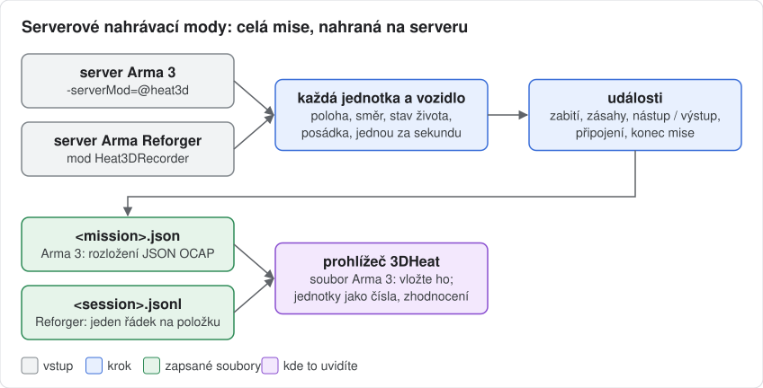

# Serverové nahrávací mody (Arma 3, Arma Reforger) {#server-recorder-mods-arma-3-arma-reforger}

Většinu her Watcher nahrává na počítači hráče. Arma je jiná: server může nahrát celou misi – každou jednotku a vozidlo, ne jen vaše – pomocí modu, který běží na serveru. Hráči nic nenastavují: mod pro Arma 3 je jen serverový a Reforger si mody serveru stáhne sám, když se hráč připojí (mod na jeho počítači nedělá nic). Repozitář obsahuje dva takové mody, v [`mods/arma3`](https://github.com/Holdi601/3DHeat-Watcher/tree/main/mods/arma3) a [`mods/reforger`](https://github.com/Holdi601/3DHeat-Watcher/tree/main/mods/reforger). Jejich README je úplná dokumentace; tato stránka je přehled.

**Stav: oba jsou zatím v hře netestované.** Rozšíření pro Arma 3 bylo sestaveno a spouštěno tak, jak Arma rozšíření volá, a jeho výstup načetl 3DHeat; jeho skripty SQF v Arma 3 zatím neběžely. Mod pro Reforger byl napsán podle publikovaného skriptovacího API společnosti Bohemia a zatím nebyl zkompilován. Než projdete testovací kroky v jeho README, nedávejte žádný z nich na veřejný server.

## Arma 3 {#arma-3}

1. Sestavte rozšíření jednou pro každou platformu (`mods/arma3/extension`). K tomu je třeba C kompilátor: Visual Studio Build Tools na Windows, gcc na Linuxu; pokud jste nikdy nic nekompilovali, zeptejte se svého hostitele serveru.
   - Windows, v "x64 Native Tools Command Prompt for VS":
     `cl /nologo /O2 /LD heat3d.c /Fe:heat3d_x64.dll`
   - Linux: `gcc -O2 -shared -fPIC -o heat3d_x64.so heat3d.c -ldl`
2. Sestavte mod: `python mods/arma3/build.py` zapíše `mods/arma3/@heat3d/` (Arma 3 Tools nepotřebujete).
3. Zkopírujte `@heat3d` do složky serveru a spusťte server s `-serverMod=@heat3d`.
4. Log `.rpt` serveru říká `Heat3D recorder 0.1.0: recording <file> every 1 s`.

| Nastavení | Výchozí | Co dělá |
|---|---|---|
| `captureDelay` | 1 | sekundy mezi snímky |
| `recordHits` | 1 | 0 vypne události zásahů |
| `recordShots` | 1 | 0 vypne počítání výstřelů |
| `minPlayers` | 0 | nahrávat, až bude na serveru tolik hráčů |

Mise přepíše jedno nastavení ve svém `init.sqf` (`heat3d_captureDelay = 0.5;`). Záznamy jdou do `recordings/` uvnitř `@heat3d`, nebo do `HEAT3D_DIR`.

**Výstup:** jeden soubor na misi v rozložení JSON z OCAP (formát nahrávače OCAP2), pojmenovaný `<date>__<time>_<mission>.json`. Během mise je to deník (`.heat3d.part`), vyprázdněný při každém zápisu; deník zkolabované mise se dokončí, až se spustí další mise.

## Arma Reforger {#arma-reforger}

Mod (`Heat3DRecorder.gproj`) se otevírá a sestavuje v Workbench od Bohemie (Arma Reforger Tools), testuje se na lokálním dedikovaném serveru, publikuje z Workbench (neveřejně během testování) a přidá do seznamu `mods` v `config.json` serveru – krok za krokem v jeho README. Každou sekundu zapisuje pozici, směr, stav života, vozidlo a id hráče každé postavy a pozici, směr, stav a osádku každého vozidla; a zabití (vrah, zbraň, vzdálenost), zásahy, nastupování a vystupování, připojování a odpojování hráčů a konec mise.

**Výstup:** jeden objekt JSON na řádek, `$profile:heat3d/<UTC date>_<UTC time>_<world>.jsonl`: řádek `header` (formát `heat3d-reforger`, osy x na východ, y nahoru, z na sever), pak řádky `entity`, `frame` a `event`, jak nastanou, a řádek `end`. Řádky jednotek jsou `[id, x, y, z, dir, alive, vehicleId, playerId]`, řádky vozidel `[id, x, y, z, dir, alive, [crew ids]]`; události následují rozložení událostí OCAP2.

## V prohlížeči {#in-the-viewer}

Přetáhněte záznam z Arma 3 na [prohlížeč 3DHeat](https://holdi601.github.io/3DHeat/): jedna mise je jedna relace, jednotky se stanou vojáky, vozidla svým typem, zabití a zásahy jdou do seznamu debriefu. Webový přehrávač OCAP2 ho také přehraje. Soubor z Reforgeru je vlastní řádkový formát modu s rozložením událostí OCAP2.
