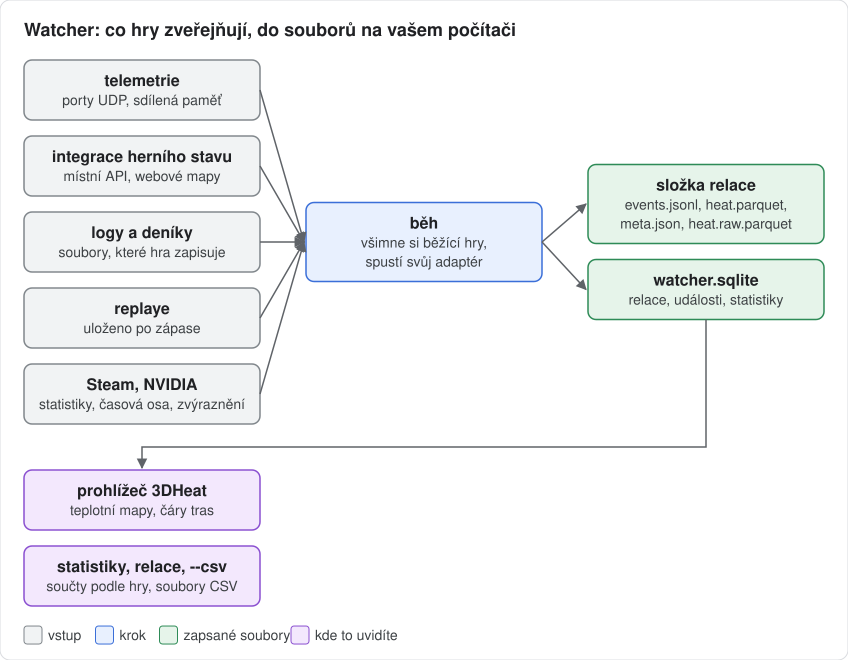

# Zdroje a pravidla {#sources-and-rules}

Watcher zaznamenává jen to, co hry a platformy vydávají hráči. Tato stránka vysvětluje, které zdroje to pokrývá, co s každým smí Watcher dělat, a které hry nebo části her vynechává úmyslně.

## Šest druhů zdrojů {#the-six-kinds-of-source}

Každý adaptér má `kind` (druh) a ten rozhoduje, co adaptér smí dělat:

| Druh | Co to je | Hry pro více hráčů |
|---|---|---|
| `telemetry` | UDP port nebo sdílená paměť, kterou hra zveřejňuje pro palubní desky, pohybové platformy a volanty (Forza Data Out, F1 UDP, sdílená paměť Kunos a iRacing, SimConnect, UDP rozhraní X-Plane, plugin SCS SDK) | ano – je to vlastní výstup hry |
| `gsi` | game-state integration nebo místní webové API, které hra poskytuje hráčovu počítači (Valve GSI, Live Client Data API League, Stats API Rocket League, webová mapa War Thunder) | ano, v rozsahu toho, co API hráči ukazuje |
| `log` | soubory, které hra zapisuje, zatímco běží: deníky, logy, statistiky, uložené hry (Elite Dangerous, Minecraft, Path of Exile, Hearthstone, Star Citizen, EVE Online) | ano |
| `replay` | dema a replaye, které hra ukládá pro své hráče a převádí se po zápase (CS2, Dota 2, osu!, War Thunder, World of Tanks, World of Warships, Squad, League of Legends, VALORANT, IL-2 Tacview) | ano, pokud nejsou zašifrované, a jen části, které jsou čitelné |
| `platform` | to, co drží Steam a ovladač grafické karty: statistiky, úspěchy, časové osy, klipy a highlighty | ano |
| `memory` | paměť hry, jen ke čtení, podle profilu, který jste napsali | **nikdy** – jen pro jednoho hráče |

Jen `memory` otevírá jiný proces, a jen pro čtení. Ostatních pět druhů čte to, co hra, Steam nebo aplikace NVIDIA App už zapsala nebo posílá.

## Jak se zdroje čtou {#how-the-sources-are-read}

- **Do hry se nic nevkládá, neháčkuje ani nemění.** Do hry se nenačítá žádný kód, nehákuje se žádné okno ani vstup, žádný herní soubor se neopravuje. Jediné soubory, které Watcher zapisuje mimo svou datovou složku, jsou ty, které zapíše [`setup --apply`](commands.md#setup), když o to požádáte: nastavovací soubor hry (původní se nechá jako `<file>.heat3d-backup`), soubor cfg pro game-state, skript hooku DCS, protokolový mod BeamNG.
- **Sdílená paměť se otevírá jen pro čtení a nikdy se nevytváří.** Obvyklý způsob v Pythonu, jak otevřít pojmenované mapování, ho vytvoří, když ještě neexistuje. Hra spuštěná potom by našla prázdné, jen-pro-čtení mapování Watcheru místo vlastního, a její telemetrie by byla mrtvá. Watcher otevírá mapování jen přes `OpenFileMappingW` (které najde jen existující), mapuje je s `FILE_MAP_READ` a zkusí to později znovu, když je hra ještě nevytvořila.
- **Porty se půjčují, nikdy se nebírají.** UDP port, na kterém už naslouchá jiný program (FH Companion, SimHub, aplikace palubní desky), zůstane tomu programu. Když jiný program začne naslouchat na portu, který Watcher drží, Watcher ho do několika sekund pustí. Adaptéry Forza čekají 15 s po spuštění hry, než vezmou port 5300, a každý paket předají beze změny na 127.0.0.1:5301, takže druhá aplikace Data Out může stále nahrávat.
- **Lokálně a jen lokálně.** Servery game-state, které Watcher spouští (CS2, Dota 2), naslouchají na 127.0.0.1 a nikde jinde. Když soubor cfg hry obsahuje token (ten, který zapíše `setup`), každý post ho musí nést; posty bez něj se počítají jako `bad_auth` a zahodí se. Bez souboru cfg s tokenem se přijme jakýkoli místní post a log to říká. Místní API, která Watcher volá (League na portu 2999, War Thunder na 8111, Rocket League na 49123, X-Plane na 49000), jsou na 127.0.0.1.
- **Soubory logů se sdílejí, nikdy se nezamykají.** Každé čtení otevře soubor se všemi sdílecími příznaky, které Windows má, a zase ho zavře, takže hra může dál zapisovat, přejmenovat nebo nahradit svůj log.
- **Dvě externí služby, a jen v těchto případech.** Kontrola vydání se ptá GitHubu (`api.github.com`) nejvýš každých šest hodin a dá se vypnout (viz [Aktualizace](updates.md)). Adaptér replayů League se ptá API Match-V5 společnosti Riot, jen když jste zadali svůj `riot_api_key`. Nic jiného se nikam neposílá.
- **Zapnutí zdroje je vaše rozhodnutí.** `setup` bez `--apply` jen říká, co by změnil.

## Pravidla pro hry pro více hráčů {#multiplayer-rules}

- Hra hraná online se nahrává jen tím, co zveřejňuje: telemetrií, API game-state, logy, replaye, soubory platformy. V jejich rámci Watcher zaznamenává to, co hra ukazuje hráči, a nic vypočteného navíc:
  - **CS2 game-state integration** posílá sledovaného hráče (vás, dokud žijete, spoluhráče po smrti). Pozice ostatních hráčů (`allplayers_*`) se posílají jen divákům a GOTV, takže je Watcher nežádá.
  - **Live Client Data API League of Legends** nemá pozice. Zásady Riotu dovolují nástrojům ukazovat to, co může hráč vědět ze samotné hry, a nic vypočteného navíc (žádné časovače nepřátel). Watcher zaznamenává zpravodajství o zabitích a tabulku výsledků, které hráč vidí, a vlastní čísla hráče.
  - **Stats API Rocket League** nemá pozice aut (stav auta se posílá jen divákům). Místo má míč, kde byl zasažen, vstřelen nebo trefil příčku.
  - **Webová mapa War Thunder** ukazuje to, co ukazuje minimapa, bez jmen a id.
  - **F1 23/24/25** dávají pozici každého auta do svého paketu Motion, i online. Hra je vydává sama a zadržuje jen data hráčů, jejichž „Your Telemetry“ je omezená.
  - **DCS World**: server pro více hráčů může zakázat export dat vlastního letadla; relace pak má události bez pozic a řekne to.
- **Paměť se ve hře pro více hráčů nikdy nečte.** Adaptér paměti pro hru označenou jako hraná online se odmítne a profil musí uvést, zda jeho hru lze hrát online. Jednohráčová hra, která má i online režim, se čte jen tehdy, když nemá spojení s ničím jiným než s tímto počítačem. Hry, jejichž jednohráčový režim běží pod anti-cheatem, se také nikdy nečtou. Viz [Čtení paměti](memory-reading.md).
- Příznak `multiplayer` na adaptéru (v `games --markdown` zobrazený jako „Online play“) rozhoduje jen o čtení paměti. Nebrání ostatním druhům nahrávat online hru.

## Co se vynechává a proč {#what-is-declined-and-why}

Některé hry a některé části her se nenahrávají: jejich data jsou chráněná, nezveřejněná nebo na počítači hráče vůbec nejsou:

| Hra | Co se vynechává | Proč |
|---|---|---|
| VALORANT | pozice, jména, skóre v replayích; koncové body lockfile klienta | Herní proud replaye je zakryt hodnotami, které se berou z spustitelného souboru každé verze. Hra běží pod Vanguardem. Koncové body lockfile klienta Riot nejsou zveřejněné API. **Čte se:** co replay nese otevřeně – mapa, id zápasu, agenti, časová osa serveru pro zabití a kola. |
| League of Legends | pohybová část replayů `.rofl`; koncové body lockfile klienta | Zakryto proti podvádění, jinak při každém patchi, a nedekóduje se. **Čte se:** koncový přehled statistik, který každý replay nese jako obyčejný JSON, Live Client Data API během zápasu a – s vlastním vývojářským klíčem – oficiální časová osa Match-V5 (pozice jednou za minutu, zabití tam, kde se staly). |
| Fortnite | replaye | Zašifrované. |
| World of Tanks, World of Warships | replaye, v Watcheru | Zašifrované. Watcher je nečte; čtou je samostatné převodníky mimo něj (`exporters/ext/wot-replay`, `exporters/ext/wows-replay`), každý jako samostatný projekt. **Čte se, když je nainstalovaný převodník:** pozice každého vozidla nebo lodi, dokud ho nahrávací klient znal, a zabití. |
| Gran Turismo 7 | telemetrie | Jen na konzolích a její telemetrie je šifrovaná klíčem, který byl z hry získán. |
| Apex Legends | všechno | Jeho LiveAPI posílá plné události jen v soukromých a vlastních lobby; jinak není nic dostupné lokálně. |
| Overwatch 2, Call of Duty, Battlefield 6, Hunt: Showdown 1896 | živá data | Žádný místní replay, log ani výstup game-state ke čtení. Jejich statistiky přicházejí tam, kde je drží Steam ([Statistiky Steamu](game-steam-stats.md), [Steam Timeline](game-steam-timeline.md)), a jejich klipy jako [NVIDIA highlights](nvidia-highlights.md). |
| Star Citizen | cokoli kromě `Game.log` | Běží Easy Anti-Cheat; Watcher čte jen soubor logu, který hra zapisuje, a k procesu hry se nikdy nepřibližuje. |
| osu!lazer | replaye | Drží je úložiště samotné hry; čtou se jen soubory `.osr` osu! (stabilní verze). |
| Jakákoli hra pro více hráčů | paměť | Nikdy. Jednohráčové hry, jejichž režim běží pod anti-cheatem (GTA V, Elden Ring přes spouštěč), se také nečtou. |

Zašifrované replaye se neotevírají: čtečka replayů VALORANT zkontroluje příznak šifrování a zašifrovaný soubor odmítne („this replay is encrypted; it is not read“).

Hry, které byly prozkoumány, ale ještě nejsou postavené (replaye Deadlock, soubory `.replay` Rocket League, StarCraft II, Team Fortress 2, Rainbow Six Siege, Beat Saber, Trackmania, několik závodních simulátorů), jsou uvedené i se svými zdroji v [Všechny hry v jedné tabulce](watcher.md#researched-not-yet-built). Každá potřebuje ukázkové soubory, podle kterých se ověří, než se vydá.
