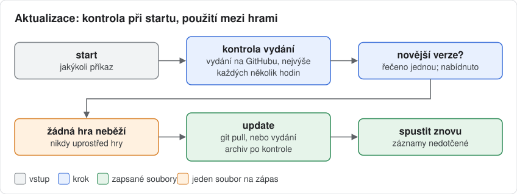

# Aktualizace {#updates}

Watcher se udržuje aktuální sám podle vydání z [Holdi601/3DHeat-Watcher](https://github.com/Holdi601/3DHeat-Watcher/releases). Aktualizátor je balíček `heat3d_update` vedle `heat3d_watch` v repozitáři.

## Kontrola {#the-check}

- **Kdy**: každý příkaz kromě `update` kontroluje při svém startu. `run` kontroluje i za běhu, nejvýš jednou za hodinu a jen když neběží žádná hra.
- **Jak**: jeden HTTPS požadavek na `https://api.github.com/repos/Holdi601/3DHeat-Watcher/releases/latest` s časovým limitem 5 sekund. Odpověď se ukládá do mezipaměti na šest hodin v `%LOCALAPPDATA%\3DHeat\update-check-3DHeat-Watcher.json`, takže většina startů se nic neptá. "Zatím žádné vydání" (HTTP 404) se ukládá stejně jako odpověď. Když není připojení, je omezen počet požadavků nebo je za proxy, kontrola tiše selže a příkaz pokračuje s verzí, kterou má.
- **Verze**: nainstalovaná verze je soubor `VERSION` ve složce repozitáře. Tag vydání (`v1.2.0` nebo `1.2.0`) se porovnává jako čísla, část po části; cokoli za `-` nebo `+` se ignoruje.
- **Vypnutí**: `HEAT3D_NO_UPDATE=1` (jakákoli hodnota kromě prázdné, `0`, `false` nebo `no`) vypne kontrolu i automatickou aktualizaci. Každý nástroj 3DHeat má vlastní soubor mezipaměti, takže odpověď jednoho nástroje nikdy nenahrazuje odpověď jiného.

## Co se stane, když je venku novější vydání {#what-happens-when-a-newer-release-is-out}

- **`run`** při startu vypíše upozornění a běží dál: `[heat3d_watch] 3DHeat Watcher 1.2.0 is out (this is 1.0.2). <release page>`. Zatímco běží, s `auto_update` zapnutým (výchozí) a bez spuštěné hry se pak sám aktualizuje: řádek logu `3DHeat Watcher 1.2.0 is out (this is 1.0.2); updating`, Windows oznámení "Updating to 1.2.0", aktualizace, zastavení každého adaptéru a uzavření jeho relací, a stejný příkaz se spustí znovu na novém kódu. Watcher se nikdy neaktualizuje uprostřed hry. Pokud aktualizaci nelze provést, oznámení to řekne ("1.2.0 is out; not updated: ...") a Watcher dál běží stará verze. S vypnutým `auto_update` zůstane jen upozornění.
- **Ostatní příkazy** se v terminálu ptají `Update now? [Y/n]`. Enter, `y`, `yes`, `j` nebo `ja` aktualizuje a pak spustí stejný příkaz znovu na nové verzi. Bez terminálu (plánovaný běh, roura) vypíšou, jak aktualizovat, a pokračují dál.
- **Na vyžádání**: `python -m heat3d_watch update` (nebo `python -m heat3d_update`) se zeptá GitHubu bez mezipaměti a aktualizuje. `--check` jen řekne, zda je venku novější vydání. Funguje to i s nastaveným `HEAT3D_NO_UPDATE`.

## Jak se aktualizace provádí {#how-an-update-is-applied}

Závisí na tom, jak byla kopie nainstalována:

- **Klon gitu** (složka má `.git` a `git` je v PATH): `git pull --ff-only`. To se odmítne, dokud má klon změny v sledovaných souborech (`git status --porcelain --untracked-files=no` není prázdné): ty změny jsou něčí práce a aktualizace nerozhoduje, co se s nimi stane. Potvrďte je nebo odložte do schránky (stash), pak stáhněte.
- **Stažená kopie**: archiv se zdrojovým kódem vydání se stáhne a rozbalí do dočasné složky. Položky, které by skončily mimo ni, se přeskočí. `VERSION` v archivu musí být verze, kterou vydání uvádí, jinak se nezkopíruje nic. Pak se jeho soubory zkopírují přes složku repozitáře. Soubory, které nejsou součástí vydání – nahrávky, nastavení, virtuální prostředí, exporty, cokoli, co jste vytvořili – se nedotknou. Pythonový modul, který starší vydání mělo a nové ho vynechalo, se odstraní z balíčků vydání (`heat3d_watch`, `heat3d_update`), takže se po aktualizaci nenačte žádný zastaralý modul adaptéru; mimo tyto balíčky se nic neodstraňuje.

Nahrávky a nastavení obvykle leží stejně mimo složku repozitáře (`%LOCALAPPDATA%\3DHeat\Watcher`), takže se aktualizace k nim vůbec nedostane.

Po aktualizaci se stejný příkaz spustí znovu. Na Windows Watcher spustí nový proces, počká na něj a předá jeho návratový kód dál, takže konzole se chová, jako by práci udělal první proces.
