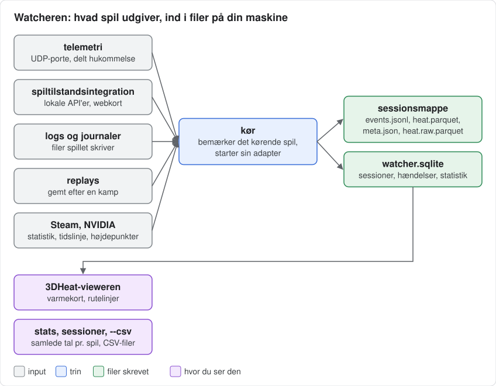
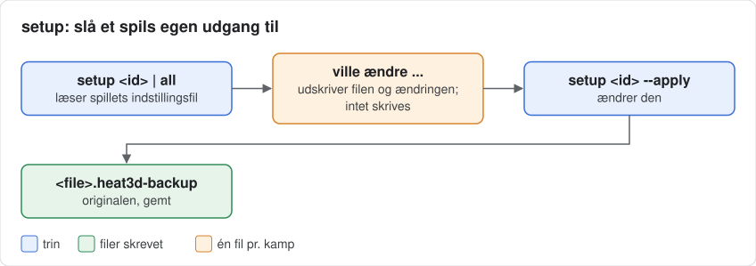
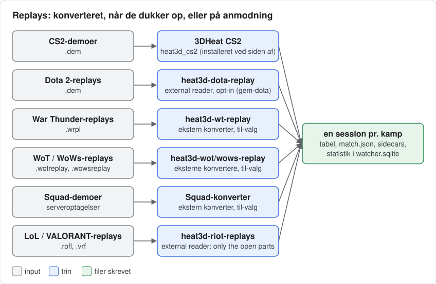
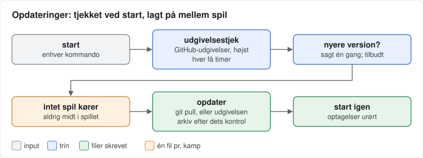

# Kommandoer {#commands}

Ny til kommandolinjen? Læs først [Før du går i gang](before-you-start.md). Hver kommando skrives i en
terminal, der er åbnet i mappen, du pakkede ud eller klonede (i Stifinder skriver du `powershell` i
adresselinjen), sådan her:

```bash
python -m heat3d_watch <command> [options]
```


| Kommando | Hvad den gør |
|---|---|
| [`run`](#run) | overvåger i baggrunden og optager hvert spil, der kører |
| [`games`](#games) | hvad hvert spil giver, og hvorfra |
| [`setup`](#setup) | slår spillets eget output til |
| [`status`](#status) | hvilke spil der kører nu, og hvilke adaptere der ville køre |
| [`sessions`](#sessions) | optagelserne indtil nu |
| [`stats`](#stats) | summer pr. spil, eller tabellerne som CSV |
| [`table`](#table) | genopbyg en sessions `heat.parquet` fra dens `events.jsonl` |
| [`replays`](#replays) | konverter de replays, der allerede ligger på disken |
| [`dota-replay`](#dota-replay) | hent en offentlig Dota 2-kamps replay med dens id |
| [`dota-map`](#dota-map) | Dota 2-kortet fra din installation som et 3D-level, med det separate værktøj 3DHeat Dota |
| [`update`](#update) | opdater til den nyeste udgivelse |
| [`config`](#config) | vis eller ændr indstillingerne |

Valgmuligheder for alle kommandoer: `-h` / `--help` viser hjælpen, og `python -m heat3d_watch --version`
viser versionen (filen `VERSION`).

Billederne på denne side er kørsler på syntetiske eksempelsessioner (`Example Racer`, `Example Arena`),
ikke rigtige optagelser.

Hver kommando undtagen `update` leder først efter en nyere udgivelse (højst hvert sjette timer; springes
over med `HEAT3D_NO_UPDATE=1`, se [Opdateringer](updates.md)). `run` viser kun en besked. De andre
kommandoer spørger `Update now? [Y/n]`, når de kører i en terminal, og skriver, hvordan man opdaterer,
når de ikke gør. Outputtet er UTF-8, så spilnavne i alle skriftsystemer vises rigtigt i enhver konsol.

## run {#run}

```bash
python -m heat3d_watch run [--once] [-v]
```



Holder øje, indtil den stoppes (Ctrl+C): for hvert `scan_seconds` læser den proceslisten og kører en
adapter for hvert spil, den finder, plus de altid-aktive adaptere. Før første kig afslutter den de
sessioner, en tidligere kørsel efterlod åbne. Mens intet spil kører, kan den opdatere sig selv (med
`auto_update` slået til). Detaljerne står i [Installation og kørsel](installing-and-running.md#running).

| Valgmulighed | Virkning |
|---|---|
| `--once` | ét kig på de spil, der kører, og så slut. Adapterne for de spil, der kører nu (og de altid-aktive), startes, hver spørger én gang (der ventes højst 10 sekunder på det), og derefter stoppes de alle, ligesom når et spil lukker: deres sessioner lukkes, skrives og tælles. Til at tjekke registreringen, ikke til optagelse. |
| `-v`, `--verbose` | fejlsøgningslinjer i `watcher.log` og på konsollen |

`run` skriver `<data>\watcher.lock` og nægter at starte endnu en gang for den samme datamappe (afslutningskode 1);
se [Låsefilen](installing-and-running.md#the-lock-file).

## games {#games}

```bash
python -m heat3d_watch games [--markdown]
```


Lister hver adapter sorteret efter spil: dens navn, id og slags, hvor den læser fra, hvad den optager, og
hvordan den slås til. En adapter, der ikke kan køre på denne maskine, markeres `[unavailable: <why>]` -
SimConnect.dll ikke fundet, ingen Minecraft-mappe, 3DHeat CS2 ikke installeret, Steam eller NVIDIA-appen
ikke fundet. Et adaptermodul, der ikke kunne indlæses, nævnes til sidst med fejlen.

```text
EA SPORTS F1 25  (f1-25, telemetry)
    from: UDP telemetry 127.0.0.1:20777 (Documents\My Games\F1 25\hardwaresettings\hardware_settings_config.xml)
    - every car's position (world XYZ, m) at 10 Hz, by driver name, team, own car marked, ...
    switch on: In the game: Settings > Telemetry Settings > UDP Telemetry On, IP 127.0.0.1, port 20777 - ...
```

`--markdown` udskriver det samme som én Markdown-tabel (spil, hvad der optages, hvorfra, hvordan det slås til,
online-spil, kontrolleret). Tabellen i [Alle spil i én tabel](watcher.md) er det output. Cellerne er escapet
for Markdown: tekst i backticks forbliver en kodestump, og uden for dem skrives `<`, `>`, `&`, `*`, `|` og en
backslash før tegnsætning, så de vises som skrevet (`<CS2>` ville ellers forsvinde som et HTML-tag i kramdown).
Det eneste HTML er `<br>` mellem punkterne i kolonnen "What is recorded".

## setup {#setup}

```bash
python -m heat3d_watch setup <adapter id | all> [--apply]
```




Slår et spils eget output til, hvor spillet kræver, at en fil ændres for det. Uden `--apply` ændres intet: hver
linje siger, hvad der ville ændres, og når der er noget at ændre, siger den sidste linje
Nothing was changed. Run again with --apply to make these changes. Når der intet er at ændre, siger den
`<id>: nothing to change` (`Nothing to change.` for `all`). Med `--apply` foretages ændringerne, og før en fil
ændres for første gang, gemmes dens original som `<file>.heat3d-backup`. En backup, der allerede findes,
overskrives aldrig, så den altid indeholder filen, som den var, før watcheren første gang rørte den.

```text
f1-25: would change: hardware_settings_config.xml <udp>: enabled="false" -> "true"
Nothing was changed. Run again with --apply to make these changes.
```

`all` kører opsætningen for hver adapter, der har en. En adapter uden en, nævnt alene, skriver
`<id>: nothing for setup to change; ` efterfulgt af, hvordan spillet slås til (dets `enable`-tekst, eller at det
ikke behøver noget). Et ukendt id skriver `no adapter '<id>'; games lists them` og afslutter med kode 2.
Adaptere, der har noget at opsætte:

| Adapter | Hvad `--apply` ændrer |
|---|---|
| `beamng` | installerer `heat3d`-protokolmodet i BeamNGs brugermappe `mods` (kun når det ikke er der); slå derefter Options > Other > Protocols > "others" til i spillet |
| `cs2-gsi` | skriver `<CS2>\game\csgo\cfg\gamestate_integration_heat3d.cfg`: send spiltilstanden til `http://127.0.0.1:3311/` med et tilfældigt token, som watcheren derefter kræver (et token, der allerede står i filen, beholdes); CS2 læser den, når det starter |
| `dota2-gsi` | det samme for Dota 2: `<Dota>\game\dota\cfg\gamestate_integration\gamestate_integration_heat3d.cfg`, port 3312 |
| `dcs` | tilføjer `Scripts\Hooks\heat3d-watch.lua` i hver `%USERPROFILE%\Saved Games\DCS*`-mappe. Dens egen ældre kopi opdateres; en fil med det navn, som watcheren ikke skrev, lades i fred. Genstart DCS. |
| `dirt-rally-2` | `hardware_settings_config.xml`: `<udp enabled="true" extradata="3" ip="127.0.0.1" port="20777">`; start spillet én gang først, så filen findes |
| `ea-wrc` | `Documents\My Games\WRC\telemetry\config.json`: pakken `session_update` for strukturen `wrc` slås til, til denne maskine |
| `f1-23`, `f1-24`, `f1-25` | `hardware_settings_config.xml`: `<udp enabled="true" ip="127.0.0.1" port="20777">`; spillet skal være lukket |
| `hearthstone` | tilføjer et afsnit `[Power]` (`LogLevel=1`, `FilePrinting=true`) til `%LOCALAPPDATA%\Blizzard\Hearthstone\log.config`; genstart spillet |
| `il2` | `<game>\data\startup.cfg`, `[KEY = telemetrydevice]`: ét mål mere `addrN = "127.0.0.1:41995"` og `enable = true` (afsnittet tilføjes, med 10 Hz, når der ikke er et); genstart IL-2 |
| `il2-tacview` | `<game>\data\startup.cfg`, `[KEY = track_record]`: `tacviewrecord = 1` |
| `rocketleague-stats` | `TAStatsAPI.ini` (eller `DefaultStatsAPI.ini`, når den ikke findes) i `<RL>\TAGame\Config`: `PacketSendRate=30`, når API'et er slukket, og `Port`, når ingen er sat; læses, når Rocket League starter |

`richard-burns-rally` har ingen opsætning: dens telemetri kommer fra RSF/NGP-pluginet, som slås til i hånden i
`RichardBurnsRally.ini` (se [dens side](game-richard-burns-rally.md)); `setup richard-burns-rally` siger det.
Alle andre spil enten behøver intet, eller også slås de til i spillet; hver spilside siger, hvordan.

## status {#status}

```bash
python -m heat3d_watch status
```

```text
3DHeat Watcher 1.0.2; data in C:\Users\...\AppData\Local\3DHeat\Watcher
Games running: EA SPORTS F1 25 (f1-25)
Always on: il2-tacview, steam-stats, steam-timeline, nvidia-highlights, cs2-demos, osu-replays, lol-replays, valorant-replays
```

Siger, hvilke adaptere en `run` ville starte nu, efter de samme regler: spillets proces kører, adapteren er ikke
i `disabled`, intet den behøver mangler, replay-adaptere kun med `replays` slået til, hukommelsesadaptere kun
med `memory` slået til, og alle hukommelseskontrollerne er bestået. Den starter ikke noget.

## sessions {#sessions}

```bash
python -m heat3d_watch sessions [--game NAME] [--limit N]
```


De nyeste sessioner fra `watcher.sqlite`, én linje hver: start (lokal tid), spil, minutter, hændelser,
positioner, mappe.

| Valgmulighed | Virkning |
|---|---|
| `--game NAME` | kun dette spil, med dets præcise navn som på listen (`"EA SPORTS F1 25"`) |
| `--limit N` | højst N sessioner (standard 40) |

## stats {#stats}

```bash
python -m heat3d_watch stats [--game NAME] [--csv DIR]
```


Uden valgmuligheder: en tabel over hvert spil (sessioner, timer, hændelser, positioner, sidst spillet), mest
spillede først, og for hvert spil dets 25 hyppigste hændelser og hver numeriske statistik med antallet af
sessioner, der har den, summen, den bedste værdi (`best`) og gennemsnittet. `best` ved, hvilken vej der er
bedre: den laveste værdi for tider, der gemmes som bedste (`best_lap`, `best_stage` og enhver anden nøgle, der
starter med `best_`), og for placeringer (`race_position`, `grid_position`, enhver nøgle der slutter med
`_position`); den højeste for alt andet (drab, distance, topfart, et spils egne tællere).

| Valgmulighed | Virkning |
|---|---|
| `--game NAME` | kun dette spils hændelser og statistik, uden oversigten |
| `--csv DIR` | skriver `sessions.csv`, `events.csv` og `stats.csv` (hver række i de tre tabeller) til `DIR` i stedet; `--game` begrænser ikke det |

## table {#table}

```bash
python -m heat3d_watch table <session folder>
```


Genopbygger `heat.parquet` i en sessionsmappe fra dens `events.jsonl`, med akserne fra dens `meta.json`.
Udskriver tabellens sti eller `no positions in this session`. Brug den til en session, der blev optaget,
mens `pyarrow` manglede, eller efter at have redigeret `events.jsonl` i hånden.

## replays {#replays}

```bash
python -m heat3d_watch replays <adapter id> [folder] [-v]
```



Konverterer de replays, der allerede ligger på disken, nu, én efter én, hver til en session, som overvågningen
ville have gjort det. Første gang watcheren ser en replay-mappe, noterer den kun, hvad der er i den (se
[Installation og kørsel](installing-and-running.md#replays-already-on-disk)); denne kommando konverterer dem efter
ønske. Uden `folder` læses adapterens egne mapper (spillets, plus `replay_folders`); med den læses replays i
den mappe. Hver konverteret replay noteres som set, så den kørende watcher ikke konverterer den igen. Et replay,
der ikke kan konverteres, logges og springes over.

| Adapter | Replays |
|---|---|
| `cs2-demos` | Counter-Strike 2-demoer (`*.dem`), via 3DHeat CS2 |
| `lol-replays` | League of Legends-replays (`*.rofl`), via den eksterne læser `heat3d-riot-replays` (3DHeat-Ext-Riot) |
| `osu-replays` | osu!-replays (`*.osr`), via den eksterne læser `heat3d-osu-replays` (3DHeat-Ext-Osu) |
| `valorant-replays` | VALORANT-replays (`*.vrf`), via den eksterne læser `heat3d-riot-replays` (3DHeat-Ext-Riot) |
| `warthunder-replays` | War Thunder-replays (`*.wrpl`), via den eksterne konverter `heat3d-wt-replay` (exporters/ext/warthunder-replay) |
| `wot-replays` | World of Tanks-replays (`*.wotreplay`), via den eksterne konverter `heat3d-wot-replay` (exporters/ext/wot-replay) |
| `wows-replays` | World of Warships-replays (`*.wowsreplay`), via den eksterne konverter `heat3d-wows-replay` (exporters/ext/wows-replay) |
| `dota-replays` | Dota 2-replays (`*.dem`), via den eksterne læser `heat3d-dota-replay` (3DHeat-Ext-DotaReplay) |

```text
osu-replays: converted 12 replay(s); `sessions --game` lists them
```

Et id, der ikke er en af disse, skriver `no replay adapter '<id>'` med listen og afslutter med kode 2; det
samme gælder en `folder`, der ikke findes. En adapter, der ikke kan køre her (3DHeat CS2 eller spillets læser
ikke installeret), skriver hvorfor - hvor man henter læseren, og hvordan den installeres - og afslutter med
kode 1. IL-2's Tacview-spor er ikke på listen: den adapter konverterer selv hvert færdige spor, den finder.

## dota-replay {#dota-replay}

```bash
python -m heat3d_watch dota-replay <match id> [<match id> ...] [-o FOLDER] [--convert] [-v]
```

Henter replayet af en offentlig Dota 2-kamp fra Valves replay-servere. Det kræver internet. Kamp-id'et er tallet
på kampens side i Dota-klienten (kampdetaljerne) eller på OpenDotas hjemmeside; Valve gemmer et replay i et par
uger, hvorefter hentningen fejler. Serveren og replayets salt hentes fra OpenDotas registrering af kampen
(`api.opendota.com/api/matches/<id>`, ingen nøgle nødvendig), filen fra
`replay<cluster>.valve.net/570/<id>_<salt>.dem.bz2`; den pakkes ud, mens den kommer ind (Valve serverer både
bzip2 og Zstandard under det navn), og gemmes som `<match id>.dem`. Uden `-o` går den til Dotas egen replay-mappe,
når Dota 2 er installeret - hvor en kørende watcher konverterer den - og ellers til `<data>/replays/dota`. En
fil, der allerede findes, beholdes. `--convert` konverterer de hentede replays med det samme, som
`replays dota-replays` ville, og noterer dem som set; den kræver Dota 2-replaylæseren
([3DHeat-Ext-DotaReplay](https://github.com/Holdi601/3DHeat-Ext-DotaReplay), `heat3d-dota-replay`), og uden den
siger den, hvor man henter den, og afslutter med kode 1, før der hentes noget. Selve hentningen kræver kun
watcheren.

```text
match 9000000000: C:\Program Files (x86)\Steam\steamapps\common\dota 2 beta\game\dota\replays\9000000000.dem
```

Valve gemmer replays i et par uger; en ældre kamp skriver `Valve no longer has the replay of match <id>` og
afslutter med kode 1. En kamp, OpenDota ikke har set endnu, har intet salt: meddelelsen siger, at man skal bede
OpenDota om det (`curl -X POST https://api.opendota.com/api/request/<id>`) og prøve igen et par minutter senere.
Private lobbyer og kampe med skjult profil findes slet ikke på replay-serverne.

## dota-map {#dota-map}

```bash
python -m heat3d_watch dota-map [<map>] -o <file.glb> [--game FOLDER] [--source2viewer EXE] [--detail UNITS]
```

Skriver Dota 2-kortet - terræn, klipper, vand, træer og bygninger - som et `.glb`-level i det koordinatsystem,
Dota-replay-tabellerne tegnes i, fra din egen Dota 2-installation. Watcheren læser ikke spillets filer selv: den
kører det separate værktøj **3DHeat Dota** (`heat3d-dota-maps level`,
[3DHeat-Ext-Dota](https://github.com/Holdi601/3DHeat-Ext-Dota)) med disse valgmuligheder og videresender dets
output og afslutningsstatus. `<map>` er `dota` som standard; `--game` er Dota 2-mappen, når den ikke ligger i et
Steam-bibliotek; `--source2viewer` er stien til Source2Viewers CLI, som værktøjet kræver; `--detail` er
cellestørrelsen for sammenklyngning af hjørner i bygninger, i spilenheder (standard 8, 0 beholder hver trekant).
Når værktøjet ikke er installeret, skriver den `dota-map: the Dota 2 map converter is not installed: ...` med
hvor man henter det, og afslutter med kode 2. Detaljer: [Dota 2-kort](dota-map.md).

## update {#update}

```bash
python -m heat3d_watch update [--check]
```



Spørger GitHub om den nyeste udgivelse og ignorerer det gemte svar, og opdaterer denne kopi, når den er nyere
(se [Opdateringer](updates.md)). `--check` siger kun, om en nyere udgivelse findes. Kommandoen kører også, når
`HEAT3D_NO_UPDATE` er sat: at bede om den er beslutningen. `python -m heat3d_update [--check]` gør det samme.

## config {#config}

```bash
python -m heat3d_watch config [--set KEY=VALUE ...]
```


Udskriver hver indstilling som `key = value`. Med `--set` ændres de givne først, og `settings.json` gemmes
(`saved <path>`). Værdier læses efter indstillingens type:

- sand/falsk-indstillinger: `1`, `true`, `yes`, `on` eller `ja` er sand; `0`, `false`, `no`, `off`, `nein` eller
  intet er falsk;
- tal: et decimaltal (`scan_seconds=5`);
- lister: kommasepareret eller en JSON-liste (`disabled=steam-stats,steam-timeline`; en tom værdi tømmer listen);
- ordbøger (`replay_folders`, `player_names`): hele ordbogen som JSON, eller én post som `KEY.ID=VALUE` -
  `replay_folders.cs2-demos=D:\Demos,E:\More Demos` sætter den adapters mapper (kommasepareret),
  `player_names.warthunder-webmap=Name` den adapters navn; en tom værdi fjerner posten;
- tekst: som givet (`data=D:\Heat`, `riot_id=Name#TAG`).

```bash
python -m heat3d_watch config --set memory=true scan_seconds=5
python -m heat3d_watch config --set riot_id=Name#TAG riot_platform=EUW1
python -m heat3d_watch config --set replay_folders.cs2-demos=D:\Demos player_names.rocketleague-stats=Name
```

En ukendt nøgle skriver `no setting '<key>'`, og en værdi, der ikke er af indstillingens type (`memory=perhaps`,
`scan_seconds=often`, en ordbog der ikke er JSON), skriver `not saved: ...`; begge afslutter med kode 2 uden at
gemme noget. En `settings.json`, der redigeres i hånden, læses på samme måde: en værdi givet som tekst, hvor
indstillingen er et tal, en sand/falsk eller en ordbog, læses som skrevet, og en, der ikke kan læses, står på sin
standard. Hver indstilling er beskrevet i [Installation og kørsel](installing-and-running.md#settings).
