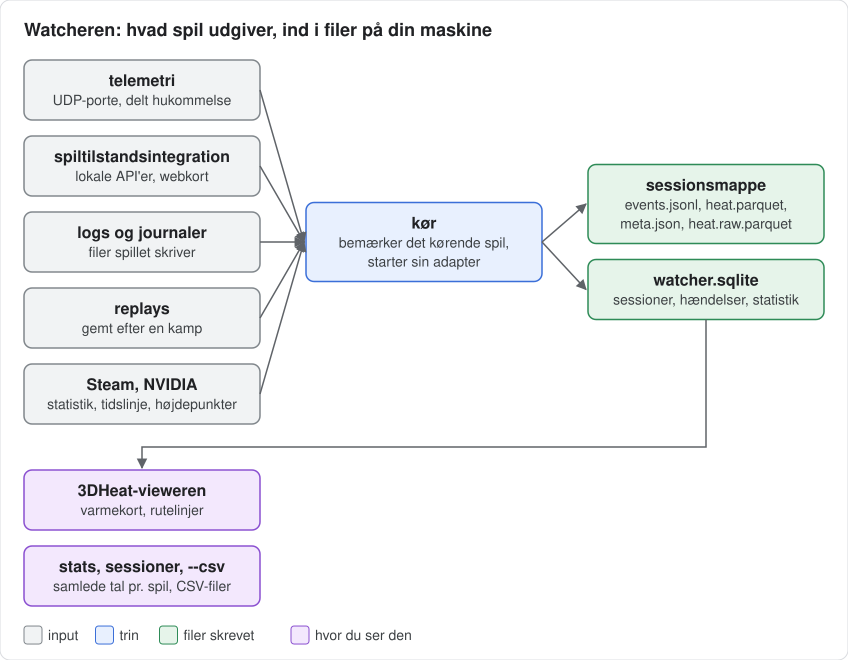

# 3DHeat Watcher {#dheat-watcher}

**Hvad er det?** Du spiller et spil. Dette program skriver stille ned, hvor du var, og hvad der skete.
Senere kan du se det som et farvet kort i 3DHeat-fremviseren.

**Hvorfor skulle jeg bruge det?** For at have din egen optegnelse over hver session - hvor du kørte, fløj eller kæmpede,
dine samlede tal pr. spil - uden nogen hjemmeside og uden at ændre spillet.

**Eksempel:** du kører en omgang i et løbsspil med watcheren kørende; bagefter ligger en fil i
`sessions\<game>\`, der holder den linje, du kørte, og fremviseren tegner den.

Mere detaljeret: 3DHeat Watcher er et baggrundsprogram, der optager, hvad spil udgiver om dit spil - hvor du
var, hvad der skete hvor, og tallene bag det - i filer på din egen maskine. Filerne er
til din egen statistik og til varmekortene og rutelinjerne i 3DHeat-fremviseren.

Det kører stille, bemærker hvilket spil du startede, og læser det spils egne udgange: en telemetriport
eller delt hukommelse, som spillet udgiver til dashboards, en spiltilstandsintegration, den journal eller log
spillet skriver, replayet det gemmer efter en kamp, statistikkerne Steam fører, klipene
NVIDIA App gemmer. Optagelser bliver på din maskine. Programmet kontakter kun to eksterne tjenester, og kun i
disse tilfælde: GitHub, for at lede efter en nyere udgivelse (se [Opdateringer](../updates.md)), og Riots Match-V5-API,
og kun hvis du indtaster din egen Riot-API-nøgle (se [League of Legends-replays](../game-lol-replays.md)).



## Hvad den optager {#what-it-records}

- **Positioner**: bilen, flyet, helten eller spilleren, flere gange i sekundet, hvor spillet udgiver dem,
  med fart, retning og det andet, spillet sender sammen med dem.
- **Hændelser**: fremkomst, dødsfald, drab, omgange, etaper, runder, mål, job, start og landinger, zoneskift,
  præstationer, højdepunkter. Hver hændelse gemmes med sit tidspunkt, og med sit sted, når spillet giver et.
- **Statistik pr. session**: drab, dødsfald, omgange, bedste omgang, distance, topfart, spilletid, og spillets
  egen statistik, hvor det fører den.

Hvad hvert spil giver, og hvorfra, står på sin egen side under [Spil](../games.md). Én kilde kan ikke
optage alt: multiplayer-spil optages kun gennem det, de udgiver, og watcheren læser aldrig
deres hukommelse (se [Kilder og regler](../sources-and-rules.md)).

## Installation {#install}

Ny til kommandolinjen? Læs [Før du går i gang](before-you-start.md) først.

Watcheren er et Python-program til Windows (Python 3.10 eller nyere). Mange af dens kilder findes kun på Windows: delt
hukommelse, registreringsdatabasen, Windows-notifikationer.

```bash
git clone https://github.com/Holdi601/3DHeat-Watcher.git
cd 3DHeat-Watcher
pip install -r requirements.txt
```

Et hentet udgivelsesarkiv virker på samme måde: pak det ud, og kør derefter `pip install -r requirements.txt`
inde i mappen. Detaljerne, og de ekstra ting nogle spil har brug for, står i
[Installation og kørsel](../installing-and-running.md).

## Hurtig start {#quick-start}

```bash
python -m heat3d_watch games            # what each game gives, and from where
python -m heat3d_watch setup all        # what would have to be switched on (nothing is changed)
python -m heat3d_watch setup f1-25 --apply   # switch one game's output on (the original file is backed up)
python -m heat3d_watch run              # watch; leave it running while you play
python -m heat3d_watch stats            # totals per game
python -m heat3d_watch stats --csv out  # sessions, events and stats as CSV files
```

Du bør se: efter `games` en tabel med én linje pr. spil; `run` fortsætter, indtil du trykker
Ctrl+C eller lukker vinduet.

Alt skrives til `%LOCALAPPDATA%\3DHeat\Watcher`. For at bruge en anden mappe, sæt
miljøvariablen `HEAT3D_WATCH_HOME`, eller kør `python -m heat3d_watch config --set data=D:\somewhere`.

- `sessions\<game>\<date>_<adapter>\` - én mappe pr. session, der holder `events.jsonl` (hver hændelse
  når den sker), `heat.parquet` (rækkerne med en position, klar til 3DHeat-fremviseren) og
  `meta.json` (spil, kilde, akser, antal, statistik)
- `watcher.sqlite` - statistikken for hver session, i tre almindelige tabeller
- `watcher.log` - hvad watcheren gjorde

Fremviseren åbner en sessions `heat.parquet` direkte, uden at du skal indstille noget (dens akser og enheder står i
filen). Konverterede replays skrives som tabeller og kampdokumenter ved siden af; fremviserens
eget format med én fil pr. kamp beskrives på dens side om [`.3dheat`-containeren](https://holdi601.github.io/3DHeat/container.html),
og alle tabellers kolonner står i [Data](../the-data.md).

## Dokumentationen {#the-documentation}

| Side | Hvad den dækker |
|---|---|
| [Før du går i gang](before-you-start.md) | Python, en terminal, pladsholdere, hvordan succes og de almindelige fejl ser ud |
| [Installation og kørsel](../installing-and-running.md) | krav, kørsel i baggrunden, start med Windows, låsefilen, loggen, alle indstillinger og miljøvariabler |
| [Spil](../games.md) | én side pr. spil: hvad der optages, hvorfra, hvordan det slås til, hvordan det virker, akser, statistik, hvad der er kontrolleret |
| [Data](../the-data.md) | sessionsmapper, `events.jsonl`, `heat.parquet` og dens footer, `meta.json`, `watcher.sqlite`, gendannelse efter et nedbrud, CSV-eksport, åbning af en session i 3DHeat-fremviseren |
| [Kommandoer](../commands.md) | hver kommando og valgmulighed for `python -m heat3d_watch` |
| [Kilder og regler](../sources-and-rules.md) | de seks slags kilder, multiplayer-reglerne, hvilke spil der er udeladt og hvorfor |
| [NVIDIA Highlights](../nvidia-highlights.md) | hvad NVIDIA Highlights kan og ikke kan levere, og hvordan et højdepunkt får en position |
| [Serveroptagermods](../server-mods.md) | Arma 3- og Arma Reforger-servermods, der optager hele missioner til fremviseren |
| [Læsning af hukommelse](../memory-reading.md) | enkeltspiller-hukommelsesprofiler: formatet, kontrollerne, hvordan man skriver og verificerer en |
| [Opdateringer](../updates.md) | hvordan watcheren leder efter nye udgivelser og opdaterer sig selv |
| [Udvikling](../development.md) | at skrive en adapter: API'et, tests, en ærlig `verified`, regenerering af spilsiderne |
| [Alle spil i én tabel](../watcher.md) | hvert spil i én tabel, som `games --markdown` udskriver, plus de spil, der er undersøgt men endnu ikke bygget |
| [Kommandoreference](../cli-reference.md) | hver kommandos `--help`, genereret ud fra koden |
| [Vedligeholdelse](../maintaining.md) | udgivelsestjeklisten for disse sider |

## Del af 3DHeat {#part-of-3dheat}

3DHeat Watcher er et af de gratis værktøjer omkring 3DHeat-fremviseren (watcheren bruger 3DHeat CS2
til at konvertere CS2-demoer). Hver er sit eget projekt med sine egne udgivelser og licens:

| Værktøj | Hvad det gør | Dokumentation |
|---|---|---|
| [3DHeat](https://github.com/Holdi601/3DHeat) | fremviseren: varmekort, løbsanalyse og kampgennemgang i 3D | [site](https://holdi601.github.io/3DHeat/) |
| [GameFiles](https://github.com/Holdi601/3DHeat-GameFiles) | baner og kort ud af de filer, spil leverer, som 3D-modeller | [site](https://holdi601.github.io/3DHeat-GameFiles/) |
| [GameCapture](https://github.com/Holdi601/3DHeat-GameCapture) | omgangstelemetri fra løbsspil; baner genskabt ud fra spilvideo | [site](https://holdi601.github.io/3DHeat-GameCapture/) |
| [Unreal Exporter](https://github.com/Holdi601/3DHeat-UnrealExporter) | et Unreal Editor-plugin, der eksporterer en bane som én 3D-model | [site](https://holdi601.github.io/3DHeat-UnrealExporter/) |
| [CS2](https://github.com/Holdi601/3DHeat-CS2) | Counter-Strike 2-demoer til tabeller og kampdokumenter; kort til 3D-modeller | [site](https://holdi601.github.io/3DHeat-CS2/) |
| [Watcher](https://github.com/Holdi601/3DHeat-Watcher) | optager, hvad spil udgiver om dit spil, i baggrunden | [site](https://holdi601.github.io/3DHeat-Watcher/) |
| [Ext-WarThunder](https://github.com/Holdi601/3DHeat-Ext-WarThunder) | War Thunder-replays til tabeller og kampdokumenter | [site](https://holdi601.github.io/3DHeat-Ext-WarThunder/) |
| [Ext-WoT](https://github.com/Holdi601/3DHeat-Ext-WoT) | World of Tanks-replays til tabeller og kampdokumenter | [site](https://holdi601.github.io/3DHeat-Ext-WoT/) |
| [Ext-WoWs](https://github.com/Holdi601/3DHeat-Ext-WoWs) | World of Warships-replays til tabeller og kampdokumenter | [site](https://holdi601.github.io/3DHeat-Ext-WoWs/) |
| [Ext-Squad](https://github.com/Holdi601/3DHeat-Ext-Squad) | Squad-serverdemoer til tabeller og kampdokumenter | [site](https://holdi601.github.io/3DHeat-Ext-Squad/) |
| [Ext-DCS](https://github.com/Holdi601/3DHeat-Ext-DCS) | DCS World-kort til 3D-modeller | [site](https://holdi601.github.io/3DHeat-Ext-DCS/) |
| [Ext-IL2](https://github.com/Holdi601/3DHeat-Ext-IL2) | IL-2 Sturmovik-kort til 3D-modeller | [site](https://holdi601.github.io/3DHeat-Ext-IL2/) |

Licens: MIT ([LICENSE](https://github.com/Holdi601/3DHeat-Watcher/blob/main/LICENSE)). Licenserne
for tredjepartspakkerne, det bruger, og hvad de spil, det læser, kræver, står i
[LICENSES.md](https://github.com/Holdi601/3DHeat-Watcher/blob/main/LICENSES.md).
