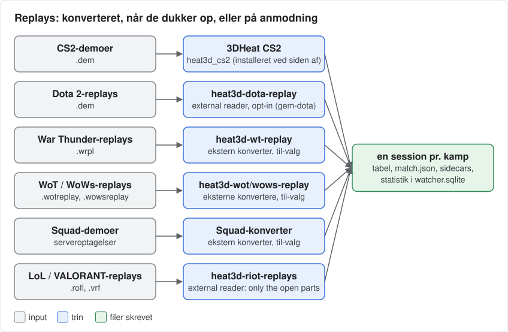

# Installation og kørsel {#installing-and-running}

## Krav {#requirements}

- **Windows.** Watcheren er skrevet til Windows, og de fleste af dens kilder findes kun der: delt hukommelse, som spil
  opretter (`Local\...`-mappinger), registreringsdatabasen (hvor Steam er), Windows-meddelelser og proceslisten med
  programstier. På et andet system starter programmet, men disse kilder finder intet, meddelelser logges kun, og
  hukommelseslæsning nægter (`"only implemented on Windows"`).
- **Python 3.10 eller nyere**, fra <https://www.python.org/downloads/>: sæt flueben i **Add python.exe to PATH** i
  installationsprogrammet, og tjek derefter med `python --version` i en ny terminal. Ny til det her? Læs først
  [Før du går i gang](before-you-start.md).
- **Pakker** (`requirements.txt`): `psutil>=6.0` (hvilke spil der kører, hvilket program der holder en port, et spils
  forbindelser; en ældre psutil virker stadig, gennem dens ældre navn for en proces' forbindelser), `pyarrow>=15`
  (skriver `heat.parquet`), `numpy>=1.24` og `pytest>=8.0` til testene. `requirements-optional.txt` lister i øjeblikket
  ingen pakker.

Uden `pyarrow` optages sessioner stadig: `events.jsonl` er optagelsen, og tabellen kan bygges senere med
[`table`](commands.md#table).

### Ekstra til nogle spil {#extras-some-games-need}

| Spil | Hvad det kræver |
|---|---|
| Counter-Strike 2-demoer | [3DHeat CS2](https://github.com/Holdi601/3DHeat-CS2) og dets krav (`demoparser2`). Watcheren leder efter det i `HEAT3D_CS2`, derefter i en mappe `3DHeat-CS2` eller `cs2` ved siden af watcherens egen mappe, derefter hvor som helst Python kan importere `heat3d_cs2` fra. Uden det viser `games` adapteren som utilgængelig. |
| Microsoft Flight Simulator 2020 / 2024 | `SimConnect.dll` - ikke med i pakken. MSFS 2020 har en i sin installationsmappe; til MSFS 2024 installeres MSFS 2024 SDK. `MSFS_SDK` / `MSFS2024_SDK` peger på SDK-mappen. |
| Euro Truck Simulator 2, American Truck Simulator | RenCloud-pluginet `scs-telemetry.dll` (revision 12) i `<game>\bin\win_x64\plugins` |
| BeamNG.drive | `heat3d`-protokolmodet, installeret med `python -m heat3d_watch setup beamng --apply` |
| League of Legends (live) | valgfrit: Riots rodcertifikat som `<data>\riotgames.pem`, så den lokale forbindelse verificeres |
| Minecraft | en `%APPDATA%\.minecraft`-mappe (Java Edition) |

Hver spilside under [Spil](games.md) siger, hvad der skal slås til i selve spillet.
`python -m heat3d_watch games` markerer en adapter `[unavailable: ...]`, når noget, den behøver, mangler på denne maskine.

## Installation {#installing}

Ny til kommandolinjen? Læs først [Før du går i gang](before-you-start.md). Hvis `pip` ikke findes, brug i stedet
`python -m pip install -r requirements.txt`.

Fra en klon:

```bash
git clone https://github.com/Holdi601/3DHeat-Watcher.git
cd 3DHeat-Watcher
pip install -r requirements.txt
```

Fra en udgivelse: hent arkivet fra depotets udgivelser, pak det ud, og kør derefter `pip install -r requirements.txt`
inde i mappen. Begge slags kopier opdaterer sig selv (se [Opdateringer](updates.md)).

Kør hver kommando fra depotmappen: `python -m heat3d_watch` importerer pakken derfra, og opdateringsprogrammet
(`heat3d_update`) ligger ved siden af den.

## Kørsel {#running}

```bash
python -m heat3d_watch run        # watch until stopped
python -m heat3d_watch run -v     # the same, with debug lines in the log
python -m heat3d_watch run --once # one look at the games running now, then stop and exit
```

Ved start gør `run` følgende:

1. skriver [låsefilen](#the-lock-file);
2. afslutter de sessioner, en tidligere kørsel efterlod åbne, for eksempel efter et nedbrud
   (se [Gendannelse](the-data.md#recovery-after-a-crash));
3. hvert `scan_seconds` (2 s) læser den proceslisten (kun navne og stier, ingen proces åbnes) og starter en adapter,
   i sin egen tråd, for hvert spil, den finder. Når et spils proces er væk, stoppes dets adapter, og de sessioner, den
   havde åbne, lukkes, hvilket skriver deres tabel og deres linje i statistikken. Adaptere, der ikke venter på et spil
   (Steam-statistik, Steam Timeline, NVIDIA-højdepunkter, replay-mapperne), kører hele tiden;
4. mens intet spil kører, kigger den efter en nyere udgivelse højst én gang i timen (selve svaret caches i seks timer)
   og, med `auto_update` slået til, installerer den og starter sig selv igen (se [Opdateringer](updates.md)).

En adapter, der fejler, logges og stopper ikke de andre. Hvis en adapters spørgsmål fejler 20 gange i træk, eller dens
start fejler, stoppes adapteren og genstartes ikke, før spillet startes igen (et nyt proces-id).

Stop watcheren med Ctrl+C. Adapterne lukker deres sessioner, før den afslutter. Hvis watcheren dræbes i stedet (Jobliste,
et nedbrud, et strømsvigt), går intet, der allerede er skrevet, tabt: den næste `run` afslutter disse sessioner.

`--once` tager et enkelt kig: den starter adapterne for de spil, der kører i det øjeblik (og de altid-aktive), lader hver
spørge én gang - venter højst 10 sekunder på det - og stopper dem derefter, som når et spil slutter. Sessionerne, de
åbnede, lukkes, deres tabeller skrives, og deres linjer tælles i statistikken, før den afslutter. Brug den til at kontrollere,
at et spil bliver fundet, ikke til at optage.

### Replays der allerede ligger på disken {#replays-already-on-disk}


Første gang en replay-adapter ser en af sine mapper, noterer den kun de replays, der allerede er i den: en spiller med år
af demoer ville ellers finde watcheren optaget i en dag med at konvertere. Derfra konverteres hvert nye replay, når spillet
er færdig med at skrive det. De gamle konverteres efter ønske med [`replays`](commands.md#replays):

```bash
python -m heat3d_watch replays cs2-demos              # every demo in CS2's folders and replay_folders
python -m heat3d_watch replays osu-replays D:\Old     # the replays in one folder
```

### Kørsel i baggrunden {#running-in-the-background}

Watcheren har ikke et vindue af sin egen; det er et konsolprogram, der kører, indtil det stoppes. Det skriver alt til
`watcher.log`, så det behøver ikke en synlig konsol. Måder at holde det ude af vejen:

- start det i en konsol og minimér konsollen: `start "" /min python -m heat3d_watch run` fra `cmd`, i depotmappen;
- start det uden konsol: `pythonw -m heat3d_watch run`. Konsoloutput går tabt, men `watcher.log` skrives stadig. For at
  stoppe det, afslut processen `pythonw.exe`; den næste start afslutter så de sessioner, den efterlod åbne. Projektet har
  ikke testet denne måde at køre på.

### Start med Windows (en idé) {#starting-with-windows-an-idea}

Watcheren installerer sig ikke selv til at starte med Windows. For at starte den automatisk:

- **Task Scheduler**: opret en opgave med udløseren *At log on* og handlingen *Start a program*, program `pythonw.exe`
  (eller `python.exe`), argumenter `-m heat3d_watch run`, *Start in* sat til depotmappen;
- **Startmappen**: læg en genvej i `shell:startup` med samme program, argumenter og *Start in*-mappe.

Ingen af dem er en del af watcheren eller testet af den. [Låsefilen](#the-lock-file) sørger for, at en anden kopi, der ved
en fejl startes, afslutter med det samme.

## Låsefilen {#the-lock-file}

`<data>\watcher.lock` indeholder proces-id'et for den kørende watcher. Når `run` starter, og låsefilen nævner en proces, der
stadig findes, og hvis navn indeholder `python`, udskriver den

```text
A watcher is already running (process 12345) for C:\Users\...\3DHeat\Watcher.
```

og afslutter med kode 1. To watchere på samme datamappe ville optage hvert spil to gange, og den anden ville opfatte den
første watchers åbne sessioner som rester fra et nedbrud. En låsefil, hvis proces er væk, eller som hører til et andet
program, overskrives. Når `run` slutter, fjerner den låsefilen, hvis den stadig nævner dens egen proces.

## Loggen {#the-log}

`<data>\watcher.log` skrives kun af `run`; de andre kommandoer udskriver til konsollen. Hver linje har tidspunkt, niveau og en
besked:

```text
2026-05-01 20:15:01,123 INFO watching; data in C:\Users\...\AppData\Local\3DHeat\Watcher
2026-05-01 20:15:03,456 INFO f1-25: starting (EA SPORTS F1 25)
2026-05-01 21:02:11,789 INFO f1-25: stopping
```

Adaptere logger, hvad de ikke kan gøre, og hvorfor: "UDP 20777 is in use by ...; not taking it from that program",
"not reading memory: the game is played online", "could not start", "poll failed (3)" med tracebacken. `run -v` tilføjer
fejlsøgningslinjer. Filen tilføjes til, og watcheren roterer eller tømmer den aldrig; slet den, når du vil. De samme linjer
går også til konsollen.

## Hvor alt ligger {#where-everything-is}

Hjemmemappen er `%LOCALAPPDATA%\3DHeat\Watcher`, eller `HEAT3D_WATCH_HOME`, når den er sat (uden `LOCALAPPDATA`, for eksempel
på et andet system, `~/.local/share/3DHeat/Watcher`). `settings.json` ligger altid i hjemmemappen. Alt andet går til
datamappen, som er hjemmemappen, medmindre indstillingen `data` nævner en anden:

| Sti | Hvad den er |
|---|---|
| `<home>\settings.json` | indstillingerne |
| `<data>\sessions\` | optagelserne, én mappe pr. omgang ([Dataene](the-data.md)) |
| `<data>\watcher.sqlite` | statistikdatabasen |
| `<data>\watcher.log` | loggen for `run` |
| `<data>\watcher.lock` | låsefilen, mens `run` kører |
| `<data>\state\` | hvad de altid-aktive og replay-adapterne allerede har set (`steam-stats.json`, `replays-cs2-demos.json`, ...), så en genstart ikke optager noget to gange |
| `<data>\profiles\*.json` | hukommelsesprofiler, du har skrevet ([Læsning af hukommelse](memory-reading.md)) |
| `<data>\riotgames.pem` | valgfrit, Riots rodcertifikat til League of Legends-livadapteren |
| `%LOCALAPPDATA%\3DHeat\update-check-3DHeat-Watcher.json` | det gemte svar fra det sidste udgivelsestjek |

Watcheren sletter intet i disse mapper, undtagen en sessionsmappe, hvor intet blev optaget (et spil, der blev i sine menuer).

## Indstillinger {#settings}


`python -m heat3d_watch config` viser indstillingerne; `config --set key=value ...` ændrer dem og gemmer `settings.json`
(se [config](commands.md#config)). Filen er almindelig JSON og kan også redigeres i hånden, mens watcheren ikke kører. Ukendte
nøgler i den ignoreres. Indstillinger læses, når en kommando starter, så genstart `run` efter en ændring.

| Indstilling | Standard | Hvad den gør |
|---|---|---|
| `data` | `""` | Datamappen. Tom: hjemmemappen. |
| `disabled` | `[]` | Adapter-id'er, der aldrig kører, for eksempel `config --set disabled=steam-stats,nvidia-highlights`. Enhver anden adapter kører, når den finder sit spil. |
| `auto_update` | `true` | Mens intet spil kører, installeres en nyere udgivelse, og watcheren genstarter ([Opdateringer](updates.md)). `false`: kun en besked i loggen. |
| `scan_seconds` | `2.0` | Sekunder mellem kig på proceslisten. |
| `memory` | `false` | Tillad hukommelsesadaptere (enkeltspiller-spil med en profil, du skrev) at køre. Slået fra som standard; se [Læsning af hukommelse](memory-reading.md). |
| `replays` | `true` | Kør `replay`-adapterne: alle af dem (se `python -m heat3d_watch replays` og [Spil](games.md)) - CS2-demoer, Dota 2, osu!, War Thunder, World of Tanks, World of Warships, Squad, League of Legends- og VALORANT-replays, IL-2 Tacview-optagelser. |
| `replay_folders` | `{}` | Ekstra mapper pr. adapter-id, for eksempel `{"cs2-demos": ["D:\\Demos"]}`. Replay-adapterne overvåger dem ud over spillets egne mapper; `il2-tacview` accepterer også installationsmapper (den kigger så i deres `data\Tracks`); for `elite` erstatter den første mappe journalmappen. Sæt en adapters mapper med `config --set replay_folders.cs2-demos=D:\Demos,E:\More`, eller hele ordbogen som JSON. |
| `riot_id` | `""` | Dit Riot-ID (`Name#TAG`), så din egen linje i en League of Legends-replay bliver til din statistik. Tom: hver spillers linje gemmes, og ingen markeres som din. |
| `riot_api_key` | `""` | Din egen Riot-udviklernøgle, til at hente hver replayet League-kamps officielle tidslinje (positioner hvert minut, drab der hvor de skete). Tom: intet hentes. |
| `riot_platform` | `"EUW1"` | Dit League-servers platform-id (`EUW1`, `EUN1`, `NA1`, `KR`, ...), brugt til at finde den regionale Match-V5-vært. |
| `player_names` | `{}` | Dit navn i spil, hvis grænseflade navngiver alle spillere, men ikke siger, hvem du er, pr. adapter-id: `warthunder-webmap` (dræbermeddelelsernes linjer om dig bliver til dine drab og dødsfald) og `rocketleague-stats` (dine rækker bliver `me`; uden det, den spiller spillets kamera følger). Sæt med `config --set player_names.warthunder-webmap=Name`. |

En `settings.json` med alle standardværdierne:

```json
{
  "data": "",
  "disabled": [],
  "auto_update": true,
  "scan_seconds": 2.0,
  "memory": false,
  "replays": true,
  "replay_folders": {},
  "riot_id": "",
  "riot_api_key": "",
  "riot_platform": "EUW1",
  "player_names": {}
}
```

## Miljøvariabler {#environment-variables}

| Variabel | Virkning |
|---|---|
| `HEAT3D_WATCH_HOME` | hjemmemappen (indstillinger, og data, medmindre `data` siger andet) |
| `HEAT3D_NO_UPDATE` | enhver værdi undtagen tom, `0`, `false` eller `no` slår udgivelsestjekket og den automatiske opdatering fra |
| `HEAT3D_NO_TOAST` | enhver ikke-tom værdi: ingen Windows-meddelelser, kun loglinjer |
| `HEAT3D_CS2` | mappen for 3DHeat CS2, til CS2-demoer |
| `HEAT3D_CS2_GSI_PORT` | CS2's spiltilstandsport (standard 3311); cfg-filen, `setup` skriver, bruger den |
| `HEAT3D_DOTA_GSI_PORT` | Dota 2's spiltilstandsport (standard 3312) |
| `MSFS_SDK`, `MSFS2024_SDK` | MSFS SDK-mapperne, hvor `SimConnect SDK\lib\SimConnect.dll` søges |

Windows-meddelelser bruges kun til opdateringer: "Updating to 1.2.0", eller "1.2.0 is out; not updated: ...", når opdateringen
ikke kunne anvendes. De vises gennem PowerShells egen meddelelses-API, så intet skal installeres. Titlen og teksten sendes til
PowerShell som miljøvariabler, aldrig som en del af scriptet.
