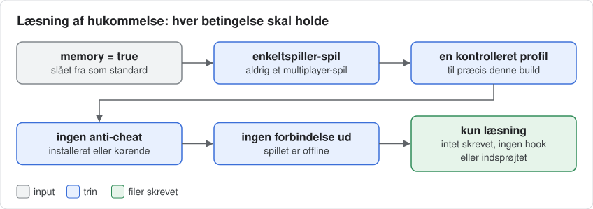

# Læsning af hukommelse {#reading-memory}

Nogle enkeltspiller-spil fortæller intet til andre programmer. For dem kan watcheren - hvis du slår det til og selv
skriver en profil - slå din position op i spillets hukommelse, kun læsende.

For enkeltspiller-spil, der ikke udgiver noget, kan watcheren læse positioner og værdier fra spillets hukommelse gennem
en **profil**, du selv skriver til din egen build af spillet. Blandt alle kilderne er dette den eneste, spillet ikke selv har
udleveret, og den er derfor afskærmet mere end de andre:

- den er **slået fra som standard** (`python -m heat3d_watch config --set memory=true` slår den til);
- den læser, og den har ingen måde at skrive på;
- **ingen profiler følger med værktøjerne.**

Profiler følger ikke med, fordi en offset kun passer til den build, den blev fundet på. Efter en patch læser en profil, der var
rigtig før, skrald, og skrald ligner præcis tal. En profil skal kontrolleres på den build, en spiller har, af spilleren selv.

## Kontrollerne, i rækkefølge {#the-checks-in-order}



Alle kontrollerne nedenfor skal bestås. De første fire laves **før** spillet åbnes, fordi åbning af et beskyttet spil til
læsning i sig selv er det, et anti-cheat bemærker, og at afvise bagefter ville komme for sent.

1. **Indstillingen**: `memory` er sand. Ellers startes hukommelsesadaptere aldrig.
2. **En profil for spillet**, hvis `exe` nævner den kørende proces. En profil angiver, om spillet overhovedet kan spilles
   online (`"online"`); en profil, der udelader det, afvises.
3. **Intet anti-cheat i nærheden**:
   - ingen anti-cheat-fil i spillets mappe eller op til tre mapper over den (stopper ved et Steam-biblioteks mappe `common`,
     eller ved en mappe med `steamapps` i sig, da andre spil ligger over den): `EasyAntiCheat`,
     `EasyAntiCheat_EOS_Setup.exe`, `start_protected_game.exe`, `BattlEye`, `BEClient_x64.dll`, `BEService_x64.exe`,
     `EAAntiCheat.GameServiceLauncher.exe`, `AntiCheatExpert`, `SGuard64.exe`, `GameGuard`, `GameMon.des`, `XIGNCODE`,
     `xhunter1.sys`, `Vanguard`, `FACEIT` (sammenlignet med små bogstaver, også som starten af et navn). Hvis spillets mappe
     er ukendt, afvises spillet;
   - ingen anti-cheat-driver eller -tjeneste kører på maskinen overhovedet, som listet af
     `sc query type= driver state= active` og `sc query type= service state= active`: EasyAntiCheat, EasyAntiCheat_EOS,
     BEService, BEDaisy, vgk, vgc, ACE-BASE, ACE-GAME, xhunter1, FACEIT, FACEITService, EAAntiCheatService, Denuvo Anti-Cheat,
     npggsvc, Ricochet. Et kerne-anti-cheat, installeret til et andet spil, overvåger stadig hver proces. Hvis tjenesterne ikke
     kan listes, afvises spillet.
4. **Ikke online**: et spil, hvis profil siger `"online": true`, læses kun, mens det ingen forbindelse har til andet end denne
   maskine (enhver fjernadresse andet end `127.x` og `::1`). Hvis dets forbindelser ikke kan læses, afvises det.
5. Derefter, når adapteren starter:
   - **den præcise build**: programmets filstørrelse eller dets SHA-256 skal matche en version, profilen lister. En ukendt
     build læses ikke;
   - **modulerne en gang til**: spillets indlæste moduler listes (et Toolhelp-øjebliksbillede, som ikke kræver adgangsrettigheder
     af sig selv) og kontrolleres for en anti-cheat-klient (`BEClient_x64.dll`, `BEClient.dll`, `EasyAntiCheat_x64.dll`,
     `EasyAntiCheat.dll`, `EOSAntiCheat...`). En beskyttet proces afviser øjebliksbilledet, og det er også en afvisning;
   - først derefter åbnes processen, med `PROCESS_VM_READ | PROCESS_QUERY_LIMITED_INFORMATION` og intet andet.

Kontrollerne 1 til 4 gentages ved hver scanning (hvert 2. sekund), mens spillet kører. Hvis en af dem begynder at fejle (spillet
forbinder til en server, en anti-cheat-tjeneste starter), stoppes adapteren ved næste scanning. En afvisning logges:
`mem-<id>: not reading memory: <reason>`. En fejl under start (ukendt build, en anti-cheat-modul, et mønster, der ikke findes)
logges som `mem-<id>: could not start`, og adapteren forsøges ikke igen, før spillet startes igen.

Der er ingen skrivning, ingen allokering i den anden proces, ingen tråd startet i den, intet bibliotek indlæst i den, ingen
debug-rettighed og ingen ophøjelse. En test (`test_memory_reading_cannot_write` i `tests/test_core.py`) fejler, hvis ethvert kald,
der skriver til, allokerer i eller kører kode i en anden proces - `WriteProcessMemory`, `VirtualAllocEx`, `CreateRemoteThread`,
`PROCESS_VM_WRITE`, `SeDebugPrivilege`, `LoadLibrary`, ... - findes et sted i pakken.

Læs aldrig, uanset hvad en profil siger: spil, der spilles online, og spil, hvis enkeltspiller-tilstand kører under et anti-cheat,
såsom GTA V, eller Elden Ring startet gennem dets launcher. Kontrollerne ovenfor afviser dem alligevel.

## Profilformatet {#the-profile-format}

En profil er en JSON-fil i `<data>\profiles\` (`<data>` er datamappen, se [Installation og kørsel](installing-and-running.md#where-everything-is)),
én pr. spil, med et filnavn, der ender på `.json`. Et syntetisk eksempel:

```json
{
  "schema": "heat3d.memprofile/1",
  "id": "mygame",
  "game": "My Game",
  "exe": "MyGame.exe",
  "online": false,
  "versions": [ { "label": "1.06", "size": 123456789 } ],
  "anchors": {
    "World": { "aob": "48 8B 05 ?? ?? ?? ?? 48 85 C0", "rip": [3, 7] }
  },
  "values": {
    "pos": { "type": "vec3f", "base": "World", "chain": ["0x10", "0x68", "0x70"] },
    "hp":  { "type": "i32",   "base": "World", "chain": ["0x10", "0x138"] },
    "map": { "type": "u32",   "base": "World", "chain": ["0x10", "0x1C0"] }
  },
  "events": [
    { "event": "death", "value": "hp",  "when": "to_zero" },
    { "event": "zone",  "value": "map", "when": "change" }
  ],
  "axes": { "up": "y", "units": "metres" },
  "rate": 10,
  "provenance": [ { "source": "https://example.com/my-notes", "verified_on": "1.06" } ]
}
```

| Nøgle | Påkrævet | Hvad den er |
|---|---|---|
| `schema` | ja | præcis `heat3d.memprofile/1` |
| `id` | ja | kort og stabil; adapteren kaldes `mem-<id>` |
| `game` | ja | spillets navn, som sessionsmappen får navn efter |
| `exe` | ja | programfilens navn, som også siger, at spillet kører |
| `online` | ja | `true`, hvis spillet overhovedet kan spilles online; det læses så kun, mens det er offline |
| `versions` | ja | de builds, profilen blev kontrolleret på: hver med en `label` og en `size` (programmets størrelse i bytes) og/eller en `sha256`. Når begge er givet, skal begge matche. En post med ingen af dem matcher intet. |
| `anchors` | ja | navngivne adresser i hovedmodulet. `aob`: et bytemønster, hex-bytes adskilt af mellemrum, `?` eller `??` for enhver byte; det skal forekomme **præcis én gang** i modulbilledet (flere forekomster tæller som en fejl, ligesom ingen). `rip: [d, n]`: mønstret peger på en instruktion med en 32-bit RIP-relativ forskydning ved byte `d` og længde `n`; ankeret bliver den adresse, instruktionen henviser til. `offset`: lægges til bagefter (hex eller decimal tekst). I stedet for `aob` giver `module_offset` en fast offset fra modulets base. |
| `values` | ja | hvad der læses ved hvert spørgsmål: `type` (`i32`, `u32`, `i64`, `u64`, `u8`, `f32`, `f64`, `vec3f`, `vec3d`), `base` (et ankers navn), `chain` (offsets som hex eller decimal tekst) |
| `events` | nej | regler, der gør ændringer til hændelser: `when` `change` (værdien er forskellig fra sidste spørgsmål) eller `to_zero` (et tal falder fra over 0 til 0 eller under) |
| `axes` | nej | `up` (standard `y`), `units` (standard `game units`), `scale` (fremviserens enhedsskala, der ganger hver position; standard 1, spillets egne enheder) |
| `rate` | nej | spørgsmål pr. sekund, 1 til 60 (standard 10) |
| `provenance` | nej | hvor offsets kommer fra, og på hvilken build du kontrollerede dem; den kopieres ind i hver sessions `meta.json` |

**Sådan læses en værdi.** Ankerets adresse er startpunktet. Hvis `chain` er tom, læses værdien lige der. Ellers læses først
markøren gemt ved ankeret. Derefter læses for hver offset undtagen den sidste markøren ved `address + offset`. Den sidste offset
lægges til for at give værdiens adresse. En nul-markør undervejs (spillet er mellem baner eller i en menu) lader værdien stå tom
for det spørgsmål.

**Hvad der optages.** En værdi ved navn `pos` (en `vec3f` eller `vec3d`) bliver en `position`-række for spilleren `me` ved hvert
spørgsmål. Hver hændelsesregel skriver sin `event`-række med den nye værdi og, hvor `pos` er kendt, positionen, og lægger 1 til en
statistik med samme navn. Modulbilledet læses én gang ved start for at finde ankrene, i 64 KiB-blokke; blokke, der ikke kan læses,
tælles som nuller. Sessionens `meta.json` nævner profilen, build-etiketten og provenance.

En profil, der ikke kan bruges (ugyldig JSON, forkert `schema`, en påkrævet nøgle mangler), springes over og logges som
`profile <file> not used: <reason>`. Profiler indlæses, når watcheren starter, så start `run` igen efter at have tilføjet eller ændret en.

## Skriv og verificér en profil {#writing-and-verifying-a-profile}

1. **Kun for et enkeltspiller-spil uden anti-cheat.** Hvis spillet har et anti-cheat, eller du spiller det online, så stop her:
   watcheren vil afvise det, og det skal den.
2. **Find værdierne på din egen build.** Arbejd offline. Brug dine egne debug-værktøjer eller offentliggjorte noter om spillet til at
   finde spillerens position og de værdier, du vil have, og en pointerstibane til hver fra et statisk sted i programmet. Foretræk et
   bytemønster (`aob`) frem for en fast `module_offset`: et mønster finder stadig sit sted, når koden flytter sig lidt.
3. **Gør mønstret unikt.** Det skal matche præcis én gang i modulet. Gør de bytes, der ændrer sig (adresser, forskydninger), til
   jokertegn, og behold nok faste bytes omkring dem.
4. **Lås build'en.** Skriv programmets præcise størrelse i `versions`; PowerShell `(Get-Item .\MyGame.exe).Length` giver den, og
   `Get-FileHash .\MyGame.exe -Algorithm SHA256` giver hashen. Efter en patch bliver profilen simpelthen ikke brugt, før du har
   kontrolleret den igen og tilføjet den nye build.
5. **Sig, om spillet går online** (`online`), ærligt.
6. **Prøv det**: slå læsning til (`config --set memory=true`), læg filen i `<data>\profiles\`, og kontrollér, at
   `python -m heat3d_watch games` lister `mem-<id>`. Start spillet og kør `python -m heat3d_watch run -v`. I `watcher.log` skal du
   lede efter `mem-<id>: starting` eller årsagen til, at den blev afvist, eller ikke kunne starte.
7. **Kontrollér tallene mod spillet.** Gå hen til et kendt sted, og se på `position`-rækkerne i sessionens `events.jsonl`. Bevæger de
   sig, når du bevæger dig, med den rigtige længde, langs de rigtige akser? Åbn `heat.parquet` i fremviseren og kontrollér, at ruten
   passer med, hvor du var. Udløs hver hændelse (mist al health, skift zone), og kontrollér, at den optræder én gang. Skrald ligner tal,
   og kun denne sammenligning kan skille de to ad.
8. **Skriv ned, hvad du har kontrolleret**, i `provenance`: kilden til offsets og den build, du kontrollerede dem på.

En hukommelsesadapters `verified`-tekst, som `games` udskriver den, er altid "by the profile's author, for the builds it lists".
Watcheren kan ikke vide mere end det.
