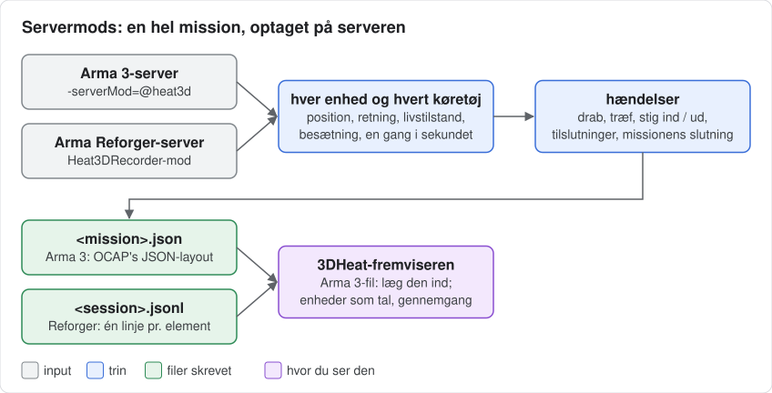

# Server-optagelsesmods (Arma 3, Arma Reforger) {#server-recorder-mods-arma-3-arma-reforger}

De fleste spil optages af watcheren på spillerens egen maskine. Arma er
anderledes: en server kan optage en hel mission - hver enhed og hvert køretøj,
ikke kun dit eget - med en mod, der kører på serveren. Spillerne skal ikke
sætte noget op: Arma 3-modden er kun til serveren, og Reforger henter af sig
selv en servers mods til spillerne, når de går ind (modden gør intet på deres
maskiner). Repositoryet indeholder to sådanne mods, i
[`mods/arma3`](https://github.com/Holdi601/3DHeat-Watcher/tree/main/mods/arma3)
og [`mods/reforger`](https://github.com/Holdi601/3DHeat-Watcher/tree/main/mods/reforger).
Deres READMEs er den fulde dokumentation; denne side er overblikket.

**Status: begge er endnu ikke testet i spillet.** Arma 3-udvidelsen er bygget og kørt, som Arma kalder udvidelser, og dens output er læst af 3DHeat; dens SQF-scripts er endnu ikke kørt i Arma 3. Reforger-modden er skrevet ud fra Bohemias offentliggjorte script-API og er aldrig blevet kompileret. Læg ingen af dem på en offentlig server, før testtrinnene i deres README er gennemført.

## Arma 3 {#arma-3}

1. Byg udvidelsen én gang pr. platform (`mods/arma3/extension`). Det kræver en C-compiler: Visual Studio Build Tools på Windows, gcc på Linux; hvis du aldrig har kompileret noget, så spørg din serverudbyder.
   - Windows, i en "x64 Native Tools Command Prompt for VS":
     `cl /nologo /O2 /LD heat3d.c /Fe:heat3d_x64.dll`
   - Linux: `gcc -O2 -shared -fPIC -o heat3d_x64.so heat3d.c -ldl`
2. Byg modden: `python mods/arma3/build.py` skriver `mods/arma3/@heat3d/` (kræver ikke Arma 3 Tools).
3. Kopiér `@heat3d` ind i serverens mappe, og start serveren med `-serverMod=@heat3d`.
4. Serverens `.rpt`-log siger `Heat3D recorder 0.1.0: recording <file> every 1 s`.

| Indstilling | Standard | Hvad den gør |
|---|---|---|
| `captureDelay` | 1 | sekunder mellem billeder |
| `recordHits` | 1 | 0 slår træfhændelser fra |
| `recordShots` | 1 | 0 slår optælling af skud fra |
| `minPlayers` | 0 | optag først, når så mange spillere er på |

En mission overskriver en i sin `init.sqf` (`heat3d_captureDelay = 0.5;`).
Optagelser gemmes i `recordings/` inde i `@heat3d`, eller i `HEAT3D_DIR`.

**Output:** én fil pr. mission i OCAP's JSON-layout (OCAP2-optagerens format), navngivet `<date>__<time>_<mission>.json`. Under missionen er den en journal (`.heat3d.part`), skyllet ved hver skrivning; en styrtet missions journal færdiggøres, næste gang en mission starter.

## Arma Reforger {#arma-reforger}

Modden (`Heat3DRecorder.gproj`) åbnes og bygges i Bohemias Workbench (Arma Reforger Tools), testes på en lokal dedikeret server, udgives fra Workbench (ulistet under test) og føjes til serverens `config.json`-liste `mods` - trin for trin i dens README. Hvert sekund skriver den hver karakters position, retning, livstilstand, køretøj og spiller-id samt hvert køretøjs position, retning, tilstand og besætning; og drab (dræber, våben, afstand), træf, ind- og udstigning, spillere der går ind og forlader, og missionens slutning.

**Output:** ét JSON-objekt pr. linje, `$profile:heat3d/<UTC date>_<UTC time>_<world>.jsonl`: en `header`-linje (format `heat3d-reforger`, akser x øst, y op, z nord), derefter `entity`-, `frame`- og `event`-linjer, efterhånden som de sker, og til sidst en `end`-linje. Enhedsrækker er `[id, x, y, z, dir, alive, vehicleId, playerId]`, køretøjsrækker er `[id, x, y, z, dir, alive, [crew ids]]`; begivenheder følger OCAP2's event-layout.

## I vieweren {#in-the-viewer}

Træk en Arma 3-optagelse ind på [3DHeat-vieweren](https://holdi601.github.io/3DHeat/): én mission er én session, enheder bliver til soldater, køretøjer til deres type, og drab og træf går ind i Gennemgang-listen. OCAP2's webafspiller spiller den også. Reforger-filen er modens eget linjeformat med OCAP2's event-layout.
