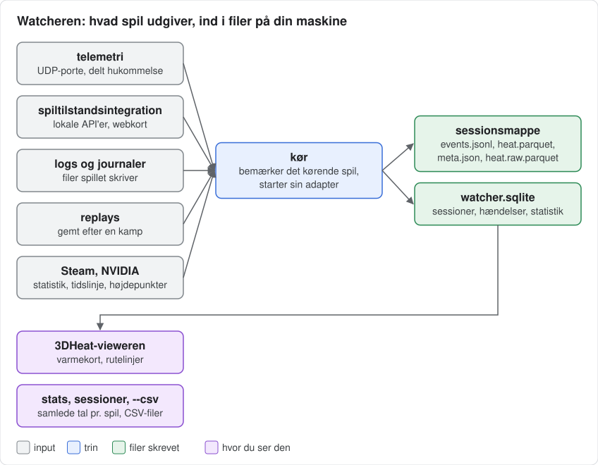

# Kilder og regler {#sources-and-rules}

Watcheren optager kun det, spil og platforme udleverer til spilleren. Denne side forklarer, hvilke
kilder det dækker, hvad watcheren må gøre med hver enkelt, og hvilke spil eller dele af spil den
bevidst lader være.

## De seks slags kilder {#the-six-kinds-of-source}

Hver adapter har en `kind`, og kind'en bestemmer, hvad adapteren må gøre:

| Slags | Hvad det er | Multiplayer-spil |
|---|---|---|
| `telemetry` | en UDP-port eller delt hukommelse, spillet udgiver til dashboards, bevægelsesplatforme og rat (Forza Data Out, F1 UDP, Kunos og iRacing delt hukommelse, SimConnect, X-Planes UDP-grænseflade, SCS SDK-plugin'et) | ja - det er spillets eget output |
| `gsi` | en game-state integration eller lokal webgrænseflade, spillet serverer til spillerens egen maskine (Valve GSI, Leagues Live Client Data API, Rocket Leagues Stats API, War Thunders webkort) | ja, inden for det API'et viser spilleren |
| `log` | filer spillet skriver, mens det kører: journaler, logfiler, statistik, gemte spil (Elite Dangerous, Minecraft, Path of Exile, Hearthstone, Star Citizen, EVE Online) | ja |
| `replay` | demoer og replays, spillet gemmer til sine spillere, konverteret efter kampen (CS2, Dota 2, War Thunder, World of Tanks, World of Warships, Squad, League of Legends, VALORANT, IL-2 Tacview) | ja, medmindre det er krypteret, og kun de dele der står åbent |
| `platform` | det Steam og grafikdriveren gemmer: statistik, achievements, tidslinjer, klip og highlights | ja |
| `memory` | spillets hukommelse, kun læst, af en profil du selv har skrevet | **aldrig** - kun enkeltspiller |

Kun `memory` åbner et andet program, og kun for at læse. De fem andre slags læser det, spillet,
Steam eller NVIDIA-appen allerede har skrevet ud eller sender.

## Sådan læses kilderne {#how-the-sources-are-read}

- **Intet bliver injiceret, hooket eller ændret i et spil.** Der bliver ikke indlæst kode i et spil, ingen vindue eller input hookes, ingen spilfil patches. De eneste filer watcheren skriver uden for sin datamappe er dem [`setup --apply`](commands.md#setup) skriver, når du beder den om det: en spils egen indstillingsfil (med originalen gemt som `<file>.heat3d-backup`), en game-state cfg-fil, DCS-hook-scriptet, BeamNG-protokolmodden.
- **Delt hukommelse åbnes kun læst og oprettes aldrig.** Den almindelige Python-måde at åbne et navngivet mapping på opretter et, når det ikke findes endnu. Et spil startet efter det ville finde watcherens tomme, skrivebeskyttede mapping i stedet for at lave sit eget, og dets telemetri ville være død. Watcheren åbner kun mappings med `OpenFileMappingW` (som kun finder et eksisterende), mapper dem med `FILE_MAP_READ` og prøver igen senere, hvis spillet ikke har lavet dem endnu.
- **Porte lånes, aldrig overtages.** En UDP-telemetriport, et andet program allerede lytter på (FH Companion, SimHub, en dashboard-app), bliver ved det programmet. Hvis et andet program begynder at lytte på en port, watcheren holder, slipper watcheren den inden for få sekunder. Forza-adaptere venter 15 s, efter spillet er startet, før de tager port 5300, og videresender hver pakke uændret til 127.0.0.1:5301, så en anden Data Out-app stadig kan optage.
- **Kun lokalt.** De game-state-servere watcheren kører (CS2, Dota 2) lytter på 127.0.0.1 og ingen andre steder. Når spillets cfg-fil har et token (det `setup` skriver), skal hver post bære det; poster uden det tælles som `bad_auth` og droppes. Uden en cfg-fil med token accepteres enhver lokal post, og loggen siger det. De lokale API'er den spørger (League på port 2999, War Thunder på 8111, Rocket League på 49123, X-Plane på 49000) ligger alle på 127.0.0.1.
- **Logfiler deles, aldrig låses.** Hver læsning åbner filen med alle de delingsflag Windows har, og lukker den igen, så spillet kan blive ved med at skrive, omdøbe eller erstatte sin log.
- **To eksterne tjenester, og kun i disse tilfælde.** Udgivelsestjekket spørger GitHub (`api.github.com`) højst hver sjette time og kan slås fra (se [Opdateringer](updates.md)). League replay-adapteren spørger Riots Match-V5 API kun, når du har indtastet din egen `riot_api_key`. Intet andet sendes nogen steder hen.
- **At slå en kilde til er din beslutning.** `setup` uden `--apply` siger kun, hvad den ville ændre.

## Multiplayer-regler {#multiplayer-rules}

- Et spil, der spilles online, optages kun gennem det, det udgiver: telemetri, game-state-API'er, logfiler, replays, platformsfiler. Inden for dem optager watcheren det, spillet viser spilleren, og intet beregnet ud over det:
  - **CS2 game-state integration** sender den iagttagne spiller (dig selv, mens du er i live, en holdkammerat efter død). Andre spilleres positioner (`allplayers_*`) sendes kun til tilskuere og GOTV, så watcheren beder ikke om dem.
  - **League of Legends' Live Client Data API** har ingen positioner. Riots politik tillader værktøjer at vise det, spilleren selv kan vide ud fra spillet, og intet beregnet ud over det (ingen fjendtlige timere). Watcheren optager dræbeboksen og scoreboardet, spilleren ser, og spillerens egne tal.
  - **Rocket Leagues Stats API** har ingen bilpositioner (bilens tilstand sendes kun til tilskuere). Det der har et sted, er bolden, hvor den blev ramt, scoret eller ramte overliggeren.
  - **War Thunders webkort** viser det, minikortet viser, uden navne eller id'er.
  - **F1 23/24/25** lægger hver bils position i deres Motion-pakke, også online. Spillet udleverer dem selv og holder kun data tilbage for spillere, hvis "Your Telemetry" er begrænset.
  - **DCS World**: en multiplayer-server kan forbyde eksport af egen flyveenheds data; sessionen har så hændelser, men ingen positioner, og siger det.
- **Hukommelse læses aldrig i et multiplayer-spil.** En hukommelsesadapter for et spil markeret som spillet online afvises, og en profil skal angive, om dens spil overhovedet kan spilles online. Et enkeltspillerspil, der også har en online-tilstand, læses kun, mens det ikke har nogen forbindelse til andet end denne maskine. Spil, hvis enkeltspillertilstand kører under en anti-cheat, læses heller aldrig. Se [Læsning af hukommelse](memory-reading.md).
- Flaget `multiplayer` på en adapter (vist som "Online play" af `games --markdown`) afgør kun hukommelseslæsning. Det stopper ikke de andre slags i at optage online-spil.

## Hvad der er fravalgt, og hvorfor {#what-is-declined-and-why}

Nogle spil, og nogle dele af spil, optages ikke: deres data er beskyttet, ikke udgivet eller slet ikke på spillerens maskine:

| Spil | Hvad der er udeladt | Hvorfor |
|---|---|---|
| VALORANT | positioner, navne, scorer i replays; klientens lockfile-endepunkter | Replayets spilstrøm er sløret med værdier taget fra hver builds eksekverbare fil. Spillet kører under Vanguard. Riot-klientens lockfile-endepunkter er ikke et offentliggjort API. **Læst:** det replayet bærer åbent - kort, kamp-id, agenter, serverens drabs- og rundetidslinje. |
| League of Legends | den løbende del af `.rofl`-replays; klientens lockfile-endepunkter | Sløret mod snyd, forskelligt for hver patch, og afkodes ikke. **Læst:** slutoversigten, hvert replay bærer som almindelig JSON, Live Client Data API under en kamp, og - med din egen udviklernøgle - den officielle Match-V5-tidslinje (positioner én gang i minuttet, drab hvor de skete). |
| Fortnite | replays | Krypteret. |
| World of Tanks, World of Warships | replays, i watcheren | Chifferet. Watcheren læser dem ikke; separate konvertere uden for den gør det (`exporters/ext/wot-replay`, `exporters/ext/wows-replay`), hver et projekt for sig. **Læst, med en konverter installeret:** hvert køretøjs eller skibs position, mens optagelsesklienten kendte til det, og drabene. |
| Gran Turismo 7 | telemetri | Kun konsol, og dens telemetri er krypteret med en nøgle, der er genskabt fra spillet. |
| Apex Legends | alt | Dets LiveAPI sender fulde hændelser kun i private og brugerdefinerede lobbyer; intet er ellers tilgængeligt lokalt. |
| Overwatch 2, Call of Duty, Battlefield 6, Hunt: Showdown 1896 | live-data | Ingen lokalt replay, log eller game-state-output at læse. Deres statistik kommer ind, hvor Steam gemmer den ([Steam-statistik](game-steam-stats.md), [Steam Timeline](game-steam-timeline.md)), og deres klip som [NVIDIA highlights](nvidia-highlights.md). |
| Star Citizen | alt ud over `Game.log` | Kører Easy Anti-Cheat; watcheren læser kun den logfil, spillet skriver, og rører aldrig spillets proces. |
| osu! | replays | Uden for rammen: et 2D-spil, uden noget at placere på et kort. |
| Ethvert multiplayer-spil | hukommelse | Aldrig. Enkeltspillerspil, hvis tilstand kører under en anti-cheat (GTA V, Elden Ring via dets launcher), læses heller ikke. |

Krypterede replays åbnes ikke: VALORANT-læseren tjekker replayets krypteringsflag og afviser en krypteret fil
("this replay is encrypted; it is not read").

Spil der er undersøgt, men endnu ikke bygget (Deadlock-replays, Rocket League `.replay`-filer,
StarCraft II, Team Fortress 2, Rainbow Six Siege, Beat Saber, Trackmania, flere racingsimulatorer) er
listet med deres kilder i [Alle spil i én tabel](watcher.md#researched-not-yet-built). Hver af dem
kræver eksempelfiler at blive kontrolleret mod, før den udgives.
