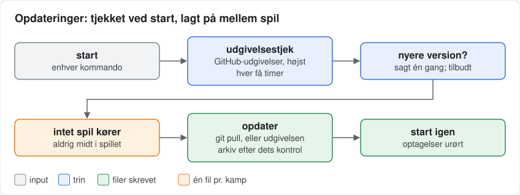

# Opdateringer {#updates}

Watcheren holder sig selv opdateret fra udgivelserne i
[Holdi601/3DHeat-Watcher](https://github.com/Holdi601/3DHeat-Watcher/releases). Opdateringsværktøjet er pakken
`heat3d_update`, ved siden af `heat3d_watch` i repositoryet.

## Tjekket {#the-check}

- **Hvornår**: hver kommando undtagen `update` tjekker, når den starter. `run` tjekker også, mens den kører, højst én gang i timen og kun, mens intet spil kører.
- **Hvordan**: én HTTPS-forespørgsel til `https://api.github.com/repos/Holdi601/3DHeat-Watcher/releases/latest`, med en timeout på 5 sekunder. Svaret caches i seks timer i `%LOCALAPPDATA%\3DHeat\update-check-3DHeat-Watcher.json`, så de fleste starter ikke spørger om noget. "Ingen udgivelse endnu" (HTTP 404) caches ligesom et svar. Offline, begrænset af antal forespørgsler eller bag en proxy fejler tjekket stille, og kommandoen kører videre med den version, den har.
- **Versioner**: den installerede version er filen `VERSION` i repositoryets mappe. En udgivelses tag (`v1.2.0` eller `1.2.0`) sammenlignes som tal, del for del; alt efter et `-` eller `+` ignoreres.
- **Fra**: `HEAT3D_NO_UPDATE=1` (enhver værdi undtagen tom, `0`, `false` eller `no`) slår både tjekket og den automatiske opdatering fra. Hvert 3DHeat-værktøj har sin egen cache-fil, så ét værktøjs svar aldrig gælder for et andet.

## Hvad der sker, når en nyere udgivelse er ude {#what-happens-when-a-newer-release-is-out}

- **`run`** udskriver en besked, når den starter, og kører videre: `[heat3d_watch] 3DHeat Watcher 1.2.0 is out (this is 1.0.2). <release page>`. Mens den kører, med `auto_update` slået til (standard) og intet spil kørende, opdaterer den sig selv: loglinjen `3DHeat Watcher 1.2.0 is out (this is 1.0.2); updating`, en Windows-notifikation "Updating to 1.2.0", selve opdateringen, alle adaptere stoppet og deres sessioner lukket, og samme kommando startet igen på den nye kode. Watcheren opdaterer aldrig midt i et spil. Kan opdateringen ikke gennemføres, siger notifikationen det ("1.2.0 is out; not updated: ..."), og watcheren kører videre med den gamle version. Med `auto_update` fra er der kun beskeden.
- **Andre kommandoer** spørger `Update now? [Y/n]`, når de kører i en terminal. Enter, `y`, `yes`, `j` eller `ja` opdaterer og kører derefter samme kommando igen på den nye version. Uden terminal (en planlagt kørsel, en pipe) skriver de, hvordan man opdaterer, og kører videre.
- **På forespørgsel**: `python -m heat3d_watch update` (eller `python -m heat3d_update`) spørger GitHub uden cachen og opdaterer. `--check` siger kun, om en nyere udgivelse er ude. Dette virker også med `HEAT3D_NO_UPDATE` sat.

## Sådan anvendes en opdatering {#how-an-update-is-applied}

Det afhænger af, hvordan kopien blev installeret:

- **En git-klon** (mappen har `.git`, og `git` er på PATH): `git pull --ff-only`. Det nægtes, mens klonen har ændringer i sporede filer (`git status --porcelain --untracked-files=no` er ikke tom): de ændringer er nogens arbejde, og en opdatering afgør ikke, hvad der sker med dem. Commit eller stash dem, og pull derefter.
- **En downloadet kopi**: udgivelsens kildearkiv downloades og pakkes ud i en midlertidig mappe. Poster, der ville havne uden for den, springes over. Arkivets `VERSION` skal være den version, udgivelsen hævder, ellers kopieres intet. Derefter kopieres dets filer over repositoryets mappe. Filer, der ikke er en del af en udgivelse - optagelser, indstillinger, virtuelle miljøer, eksporter, alt du selv har lavet - røres ikke. Et Python-modul, en ældre udgivelse havde, og den nye har droppet, fjernes fra udgivelsens egne pakker (`heat3d_watch`, `heat3d_update`), så intet forældet adaptermodul indlæses efter opdateringen; intet uden for disse pakker fjernes.

Optagelser og indstillinger ligger som regel alligevel uden for repositoryets mappe (`%LOCALAPPDATA%\3DHeat\Watcher`), så en opdatering kommer aldrig i nærheden af dem.

Efter en opdatering startes den samme kommando igen. På Windows starter watcheren den nye proces, venter på den og videregiver dens exit-kode, så konsollen opfører sig, som om den første proces selv havde udført arbejdet.
