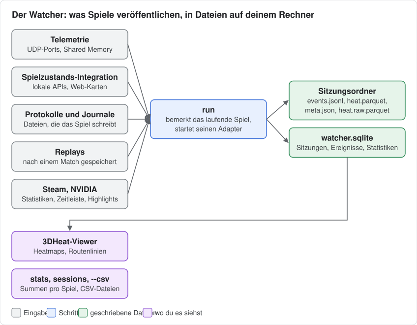
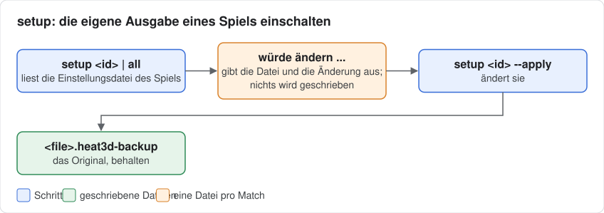
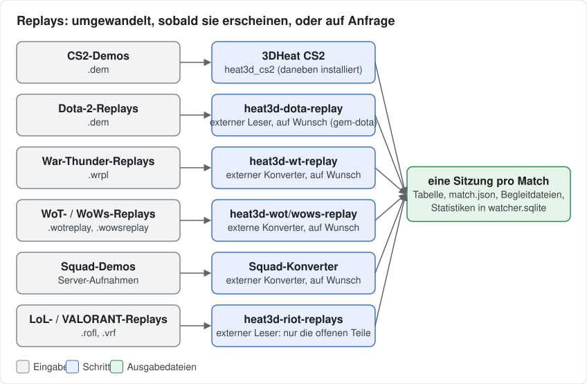
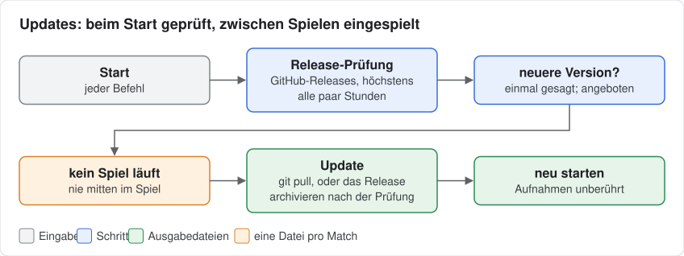

# Befehle {#commands}

Neu in der Kommandozeile? Lies zuerst [Bevor du anfängst](before-you-start.md). Jeder Befehl wird in einem
Terminal eingegeben, das in dem Ordner geöffnet ist, in den du das Programm entpackt oder geklont hast (im
Explorer tippst du `powershell` in die Adressleiste), so:

```bash
python -m heat3d_watch <command> [options]
```


| Befehl | Was er tut |
|---|---|
| [`run`](#run) | läuft im Hintergrund und zeichnet jedes laufende Spiel auf |
| [`games`](#games) | was jedes Spiel liefert und woher |
| [`setup`](#setup) | schaltet die eigene Ausgabe eines Spiels ein |
| [`status`](#status) | welche Spiele gerade laufen und welche Adapter starten würden |
| [`sessions`](#sessions) | die bisherigen Aufnahmen |
| [`stats`](#stats) | Summen je Spiel oder die Tabellen als CSV |
| [`table`](#table) | baut die `heat.parquet` einer Sitzung aus ihrer `events.jsonl` neu auf |
| [`replays`](#replays) | wandelt die Replays um, die schon auf der Festplatte liegen |
| [`dota-replay`](#dota-replay) | lädt das Replay eines öffentlichen Dota-2-Matches über seine ID herunter |
| [`update`](#update) | aktualisiert auf die neueste Version |
| [`config`](#config) | zeigt oder ändert die Einstellungen |

Für jeden Befehl gilt: `-h` / `--help` zeigt die Hilfe, und `python -m heat3d_watch --version` zeigt die
Version (die Datei `VERSION`).

Die Bilder auf dieser Seite zeigen Läufe mit erfundenen Beispielsitzungen (`Example Racer`,
`Example Arena`), keine echten Aufnahmen.

Jeder Befehl außer `update` sucht zuerst nach einer neueren Version (höchstens alle sechs Stunden; wird mit
`HEAT3D_NO_UPDATE=1` übersprungen, siehe [Updates](updates.md)). `run` zeigt nur einen Hinweis. Die anderen
Befehle fragen `Update now? [Y/n]`, wenn sie in einem Terminal laufen, und zeigen, wie man aktualisiert,
wenn nicht. Die Ausgabe ist UTF-8, daher werden Spielnamen in jeder Schrift auf jeder Konsole richtig
angezeigt.

## run {#run}

```bash
python -m heat3d_watch run [--once] [-v]
```



Läuft, bis du sie anhältst (Strg+C): Alle `scan_seconds` liest sie die Prozessliste und startet für jedes
gefundene Spiel einen Adapter, dazu die immer aktiven Adapter. Vor dem ersten Blick beendet sie die
Sitzungen, die ein früherer Lauf offen gelassen hat. Solange kein Spiel läuft, kann sie sich selbst
aktualisieren (wenn `auto_update` an ist). Details stehen unter
[Installieren und Starten](installing-and-running.md#running).

| Option | Wirkung |
|---|---|
| `--once` | ein Blick auf die laufenden Spiele, dann Ende. Die Adapter für die gerade laufenden Spiele (und die immer aktiven) werden gestartet, jeder fragt einmal ab (dafür werden höchstens 10 Sekunden gewartet), und danach werden alle so gestoppt, wie ein Spielende sie stoppt: ihre Sitzungen werden geschlossen, geschrieben und gezählt. Zum Prüfen der Erkennung, nicht zum Aufzeichnen. |
| `-v`, `--verbose` | Debug-Zeilen in `watcher.log` und auf der Konsole |

`run` schreibt `<data>\watcher.lock` und startet nicht ein zweites Mal für denselben Datenordner (Exitcode 1);
siehe [Die Sperrdatei](installing-and-running.md#the-lock-file).

## games {#games}

```bash
python -m heat3d_watch games [--markdown]
```


Listet jeden Adapter nach Spiel sortiert: Name, ID und Art, woher er liest, was er aufzeichnet und wie man
ihn einschaltet. Ein Adapter, der auf diesem Rechner nicht laufen kann, wird mit `[unavailable: <why>]`
markiert - SimConnect.dll nicht gefunden, kein Minecraft-Ordner, 3DHeat CS2 nicht installiert, Steam oder
die NVIDIA-App nicht gefunden. Ein Adaptermodul, das sich nicht importieren ließ, wird am Ende mit dem
Fehler genannt.

```text
EA SPORTS F1 25  (f1-25, telemetry)
    from: UDP telemetry 127.0.0.1:20777 (Documents\My Games\F1 25\hardwaresettings\hardware_settings_config.xml)
    - every car's position (world XYZ, m) at 10 Hz, by driver name, team, own car marked, ...
    switch on: In the game: Settings > Telemetry Settings > UDP Telemetry On, IP 127.0.0.1, port 20777 - ...
```

`--markdown` gibt dasselbe als eine Markdown-Tabelle aus (Spiel, was aufgezeichnet wird, woher, wie man es
einschaltet, Online-Spiel, geprüft). Die Tabelle unter [Alle Spiele in einer Tabelle](watcher.md) ist diese
Ausgabe. Die Zellen sind für Markdown maskiert: Text in Backticks bleibt ein Code-Abschnitt, und außerhalb
davon werden `<`, `>`, `&`, `*`, `|` und ein Backslash vor Satzzeichen so geschrieben, dass sie wie getippt
erscheinen (`<CS2>` würde sonst in kramdown als HTML-Tag verschwinden). Das einzige HTML ist das `<br>`
zwischen den Punkten der Spalte „Was aufgezeichnet wird“.

## setup {#setup}

```bash
python -m heat3d_watch setup <adapter id | all> [--apply]
```




Schaltet die eigene Ausgabe eines Spiels ein, wenn das Spiel dafür eine Datei geändert haben will. Ohne
`--apply` wird nichts geändert: Jede Zeile sagt, was sich ändern würde, und wenn es etwas zu ändern gibt,
sagt die letzte Zeile `Nothing was changed. Run again with --apply to make these changes.`. Gibt es nichts zu
ändern, steht dort `<id>: nothing to change` (`Nothing to change.` bei `all`). Mit `--apply` werden die
Änderungen gemacht. Bevor eine Datei zum ersten Mal geändert wird, wird ihr Original als
`<file>.heat3d-backup` gesichert. Eine vorhandene Sicherung wird nie überschrieben, daher enthält sie immer
die Datei so, wie sie war, bevor der Watcher sie zum ersten Mal angefasst hat.

```text
f1-25: would change: hardware_settings_config.xml <udp>: enabled="false" -> "true"
Nothing was changed. Run again with --apply to make these changes.
```

`all` führt die Einrichtung jedes Adapters aus, der eine hat. Ein Adapter ohne Einrichtung, einzeln genannt,
gibt `<id>: nothing for setup to change; ` aus, gefolgt davon, wie das Spiel eingeschaltet wird (sein
`enable`-Text, oder dass er nichts braucht). Eine unbekannte ID gibt `no adapter '<id>'; games lists them`
aus und beendet mit Exitcode 2. Die Adapter, die etwas einzurichten haben:

| Adapter | Was `--apply` ändert |
|---|---|
| `beamng` | installiert den `heat3d`-Protokoll-Mod in den Ordner `mods` von BeamNG (nur wenn er noch nicht dort ist); danach im Spiel Options > Other > Protocols > "others" einschalten |
| `cs2-gsi` | schreibt `<CS2>\game\csgo\cfg\gamestate_integration_heat3d.cfg`: den Spielzustand an `http://127.0.0.1:3311/` senden, mit einem Zufalls-Token, den der Watcher dann verlangt (ein Token, das schon in der Datei steht, bleibt); CS2 liest sie beim Start |
| `dota2-gsi` | dasselbe für Dota 2: `<Dota>\game\dota\cfg\gamestate_integration\gamestate_integration_heat3d.cfg`, Port 3312 |
| `dcs` | fügt `Scripts\Hooks\heat3d-watch.lua` in jeden Ordner `%USERPROFILE%\Saved Games\DCS*` ein. Seine eigene ältere Kopie wird aktualisiert; eine Datei dieses Namens, die der Watcher nicht geschrieben hat, bleibt unberührt. DCS neu starten. |
| `dirt-rally-2` | `hardware_settings_config.xml`: `<udp enabled="true" extradata="3" ip="127.0.0.1" port="20777">`; das Spiel muss vorher einmal gestartet worden sein, damit die Datei existiert |
| `ea-wrc` | `Documents\My Games\WRC\telemetry\config.json`: das Paket `session_update` der Struktur `wrc` an, für diesen Rechner |
| `f1-23`, `f1-24`, `f1-25` | `hardware_settings_config.xml`: `<udp enabled="true" ip="127.0.0.1" port="20777">`; das Spiel muss geschlossen sein |
| `hearthstone` | fügt einen Abschnitt `[Power]` (`LogLevel=1`, `FilePrinting=true`) in `%LOCALAPPDATA%\Blizzard\Hearthstone\log.config` ein; Spiel neu starten |
| `il2` | `<game>\data\startup.cfg`, `[KEY = telemetrydevice]`: ein weiteres Ziel `addrN = "127.0.0.1:41995"` und `enable = true` (der Abschnitt wird, mit 10 Hz, hinzugefügt, wenn er fehlt); IL-2 neu starten |
| `il2-tacview` | `<game>\data\startup.cfg`, `[KEY = track_record]`: `tacviewrecord = 1` |
| `rocketleague-stats` | `TAStatsAPI.ini` (oder `DefaultStatsAPI.ini`, wenn jene nicht existiert) in `<RL>\TAGame\Config`: `PacketSendRate=30`, wenn die API aus ist, und `Port`, wenn keiner gesetzt ist; wird beim Start von Rocket League gelesen |

`richard-burns-rally` hat keine Einrichtung: Seine Telemetrie kommt vom RSF/NGP-Plugin und wird von Hand in
`RichardBurnsRally.ini` eingeschaltet (siehe [die Seite dazu](game-richard-burns-rally.md));
`setup richard-burns-rally` sagt das. Jedes andere Spiel braucht entweder nichts, oder es wird im Spiel
eingeschaltet; die Seite jedes Spiels sagt, wie.

## status {#status}

```bash
python -m heat3d_watch status
```

```text
3DHeat Watcher 1.0.2; data in C:\Users\...\AppData\Local\3DHeat\Watcher
Games running: EA SPORTS F1 25 (f1-25)
Always on: il2-tacview, steam-stats, steam-timeline, nvidia-highlights, cs2-demos, osu-replays, lol-replays, valorant-replays
```

Sagt, welche Adapter ein `run` jetzt starten würde, nach denselben Regeln: Der Prozess des Spiels läuft, der
Adapter steht nicht in `disabled`, es fehlt nichts, was er braucht, Replay-Adapter nur bei eingeschaltetem
`replays`, Speicher-Adapter nur bei eingeschaltetem `memory` und wenn jede Speicherprüfung bestanden wurde.
Es startet nichts.

## sessions {#sessions}

```bash
python -m heat3d_watch sessions [--game NAME] [--limit N]
```


Die neuesten Sitzungen aus `watcher.sqlite`, eine Zeile je Sitzung: Start (Ortszeit), Spiel, Minuten,
Ereignisse, Positionen, Ordner.

| Option | Wirkung |
|---|---|
| `--game NAME` | nur dieses Spiel, mit seinem genauen Namen wie in der Liste (`"EA SPORTS F1 25"`) |
| `--limit N` | höchstens N Sitzungen (Standard 40) |

## stats {#stats}

```bash
python -m heat3d_watch stats [--game NAME] [--csv DIR]
```


Ohne Optionen: eine Tabelle aller Spiele (Sitzungen, Stunden, Ereignisse, Positionen, zuletzt gespielt), am
meisten gespielte zuerst, danach für jedes Spiel seine 25 häufigsten Ereignisse und jede Zahlen-Statistik
mit der Anzahl der Sitzungen, die sie haben, der Summe, dem besten Wert (`best`) und dem Durchschnitt.
`best` weiß, in welche Richtung es besser ist: Der niedrigste Wert gilt bei den Zeiten, die als Bestwert
gehalten werden (`best_lap`, `best_stage` und jeder andere Schlüssel, der mit `best_` beginnt), und bei
Platzierungen (`race_position`, `grid_position`, jeder Schlüssel, der auf `_position` endet). Bei allem
anderen gilt der höchste Wert (Abschüsse, Strecke, Höchstgeschwindigkeit, die eigenen Zähler eines Spiels).

| Option | Wirkung |
|---|---|
| `--game NAME` | nur die Ereignisse und Statistiken dieses Spiels, ohne Übersicht |
| `--csv DIR` | schreibt `sessions.csv`, `events.csv` und `stats.csv` (jede Zeile der drei Tabellen) stattdessen nach `DIR`; `--game` schränkt das nicht ein |

## table {#table}

```bash
python -m heat3d_watch table <session folder>
```


Baut die `heat.parquet` in einem Sitzungsordner aus seiner `events.jsonl` neu auf, mit den Achsen aus seiner
`meta.json`. Gibt den Pfad der Tabelle aus oder `no positions in this session`. Nutze es für eine Sitzung,
die aufgezeichnet wurde, während `pyarrow` fehlte, oder nachdem du `events.jsonl` von Hand bearbeitet hast.

## replays {#replays}

```bash
python -m heat3d_watch replays <adapter id> [folder] [-v]
```



Wandelt die Replays, die schon auf der Festplatte liegen, jetzt um, nacheinander, und jedes in eine Sitzung,
so wie es der Ordner-Watch täte. Das erste Mal, wenn der Watcher einen Replay-Ordner sieht, merkt er sich nur,
was darin liegt (siehe [Installieren und Starten](installing-and-running.md#replays-already-on-disk)); so
werden diese auf Anfrage umgewandelt. Ohne `folder` werden die Ordner des Adapters gelesen (die des Spiels
plus `replay_folders`); mit `folder` die Replays in diesem Ordner. Jedes umgewandelte Replay wird als gesehen
vermerkt, damit der laufende Watcher es nicht noch einmal umwandelt. Ein Replay, das nicht umgewandelt werden
kann, wird protokolliert und übersprungen.

| Adapter | Replays |
|---|---|
| `cs2-demos` | Counter-Strike-2-Demos (`*.dem`), über 3DHeat CS2 |
| `lol-replays` | League-of-Legends-Replays (`*.rofl`) |
| `osu-replays` | osu!-Replays (`*.osr`) |
| `valorant-replays` | VALORANT-Replays (`*.vrf`) |
| `warthunder-replays` | War-Thunder-Replays (`*.wrpl`), über den externen Konverter `heat3d-wt-replay` (exporters/ext/warthunder-replay) |
| `wot-replays` | World-of-Tanks-Replays (`*.wotreplay`), über den externen Konverter `heat3d-wot-replay` (exporters/ext/wot-replay) |
| `wows-replays` | World-of-Warships-Replays (`*.wowsreplay`), über den externen Konverter `heat3d-wows-replay` (exporters/ext/wows-replay) |
| `dota-replays` | Dota-2-Replays (`*.dem`), über gem (`pip install gem-dota`) |

```text
osu-replays: converted 12 replay(s); `sessions --game` lists them
```

Eine ID, die keiner davon ist, gibt `no replay adapter '<id>'` mit der Liste aus und beendet mit Exitcode 2;
ebenso ein `folder`, der nicht existiert. Ein Adapter, der hier nicht laufen kann (3DHeat CS2 nicht
installiert), nennt den Grund und beendet mit Exitcode 1. Die Tacview-Aufzeichnungen von IL-2 stehen nicht in
der Liste: Dieser Adapter wandelt jede fertige Aufzeichnung, die er findet, selbst um.

## dota-replay {#dota-replay}

```bash
python -m heat3d_watch dota-replay <match id> [<match id> ...] [-o FOLDER] [--convert] [-v]
```

Lädt das Replay eines öffentlichen Dota-2-Matches von den Replay-Servern von Valve herunter. Dafür braucht es
Internet. Die Match-ID ist die Zahl auf der Seite des Matches im Dota-Client (den Matchdetails) oder auf der
Website von OpenDota. Valve behält ein Replay einige Wochen, danach schlägt der Download fehl. Server und Salt
des Replays kommen aus OpenDotas Eintrag zum Match (`api.opendota.com/api/matches/<id>`, kein Schlüssel nötig),
die Datei von `replay<cluster>.valve.net/570/<id>_<salt>.dem.bz2`; sie wird beim Empfang entpackt (Valve
liefert unter diesem Namen sowohl bzip2 als auch Zstandard) und als `<match id>.dem` gespeichert. Ohne `-o`
landet sie im Replay-Ordner von Dota 2, wenn Dota 2 installiert ist – dort, wo ein laufender Watcher sie
umwandelt – und sonst in `<data>/replays/dota`. Eine Datei, die schon dort liegt, bleibt erhalten. `--convert`
wandelt die heruntergeladenen Replays sofort um, so wie `replays dota-replays` es täte, und vermerkt sie als
gesehen.

```text
match 9000000000: C:\Program Files (x86)\Steam\steamapps\common\dota 2 beta\game\dota\replays\9000000000.dem
```

Valve behält Replays einige Wochen; ein älteres Match gibt `Valve no longer has the replay of match <id>`
aus und beendet mit Exitcode 1. Ein Match, das OpenDota noch nicht gesehen hat, hat noch keinen Salt: Die
Meldung sagt, dass man OpenDota darum bitten soll (`curl -X POST https://api.opendota.com/api/request/<id>`)
und es ein paar Minuten später noch einmal versuchen soll. Private Lobbys und Matches mit einem verborgenen
Profil sind auf den Replay-Servern gar nicht vorhanden.

## update {#update}

```bash
python -m heat3d_watch update [--check]
```



Fragt GitHub nach der neuesten Version, ohne die zwischengespeicherte Antwort zu nutzen, und aktualisiert
diese Kopie, wenn sie neuer ist (siehe [Updates](updates.md)). `--check` sagt nur, ob eine neuere Version da
ist. Dieser Befehl läuft auch, wenn `HEAT3D_NO_UPDATE` gesetzt ist: Dass du ihn aufrufst, ist die
Entscheidung. `python -m heat3d_update [--check]` macht dasselbe.

## config {#config}

```bash
python -m heat3d_watch config [--set KEY=VALUE ...]
```


Gibt jede Einstellung als `key = value` aus. Mit `--set` werden zuerst die angegebenen geändert, dann wird
`settings.json` gespeichert (`saved <path>`). Werte werden nach dem Typ der Einstellung gelesen:

- Ja/Nein-Einstellungen (true/false): `1`, `true`, `yes`, `on` oder `ja` ist wahr; `0`, `false`, `no`, `off`,
  `nein` oder nichts ist falsch;
- Zahlen: eine Dezimalzahl (`scan_seconds=5`);
- Listen: durch Kommas getrennt oder als JSON-Liste (`disabled=steam-stats,steam-timeline`; ein leerer Wert
  leert die Liste);
- Wörterbücher (`replay_folders`, `player_names`): das ganze Wörterbuch als JSON, oder ein einzelner Eintrag
  als `KEY.ID=VALUE` - `replay_folders.cs2-demos=D:\Demos,E:\More Demos` setzt die Ordner dieses Adapters
  (durch Kommas getrennt), `player_names.warthunder-webmap=Name` den Namen dieses Adapters; ein leerer Wert
  entfernt den Eintrag;
- Text: so, wie er angegeben ist (`data=D:\Heat`, `riot_id=Name#TAG`).

```bash
python -m heat3d_watch config --set memory=true scan_seconds=5
python -m heat3d_watch config --set riot_id=Name#TAG riot_platform=EUW1
python -m heat3d_watch config --set replay_folders.cs2-demos=D:\Demos player_names.rocketleague-stats=Name
```

Ein unbekannter Schlüssel gibt `no setting '<key>'` aus, und ein Wert, der nicht zum Typ der Einstellung passt
(`memory=perhaps`, `scan_seconds=often`, ein Wörterbuch, das kein JSON ist), gibt `not saved: ...` aus; beides
beendet mit Exitcode 2, ohne etwas zu speichern. Eine von Hand bearbeitete `settings.json` wird genauso gelesen:
Ein Wert, der als Text angegeben ist, wo die Einstellung eine Zahl, ein Ja/Nein oder ein Wörterbuch ist, wird
so gelesen, wie er geschrieben ist, und einer, der nicht gelesen werden kann, bleibt auf seinem Standard.
Jede Einstellung wird unter
[Installieren und Starten](installing-and-running.md#settings) beschrieben.
