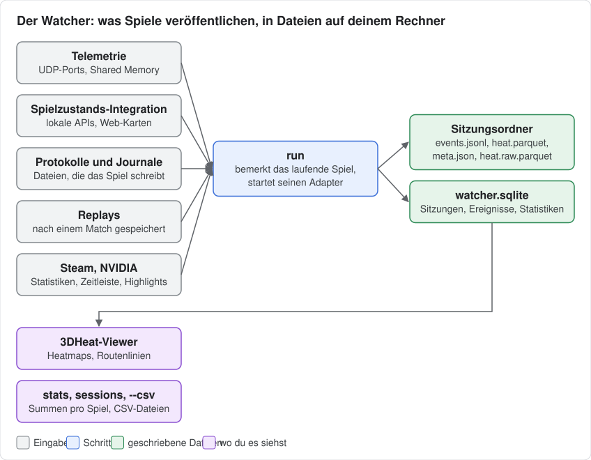

# 3DHeat Watcher {#dheat-watcher}

**Was ist das?** Du spielst ein Spiel. Dieses Programm schreibt still auf, wohin du gegangen bist und was passiert ist.
Später kannst du es als farbige Karte im 3DHeat-Viewer ansehen.

**Wozu brauche ich das?** Um dir selbst eine Aufzeichnung jeder Sitzung zu führen - wohin du gefahren, geflogen
oder gekämpft bist, deine Summen pro Spiel - ohne Webseite und ohne das Spiel zu verändern.

**Beispiel:** Du fährst in einem Rennspiel eine Runde, während der Watcher läuft; danach hält eine Datei in
`sessions\<game>\` die Linie fest, die du gefahren bist, und der Viewer zeichnet sie.

Genauer: 3DHeat Watcher ist ein Hintergrundprogramm. Es zeichnet auf, was Spiele über dein Spiel veröffentlichen -
wohin du gegangen bist, was wo passiert ist und die Zahlen dahinter -, und legt es in Dateien auf deinem eigenen Rechner ab. Die
Dateien dienen deiner eigenen Statistik sowie den Heatmaps und Routenlinien des 3DHeat-Viewers.

Es läuft unauffällig, bemerkt, welches Spiel du gestartet hast, und liest die eigenen Ausgaben dieses Spiels: einen
Telemetrie-Port oder Shared Memory, das das Spiel für Dashboards veröffentlicht, eine Spielzustands-Integration, das
Journal oder Protokoll, das das Spiel schreibt, das Replay, das es nach einem Match speichert, die Statistiken, die Steam
führt, die Clips, die die NVIDIA App speichert. Aufnahmen bleiben auf deinem Rechner. Das Programm kontaktiert nur zwei
externe Dienste, und nur in diesen Fällen: GitHub, um nach einem neueren Release zu suchen (siehe [Updates](updates.md)),
und Riots Match-V5-API, und nur, wenn du deinen eigenen Riot-API-Schlüssel eingibst (siehe
[League-of-Legends-Replays](game-lol-replays.md)).



## Was es aufzeichnet {#what-it-records}

- **Positionen**: das Auto, Flugzeug, der Held oder der Spieler, mehrmals pro Sekunde, wo das Spiel sie veröffentlicht,
  mit Geschwindigkeit, Richtung und allem, was das Spiel sonst mitsendet.
- **Ereignisse**: Erscheinen, Tode, Kills, Runden, Etappen, Spielzüge, Ziele, Aufträge, Starts und Landungen,
  Zonenwechsel, Erfolge, Highlights. Jedes Ereignis wird mit seiner Zeit gespeichert und, wenn das Spiel einen Ort
  angibt, mit seinem Ort.
- **Statistiken pro Sitzung**: Kills, Tode, Runden, beste Runde, Strecke, Höchstgeschwindigkeit, Spielzeit und die
  eigenen Statistiken des Spiels, wo es sie führt.

Was jedes Spiel liefert und woher, steht auf einer eigenen Seite unter [Spiele](games.md). Eine Quelle kann nicht alles
aufzeichnen: Mehrspielerspiele werden nur über das aufgezeichnet, was sie veröffentlichen, und der Watcher liest nie
ihren Speicher (siehe [Quellen und Regeln](sources-and-rules.md)).

## Installation {#install}

Neu in der Kommandozeile? Lies zuerst [Bevor du anfängst](before-you-start.md).

Der Watcher ist ein Python-Programm für Windows (Python 3.10 oder neuer). Viele seiner Quellen gibt es nur unter Windows:
Shared Memory, die Registry, Windows-Benachrichtigungen.

```bash
git clone https://github.com/Holdi601/3DHeat-Watcher.git
cd 3DHeat-Watcher
pip install -r requirements.txt
```

Ein heruntergeladenes Release-Archiv funktioniert genauso: entpacken, dann `pip install -r requirements.txt`
im Ordner ausführen. Die Einzelheiten und die Zusatzteile, die manche Spiele brauchen, stehen in
[Installieren und Ausführen](installing-and-running.md).

## Schnellstart {#quick-start}

Du brauchst Windows, Python 3.10 oder neuer (im Installer "Add python.exe to PATH"
ankreuzen) und die Spiele, die du spielst; Git ist nicht nötig.

Lade das Release herunter, <https://github.com/Holdi601/3DHeat-Watcher/archive/refs/tags/v1.0.3.zip>,
entpacke es und öffne PowerShell im entpackten Ordner (`3DHeat-Watcher-1.0.3`; im Datei-Explorer
`powershell` in die Adresszeile tippen); führe jeden Befehl von dort aus:

```bash
python -m pip install -r requirements.txt
python -m heat3d_watch games            # was jedes Spiel liefert, und woher
python -m heat3d_watch setup all        # was eingeschaltet werden müsste (nichts wird geändert)
python -m heat3d_watch setup f1-25 --apply   # die Ausgabe eines Spiels einschalten (die Originaldatei wird gesichert)
python -m heat3d_watch run              # beobachten; laufen lassen, während du spielst
python -m heat3d_watch stats            # Summen pro Spiel
python -m heat3d_watch stats --csv out  # Sitzungen, Ereignisse und Statistiken als CSV-Dateien
```

Manche Spiele wollen ein zusätzliches Paket oder einen eigenen Leser; `games` sagt welche, und
`requirements-optional.txt` listet sie auf ([Installieren und Ausführen](installing-and-running.md)).

Du solltest sehen: nach `games` eine Tabelle mit einer Zeile pro Spiel; `run` läuft weiter, bis du Strg+C drückst
oder das Fenster schließt.

Alles wird nach `%LOCALAPPDATA%\3DHeat\Watcher` geschrieben. Um einen anderen Ordner zu verwenden, setze die
Umgebungsvariable `HEAT3D_WATCH_HOME` oder führe `python -m heat3d_watch config --set data=D:\somewhere` aus.

- `sessions\<game>\<date>_<adapter>\` - ein Ordner pro Sitzung, mit `events.jsonl` (jedes Ereignis, sobald es
  geschieht), `heat.parquet` (die Zeilen mit einer Position, bereit für den 3DHeat-Viewer) und `meta.json`
  (Spiel, Quelle, Achsen, Zählungen, Statistiken)
- `watcher.sqlite` - die Statistiken jeder Sitzung, in drei einfachen Tabellen
- `watcher.log` - was der Watcher getan hat

Dann öffne eine Sitzung im [3DHeat-Viewer](https://github.com/Holdi601/3DHeat#quick-start):
herunterladen (**Code -> Download ZIP**, entpacken), `start.bat` doppelklicken (es bietet an, Node.js zu
installieren, wenn es fehlt, und öffnet `http://127.0.0.1:5273`), dann **Quelle -> Dateien...** und die
`heat.parquet` der Sitzung wählen (oder sie auf das Quelle-Panel ziehen); sie öffnet sich ohne Einstellung
(ihre Achsen und Einheiten stehen in der Datei). Umgewandelte Replays werden daneben als Tabellen und
Match-Dokumente geschrieben: eine `<match>.match.json` kommt in den **Match**-Tab über **Match-Dateien laden...**.
Das Ein-Datei-pro-Match-Format des Viewers steht auf seiner Seite zum
[`.3dheat`-Container](https://holdi601.github.io/3DHeat/container.html), und die Spalten jeder Tabelle in
[Die Daten](the-data.md).

Wenn ein neues Release erscheint, sagt der Watcher es beim Start und bietet an, den Ordner aus dem Release
zu aktualisieren (`python -m heat3d_watch update` tut dasselbe).

## Die Dokumentation {#the-documentation}

| Seite | Was sie behandelt |
|---|---|
| [Bevor du anfängst](before-you-start.md) | Python, ein Terminal, Platzhalter, wie Erfolg und die häufigen Fehler aussehen |
| [Installieren und Ausführen](installing-and-running.md) | Anforderungen, Betrieb im Hintergrund, Start mit Windows, die Sperrdatei, das Protokoll, jede Einstellung und Umgebungsvariable |
| [Spiele](games.md) | eine Seite pro Spiel: was aufgezeichnet wird, woher, wie man es einschaltet, wie es funktioniert, Achsen, Statistiken, was geprüft wurde |
| [Die Daten](the-data.md) | Sitzungsordner, `events.jsonl`, `heat.parquet` und sein Footer, `meta.json`, `watcher.sqlite`, Wiederherstellung nach einem Absturz, CSV-Export, das Öffnen einer Sitzung im 3DHeat-Viewer |
| [Befehle](commands.md) | jeder Befehl und jede Option von `python -m heat3d_watch` |
| [Quellen und Regeln](sources-and-rules.md) | die sechs Arten von Quellen, die Mehrspielerregeln, welche Spiele ausgelassen werden und warum |
| [NVIDIA Highlights](nvidia-highlights.md) | was NVIDIA Highlights liefern kann und nicht, und wie ein Highlight eine Position bekommt |
| [Server-Recorder-Mods](server-mods.md) | die Server-Mods für Arma 3 und Arma Reforger, die ganze Missionen für den Viewer aufzeichnen |
| [Speicher auslesen](memory-reading.md) | Einzelspielerprofile des Speichers: das Format, die Prüfungen, wie man eines schreibt und prüft |
| [Updates](updates.md) | wie der Watcher nach neuen Releases sucht und sich selbst aktualisiert |
| [Entwicklung](development.md) | einen Adapter schreiben: die API, Tests, ein ehrliches `verified`, Neuerzeugen der Spielseiten |
| [Alle Spiele in einer Tabelle](watcher.md) | jedes Spiel in einer Tabelle, so wie `games --markdown` sie ausgibt, plus die Spiele, die untersucht, aber noch nicht gebaut sind |
| [Befehlsreferenz](../cli-reference.md) | das `--help` jedes Befehls, aus dem Code erzeugt |
| [Pflege](maintaining.md) | die Release-Checkliste für diese Seiten |

## Teil von 3DHeat {#part-of-3dheat}

3DHeat Watcher ist eines der kostenlosen Werkzeuge rund um den 3DHeat-Viewer (der Watcher verwendet 3DHeat CS2,
um CS2-Demos umzuwandeln). Jedes ist ein eigenes Projekt mit eigenen Releases und eigener Lizenz:

| Werkzeug | Was es tut | Doku |
|---|---|---|
| [3DHeat](https://github.com/Holdi601/3DHeat) | der Viewer: Heatmaps, Rennanalyse und Match-Auswertung in 3D | [Seite](https://holdi601.github.io/3DHeat/) |
| [GameFiles](https://github.com/Holdi601/3DHeat-GameFiles) | Strecken und Levels aus den Dateien, die Spiele mitliefern, als 3D-Modelle | [Seite](https://holdi601.github.io/3DHeat-GameFiles/) |
| [GameCapture](https://github.com/Holdi601/3DHeat-GameCapture) | Rundentelemetrie aus Rennspielen; Levels aus Spielvideos nachgebaut | [Seite](https://holdi601.github.io/3DHeat-GameCapture/) |
| [Unreal Exporter](https://github.com/Holdi601/3DHeat-UnrealExporter) | ein Unreal-Editor-Plugin, das ein Level als ein 3D-Modell exportiert | [Seite](https://holdi601.github.io/3DHeat-UnrealExporter/) |
| [CS2](https://github.com/Holdi601/3DHeat-CS2) | Counter-Strike-2-Demos in Tabellen und Match-Dokumente; Karten in 3D-Modelle | [Seite](https://holdi601.github.io/3DHeat-CS2/) |
| [Watcher](https://github.com/Holdi601/3DHeat-Watcher) | nimmt auf, was Spiele über dein Spiel veröffentlichen, im Hintergrund | [Seite](https://holdi601.github.io/3DHeat-Watcher/) |
| [Ext-WarThunder](https://github.com/Holdi601/3DHeat-Ext-WarThunder) | War-Thunder-Replays in Tabellen und Match-Dokumente | [Seite](https://holdi601.github.io/3DHeat-Ext-WarThunder/) |
| [Ext-WoT](https://github.com/Holdi601/3DHeat-Ext-WoT) | World-of-Tanks-Replays in Tabellen und Match-Dokumente | [Seite](https://holdi601.github.io/3DHeat-Ext-WoT/) |
| [Ext-WoWs](https://github.com/Holdi601/3DHeat-Ext-WoWs) | World-of-Warships-Replays in Tabellen und Match-Dokumente | [Seite](https://holdi601.github.io/3DHeat-Ext-WoWs/) |
| [Ext-Squad](https://github.com/Holdi601/3DHeat-Ext-Squad) | Squad-Server-Demos in Tabellen und Match-Dokumente | [Seite](https://holdi601.github.io/3DHeat-Ext-Squad/) |
| [Ext-DCS](https://github.com/Holdi601/3DHeat-Ext-DCS) | DCS-World-Karten in 3D-Modelle | [Seite](https://holdi601.github.io/3DHeat-Ext-DCS/) |
| [Ext-IL2](https://github.com/Holdi601/3DHeat-Ext-IL2) | IL-2-Sturmovik-Karten in 3D-Modelle | [Seite](https://holdi601.github.io/3DHeat-Ext-IL2/) |
| [Ext-Dota](https://github.com/Holdi601/3DHeat-Ext-Dota) | die Dota-2-Karte aus deiner eigenen Installation als 3D-Level | [Seite](https://holdi601.github.io/3DHeat-Ext-Dota/) |
| [Ext-DotaReplay](https://github.com/Holdi601/3DHeat-Ext-DotaReplay) | Dota-2-Replays | [Seite](https://holdi601.github.io/3DHeat-Ext-DotaReplay/) |
| [Ext-Riot](https://github.com/Holdi601/3DHeat-Ext-Riot) | League-of-Legends- und VALORANT-Replays (was sie unverschlüsselt enthalten) | [Seite](https://holdi601.github.io/3DHeat-Ext-Riot/) |
| [Ext-Forza](https://github.com/Holdi601/3DHeat-Ext-Forza) | Forza-Strecken, -Rennen und -Autos aus deiner eigenen Installation | [Seite](https://holdi601.github.io/3DHeat-Ext-Forza/) |
| [Ext-Battlefield](https://github.com/Holdi601/3DHeat-Ext-Battlefield) | Battlefield-Levels (Frostbite) als 3D-Levels | [Seite](https://holdi601.github.io/3DHeat-Ext-Battlefield/) |
| [Ext-BeamNG](https://github.com/Holdi601/3DHeat-Ext-BeamNG) | BeamNG.drive-Strecken | [Seite](https://holdi601.github.io/3DHeat-Ext-BeamNG/) |
| [Ext-ACRally](https://github.com/Holdi601/3DHeat-Ext-ACRally) | Assetto-Corsa-Rally-Etappen als Strecken | [Seite](https://holdi601.github.io/3DHeat-Ext-ACRally/) |
| [Ext-Reforger](https://github.com/Holdi601/3DHeat-Ext-Reforger) | Arma-Reforger-Welten (Enfusion) als 3D-Levels | [Seite](https://holdi601.github.io/3DHeat-Ext-Reforger/) |
| [Ext-R6](https://github.com/Holdi601/3DHeat-Ext-R6) | Rainbow-Six-Siege-Match-Replays | [Seite](https://holdi601.github.io/3DHeat-Ext-R6/) |

Jeder Spiel-Leser ist ein eigenes kleines Projekt mit eigener Lizenzdatei, eigenen Releases und eigenem
Issue-Tracker. So lässt er sich für sich allein installieren, aktualisieren, pflegen - oder auf Wunsch eines
Rechteinhabers zurückziehen -, ohne dass der Viewer oder die anderen Werkzeuge davon berührt werden.

Lizenz: MIT ([LICENSE](https://github.com/Holdi601/3DHeat-Watcher/blob/main/LICENSE)). Die Lizenzen der Pakete von
Dritten, die es nutzt, und der Hinweis, dass nichts aus einem Spiel mitgeliefert wird, stehen in
[LICENSES.md](https://github.com/Holdi601/3DHeat-Watcher/blob/main/LICENSES.md).
