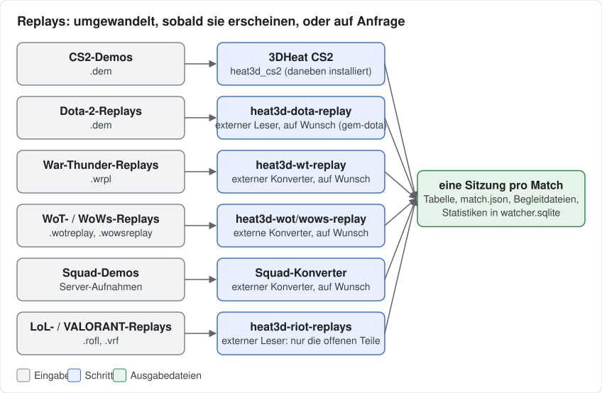

# Installieren und Starten {#installing-and-running}

## Voraussetzungen {#requirements}

- **Windows.** Der Watcher ist für Windows geschrieben, und die meisten seiner Quellen gibt es nur dort: den
  gemeinsamen Speicher, den Spiele anlegen (`Local\...`-Abbildungen), die Registry (dort steht Steam),
  Windows-Benachrichtigungen, die Prozessliste mit den Pfaden der Programme. Auf einem anderen System startet das
  Programm, aber diese Quellen finden nichts, Benachrichtigungen werden nur protokolliert, und das Lesen des
  Speichers verweigert sich („only implemented on Windows“).
- **Python 3.10 oder neuer**, von <https://www.python.org/downloads/>: Setze im Installationsprogramm den Haken bei
  **Add python.exe to PATH**, dann prüfe mit `python --version` in einem neuen Terminal. Neu dabei? Lies zuerst
  [Bevor du anfängst](before-you-start.md).
- **Pakete** (`requirements.txt`): `psutil>=6.0` (welche Spiele laufen, welches Programm einen Port hält, die
  Verbindungen eines Spiels; ein älteres psutil funktioniert auch, über seinen älteren Namen für die Verbindungen
  eines Prozesses), `pyarrow>=15` (schreibt `heat.parquet`), `numpy>=1.24`, und `pytest>=8.0` für die Tests.
  `requirements-optional.txt` führt im Moment keine Pakete auf.

Ohne `pyarrow` werden Sitzungen trotzdem aufgezeichnet: `events.jsonl` ist die Aufnahme, und die Tabelle kann
später mit [`table`](commands.md#table) gebaut werden.

### Zusätze, die manche Spiele brauchen {#extras-some-games-need}

| Spiel | Was es braucht |
|---|---|
| Counter-Strike-2-Demos | [3DHeat CS2](https://github.com/Holdi601/3DHeat-CS2) und seine Voraussetzungen (`demoparser2`). Der Watcher sucht es in `HEAT3D_CS2`, dann in einem Ordner `3DHeat-CS2` oder `cs2` neben dem eigenen Ordner des Watchers, dann überall, wo Python `heat3d_cs2` importieren kann. Ohne es zeigt `games` den Adapter als nicht verfügbar. |
| Microsoft Flight Simulator 2020 / 2024 | `SimConnect.dll` – nicht mitgeliefert. MSFS 2020 hat eine in seinem Installationsordner; für MSFS 2024 installiere das MSFS-2024-SDK. `MSFS_SDK` / `MSFS2024_SDK` zeigen auf den Ordner des SDK. |
| Euro Truck Simulator 2, American Truck Simulator | das Plugin `scs-telemetry.dll` von RenCloud (Revision 12) in `<game>\bin\win_x64\plugins` |
| BeamNG.drive | der `heat3d`-Protokoll-Mod, installiert durch `python -m heat3d_watch setup beamng --apply` |
| League of Legends (live) | optional: Riots Root-Zertifikat als `<data>\riotgames.pem`, damit die lokale Verbindung geprüft wird |
| Minecraft | ein Ordner `%APPDATA%\.minecraft` (Java Edition) |

Die Seite jedes Spiels unter [Spiele](games.md) sagt, was im Spiel selbst eingeschaltet werden muss.
`python -m heat3d_watch games` markiert einen Adapter mit `[unavailable: ...]`, wenn ihm auf diesem Rechner etwas
fehlt, das er braucht.

## Installieren {#installing}

Neu in der Kommandozeile? Lies zuerst [Bevor du anfängst](before-you-start.md). Wenn `pip` nicht gefunden wird,
verwende stattdessen `python -m pip install -r requirements.txt`.

Aus einem Klon:

```bash
git clone https://github.com/Holdi601/3DHeat-Watcher.git
cd 3DHeat-Watcher
pip install -r requirements.txt
```

Aus einer Version: Lade das Archiv von den Releases des Repositorys herunter, entpacke es und führe dann
`pip install -r requirements.txt` im Ordner aus. Beide Arten von Kopie aktualisieren sich selbst (siehe
[Updates](updates.md)).

Führe jeden Befehl aus dem Repository-Ordner aus: `python -m heat3d_watch` importiert das Paket von dort, und der
Updater (`heat3d_update`) liegt daneben.

## Starten {#running}

```bash
python -m heat3d_watch run        # watch until stopped
python -m heat3d_watch run -v     # the same, with debug lines in the log
python -m heat3d_watch run --once # one look at the games running now, then stop and exit
```

Beim Start macht `run` Folgendes:

1. schreibt die [Sperrdatei](#the-lock-file);
2. beendet alle Sitzungen, die ein früherer Lauf offen gelassen hat, zum Beispiel nach einem Absturz
   (siehe [Wiederherstellung nach einem Absturz](the-data.md#recovery-after-a-crash));
3. liest alle `scan_seconds` (2 s) die Prozessliste (nur Namen und Pfade, kein Prozess wird geöffnet) und startet
   für jedes gefundene Spiel einen Adapter in einem eigenen Thread. Wenn der Prozess eines Spiels weg ist, wird
   sein Adapter gestoppt und die Sitzungen, die er offen hatte, werden geschlossen; dabei werden ihre Tabelle und
   ihre Zeile in der Statistik geschrieben. Adapter, die nicht auf ein Spiel warten (Steam-Statistiken,
   Steam-Timeline, NVIDIA-Highlights, die Replay-Ordner), laufen die ganze Zeit;
4. solange kein Spiel läuft, sucht er höchstens einmal pro Stunde nach einer neueren Version (die Antwort selbst
   wird sechs Stunden zwischengespeichert) und installiert sie bei eingeschaltetem `auto_update`, dann startet er
   sich neu (siehe [Updates](updates.md)).

Ein Adapter, der fehlschlägt, wird protokolliert, und die anderen laufen weiter. Wenn die Abfrage eines Adapters
20-mal hintereinander fehlschlägt oder sein Start fehlschlägt, wird der Adapter gestoppt und erst wieder
gestartet, wenn das Spiel erneut gestartet wird (eine neue Prozess-ID).

Beende den Watcher mit Strg+C. Die Adapter schließen ihre Sitzungen, bevor er endet. Wird der Watcher stattdessen
abgebrochen (Task-Manager, ein Absturz, ein Stromausfall), geht nichts verloren, was schon geschrieben war: Der
nächste `run` beendet diese Sitzungen.

`--once` macht einen einzigen Blick: Es startet die Adapter für die Spiele, die in diesem Moment laufen (und die
immer aktiven), lässt jeden einmal abfragen – dafür wird höchstens 10 Sekunden gewartet – und stoppt sie dann so,
wie ein Spielende es täte. Die Sitzungen, die sie geöffnet haben, werden also geschlossen, ihre Tabellen
geschrieben und ihre Zeilen in der Statistik gezählt, bevor er endet. Nutze es, um zu prüfen, dass ein Spiel
erkannt wird, nicht zum Aufzeichnen.

### Replays, die schon auf der Festplatte liegen {#replays-already-on-disk}



Das erste Mal, wenn ein Replay-Adapter einen seiner Ordner sieht, merkt er sich nur die Replays, die schon darin
liegen: Ein Spieler mit jahrelangen Demos würde sonst einen Tag lang Konvertierungen erleben. Von da an wird jedes
neue Replay einmal umgewandelt, sobald das Spiel es fertig geschrieben hat. Die alten werden auf Anfrage mit
[`replays`](commands.md#replays) umgewandelt:

```bash
python -m heat3d_watch replays cs2-demos              # every demo in CS2's folders and replay_folders
python -m heat3d_watch replays osu-replays D:\Old     # the replays in one folder
```

### Im Hintergrund laufen lassen {#running-in-the-background}

Der Watcher hat kein eigenes Fenster; er ist ein Konsolenprogramm, das läuft, bis es gestoppt wird. Er schreibt
alles in `watcher.log`, daher braucht er keine sichtbare Konsole. Möglichkeiten, ihn aus dem Weg zu halten:

- starte ihn in einer Konsole und minimiere die Konsole: `start "" /min python -m heat3d_watch run` aus `cmd`, im
  Repository-Ordner;
- starte ihn ohne Konsole: `pythonw -m heat3d_watch run`. Die Konsolenausgabe geht verloren, aber `watcher.log`
  wird trotzdem geschrieben. Zum Stoppen beendest du den Prozess `pythonw.exe`; der nächste Start beendet dann die
  Sitzungen, die er offen gelassen hat. Das Projekt hat diese Art des Laufens nicht getestet.

### Mit Windows starten (eine Idee) {#starting-with-windows-an-idea}

Der Watcher installiert sich nicht selbst so, dass er mit Windows startet. Um ihn automatisch zu starten:

- **Aufgabenplanung**: Lege eine Aufgabe an mit dem Auslöser *Bei Anmeldung* und der Aktion *Programm starten*,
  Programm `pythonw.exe` (oder `python.exe`), Argumente `-m heat3d_watch run`, *Starten in* auf den
  Repository-Ordner gesetzt;
- **Autostart-Ordner**: Lege eine Verknüpfung in `shell:startup` an, mit demselben Programm, denselben Argumenten
  und demselben Ordner *Starten in*.

Keines von beiden gehört zum Watcher oder wird von ihm getestet. Die [Sperrdatei](#the-lock-file) sorgt dafür, dass
eine zweite Kopie, die aus Versehen gestartet wird, sofort beendet wird.

## Die Sperrdatei {#the-lock-file}

`<data>\watcher.lock` enthält die Prozess-ID des laufenden Watchers. Wenn `run` startet und die Sperrdatei einen
Prozess nennt, der noch existiert und dessen Name `python` enthält, schreibt er

```text
A watcher is already running (process 12345) for C:\Users\...\3DHeat\Watcher.
```

und endet mit Exitcode 1. Zwei Watcher auf einem Datenordner würden jedes Spiel zweimal aufzeichnen, und der zweite
würde die offenen Sitzungen des ersten für Reste eines Absturzes halten. Eine Sperrdatei, deren Prozess weg ist
oder einem anderen Programm gehört, wird überschrieben. Wenn `run` endet, entfernt er die Sperrdatei, sofern sie
noch seine eigene Prozess-ID nennt.

## Das Protokoll {#the-log}

`<data>\watcher.log` wird nur von `run` geschrieben; die anderen Befehle geben auf der Konsole aus. Jede Zeile hat
die Uhrzeit, die Stufe und eine Meldung:

```text
2026-05-01 20:15:01,123 INFO watching; data in C:\Users\...\AppData\Local\3DHeat\Watcher
2026-05-01 20:15:03,456 INFO f1-25: starting (EA SPORTS F1 25)
2026-05-01 21:02:11,789 INFO f1-25: stopping
```

Adapter protokollieren, was sie nicht tun können und warum: „UDP 20777 is in use by ...; not taking it from that
program“, „not reading memory: the game is played online“, „could not start“, „poll failed (3)“ mit dem Traceback.
`run -v` fügt Debug-Zeilen hinzu. Die Datei wird angehängt und vom Watcher nie gedreht oder geleert; lösche sie,
wann immer du willst. Dieselben Zeilen gehen auch auf die Konsole.

## Wo alles liegt {#where-everything-is}

Der Basisordner ist `%LOCALAPPDATA%\3DHeat\Watcher`, oder `HEAT3D_WATCH_HOME`, wenn das gesetzt ist (ohne
`LOCALAPPDATA`, zum Beispiel auf einem anderen System, `~/.local/share/3DHeat/Watcher`). `settings.json` liegt
immer im Basisordner. Alles andere kommt in den Datenordner, der der Basisordner ist, sofern die Einstellung
`data` nicht einen anderen nennt:

| Pfad | Was es ist |
|---|---|
| `<home>\settings.json` | die Einstellungen |
| `<data>\sessions\` | die Aufnahmen, ein Ordner pro Sitzung ([Die Daten](the-data.md)) |
| `<data>\watcher.sqlite` | die Statistik-Datenbank |
| `<data>\watcher.log` | das Protokoll von `run` |
| `<data>\watcher.lock` | die Sperrdatei, solange `run` läuft |
| `<data>\state\` | was die immer aktiven und die Replay-Adapter schon gesehen haben (`steam-stats.json`, `replays-cs2-demos.json`, ...), damit ein Neustart nichts doppelt aufzeichnet |
| `<data>\profiles\*.json` | Speicherprofile, die du geschrieben hast ([Speicher lesen](memory-reading.md)) |
| `<data>\riotgames.pem` | optional, Riots Root-Zertifikat für den Live-Adapter von League of Legends |
| `%LOCALAPPDATA%\3DHeat\update-check-3DHeat-Watcher.json` | die zwischengespeicherte Antwort der letzten Versionsprüfung |

Der Watcher löscht in diesen Ordnern nichts, außer einem Sitzungsordner, in dem nichts aufgezeichnet wurde (ein
Spiel, das in seinen Menüs blieb).

## Einstellungen {#settings}


`python -m heat3d_watch config` zeigt die Einstellungen; `config --set key=value ...` ändert sie und speichert
`settings.json` (siehe [config](commands.md#config)). Die Datei ist einfaches JSON und kann auch von Hand bearbeitet
werden, während der Watcher nicht läuft. Unbekannte Schlüssel darin werden ignoriert. Einstellungen werden beim
Start eines Befehls gelesen, daher starte `run` nach einer Änderung neu.

| Einstellung | Standard | Was sie tut |
|---|---|---|
| `data` | `""` | Der Datenordner. Leer: der Basisordner. |
| `disabled` | `[]` | Adapter-IDs, die nie laufen, zum Beispiel `config --set disabled=steam-stats,nvidia-highlights`. Jeder andere Adapter läuft, wenn er sein Spiel findet. |
| `auto_update` | `true` | Solange kein Spiel läuft, eine neuere Version installieren und neu starten (siehe [Updates](updates.md)). `false`: nur ein Hinweis im Protokoll. |
| `scan_seconds` | `2.0` | Sekunden zwischen den Blicken auf die Prozessliste. |
| `memory` | `false` | Speicher-Adaptern (Einzelspieler-Spielen mit einem Profil, das du geschrieben hast) erlauben zu laufen. Standardmäßig aus; siehe [Speicher lesen](memory-reading.md). |
| `replays` | `true` | Die `replay`-Adapter laufen lassen: alle (siehe `python -m heat3d_watch replays` und [Spiele](games.md)) – CS2-Demos, Dota 2, osu!, War Thunder, World of Tanks, World of Warships, Squad, League-of-Legends- und VALORANT-Replays, IL-2-Tacview-Aufzeichnungen. |
| `replay_folders` | `{}` | Zusätzliche Ordner nach Adapter-ID, zum Beispiel `{"cs2-demos": ["D:\\Demos"]}`. Die Replay-Adapter beobachten sie zusätzlich zu den Ordnern des Spiels selbst; `il2-tacview` akzeptiert auch Installationsordner (dann sucht es in deren `data\Tracks`); bei `elite` ersetzt der erste Ordner den Journal-Ordner. Die Ordner eines Adapters setzt du mit `config --set replay_folders.cs2-demos=D:\Demos,E:\More`, oder das ganze Wörterbuch als JSON. |
| `riot_id` | `""` | Deine Riot-ID (`Name#TAG`), damit deine eigene Zeile in einem League-of-Legends-Replay zu deiner Statistik wird. Leer: Die Zeile jedes Spielers wird behalten, keine wird als deine markiert. |
| `riot_api_key` | `""` | Dein eigener Riot-Entwicklerschlüssel, um für jedes abgespielte League-Match die offizielle Zeitleiste zu holen (Positionen jede Minute, Abschüsse dort, wo sie passierten). Leer: Es wird nichts geholt. |
| `riot_platform` | `"EUW1"` | Die Plattform-ID deines League-Servers (`EUW1`, `EUN1`, `NA1`, `KR`, ...), mit der der regionale Match-V5-Host gefunden wird. |
| `player_names` | `{}` | Dein Name in Spielen, deren Oberfläche jeden Spieler nennt, aber nicht sagt, wer du bist, nach Adapter-ID: `warthunder-webmap` (die Zeilen des Abschussprotokolls über dich werden deine Abschüsse und Tode) und `rocketleague-stats` (deine Zeilen werden `me`; ohne ihn der Spieler, dem die Kamera des Spiels folgt). Setzen mit `config --set player_names.warthunder-webmap=Name`. |

Eine `settings.json` mit allen Standardwerten:

```json
{
  "data": "",
  "disabled": [],
  "auto_update": true,
  "scan_seconds": 2.0,
  "memory": false,
  "replays": true,
  "replay_folders": {},
  "riot_id": "",
  "riot_api_key": "",
  "riot_platform": "EUW1",
  "player_names": {}
}
```

## Umgebungsvariablen {#environment-variables}

| Variable | Wirkung |
|---|---|
| `HEAT3D_WATCH_HOME` | der Basisordner (Einstellungen, und die Daten, sofern `data` nichts anderes sagt) |
| `HEAT3D_NO_UPDATE` | jeder Wert außer leer, `0`, `false` oder `no` schaltet die Versionsprüfung und das automatische Update aus |
| `HEAT3D_NO_TOAST` | jeder nicht leere Wert: keine Windows-Benachrichtigungen, nur Protokollzeilen |
| `HEAT3D_CS2` | der Ordner von 3DHeat CS2, für CS2-Demos |
| `HEAT3D_CS2_GSI_PORT` | der Port für den Spielzustand von CS2 (Standard 3311); die cfg-Datei, die `setup` schreibt, nutzt ihn |
| `HEAT3D_DOTA_GSI_PORT` | der Port für den Spielzustand von Dota 2 (Standard 3312) |
| `MSFS_SDK`, `MSFS2024_SDK` | die Ordner des MSFS-SDK, in denen nach `SimConnect SDK\lib\SimConnect.dll` gesucht wird |

Windows-Benachrichtigungen werden nur für Updates genutzt: „Updating to 1.2.0“, oder „1.2.0 is out; not updated:
...“, wenn das Update nicht angewendet werden konnte. Sie werden über die eigene Benachrichtigungs-API von
PowerShell angezeigt, daher muss nichts installiert werden. Titel und Text werden PowerShell als
Umgebungsvariablen übergeben, nie als Teil des Skripts.
