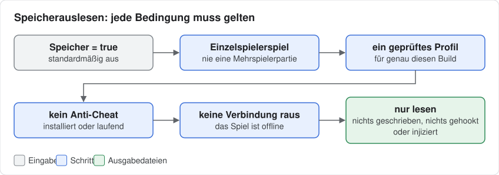

# Speicher lesen {#reading-memory}

Manche Einzelspieler-Spiele erzählen anderen Programmen nichts. Für diese kann der Watcher – wenn du es einschaltest
und selbst ein Profil schreibst – nachsehen, wo du dich im Speicher des Spiels befindest, und zwar nur lesend.

Für Einzelspieler-Spiele, die nichts veröffentlichen, kann der Watcher Positionen und Werte aus dem Speicher des
Spiels lesen, über ein **Profil**, das du für deine eigene Version des Spiels schreibst. Von allen Quellen ist
dies die einzige, die das Spiel nicht selbst herausgegeben hat, daher ist sie stärker eingezäunt als die anderen:

- sie ist **standardmäßig aus** (`python -m heat3d_watch config --set memory=true` schaltet sie ein);
- sie liest, und hat keine Möglichkeit zu schreiben;
- **es werden keine Profile mitgeliefert.**

Profile werden nicht mitgeliefert, weil ein Offset nur für die Version stimmt, auf der er gefunden wurde. Nach
einem Patch liest ein Profil, das vorher richtig war, Müll, und Müll sieht genauso aus wie Zahlen. Ein Profil muss
auf der Version geprüft werden, die ein Spieler hat, und zwar von diesem Spieler.

## Die Prüfungen, in dieser Reihenfolge {#the-checks-in-order}



Jede der folgenden Prüfungen muss bestehen. Die ersten vier werden **bevor** das Spiel geöffnet wird gemacht,
denn das Öffnen eines geschützten Spiels zum Lesen ist selbst das, was ein Anti-Cheat bemerkt, und ein Verweigern
danach käme zu spät.

1. **Die Einstellung**: `memory` ist wahr. Sonst werden Speicher-Adapter nie gestartet.
2. **Ein Profil für das Spiel**, dessen `exe` den laufenden Prozess nennt. Ein Profil sagt, ob das Spiel überhaupt
   online gespielt werden kann (`"online"`); eines, das das auslässt, wird abgelehnt.
3. **Kein Anti-Cheat in der Nähe**:
   - keine Anti-Cheat-Datei im Ordner des Spiels oder bis zu drei Ordner darüber (wobei an einem Steam-Bibliotheks-Ordner
     `common` oder an einem Ordner mit `steamapps` Schluss ist, da darüber andere Spiele liegen): `EasyAntiCheat`,
     `EasyAntiCheat_EOS_Setup.exe`, `start_protected_game.exe`, `BattlEye`, `BEClient_x64.dll`, `BEService_x64.exe`,
     `EAAntiCheat.GameServiceLauncher.exe`, `AntiCheatExpert`, `SGuard64.exe`, `GameGuard`, `GameMon.des`,
     `XIGNCODE`, `xhunter1.sys`, `Vanguard`, `FACEIT` (verglichen in Kleinschreibung, auch als Anfang eines Namens).
     Ist der Ordner des Spiels unbekannt, wird das Spiel abgelehnt;
   - kein Anti-Cheat-Treiber oder -Dienst läuft auf dem Rechner überhaupt, so wie ihn
     `sc query type= driver state= active` und `sc query type= service state= active` auflisten: EasyAntiCheat,
     EasyAntiCheat_EOS, BEService, BEDaisy, vgk, vgc, ACE-BASE, ACE-GAME, xhunter1, FACEIT, FACEITService,
     EAAntiCheatService, Denuvo Anti-Cheat, npggsvc, Ricochet. Ein Kernel-Anti-Cheat, der für ein anderes Spiel
     installiert wurde, beobachtet trotzdem jeden Prozess. Können die Dienste nicht aufgelistet werden, wird das Spiel
     abgelehnt;
4. **Nicht online**: Ein Spiel, dessen Profil `"online": true` sagt, wird nur gelesen, solange es keine Verbindung zu
   etwas außer diesem Rechner hat (jede entfernte Adresse außer `127.x`, `::1`). Können seine Verbindungen nicht
   gelesen werden, wird es abgelehnt.
5. Dann, beim Start des Adapters:
   - **genau diese Version**: die Dateigröße der Programmdatei oder ihr SHA-256 muss zu einer Version passen, die das
     Profil nennt. Eine unbekannte Version wird nicht gelesen;
   - **die Module noch einmal**: Die geladenen Module des Spiels werden aufgelistet (ein Toolhelp-Schnappschuss, der
     keine eigenen Zugriffsrechte verlangt) und auf einen Anti-Cheat-Client geprüft (`BEClient_x64.dll`,
     `BEClient.dll`, `EasyAntiCheat_x64.dll`, `EasyAntiCheat.dll`, `EOSAntiCheat...`). Ein geschützter Prozess verweigert
     den Schnappschuss, und auch das ist eine Ablehnung;
   - erst dann wird der Prozess geöffnet, mit `PROCESS_VM_READ | PROCESS_QUERY_LIMITED_INFORMATION` und sonst nichts.

Die Prüfungen 1 bis 4 werden bei jedem Scan (alle 2 s) wiederholt, solange das Spiel läuft. Wenn eine davon zu
scheitern beginnt (das Spiel verbindet sich mit einem Server, ein Anti-Cheat-Dienst startet), wird der Adapter beim
nächsten Scan gestoppt. Eine Ablehnung wird protokolliert: `mem-<id>: not reading memory: <reason>`. Ein Fehler beim
Start (unbekannte Version, ein Anti-Cheat-Modul, ein Muster nicht gefunden) wird als `mem-<id>: could not start`
protokolliert, und der Adapter wird erst wieder versucht, wenn das Spiel erneut gestartet wird.

Es gibt kein Schreiben, keine Speicherreservierung im anderen Prozess, keinen Thread, der darin startet, keine
Bibliothek, die darin geladen wird, kein Debug-Privileg und keine Erhöhung der Rechte. Ein Test (`test_memory_reading_cannot_write`
in `tests/test_core.py`) schlägt fehl, wenn irgendein Aufruf, der in einen anderen Prozess schreibt, Speicher dort
reserviert oder Code darin ausführt – `WriteProcessMemory`, `VirtualAllocEx`, `CreateRemoteThread`, `PROCESS_VM_WRITE`,
`SeDebugPrivilege`, `LoadLibrary`, ... – irgendwo im Paket auftaucht.

Nie gelesen wird, was ein Profil auch sagt: Spiele, die online gespielt werden, und Spiele, deren Einzelspieler-Modus
unter einem Anti-Cheat läuft, wie GTA V oder Elden Ring, wenn es über seinen Launcher gestartet wird. Die Prüfungen
oben lehnen sie ohnehin ab.

## Das Profilformat {#the-profile-format}

Ein Profil ist eine JSON-Datei in `<data>\profiles\` (`<data>` ist der Datenordner, siehe
[Installieren und Starten](installing-and-running.md#where-everything-is)), eines pro Spiel, mit einem beliebigen
Dateinamen, der auf `.json` endet. Ein erfundenes Beispiel:

```json
{
  "schema": "heat3d.memprofile/1",
  "id": "mygame",
  "game": "My Game",
  "exe": "MyGame.exe",
  "online": false,
  "versions": [ { "label": "1.06", "size": 123456789 } ],
  "anchors": {
    "World": { "aob": "48 8B 05 ?? ?? ?? ?? 48 85 C0", "rip": [3, 7] }
  },
  "values": {
    "pos": { "type": "vec3f", "base": "World", "chain": ["0x10", "0x68", "0x70"] },
    "hp":  { "type": "i32",   "base": "World", "chain": ["0x10", "0x138"] },
    "map": { "type": "u32",   "base": "World", "chain": ["0x10", "0x1C0"] }
  },
  "events": [
    { "event": "death", "value": "hp",  "when": "to_zero" },
    { "event": "zone",  "value": "map", "when": "change" }
  ],
  "axes": { "up": "y", "units": "metres" },
  "rate": 10,
  "provenance": [ { "source": "https://example.com/my-notes", "verified_on": "1.06" } ]
}
```

| Schlüssel | Pflicht | Was er ist |
|---|---|---|
| `schema` | ja | genau `heat3d.memprofile/1` |
| `id` | ja | kurz und stabil; der Adapter heißt `mem-<id>` |
| `game` | ja | der Name des Spiels, nach dem der Sitzungsordner benannt wird |
| `exe` | ja | der Dateiname der Programmdatei, der auch sagt, dass das Spiel läuft |
| `online` | ja | `true`, wenn das Spiel überhaupt online gespielt werden kann; es wird dann nur offline gelesen |
| `versions` | ja | die Versionen, auf denen das Profil geprüft wurde: jede mit einem `label` und einer `size` (die Größe der Programmdatei in Bytes) und/oder einem `sha256`. Sind beide angegeben, müssen beide passen. Ein Eintrag ohne beides passt auf nichts. |
| `anchors` | ja | benannte Adressen im Hauptmodul. `aob`: ein Bytemuster, hexadezimale Bytes durch Leerzeichen getrennt, `?` oder `??` für jedes Byte; es muss **genau einmal** im Modul-Abbild vorkommen (mehrere Treffer zählen als Fehler, wie keiner). `rip: [d, n]`: das Muster zeigt auf eine Anweisung mit einer 32-Bit-RIP-relativen Verschiebung bei Byte `d` und Länge `n`; der Anker wird die Adresse, auf die diese Anweisung zeigt. `offset`: wird danach addiert (hexadezimal oder dezimal als Text). Statt `aob` gibt `module_offset` einen festen Offset ab der Basis des Moduls an. |
| `values` | ja | was bei jeder Abfrage gelesen wird: `type` (`i32`, `u32`, `i64`, `u64`, `u8`, `f32`, `f64`, `vec3f`, `vec3d`), `base` (der Name eines Ankers), `chain` (Offsets als hexadezimaler oder dezimaler Text) |
| `events` | nein | Regeln, die Änderungen in Ereignisse verwandeln: `when` `change` (der Wert unterscheidet sich von der letzten Abfrage) oder `to_zero` (eine Zahl fällt von über 0 auf 0 oder darunter) |
| `axes` | nein | `up` (Standard `y`), `units` (Standard `game units`), `scale` (der Maßstab der Einheiten für den Viewer, der jede Position multipliziert; Standard 1, die eigenen Einheiten des Spiels) |
| `rate` | nein | Abfragen pro Sekunde, 1 bis 60 (Standard 10) |
| `provenance` | nein | woher die Offsets stammen und auf welcher Version du sie geprüft hast; es wird in die `meta.json` jeder Sitzung kopiert |

**Wie ein Wert gelesen wird.** Die Adresse des Ankers ist der Ausgangspunkt. Ist `chain` leer, wird der Wert genau
dort gelesen. Sonst wird zuerst der Zeiger gelesen, der am Anker gespeichert ist. Dann wird für jeden Offset außer
dem letzten der Zeiger bei `Adresse + Offset` gelesen. Der letzte Offset wird addiert, um die Adresse des Wertes
zu erhalten. Ein Nullzeiger unterwegs (das Spiel ist zwischen Level oder in einem Menü) lässt den Wert für diese
Abfrage leer.

**Was aufgezeichnet wird.** Ein Wert namens `pos` (ein `vec3f` oder `vec3d`) wird bei jeder Abfrage zu einer
`position`-Zeile des Spielers `me`. Jede Ereignisregel schreibt ihre `event`-Zeile mit dem neuen Wert und, wo `pos`
bekannt ist, der Position, und zählt eine Statistik desselben Namens um 1. Das Abbild des Moduls wird beim Start
einmal gelesen, um die Anker zu finden, in 64-KiB-Blöcken; Blöcke, die sich nicht lesen lassen, zählen als Nullen.
Die `meta.json` der Sitzung nennt das Profil, die Bezeichnung der Version und die Herkunft.

Ein Profil, das sich nicht verwenden lässt (kaputtes JSON, das falsche `schema`, ein Pflichtschlüssel fehlt), wird
übersprungen und als `profile <file> not used: <reason>` protokolliert. Profile werden beim Start des Watchers
geladen, daher starte `run` nach dem Hinzufügen oder Ändern eines Profils neu.

## Ein Profil schreiben und prüfen {#writing-and-verifying-a-profile}

1. **Nur für ein Einzelspieler-Spiel ohne Anti-Cheat.** Hat das Spiel ein Anti-Cheat, oder spielst du es online, hör
   hier auf: Der Watcher lehnt es ab, und das soll er auch.
2. **Finde die Werte auf deiner eigenen Version.** Arbeite offline. Nutze deine eigenen Debugging-Werkzeuge oder
   veröffentlichte Notizen zum Spiel, um die Position des Spielers und die Werte, die dich interessieren, zu finden,
   dazu einen Zeigerpfad zu jedem von einem festen Ort in der Programmdatei aus. Bevorzuge ein Bytemuster (`aob`) vor
   einem festen `module_offset`: Ein Muster findet seinen Platz auch dann noch, wenn der Code sich ein wenig verschiebt.
3. **Mach das Muster eindeutig.** Es muss im Modul genau einmal vorkommen. Setze die Bytes, die sich ändern
   (Adressen, Verschiebungen), als Platzhalter ein und behalte genug feste Bytes drumherum.
4. **Pinne die Version.** Trag die genaue Größe der Programmdatei in `versions` ein; PowerShell
   `(Get-Item .\MyGame.exe).Length` gibt sie, und `Get-FileHash .\MyGame.exe -Algorithm SHA256` gibt den Hash. Nach
   einem Patch wird das Profil einfach nicht mehr verwendet, bis du es erneut prüfst und die neue Version hinzufügst.
5. **Sag, ob das Spiel online geht** (`online`), ehrlich.
6. **Probier es aus**: Schalte das Lesen ein (`config --set memory=true`), lege die Datei in `<data>\profiles\`, und
   prüfe, dass `python -m heat3d_watch games` `mem-<id>` auflistet. Starte das Spiel und führe
   `python -m heat3d_watch run -v` aus. In `watcher.log` suchst du nach `mem-<id>: starting` oder nach dem Grund,
   warum es abgelehnt wurde oder nicht starten konnte.
7. **Prüfe die Zahlen gegen das Spiel.** Geh an einen bekannten Ort und sieh dir die `position`-Zeilen in der
   `events.jsonl` der Sitzung an. Bewegen sie sich, wenn du dich bewegst, um die richtige Strecke, entlang der richtigen
   Achsen? Öffne `heat.parquet` im Viewer und prüfe, dass die Route zu dem passt, wohin du gegangen bist. Löse jedes
   Ereignis aus (alle Lebenspunkte verlieren, die Zone wechseln) und prüfe, dass es genau einmal erscheint. Müll sieht
   aus wie Zahlen, und nur dieser Vergleich unterscheidet beides.
8. **Schreib auf, was du geprüft hast** in `provenance`: die Quelle der Offsets und die Version, auf der du sie geprüft
   hast.

Der Text `verified` eines Speicher-Adapters, so wie ihn `games` ausgibt, lautet immer „by the profile's author, for the
builds it lists“. Mehr kann der Watcher nicht wissen.
