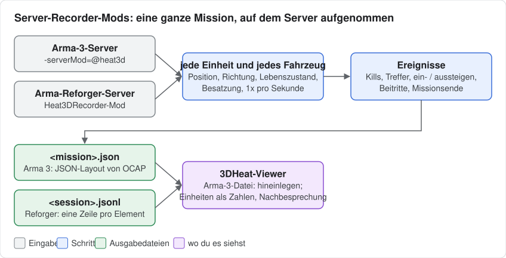

# Server-Aufzeichnungsmods (Arma 3, Arma Reforger) {#server-recorder-mods-arma-3-arma-reforger}

Die meisten Spiele zeichnet der Watcher auf dem eigenen Rechner des Spielers auf. Arma ist
anders: Ein Server kann eine ganze Mission aufzeichnen, jede Einheit und jedes Fahrzeug, nicht nur
deins, mit einem Mod, der auf dem Server läuft. Spieler richten nichts ein. Der Arma-3-Mod ist nur
für den Server, und Reforger lädt die Mods eines Servers beim Beitritt selbst auf die Rechner der Spieler
(der Mod tut dort nichts). Das Repository enthält zwei solche Mods, in
[`mods/arma3`](https://github.com/Holdi601/3DHeat-Watcher/tree/main/mods/arma3)
und [`mods/reforger`](https://github.com/Holdi601/3DHeat-Watcher/tree/main/mods/reforger).
Ihre READMEs sind die vollständige Dokumentation; diese Seite ist der Überblick.

**Status: beide sind im Spiel noch nicht getestet.** Die Arma-3-Erweiterung wurde gebaut und so
angesteuert, wie Arma Erweiterungen aufruft, und ihre Ausgabe wurde von 3DHeat gelesen. Ihre SQF-Skripte
sind in Arma 3 noch nicht gelaufen. Der Reforger-Mod wurde nach Bohemias veröffentlichter Skript-API
geschrieben und wurde noch nie kompiliert. Setze keinen von beiden auf einen öffentlichen Server, bevor
die Testschritte in seiner README bestanden sind.

## Arma 3 {#arma-3}

1. Baue die Erweiterung einmal pro Plattform (`mods/arma3/extension`). Dafür braucht es einen C-Compiler:
   Visual Studio Build Tools unter Windows, gcc unter Linux. Wenn du noch nie etwas kompiliert hast,
   frag deinen Server-Anbieter.
   - Unter Windows, in einer „x64 Native Tools Command Prompt for VS“:
     `cl /nologo /O2 /LD heat3d.c /Fe:heat3d_x64.dll`
   - Unter Linux: `gcc -O2 -shared -fPIC -o heat3d_x64.so heat3d.c -ldl`
2. Baue den Mod: `python mods/arma3/build.py` schreibt `mods/arma3/@heat3d/`
   (die Arma-3-Tools braucht man dafür nicht).
3. Kopiere `@heat3d` in den Ordner des Servers und starte den Server mit
   `-serverMod=@heat3d`.
4. Das `.rpt`-Protokoll des Servers sagt `Heat3D recorder 0.1.0: recording <file> every 1 s`.

| Einstellung | Standard | Was sie tut |
|---|---|---|
| `captureDelay` | 1 | Sekunden zwischen zwei Bildern |
| `recordHits` | 1 | 0 schaltet die Trefferereignisse aus |
| `recordShots` | 1 | 0 schaltet das Zählen der Schüsse aus |
| `minPlayers` | 0 | nur aufzeichnen, wenn so viele Spieler online sind |

Eine Mission überschreibt einen Wert in ihrer `init.sqf` (`heat3d_captureDelay = 0.5;`).
Aufnahmen landen im Ordner `recordings/` innerhalb von `@heat3d` oder in `HEAT3D_DIR`.

**Ausgabe:** eine Datei pro Mission im JSON-Layout von OCAP (dem Format des OCAP2-Recorders),
benannt `<date>__<time>_<mission>.json`. Während der Mission ist sie ein Journal (`.heat3d.part`), das bei
jedem Schreiben gespeichert wird. Das Journal einer abgestürzten Mission wird beim nächsten Start einer
Mission abgeschlossen.

## Arma Reforger {#arma-reforger}

Der Mod (`Heat3DRecorder.gproj`) wird in Bohemias Workbench (Arma Reforger Tools) geöffnet und gebaut,
auf einem lokalen dedizierten Server getestet, aus der Workbench veröffentlicht (ungelistet, solange getestet
wird) und in die Liste `mods` der `config.json` des Servers eingetragen. Die Schritte stehen in seiner README.
Jede Sekunde schreibt er die Position, Blickrichtung, den Lebensstatus, das Fahrzeug und die Spieler-ID jedes
Charakters sowie Position, Richtung, Zustand und Besatzung jedes Fahrzeugs. Dazu kommen Kills (Killer, Waffe,
Entfernung), Treffer, Ein- und Aussteigen, Spieler, die beitreten oder gehen, und das Ende der Mission.

**Ausgabe:** ein JSON-Objekt pro Zeile, `$profile:heat3d/<UTC-Datum>_<UTC-Zeit>_<world>.jsonl`:
eine `header`-Zeile (Format `heat3d-reforger`, Achsen x Ost, y oben, z Nord), dann `entity`-, `frame`- und
`event`-Zeilen, sobald sie entstehen, und eine `end`-Zeile. Zeilen für Einheiten sind
`[id, x, y, z, dir, alive, vehicleId, playerId]`, Zeilen für Fahrzeuge `[id, x, y, z, dir, alive, [crew ids]]`.
Ereignisse folgen dem Ereignislayout von OCAP2.

## Im Viewer {#in-the-viewer}

Ziehe eine Arma-3-Aufnahme auf den [3DHeat-Viewer](https://holdi601.github.io/3DHeat/):
Eine Mission ist eine Sitzung, Einheiten werden zu Soldaten, Fahrzeuge zu ihrem Typ, und
Kills und Treffer landen in der Liste der Nachbesprechung. Der Web-Player von OCAP2 spielt sie ebenfalls ab.
Die Reforger-Datei ist das eigene Zeilenformat des Mods mit dem Ereignislayout von OCAP2.
