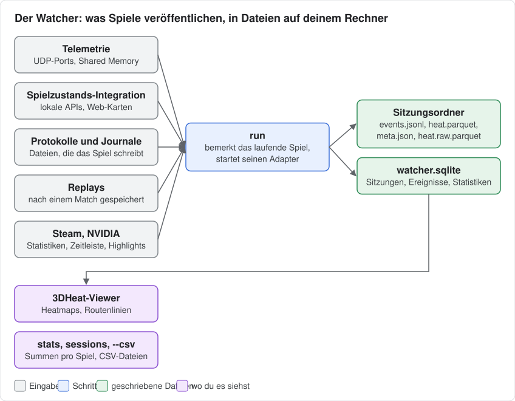

# Quellen und Regeln {#sources-and-rules}

Der Watcher zeichnet nur auf, was Spiele und Plattformen dem Spieler herausgeben. Diese Seite erklärt, welche Quellen das umfasst, was der Watcher mit jeder davon tun darf und welche Spiele oder Teile von Spielen er bewusst auslässt.

## Die sechs Arten von Quellen {#the-six-kinds-of-source}

Jeder Adapter hat eine `kind`, und die Art entscheidet, was der Adapter darf:

| Art | Was es ist | Mehrspielerspiele |
|---|---|---|
| `telemetry` | ein UDP-Port oder Shared Memory, das das Spiel für Armaturenbretter, Bewegungssysteme und Lenkräder veröffentlicht (Forza Data Out, F1-UDP, Kunos- und iRacing-Shared-Memory, SimConnect, die UDP-Schnittstelle von X-Plane, das SCS-SDK-Plugin) | ja - es ist die eigene Ausgabe des Spiels |
| `gsi` | eine Game-State-Integration oder lokale Web-API, die das Spiel dem eigenen Rechner des Spielers bereitstellt (Valve GSI, die Live Client Data API von League, die Stats API von Rocket League, die Web-Karte von War Thunder) | ja, innerhalb dessen, was die API dem Spieler zeigt |
| `log` | Dateien, die das Spiel während des Laufens schreibt: Journale, Logs, Statistiken, Speicherstände (Elite Dangerous, Minecraft, Path of Exile, Hearthstone, Star Citizen, EVE Online) | ja |
| `replay` | Demos und Replays, die das Spiel für seine Spieler speichert und nach dem Match umwandelt (CS2, Dota 2, osu!, War Thunder, World of Tanks, World of Warships, Squad, League of Legends, VALORANT, IL-2 Tacview) | ja, außer verschlüsselt, und nur die Teile, die offen liegen |
| `platform` | was Steam und der Grafiktreiber aufbewahren: Statistiken, Erfolge, Zeitleisten, Clips und Highlights | ja |
| `memory` | der Speicher des Spiels, nur lesend, durch ein Profil, das du geschrieben hast | **nie** - nur Einzelspieler |

Nur `memory` öffnet einen anderen Prozess, und nur zum Lesen. Die fünf anderen Arten lesen nur, was das Spiel, Steam oder die NVIDIA-App schon herausgeschrieben oder gesendet haben.

## Wie die Quellen gelesen werden {#how-the-sources-are-read}

- **Nichts wird in ein Spiel eingeschleust, gehakt oder verändert.** Es wird kein Code in ein Spiel geladen, kein Fenster und keine Eingabe abgefangen, keine Spieldatei gepatcht. Die einzigen Dateien, die der Watcher außerhalb seines Datenordners schreibt, sind die, die [`setup --apply`](commands.md#setup) schreibt, wenn du es verlangst: eine Einstellungsdatei des Spiels (mit dem Original als `<file>.heat3d-backup`), eine cfg-Datei für die Game-State-Integration, das DCS-Hook-Skript, der BeamNG-Protokoll-Mod.
- **Shared Memory wird nur lesend geöffnet und nie angelegt.** Der übliche Weg in Python, einen benannten Bereich zu öffnen, legt ihn an, wenn er noch nicht existiert. Ein Spiel, das danach startet, fände dann den leeren, nur lesbaren Bereich des Watchers statt seinen eigenen, und seine Telemetrie wäre tot. Der Watcher öffnet Bereiche nur mit `OpenFileMappingW` (das nur einen vorhandenen findet), bildet sie mit `FILE_MAP_READ` ab und versucht es später erneut, wenn das Spiel sie noch nicht angelegt hat.
- **Ports werden geliehen, nie übernommen.** Ein UDP-Telemetrie-Port, auf dem schon ein anderes Programm lauscht (FH Companion, SimHub, eine Armaturenbrett-App), bleibt diesem Programm überlassen. Beginnt ein anderes Programm, auf einem Port zu lauschen, den der Watcher hält, gibt der Watcher ihn innerhalb weniger Sekunden frei. Forza-Adapter warten 15 s nach dem Start des Spiels, bevor sie Port 5300 nehmen, und geben jedes Paket unverändert an 127.0.0.1:5301 weiter, damit eine zweite Data-Out-App weiter aufzeichnen kann.
- **Nur lokal.** Die Game-State-Server, die der Watcher betreibt (CS2, Dota 2), hören nur auf 127.0.0.1 und nirgends sonst. Enthält die cfg-Datei des Spiels ein Token (das `setup` schreibt), muss jeder Post es tragen; Posts ohne es werden als `bad_auth` gezählt und verworfen. Ohne eine cfg-Datei mit Token wird jeder lokale Post angenommen, und das Protokoll sagt das. Die lokalen APIs, die er abfragt (League auf Port 2999, War Thunder auf 8111, Rocket League auf 49123, X-Plane auf 49000), liegen auf 127.0.0.1.
- **Logdateien werden geteilt, nie gesperrt.** Jedes Lesen öffnet die Datei mit allen Freigabeflags, die Windows kennt, und schließt sie danach wieder, damit das Spiel weiter schreiben, umbenennen oder ersetzen kann.
- **Zwei externe Dienste, und nur in diesen Fällen.** Die Prüfung auf neue Versionen fragt GitHub (`api.github.com`) höchstens alle sechs Stunden und lässt sich abschalten (siehe [Updates](updates.md)). Der Replay-Adapter für League fragt die Match-V5-API von Riot nur, wenn du deinen eigenen `riot_api_key` eingetragen hast. Sonst wird nichts irgendwohin gesendet.
- **Eine Quelle einzuschalten ist deine Entscheidung.** `setup` ohne `--apply` sagt nur, was es ändern würde.

## Regeln für Mehrspielerspiele {#multiplayer-rules}

- Ein online gespieltes Spiel wird nur über das aufgezeichnet, was es veröffentlicht: Telemetrie, Game-State-APIs, Logs, Replays, Plattformdateien. Innerhalb davon zeichnet der Watcher auf, was das Spiel dem Spieler zeigt, und nichts darüber Hinausberechnetes:
  - **CS2-Game-State-Integration** sendet den beobachteten Spieler (dich selbst, solange du lebst, nach dem Tod einen Teamkameraden). Positionen anderer Spieler (`allplayers_*`) werden nur an Zuschauer und GOTV gesendet, deshalb fragt der Watcher sie nicht ab.
  - **Die Live Client Data API von League of Legends** hat keine Positionen. Riots Richtlinie erlaubt Tools, zu zeigen, was der Spieler aus dem Spiel selbst wissen könnte, und nichts darüber Hinausberechnetes (keine Timer der Gegner). Der Watcher zeichnet den Kill-Feed und die Punktetafel auf, die der Spieler sieht, und die eigenen Werte des Spielers.
  - **Die Stats API von Rocket League** hat keine Autopositionen (der Zustand der Autos wird nur an Zuschauer gesendet). Einen Ort hat der Ball, wo er getroffen, getroffen oder an der Querlatte getroffen wurde.
  - **Die Web-Karte von War Thunder** zeigt, was die Minimap zeigt, ohne Namen oder IDs.
  - **F1 23/24/25** legen die Position jedes Autos in ihr Motion-Paket, auch online. Das Spiel gibt diese selbst heraus und hält nur die Daten von Spielern zurück, deren "Deine Telemetrie" eingeschränkt ist.
  - **DCS World**: ein Mehrspieler-Server kann das Exportieren der eigenen Flugzeugdaten verbieten; die Session hat dann Ereignisse, aber keine Positionen, und sagt das.
- **Speicher wird in einem Mehrspielerspiel nie gelesen.** Ein Speicheradapter für ein als online gespieltes Spiel wird abgelehnt, und ein Profil muss angeben, ob sein Spiel überhaupt online gespielt werden kann. Ein Einzelspielerspiel, das auch einen Online-Modus hat, wird nur gelesen, solange es keine Verbindung zu irgendetwas außer diesem Rechner hat. Spiele, deren Einzelspielermodus unter einem Anti-Cheat läuft, werden ebenfalls nie gelesen. Siehe [Speicher lesen](memory-reading.md).
- Die Markierung `multiplayer` eines Adapters (in `games --markdown` als "Online-Spiel" angezeigt) entscheidet nur über das Lesen des Speichers. Sie hält die anderen Arten nicht davon ab, Online-Spiele aufzuzeichnen.

## Was abgelehnt wird und warum {#what-is-declined-and-why}

Manche Spiele und manche Teile von Spielen werden nicht aufgezeichnet, weil der einzige Weg zu ihnen einen Schutz oder die Nutzungsbedingungen eines Spiels brechen würde:

| Spiel | Was ausgelassen wird | Warum |
|---|---|---|
| VALORANT | Positionen, Namen, Punktestände in Replays; die Lockfile-Endpunkte des Clients | Der Spielstrom im Replay ist mit Werten verschleiert, die aus der ausführbaren Datei jedes Builds stammen. Sie wiederherzustellen hieße, das Spiel zu reverse-engineeren, was die Nutzungsbedingungen von Riot verbieten (Abschnitte 3.1 und 7.1), und das Spiel läuft unter Vanguard. Die Lockfile-Endpunkte des Riot-Clients sind keine veröffentlichte API. **Gelesen:** was das Replay offen mitführt - Karte, Match-ID, Agenten, die Kill- und Rundenzeitleiste des Servers. |
| League of Legends | der Verlauf im Detail der `.rofl`-Replays; die Lockfile-Endpunkte des Clients | Gegen Betrug verschleiert, bei jedem Patch anders; sie zu dekodieren hieße, das Spiel auseinanderzunehmen, was die Bedingungen von Riot verbieten. **Gelesen:** die Endstand-Tabelle, die jedes Replay als einfaches JSON mitführt, die Live Client Data API während eines Matches und - mit deinem eigenen Entwicklerschlüssel - die offizielle Match-V5-Zeitleiste (Positionen einmal pro Minute, Kills dort, wo sie passierten). |
| Fortnite | Replays | Verschlüsselt, und die Nutzungsbedingungen von Epic verbieten, sie zu reverse-engineeren. |
| World of Tanks, World of Warships | Replays im Watcher | Verschlüsselt, mit einem Schlüssel, den das Spiel mitführt und den Community-Tools seit Jahren veröffentlicht haben. Der Watcher liest sie nicht; separate Konverter außerhalb von ihm tun es (`exporters/ext/wot-replay`, `exporters/ext/wows-replay`), damit ein Problem mit den Bedingungen von Wargaming - seine Lizenz verbietet das Reverse-Engineering (5.3 b) und unautorisierte Software, die mit seinen Produkten interagiert (12.1 k) - nur diese berührt. **Gelesen, mit installiertem Konverter:** die Position jedes Fahrzeugs oder Schiffs, solange der Aufnahme-Client es kannte, und die Kills. |
| Gran Turismo 7 | Telemetrie | Nur für Konsolen, und seine Telemetrie ist mit einem aus dem Spiel gewonnenen Schlüssel verschlüsselt. |
| Apex Legends | alles | Seine LiveAPI sendet vollständige Ereignisse nur in privaten und benutzerdefinierten Lobbys; sonst ist nichts lokal verfügbar. |
| Overwatch 2, Call of Duty, Battlefield 6, Hunt: Showdown 1896 | Live-Daten | Kein lokales Replay, kein Log und keine Game-State-Ausgabe zum Lesen. Ihre Statistiken kommen dort herein, wo Steam sie aufbewahrt ([Steam-Statistiken](game-steam-stats.md), [Steam Timeline](game-steam-timeline.md)), und ihre Clips als [NVIDIA-Highlights](nvidia-highlights.md). |
| Star Citizen | alles außer `Game.log` | Läuft mit Easy Anti-Cheat; der Watcher liest nur die Logdatei, die das Spiel schreibt, und kommt nie an den Prozess des Spiels heran. |
| osu!lazer | Replays | Im eigenen Speicher des Spiels abgelegt; nur die `.osr`-Dateien von osu! (stabil) werden gelesen. |
| jedes Mehrspielerspiel | Speicher | Nie. Einzelspielerspiele, deren Modus unter einem Anti-Cheat läuft (GTA V, Elden Ring über seinen Launcher), werden ebenfalls nicht gelesen. |

Verschlüsselte Replays werden nicht geöffnet: Der VALORANT-Leser prüft das Verschlüsselungsflag des Replays und lehnt eine verschlüsselte Datei ab ("this replay is encrypted; it is not read").

Spiele, die untersucht, aber noch nicht gebaut sind (Deadlock-Replays, Rocket-League-`.replay`-Dateien, StarCraft II, Team Fortress 2, Rainbow Six Siege, Beat Saber, Trackmania, mehrere Rennsimulatoren), sind mit ihren Quellen aufgeführt in [Alle Spiele in einer Tabelle](watcher.md#researched-not-yet-built). Jedes braucht Beispieldateien, gegen die es geprüft wird, bevor es ausgeliefert wird.
