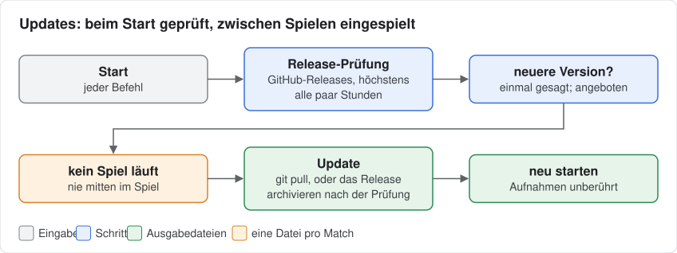

# Updates {#updates}

Der Watcher hält sich selbst aktuell, mit den Releases von
[Holdi601/3DHeat-Watcher](https://github.com/Holdi601/3DHeat-Watcher/releases). Der Updater ist das
Paket `heat3d_update` neben `heat3d_watch` im Repository.

## Die Prüfung {#the-check}

- **Wann**: Jeder Befehl außer `update` prüft beim Start. `run` prüft auch während des Laufs, höchstens
  einmal pro Stunde und nur, solange kein Spiel läuft.
- **Wie**: eine HTTPS-Anfrage an `https://api.github.com/repos/Holdi601/3DHeat-Watcher/releases/latest`
  mit einer Zeitgrenze von 5 Sekunden. Die Antwort wird sechs Stunden lang in
  `%LOCALAPPDATA%\3DHeat\update-check-3DHeat-Watcher.json` zwischengespeichert, daher fragen die meisten Starts
  nichts ab. „Noch kein Release“ (HTTP 404) wird wie eine Antwort zwischengespeichert. Ist der Rechner offline,
  rate-limitiert oder hinter einem Proxy, schlägt die Prüfung leise fehl, und der Befehl läuft mit der Version
  weiter, die er hat.
- **Versionen**: Die installierte Version ist die Datei `VERSION` im Repository-Ordner.
  Der Tag eines Releases (`v1.2.0` oder `1.2.0`) wird als Zahlen verglichen, Teil für Teil. Alles
  nach einem `-` oder `+` wird ignoriert.
- **Aus**: `HEAT3D_NO_UPDATE=1` (jeder Wert außer leer, `0`, `false` oder `no`) schaltet sowohl die
  Prüfung als auch das automatische Update aus. Jedes 3DHeat-Werkzeug hat seine eigene Cache-Datei, sodass
  die Antwort eines Werkzeugs nie für ein anderes gilt.

## Was passiert, wenn ein neueres Release erschienen ist {#what-happens-when-a-newer-release-is-out}

- **`run`** zeigt beim Start einen Hinweis und läuft weiter:
  `[heat3d_watch] 3DHeat Watcher 1.2.0 is out (this is 1.0.2). <release page>`. Während er läuft, aktualisiert er sich
  selbst, wenn `auto_update` eingeschaltet ist (der Standard) und kein Spiel läuft: die Protokollzeile
  `3DHeat Watcher 1.2.0 is out (this is 1.0.2); updating`, eine Windows-Benachrichtigung „Updating to 1.2.0“,
  das Update, wobei jeder Adapter gestoppt und seine Sitzungen geschlossen werden, und derselbe Befehl
  startet auf dem neuen Code erneut. Der Watcher aktualisiert sich nie mitten in einem Spiel. Kann das Update
  nicht angewendet werden, sagt die Benachrichtigung das („1.2.0 is out; not updated: ...“), und der Watcher
  läuft mit der alten Version weiter. Ist `auto_update` aus, bleibt es beim Hinweis.
- **Andere Befehle** fragen `Update now? [Y/n]`, wenn sie in einem Terminal laufen. Enter, `y`, `yes`, `j`
  oder `ja` aktualisiert, und danach läuft derselbe Befehl erneut mit der neuen Version. Ohne Terminal
  (ein geplanter Lauf, eine Pipe) zeigen sie, wie man aktualisiert, und laufen weiter.
- **Auf Anfrage**: `python -m heat3d_watch update` (oder `python -m heat3d_update`) fragt GitHub ohne
  Zwischenspeicher und aktualisiert. `--check` sagt nur, ob ein neueres Release erschienen ist. Das geht
  auch dann, wenn `HEAT3D_NO_UPDATE` gesetzt ist.

## Wie ein Update angewendet wird {#how-an-update-is-applied}

Das hängt davon ab, wie die Kopie installiert wurde:

- **Ein Git-Klon** (der Ordner hat `.git`, und `git` ist im PATH): `git pull --ff-only`. Das wird verweigert,
  solange der Klon Änderungen an verfolgten Dateien hat (`git status --porcelain --untracked-files=no` ist nicht
  leer). Diese Änderungen sind jemandes Arbeit, und ein Update entscheidet nicht, was damit geschieht. Committe
  oder lege sie mit stash beiseite, dann ziehe.
- **Eine heruntergeladene Kopie**: Das Quellarchiv des Releases wird in einen temporären Ordner geladen und
  entpackt. Einträge, die außerhalb davon landen würden, werden übersprungen. Die `VERSION` im Archiv muss die
  Version sein, die das Release angibt, sonst wird nichts kopiert. Dann werden seine Dateien über den
  Repository-Ordner kopiert. Dateien, die nicht Teil eines Releases sind (Aufnahmen, Einstellungen, virtuelle
  Umgebungen, Exporte, alles, was du selbst gemacht hast), bleiben unangetastet. Ein Python-Modul, das ein älteres
  Release hatte und das neue nicht mehr hat, wird aus den eigenen Paketen des Releases entfernt (`heat3d_watch`,
  `heat3d_update`), damit nach dem Update kein veralteter Adapter geladen wird. Außerhalb dieser Pakete wird nichts entfernt.

Aufnahmen und Einstellungen liegen ohnehin meist außerhalb des Repository-Ordners
(`%LOCALAPPDATA%\3DHeat\Watcher`), deshalb kommt ein Update ihnen nie nahe.

Nach einem Update wird derselbe Befehl erneut gestartet. Unter Windows startet der Watcher den neuen Prozess,
wartet auf ihn und gibt dessen Exit-Code weiter, sodass sich die Konsole so verhält, als hätte der erste
Prozess die Arbeit getan.
