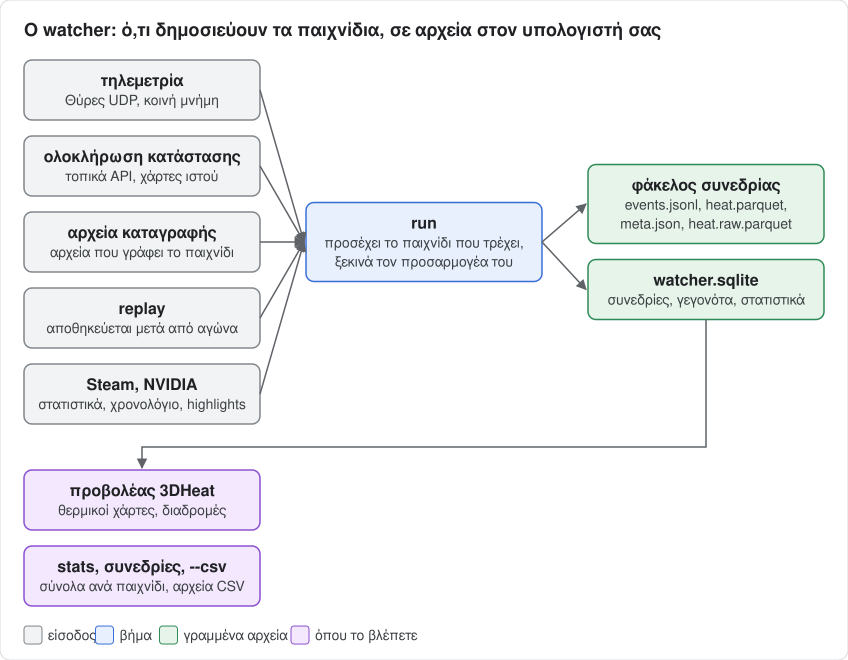
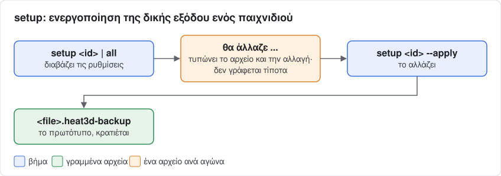
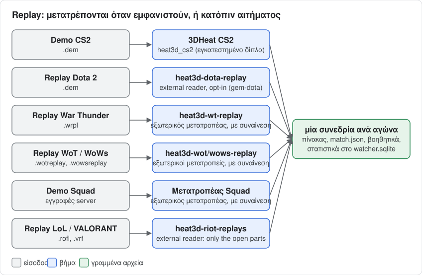
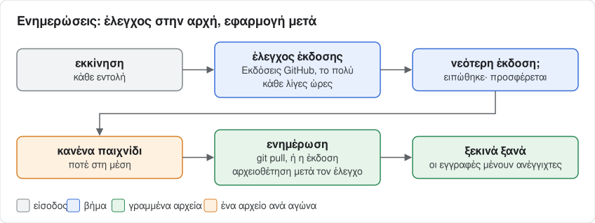

# Εντολές {#commands}

Δεν έχετε ξαναδουλέψει με τη γραμμή εντολών; Διαβάστε πρώτα το [Πριν ξεκινήσετε](before-you-start.md). Κάθε εντολή γράφεται σε ένα τερματικό που ανοίγει στον φάκελο όπου αποσυμπιέσατε ή κλωνοποιήσατε το πρόγραμμα (στην Εξερεύνηση αρχείων, γράψτε `powershell` στη γραμμή διεύθυνσης), ως εξής:

```bash
python -m heat3d_watch <command> [options]
```


| Εντολή | Τι κάνει |
|---|---|
| [`run`](#run) | παρακολουθεί στο παρασκήνιο και καταγράφει κάθε παιχνίδι που τρέχει |
| [`games`](#games) | τι δίνει κάθε παιχνίδι και από πού |
| [`setup`](#setup) | ανοίγει την έξοδο δεδομένων ενός παιχνιδιού |
| [`status`](#status) | ποια παιχνίδια τρέχουν τώρα, και ποιοι προσαρμογείς θα έτρεχαν |
| [`sessions`](#sessions) | οι καταγραφές μέχρι τώρα |
| [`stats`](#stats) | σύνολα ανά παιχνίδι, ή οι πίνακες σε CSV |
| [`table`](#table) | ξαναχτίζει το `heat.parquet` μιας συνεδρίας από το `events.jsonl` της |
| [`replays`](#replays) | μετατρέπει τα replays που ήδη υπάρχουν στον δίσκο |
| [`dota-replay`](#dota-replay) | κατεβάζει το replay ενός δημόσιου αγώνα Dota 2 με το αναγνωριστικό του |
| [`dota-map`](#dota-map) | ο χάρτης του Dota 2 από την εγκατάστασή σας ως τρισδιάστατο επίπεδο, από το ξεχωριστό εργαλείο 3DHeat Dota |
| [`update`](#update) | ενημερώνει στην πιο πρόσφατη έκδοση |
| [`config`](#config) | εμφανίζει ή αλλάζει τις ρυθμίσεις |

Επιλογές για κάθε εντολή: το `-h` / `--help` εμφανίζει τη βοήθεια, και το `python -m heat3d_watch --version`
εμφανίζει την έκδοση (το αρχείο `VERSION`).

Οι εικόνες σε αυτή τη σελίδα είναι από εκτελέσεις σε συνθετικές δοκιμαστικές συνεδρίες (`Example Racer`, `Example Arena`),
όχι από πραγματικές καταγραφές.

Κάθε εντολή εκτός από το `update` ελέγχει πρώτα αν υπάρχει νεότερη έκδοση (το πολύ κάθε έξι ώρες· παρακάμπτεται με
`HEAT3D_NO_UPDATE=1`, βλ. [Ενημερώσεις](updates.md)). Το `run` μόνο εμφανίζει μια ειδοποίηση. Οι άλλες εντολές ρωτούν
`Update now? [Y/n]` όταν τρέχουν σε τερματικό, και εμφανίζουν πώς να ενημερώσετε όταν δεν τρέχουν. Η έξοδος είναι σε UTF-8,
άρα τα ονόματα παιχνιδιών σε όποια γραφή και να είναι εμφανίζονται σωστά σε οποιαδήποτε κονσόλα.

## run {#run}

```bash
python -m heat3d_watch run [--once] [-v]
```



Παρακολουθεί μέχρι να σταματήσει (Ctrl+C): κάθε `scan_seconds` διαβάζει τη λίστα των προγραμμάτων και εκκινεί έναν
προσαρμογέα για κάθε παιχνίδι που βρίσκει, μαζί με τους προσαρμογείς που τρέχουν πάντα. Πριν από την πρώτη ματιά κλείνει
τις συνεδρίες που άφησε ανοιχτές μια προηγούμενη εκτέλεση. Όσο δεν τρέχει κανένα παιχνίδι, μπορεί να ενημερώνεται μόνο του
(με το `auto_update` ενεργό). Οι λεπτομέρειες είναι στο [Εγκατάσταση και εκτέλεση](installing-and-running.md#running).

| Επιλογή | Αποτέλεσμα |
|---|---|
| `--once` | μία ματιά στα παιχνίδια που τρέχουν, και μετά έξοδος. Ξεκινούν οι προσαρμογείς για τα παιχνίδια που τρέχουν τώρα (και για αυτούς που τρέχουν πάντα), ο καθένας ρωτά μία φορά (περιμένει το πολύ 10 δευτερόλεπτα), και μετά σταματούν όλοι όπως όταν τελειώνει ένα παιχνίδι: οι συνεδρίες τους κλείνουν, γράφονται και μετριούνται. Για έλεγχο της ανίχνευσης, όχι για καταγραφή. |
| `-v`, `--verbose` | γραμμές εντοπισμού σφαλμάτων στο `watcher.log` και στην κονσόλα |

Το `run` γράφει το `<data>\watcher.lock` και αρνείται να ξεκινήσει δεύτερη φορά για τον ίδιο φάκελο δεδομένων (κωδικός
εξόδου 1)· βλ. [Το αρχείο κλειδώματος](installing-and-running.md#the-lock-file).

## games {#games}

```bash
python -m heat3d_watch games [--markdown]
```


Εμφανίζει κάθε προσαρμογέα ταξινομημένο ανά παιχνίδι: το όνομά του, το αναγνωριστικό και το είδος του, από πού διαβάζει,
τι καταγράφει και πώς ανοίγει η έξοδός του. Ένας προσαρμογέας που δεν μπορεί να τρέξει σε αυτόν τον υπολογιστή σημειώνεται
ως `[unavailable: <why>]` - δεν βρέθηκε το SimConnect.dll, δεν υπάρχει φάκελος Minecraft, δεν είναι εγκατεστημένο το 3DHeat CS2,
δεν βρέθηκε το Steam ή το NVIDIA App. Ένα αρχείο προσαρμογέα που δεν φορτώθηκε σωστά αναφέρεται στο τέλος μαζί με το σφάλμα.

```text
EA SPORTS F1 25  (f1-25, telemetry)
    from: UDP telemetry 127.0.0.1:20777 (Documents\My Games\F1 25\hardwaresettings\hardware_settings_config.xml)
    - every car's position (world XYZ, m) at 10 Hz, by driver name, team, own car marked, ...
    switch on: In the game: Settings > Telemetry Settings > UDP Telemetry On, IP 127.0.0.1, port 20777 - ...
```

Το `--markdown` εμφανίζει τα ίδια ως έναν πίνακα Markdown (παιχνίδι, τι καταγράφεται, από πού, πώς ανοίγει, παιχνίδι online,
έλεγχος). Ο πίνακας στο [Όλα τα παιχνίδια σε έναν πίνακα](watcher.md) είναι αυτή η έξοδος. Τα κελιά είναι διαφυγμένα για
Markdown: το κείμενο σε backticks μένει ως κώδικας, και έξω από αυτά τα `<`, `>`, `&`, `*`, `|` και μια ανάστροφη κάθετος
πριν από σημείο στίξης γράφονται ώστε να φαίνονται όπως πληκτρολογήθηκαν (το `<CS2>` αλλιώς θα εξαφανιζόταν ως HTML tag στο
kramdown). Το μόνο HTML είναι το `<br>` ανάμεσα στα στοιχεία της στήλης «Τι καταγράφεται».

## setup {#setup}

```bash
python -m heat3d_watch setup <adapter id | all> [--apply]
```




Ανοίγει την έξοδο δεδομένων ενός παιχνιδιού, όταν το παιχνίδι χρειάζεται αλλαγή σε ένα αρχείο ρυθμίσεών του. Χωρίς `--apply` δεν αλλάζει
τίποτα: κάθε γραμμή λέει τι θα άλλαζε, και όταν υπάρχει κάτι να αλλάξει, η τελευταία γραμμή γράφει
`Nothing was changed. Run again with --apply to make these changes.` Όταν δεν υπάρχει τίποτα να αλλάξει, γράφει
`<id>: nothing to change` (`Nothing to change.` για το `all`). Με `--apply` γίνονται οι αλλαγές, και πριν αλλαχτεί για πρώτη
φορά ένα αρχείο, το αρχικό του αποθηκεύεται ως `<file>.heat3d-backup`. Ένα αντίγραφο που υπάρχει ήδη δεν γράφεται ξανά,
άρα πάντα περιέχει το αρχείο όπως ήταν πριν το αγγίξει πρώτη φορά ο παρακολουθητής.

```text
f1-25: would change: hardware_settings_config.xml <udp>: enabled="false" -> "true"
Nothing was changed. Run again with --apply to make these changes.
```

Το `all` τρέχει τη ρύθμιση κάθε προσαρμογέα που έχει ρύθμιση. Ένας προσαρμογέας χωρίς ρύθμιση, όταν ζητηθεί μόνος του,
εμφανίζει `<id>: nothing for setup to change; ` και μετά πώς ανοίγει το παιχνίδι (το κείμενο `enable` του, ή ότι δεν
χρειάζεται τίποτα). Ένα άγνωστο αναγνωριστικό εμφανίζει `no adapter '<id>'; games lists them` και τερματίζει με κωδικό
εξόδου 2. Οι προσαρμογείς που έχουν τι να ρυθμίσουν:

| Προσαρμογέας | Τι αλλάζει το `--apply` |
|---|---|
| `beamng` | εγκαθιστά το πρωτόκολλο `heat3d` mod στον φάκελο `mods` του χρήστη του BeamNG (μόνο όταν δεν υπάρχει εκεί)· μετά ανοίξτε Options > Other > Protocols > "others" μέσα στο παιχνίδι |
| `cs2-gsi` | γράφει το `<CS2>\game\csgo\cfg\gamestate_integration_heat3d.cfg`: στέλνει την κατάσταση του παιχνιδιού στο `http://127.0.0.1:3311/` με ένα τυχαίο διακριτικό που ο παρακολουθητής ζητά μετά (ένα διακριτικό που ήδη υπάρχει στο αρχείο διατηρείται)· το CS2 το διαβάζει όταν ξεκινά |
| `dota2-gsi` | το ίδιο για το Dota 2: `<Dota>\game\dota\cfg\gamestate_integration\gamestate_integration_heat3d.cfg`, θύρα 3312 |
| `dcs` | προσθέτει το `Scripts\Hooks\heat3d-watch.lua` σε κάθε φάκελο `%USERPROFILE%\Saved Games\DCS*`. Το δικό του παλιότερο αντίγραφο ενημερώνεται· ένα αρχείο με αυτό το όνομα που δεν έγραψε ο παρακολουθητής μένει ανέπαφο. Κάντε επανεκκίνηση του DCS. |
| `dirt-rally-2` | `hardware_settings_config.xml`: `<udp enabled="true" extradata="3" ip="127.0.0.1" port="20777">`· ανοίξτε πρώτα το παιχνίδι μία φορά, ώστε να υπάρχει το αρχείο |
| `ea-wrc` | `Documents\My Games\WRC\telemetry\config.json`: το πακέτο `session_update` της δομής `wrc` ανοίγει, προς αυτόν τον υπολογιστή |
| `f1-23`, `f1-24`, `f1-25` | `hardware_settings_config.xml`: `<udp enabled="true" ip="127.0.0.1" port="20777">`· το παιχνίδι πρέπει να είναι κλειστό |
| `hearthstone` | προσθέτει ενότητα `[Power]` (`LogLevel=1`, `FilePrinting=true`) στο `%LOCALAPPDATA%\Blizzard\Hearthstone\log.config`· κάντε επανεκκίνηση του παιχνιδιού |
| `il2` | `<game>\data\startup.cfg`, `[KEY = telemetrydevice]`: ένας ακόμη προορισμός `addrN = "127.0.0.1:41995"` και `enable = true` (η ενότητα προστίθεται, στα 10 Hz, όταν δεν υπάρχει)· κάντε επανεκκίνηση του IL-2 |
| `il2-tacview` | `<game>\data\startup.cfg`, `[KEY = track_record]`: `tacviewrecord = 1` |
| `rocketleague-stats` | `TAStatsAPI.ini` (ή `DefaultStatsAPI.ini` όταν αυτό δεν υπάρχει) στο `<RL>\TAGame\Config`: `PacketSendRate=30` όταν το API είναι κλειστό, και `Port` όταν δεν έχει οριστεί· διαβάζεται όταν ξεκινά το Rocket League |

Το `richard-burns-rally` δεν έχει ρύθμιση: η τηλεμετρία του είναι του plugin RSF/NGP, που ανοίγει χειροκίνητα στο
`RichardBurnsRally.ini` (βλ. [τη σελίδα του](game-richard-burns-rally.md))· το `setup richard-burns-rally` το λέει.
Κάθε άλλο παιχνίδι είτε δεν χρειάζεται τίποτα είτε ανοίγει μέσα στο ίδιο το παιχνίδι· η σελίδα κάθε παιχνιδιού λέει πώς.

## status {#status}

```bash
python -m heat3d_watch status
```

```text
3DHeat Watcher 1.0.2; data in C:\Users\...\AppData\Local\3DHeat\Watcher
Games running: EA SPORTS F1 25 (f1-25)
Always on: il2-tacview, steam-stats, steam-timeline, nvidia-highlights, cs2-demos, osu-replays, lol-replays, valorant-replays
```

Λέει ποιοι προσαρμογείς θα ξεκινούσε ένα `run` τώρα, με τους ίδιους κανόνες: το πρόγραμμα του παιχνιδιού τρέχει, ο
προσαρμογέας δεν είναι στο `disabled`, δεν λείπει κάτι που χρειάζεται, οι προσαρμογείς replay μόνο με το `replays`
ενεργό, οι προσαρμογείς μνήμης μόνο με το `memory` ενεργό και όταν πέρασε κάθε έλεγχος μνήμης. Δεν ξεκινά τίποτα.

## sessions {#sessions}

```bash
python -m heat3d_watch sessions [--game NAME] [--limit N]
```


Οι πιο πρόσφατες συνεδρίες από το `watcher.sqlite`, μία γραμμή η καθεμία: έναρξη (τοπική ώρα), παιχνίδι, λεπτά, συμβάντα,
θέσεις, φάκελος.

| Επιλογή | Αποτέλεσμα |
|---|---|
| `--game NAME` | μόνο αυτό το παιχνίδι, με το ακριβές όνομα όπως στη λίστα (`"EA SPORTS F1 25"`) |
| `--limit N` | το πολύ N συνεδρίες (προεπιλογή 40) |

## stats {#stats}

```bash
python -m heat3d_watch stats [--game NAME] [--csv DIR]
```


Χωρίς επιλογές: πίνακας με κάθε παιχνίδι (συνεδρίες, ώρες, συμβάντα, θέσεις, τελευταία φορά που παίχτηκε), με το πιο
παιγμένο πρώτο, και μετά για κάθε παιχνίδι τα 25 πιο συχνά συμβάντα του και κάθε αριθμητική στατιστική με τον αριθμό των
συνεδριών που την έχουν, το σύνολο, την καλύτερη τιμή (`best`) και τον μέσο όρο. Το `best` ξέρει ποια κατεύθυνση είναι
καλύτερη: τη μικρότερη τιμή για τους χρόνους που κρατιούνται ως καλύτερος (`best_lap`, `best_stage` και κάθε άλλο κλειδί
που αρχίζει με `best_`) και για τις θέσεις (`race_position`, `grid_position`, κάθε κλειδί που τελειώνει σε `_position`),
τη μεγαλύτερη για όλα τα άλλα (φονεύσεις, απόσταση, μέγιστη ταχύτητα, οι μετρητές ενός παιχνιδιού).

| Επιλογή | Αποτέλεσμα |
|---|---|
| `--game NAME` | μόνο τα συμβάντα και οι στατιστικές αυτού του παιχνιδιού, χωρίς τη γενική εικόνα |
| `--csv DIR` | γράφει τα `sessions.csv`, `events.csv` και `stats.csv` (κάθε γραμμή και από τους τρεις πίνακες) στο `DIR` αντί για την οθόνη· το `--game` δεν το περιορίζει |

## table {#table}

```bash
python -m heat3d_watch table <session folder>
```


Ξαναχτίζει το `heat.parquet` σε έναν φάκελο συνεδρίας από το `events.jsonl` του, με τους άξονες από το `meta.json` του.
Εμφανίζει τη διαδρομή του πίνακα, ή `no positions in this session`. Χρησιμοποιήστε το για συνεδρία που καταγράφηκε όσο έλειπε
το `pyarrow`, ή αφού επεξεργαστείτε με το χέρι το `events.jsonl`.

## replays {#replays}

```bash
python -m heat3d_watch replays <adapter id> [folder] [-v]
```



Μετατρέπει τα replays που ήδη υπάρχουν στον δίσκο, τώρα, ένα μετά το άλλο, το καθένα σε συνεδρία όπως θα το έκανε η
παρακολούθηση φακέλου. Την πρώτη φορά που ο παρακολουθητής βλέπει έναν φάκελο replay, απλώς σημειώνει τι υπάρχει μέσα (βλ.
[Εγκατάσταση και εκτέλεση](installing-and-running.md#replays-already-on-disk))· έτσι μετατρέπονται αυτά κατ' αίτηση. Χωρίς
`folder` διαβάζονται οι φάκελοι του προσαρμογέα (του παιχνιδιού, και οι `replay_folders`)· με αυτόν, τα replays αυτού του
φακέλου. Κάθε replay που μετατράπηκε σημειώνεται ως ήδη γνωστό, ώστε ο τρέχων παρακολουθητής να μην το μετατρέψει ξανά. Ένα
replay που αποτυγχάνει καταγράφεται και παραλείπεται.

| Προσαρμογέας | Replays |
|---|---|
| `cs2-demos` | demo του Counter-Strike 2 (`*.dem`), μέσω του 3DHeat CS2 |
| `lol-replays` | replays του League of Legends (`*.rofl`) |
| `osu-replays` | replays του osu! (`*.osr`) |
| `valorant-replays` | replays του VALORANT (`*.vrf`) |
| `warthunder-replays` | replays του War Thunder (`*.wrpl`), μέσω του εξωτερικού μετατροπέα `heat3d-wt-replay` (exporters/ext/warthunder-replay) |
| `wot-replays` | replays του World of Tanks (`*.wotreplay`), μέσω του εξωτερικού μετατροπέα `heat3d-wot-replay` (exporters/ext/wot-replay) |
| `wows-replays` | replays του World of Warships (`*.wowsreplay`), μέσω του εξωτερικού μετατροπέα `heat3d-wows-replay` (exporters/ext/wows-replay) |
| `dota-replays` | replays του Dota 2 (`*.dem`), μέσω του gem (`pip install gem-dota`) |

```text
osu-replays: converted 12 replay(s); `sessions --game` lists them
```

Ένα αναγνωριστικό που δεν είναι από αυτά εμφανίζει `no replay adapter '<id>'` με τη λίστα και τερματίζει με κωδικό εξόδου 2·
το ίδιο και ένας `folder` που δεν υπάρχει. Ένας προσαρμογέας που δεν μπορεί να τρέξει εδώ (δεν είναι εγκατεστημένο το 3DHeat CS2)
εμφανίζει γιατί και τερματίζει με κωδικό εξόδου 1. Τα ίχνη Tacview του IL-2 δεν είναι στη λίστα: αυτός ο προσαρμογέας
μετατρέπει μόνος του κάθε ολοκληρωμένο ίχνος που βρίσκει.

## dota-replay {#dota-replay}

```bash
python -m heat3d_watch dota-replay <match id> [<match id> ...] [-o FOLDER] [--convert] [-v]
```

Κατεβάζει το replay ενός δημόσιου αγώνα Dota 2 από τους διακομιστές replay της Valve. Χρειάζεται σύνδεση στο internet. Το
αναγνωριστικό του αγώνα είναι ο αριθμός στη σελίδα του αγώνα στον πελάτη του Dota (τα στοιχεία του αγώνα) ή στον ιστότοπο
του OpenDota· η Valve κρατά ένα replay για μερικές εβδομάδες, και μετά το κατέβασμα αποτυγχάνει. Ο διακομιστής και το
salt του replay έρχονται από την καταγραφή του αγώνα στο OpenDota (`api.opendota.com/api/matches/<id>`, χωρίς κλειδί)·
το αρχείο από το `replay<cluster>.valve.net/570/<id>_<salt>.dem.bz2`· αποσυμπιέζεται καθώς έρχεται (η Valve στέλνει και
bzip2 και Zstandard με αυτό το όνομα) και αποθηκεύεται ως `<match id>.dem`. Χωρίς `-o` πάει στον φάκελο replays του ίδιου
του Dota όταν είναι εγκατεστημένο το Dota 2 - εκεί που ένας τρέχων παρακολουθητής το μετατρέπει - αλλιώς στο
`<data>/replays/dota`. Ένα αρχείο που υπάρχει ήδη διατηρείται. Το `--convert` μετατρέπει τα κατεβασμένα replays αμέσως,
όπως θα έκανε το `replays dota-replays`, και τα σημειώνει ως ήδη γνωστά.

```text
match 9000000000: C:\Program Files (x86)\Steam\steamapps\common\dota 2 beta\game\dota\replays\9000000000.dem
```

Η Valve κρατά τα replays για μερικές εβδομάδες· ένας παλαιότερος αγώνας εμφανίζει `Valve no longer has the replay of match
<id>` και τερματίζει με κωδικό εξόδου 1. Ένας αγώνας που το OpenDota δεν έχει δει ακόμη δεν έχει salt: το μήνυμα λέει να ζητήσετε
από το OpenDota (`curl -X POST https://api.opendota.com/api/request/<id>`) και να δοκιμάσετε λίγα λεπτά αργότερα. Οι ιδιωτικές
λόμπι και οι αγώνες με κρυμμένο προφίλ δεν υπάρχουν καθόλου στους διακομιστές replay.

## dota-map {#dota-map}

```bash
python -m heat3d_watch dota-map [<map>] -o <file.glb> [--game FOLDER] [--source2viewer EXE] [--detail UNITS]
```

Γράφει τον χάρτη του Dota 2 - έδαφος, γκρεμούς, νερό, δέντρα και κτίρια - ως επίπεδο `.glb` στο σύστημα συντεταγμένων στο οποίο σχεδιάζονται οι πίνακες replay του Dota, από τη δική σας εγκατάσταση του Dota 2. Ο watcher δεν διαβάζει μόνος του τα αρχεία του παιχνιδιού: τρέχει το ξεχωριστό εργαλείο **3DHeat Dota** (`heat3d-dota-maps level`, [3DHeat-Ext-Dota](https://github.com/Holdi601/3DHeat-Ext-Dota)) με αυτές τις επιλογές, και περνά στην έξοδό του και τον κωδικό εξόδου του. Το `<map>` είναι `dota` από προεπιλογή· το `--game` είναι ο φάκελος του Dota 2 όταν δεν βρίσκεται σε βιβλιοθήκη Steam· το `--source2viewer` η διαδρομή της γραμμής εντολών του Source2Viewer, που το εργαλείο αυτό χρειάζεται· το `--detail` το κελί ομαδοποίησης κορυφών για τα κτίρια, σε μονάδες παιχνιδιού (προεπιλογή 8, το 0 κρατά κάθε τρίγωνο). Όταν το εργαλείο δεν είναι εγκατεστημένο, τυπώνει `dota-map: the Dota 2 map converter is not installed: ...` με το πού να το κατεβάσετε και τερματίζει με κωδικό εξόδου 2. Λεπτομέρειες: [Χάρτης Dota 2](dota-map.md).

## update {#update}

```bash
python -m heat3d_watch update [--check]
```



Ρωτά το GitHub για την πιο πρόσφατη έκδοση, αγνοώντας την αποθηκευμένη απάντηση, και ενημερώνει αυτό το αντίγραφο όταν είναι
νεότερη (βλ. [Ενημερώσεις](updates.md)). Το `--check` λέει μόνο αν υπάρχει νεότερη έκδοση. Η εντολή τρέχει ακόμη και με
ορισμένο το `HEAT3D_NO_UPDATE`: το ότι τη ζητάτε είναι η απόφαση. Το `python -m heat3d_update [--check]` κάνει το ίδιο.

## config {#config}

```bash
python -m heat3d_watch config [--set KEY=VALUE ...]
```


Εμφανίζει κάθε ρύθμιση ως `key = value`. Με `--set`, αλλάζει πρώτα τις δοσμένες και αποθηκεύει το `settings.json`
(`saved <path>`). Οι τιμές διαβάζονται ανάλογα με τον τύπο της ρύθμισης:

- ρυθμίσεις ναι/όχι: το `1`, `true`, `yes`, `on` ή `ja` είναι αληθές· το `0`, `false`, `no`, `off`, `nein` ή τίποτα είναι ψευδές·
- αριθμοί: ένας δεκαδικός αριθμός (`scan_seconds=5`)·
- λίστες: χωρισμένες με κόμμα ή λίστα JSON (`disabled=steam-stats,steam-timeline`· μια κενή τιμή καθαρίζει τη λίστα)·
- λεξικά (`replay_folders`, `player_names`): ολόκληρο το λεξικό σε JSON, ή μία καταχώρηση ως `KEY.ID=VALUE` - το
  `replay_folders.cs2-demos=D:\Demos,E:\More Demos` ορίζει τους φακέλους αυτού του προσαρμογέα (χωρισμένους με κόμμα),
  το `player_names.warthunder-webmap=Name` το όνομά του· μια κενή τιμή αφαιρεί την καταχώρηση·
- κείμενο: όπως δίνεται (`data=D:\Heat`, `riot_id=Name#TAG`).

```bash
python -m heat3d_watch config --set memory=true scan_seconds=5
python -m heat3d_watch config --set riot_id=Name#TAG riot_platform=EUW1
python -m heat3d_watch config --set replay_folders.cs2-demos=D:\Demos player_names.rocketleague-stats=Name
```

Ένα άγνωστο κλειδί εμφανίζει `no setting '<key>'`, και μια τιμή που δεν είναι του τύπου της ρύθμισης (`memory=perhaps`,
`scan_seconds=often`, ένα λεξικό που δεν είναι JSON) εμφανίζει `not saved: ...`· και τα δύο τερματίζουν με κωδικό εξόδου 2
χωρίς να αποθηκεύσουν τίποτα. Ένα `settings.json` που έχετε επεξεργαστεί με το χέρι διαβάζεται με τον ίδιο τρόπο: μια τιμή
γραμμένη ως κείμενο, όπου η ρύθμιση είναι αριθμός, ναι/όχι ή λεξικό, διαβάζεται όπως γράφτηκε, και μία που δεν μπορεί να
διαβαστεί μένει στην προεπιλογή της. Κάθε ρύθμιση περιγράφεται στο
[Εγκατάσταση και εκτέλεση](installing-and-running.md#settings).
