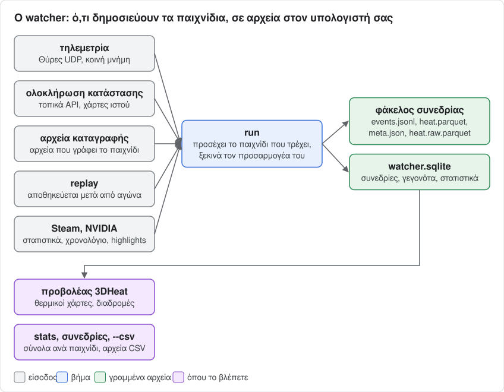

# 3DHeat Watcher {#dheat-watcher}

**Τι είναι;** Παίζετε ένα παιχνίδι. Αυτό το πρόγραμμα καταγράφει αθόρυβα πού πήγατε και τι συνέβη.
Αργότερα μπορείτε να το δείτε ως έναν έγχρωμο χάρτη στον προβολέα 3DHeat.

**Γιατί να το χρησιμοποιήσετε;** Για να κρατάτε το δικό σας αρχείο από κάθε συνεδρία — πού οδηγήσατε, πετάξατε ή
πολεμήσατε, τα σύνολά σας ανά παιχνίδι — χωρίς καμία ιστοσελίδα και χωρίς να αλλάζετε το παιχνίδι.

**Παράδειγμα:** οδηγείτε έναν γύρο σε ένα παιχνίδι αγώνων με τον Watcher ενεργό· μετά, ένα αρχείο στον φάκελο
`sessions\<game>\` κρατά τη γραμμή που ακολουθήσατε, και ο προβολέας τη ζωγραφίζει.

Πιο αναλυτικά: το 3DHeat Watcher είναι ένα πρόγραμμα που τρέχει στο παρασκήνιο και καταγράφει όσα δημοσιεύουν τα παιχνίδια
για το παιχνίδι σας — πού πήγατε, τι συνέβη πού, και τους αριθμούς πίσω από αυτά — σε αρχεία στον δικό σας υπολογιστή. Τα αρχεία
προορίζονται για τα δικά σας στατιστικά και για τους θερμικούς χάρτες και τις γραμμές διαδρομής του προβολέα 3DHeat.

Τρέχει αθόρυβα, προσέχει ποιο παιχνίδι ξεκινήσατε, και διαβάζει τις δικές του εξόδους: μια θύρα τηλεμετρίας ή κοινή
μνήμη που δημοσιεύει το παιχνίδι για πίνακες ελέγχου, μια ολοκλήρωση κατάστασης παιχνιδιού, το ημερολόγιο ή το αρχείο
καταγραφής που γράφει το παιχνίδι, το replay που αποθηκεύει μετά από έναν αγώνα, τα στατιστικά που κρατά το Steam, τα
κλιπ που αποθηκεύει η NVIDIA App. Οι εγγραφές μένουν στον υπολογιστή σας. Το πρόγραμμα επικοινωνεί μόνο με δύο εξωτερικές
υπηρεσίες, και μόνο στις εξής περιπτώσεις: το GitHub, για να αναζητήσει νεότερη έκδοση (δείτε [Ενημερώσεις](updates.md)),
και το Match-V5 API της Riot, και μόνο αν εισάγετε το δικό σας κλειδί API της Riot (δείτε [Replay του League of Legends](game-lol-replays.md)).



## Τι καταγράφει {#what-it-records}

- **Θέσεις**: το αυτοκίνητο, το αεροσκάφος, ο ήρωας ή ο παίκτης, αρκετές φορές το δευτερόλεπτο όπου το παιχνίδι
  τις δημοσιεύει, με ταχύτητα, κατεύθυνση και ό,τι άλλο στέλνει μαζί το παιχνίδι.
- **Γεγονότα**: εμφανίσεις, θάνατοι, φόνοι, γύροι, ειδικές διαδρομές, γκολ, δουλειές, απογειώσεις και προσγειώσεις,
  αλλαγές ζώνης, επιτεύγματα, σημαντικά στιγμιότυπα. Κάθε γεγονός αποθηκεύεται με την ώρα του, και με τη θέση του όταν
  το δίνει το παιχνίδι.
- **Στατιστικά ανά συνεδρία**: φόνοι, θάνατοι, γύροι, καλύτερος γύρος, απόσταση, μέγιστη ταχύτητα, χρόνος παιχνιδιού, και τα
  στατιστικά του ίδιου του παιχνιδιού όπου κρατά.

Τι δίνει το καθένα παιχνίδι, και από πού, υπάρχει στη δική του σελίδα στα [Παιχνίδια](games.md). Μία πηγή δεν μπορεί
να καταγράψει τα πάντα: τα παιχνίδια πολλών παικτών καταγράφονται μόνο από όσα δημοσιεύουν, και ο watcher δεν διαβάζει ποτέ
τη μνήμη τους (δείτε [Πηγές και κανόνες](sources-and-rules.md)).

## Εγκατάσταση {#install}

Δεν έχετε ξαναδουλέψει με τη γραμμή εντολών; Διαβάστε πρώτα το [Πριν ξεκινήσετε](before-you-start.md).

Ο watcher είναι πρόγραμμα Python για Windows (Python 3.10 ή νεότερη). Πολλές από τις πηγές του υπάρχουν μόνο στα Windows:
κοινή μνήμη, μητρώο, ειδοποιήσεις των Windows.

```bash
git clone https://github.com/Holdi601/3DHeat-Watcher.git
cd 3DHeat-Watcher
pip install -r requirements.txt
```

Ένα κατεβασμένο αρχείο έκδοσης δουλεύει με τον ίδιο τρόπο: αποσυμπιέστε το, και μετά τρέξτε `pip install -r requirements.txt`
μέσα στον φάκελο. Οι λεπτομέρειες, και τα πρόσθετα που χρειάζονται ορισμένα παιχνίδια, βρίσκονται στο
[Εγκατάσταση και εκτέλεση](installing-and-running.md).

## Γρήγορη εκκίνηση {#quick-start}

```bash
python -m heat3d_watch games            # what each game gives, and from where
python -m heat3d_watch setup all        # what would have to be switched on (nothing is changed)
python -m heat3d_watch setup f1-25 --apply   # switch one game's output on (the original file is backed up)
python -m heat3d_watch run              # watch; leave it running while you play
python -m heat3d_watch stats            # totals per game
python -m heat3d_watch stats --csv out  # sessions, events and stats as CSV files
```

Θα δείτε: μετά το `games`, έναν πίνακα με μία γραμμή για κάθε παιχνίδι· το `run` συνεχίζει μέχρι να πατήσετε
Ctrl+C ή να κλείσετε το παράθυρο.

Όλα γράφονται στο `%LOCALAPPDATA%\3DHeat\Watcher`. Για άλλον φάκελο, ορίστε τη μεταβλητή περιβάλλοντος
`HEAT3D_WATCH_HOME` ή τρέξτε `python -m heat3d_watch config --set data=D:\somewhere`.

- `sessions\<game>\<date>_<adapter>\` — ένας φάκελος ανά συνεδρία, που περιέχει το `events.jsonl` (κάθε γεγονός
  όπως συμβαίνει), το `heat.parquet` (οι γραμμές με θέση, έτοιμες για τον προβολέα 3DHeat) και το `meta.json`
  (παιχνίδι, πηγή, άξονες, πλήθη, στατιστικά)
- `watcher.sqlite` — τα στατιστικά κάθε συνεδρίας, σε τρεις απλούς πίνακες
- `watcher.log` — τι έκανε ο watcher

Ο προβολέας ανοίγει το `heat.parquet` μιας συνεδρίας απευθείας, χωρίς καμία ρύθμιση (οι άξονες και οι μονάδες του
είναι στο αρχείο). Τα μετατραμμένα replay γράφονται ως πίνακες και έγγραφα αγώνα δίπλα του· η μορφή ενός αγώνα σε ένα
αρχείο του προβολέα περιγράφεται στη σελίδα της [κοντέινερ `.3dheat`](https://holdi601.github.io/3DHeat/container.html),
και οι στήλες κάθε πίνακα στο [Τα δεδομένα](the-data.md).

## Η τεκμηρίωση {#the-documentation}

| Σελίδα | Τι καλύπτει |
|---|---|
| [Πριν ξεκινήσετε](before-you-start.md) | Python, τερματικό, σημεία κράτησης θέσης, πώς μοιάζει η επιτυχία και τα συνηθισμένα σφάλματα |
| [Εγκατάσταση και εκτέλεση](installing-and-running.md) | απαιτήσεις, εκτέλεση στο παρασκήνιο, εκκίνηση με τα Windows, το αρχείο κλειδώματος, το αρχείο καταγραφής, κάθε ρύθμιση και μεταβλητή περιβάλλοντος |
| [Παιχνίδια](games.md) | μία σελίδα ανά παιχνίδι: τι καταγράφεται, από πού, πώς ενεργοποιείται, πώς λειτουργεί, άξονες, στατιστικά, τι έχει ελεγχθεί |
| [Τα δεδομένα](the-data.md) | φάκελοι συνεδριών, `events.jsonl`, `heat.parquet` και το υποσέλιδό του, `meta.json`, `watcher.sqlite`, ανάκτηση μετά από κατάρρευση, εξαγωγή CSV, άνοιγμα συνεδρίας στον προβολέα 3DHeat |
| [Εντολές](commands.md) | κάθε εντολή και επιλογή του `python -m heat3d_watch` |
| [Πηγές και κανόνες](sources-and-rules.md) | τα έξι είδη πηγών, οι κανόνες για τα παιχνίδια πολλών παικτών, ποια παιχνίδια μένουν έξω και γιατί |
| [NVIDIA Highlights](nvidia-highlights.md) | τι μπορούν και τι δεν μπορούν να δώσουν τα NVIDIA Highlights, και πώς αποκτά θέση ένα highlight |
| [Mods διακομιστή καταγραφής](server-mods.md) | τα mods διακομιστή του Arma 3 και του Arma Reforger που καταγράφουν ολόκληρες αποστολές για τον προβολέα |
| [Ανάγνωση μνήμης](memory-reading.md) | προφίλ μνήμης για παιχνίδια ενός παίκτη: η μορφή, οι έλεγχοι, πώς γράφεται και επαληθεύεται ένα |
| [Ενημερώσεις](updates.md) | πώς ο watcher αναζητά νέες εκδόσεις και πώς ενημερώνεται μόνος του |
| [Ανάπτυξη](development.md) | γράφοντας έναν προσαρμογέα: το API, τα τεστ, ένα ειλικρινές `verified`, ανανέωση των σελίδων παιχνιδιών |
| [Όλα τα παιχνίδια σε έναν πίνακα](watcher.md) | κάθε παιχνίδι σε έναν πίνακα, όπως τον τυπώνει το `games --markdown`, και τα παιχνίδια που έχουν μελετηθεί αλλά δεν έχουν ακόμη υλοποιηθεί |
| [Αναφορά εντολών](../cli-reference.md) | το `--help` κάθε εντολής, παραγόμενο από τον κώδικα |
| [Συντήρηση](maintaining.md) | η λίστα ελέγχου κυκλοφορίας για αυτές τις σελίδες |

## Μέρος του 3DHeat {#part-of-3dheat}

Το 3DHeat Watcher είναι ένα από τα δωρεάν εργαλεία γύρω από τον προβολέα 3DHeat (ο watcher χρησιμοποιεί το 3DHeat CS2
για να μετατρέπει demo του CS2). Καθένα είναι δικό του έργο, με τις δικές του εκδόσεις και την άδειά του:

| Εργαλείο | Τι κάνει | Τεκμηρίωση |
|---|---|---|
| [3DHeat](https://github.com/Holdi601/3DHeat) | ο προβολέας: θερμικοί χάρτες, ανάλυση αγώνα και επισκόπηση αγώνα σε 3D | [σελίδα](https://holdi601.github.io/3DHeat/) |
| [GameFiles](https://github.com/Holdi601/3DHeat-GameFiles) | πίστες και επίπεδα από τα αρχεία που κυκλοφορούν τα παιχνίδια, ως τρισδιάστατα μοντέλα | [σελίδα](https://holdi601.github.io/3DHeat-GameFiles/) |
| [GameCapture](https://github.com/Holdi601/3DHeat-GameCapture) | τηλεμετρία γύρων από αγώνες· επίπεδα ανακατασκευασμένα από βίντεο παιχνιδιού | [σελίδα](https://holdi601.github.io/3DHeat-GameCapture/) |
| [Unreal Exporter](https://github.com/Holdi601/3DHeat-UnrealExporter) | ένα πρόσθετο του Unreal Editor που εξάγει ένα επίπεδο ως ένα τρισδιάστατο μοντέλο | [σελίδα](https://holdi601.github.io/3DHeat-UnrealExporter/) |
| [CS2](https://github.com/Holdi601/3DHeat-CS2) | demo του Counter-Strike 2 σε πίνακες και έγγραφα αγώνα· χάρτες σε τρισδιάστατα μοντέλα | [σελίδα](https://holdi601.github.io/3DHeat-CS2/) |
| [Watcher](https://github.com/Holdi601/3DHeat-Watcher) | καταγράφει, στο παρασκήνιο, όσα δημοσιεύουν τα παιχνίδια για το παιχνίδι σας | [σελίδα](https://holdi601.github.io/3DHeat-Watcher/) |
| [Ext-WarThunder](https://github.com/Holdi601/3DHeat-Ext-WarThunder) | replay του War Thunder σε πίνακες και έγγραφα αγώνα | [σελίδα](https://holdi601.github.io/3DHeat-Ext-WarThunder/) |
| [Ext-WoT](https://github.com/Holdi601/3DHeat-Ext-WoT) | replay του World of Tanks σε πίνακες και έγγραφα αγώνα | [σελίδα](https://holdi601.github.io/3DHeat-Ext-WoT/) |
| [Ext-WoWs](https://github.com/Holdi601/3DHeat-Ext-WoWs) | replay του World of Warships σε πίνακες και έγγραφα αγώνα | [σελίδα](https://holdi601.github.io/3DHeat-Ext-WoWs/) |
| [Ext-Squad](https://github.com/Holdi601/3DHeat-Ext-Squad) | demo από servers του Squad σε πίνακες και έγγραφα αγώνα | [σελίδα](https://holdi601.github.io/3DHeat-Ext-Squad/) |
| [Ext-DCS](https://github.com/Holdi601/3DHeat-Ext-DCS) | χάρτες του DCS World σε τρισδιάστατα μοντέλα | [σελίδα](https://holdi601.github.io/3DHeat-Ext-DCS/) |
| [Ext-IL2](https://github.com/Holdi601/3DHeat-Ext-IL2) | χάρτες του IL-2 Sturmovik σε τρισδιάστατα μοντέλα | [σελίδα](https://holdi601.github.io/3DHeat-Ext-IL2/) |

Άδεια: MIT ([LICENSE](https://github.com/Holdi601/3DHeat-Watcher/blob/main/LICENSE)). Οι άδειες των πακέτων τρίτων που
χρησιμοποιεί, και όσα απαιτούν τα παιχνίδια που διαβάζει, είναι γραμμένα στο
[LICENSES.md](https://github.com/Holdi601/3DHeat-Watcher/blob/main/LICENSES.md).
