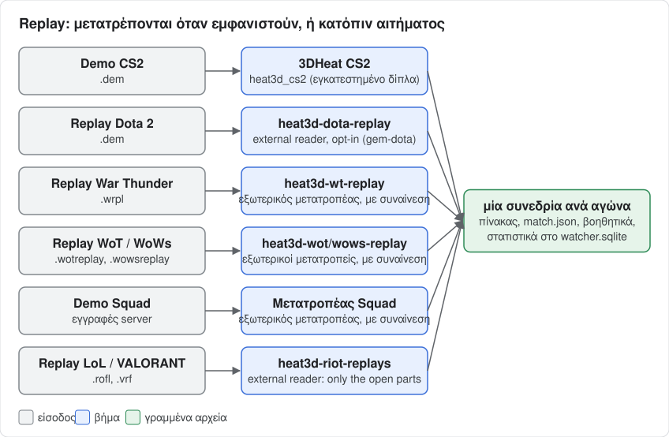

# Εγκατάσταση και εκτέλεση {#installing-and-running}

## Απαιτήσεις {#requirements}

- **Windows.** Ο παρακολουθητής είναι γραμμένος για Windows, και οι περισσότερες πηγές του υπάρχουν μόνο εκεί: η κοινή
  μνήμη που δημιουργούν τα παιχνίδια (αντιστοιχίσεις `Local\...`), το μητρώο (όπου είναι το Steam), οι ειδοποιήσεις των
  Windows, η λίστα των προγραμμάτων με τις διαδρομές τους. Σε άλλο σύστημα το πρόγραμμα ξεκινά, αλλά αυτές οι πηγές δεν
  βρίσκουν τίποτα, οι ειδοποιήσεις απλώς καταγράφονται, και η ανάγνωση μνήμης αρνείται ("only
  implemented on Windows").
- **Python 3.10 ή νεότερη**, από <https://www.python.org/downloads/>: επιλέξτε **Add python.exe to PATH**
  στον εγκαταστάτη, και μετά ελέγξτε με `python --version` σε νέο τερματικό. Είστε καινούργιοι σε αυτά; Διαβάστε πρώτα το
  [Πριν ξεκινήσετε](before-you-start.md).
- **Πακέτα** (`requirements.txt`): `psutil>=6.0` (ποια παιχνίδια τρέχουν, ποιο πρόγραμμα κρατά μια θύρα, οι συνδέσεις ενός
  παιχνιδιού· ένα παλιότερο psutil δουλεύει ακόμη, μέσω του παλιότερου ονόματός του για τις συνδέσεις μιας διεργασίας),
  `pyarrow>=15` (γράψιμο του `heat.parquet`), `numpy>=1.24`, και `pytest>=8.0` για τα τεστ. Το
  `requirements-optional.txt` δεν περιέχει προς το παρόν πακέτα.

Χωρίς `pyarrow`, οι συνεδρίες καταγράφονται κανονικά: το `events.jsonl` είναι η καταγραφή, και ο πίνακας μπορεί να φτιαχτεί
αργότερα με το [`table`](commands.md#table).

### Επεκτάσεις που χρειάζονται ορισμένα παιχνίδια {#extras-some-games-need}

| Παιχνίδι | Τι χρειάζεται |
|---|---|
| Counter-Strike 2 demos | [3DHeat CS2](https://github.com/Holdi601/3DHeat-CS2) και τα δικά του πακέτα (`demoparser2`). Ο παρακολουθητής το ψάχνει στο `HEAT3D_CS2`, μετά σε φάκελο `3DHeat-CS2` ή `cs2` δίπλα στον φάκελο του παρακολουθητή, και μετά οπουδήποτε μπορεί η Python να εισάγει το `heat3d_cs2`. Χωρίς αυτό, το `games` εμφανίζει τον προσαρμογέα ως μη διαθέσιμο. |
| Microsoft Flight Simulator 2020 / 2024 | `SimConnect.dll` - δεν συμπεριλαμβάνεται. Το MSFS 2020 έχει ένα στον φάκελο εγκατάστασής του· για το MSFS 2024, εγκαταστήστε το SDK του MSFS 2024. Τα `MSFS_SDK` / `MSFS2024_SDK` δείχνουν στον φάκελο του SDK. |
| Euro Truck Simulator 2, American Truck Simulator | το plugin `scs-telemetry.dll` της RenCloud (αναθεώρηση 12) στο `<game>\bin\win_x64\plugins` |
| BeamNG.drive | το mod πρωτοκόλλου `heat3d`, που εγκαθιστά το `python -m heat3d_watch setup beamng --apply` |
| League of Legends (live) | προαιρετικό: το βασικό πιστοποιητικό της Riot ως `<data>\riotgames.pem`, ώστε η τοπική σύνδεση να επαληθεύεται |
| Minecraft | ένας φάκελος `%APPDATA%\.minecraft` (έκδοση Java) |

Η σελίδα κάθε παιχνιδιού κάτω από το [Παιχνίδια](games.md) λέει τι πρέπει να ανοίξετε μέσα στο ίδιο το παιχνίδι.
Το `python -m heat3d_watch games` σημειώνει έναν προσαρμογέα ως `[unavailable: ...]` όταν λείπει κάτι που χρειάζεται στον
υπολογιστή αυτόν.

## Εγκατάσταση {#installing}

Είστε καινούργιοι στη γραμμή εντολών; Διαβάστε πρώτα το [Πριν ξεκινήσετε](before-you-start.md). Αν δεν βρεθεί το `pip`,
χρησιμοποιήστε αντί γι' αυτό `python -m pip install -r requirements.txt`.

Από κλώνο του αποθετηρίου:

```bash
git clone https://github.com/Holdi601/3DHeat-Watcher.git
cd 3DHeat-Watcher
pip install -r requirements.txt
```

Από έκδοση: κατεβάστε το αρχείο από τις εκδόσεις (releases) του αποθετηρίου, αποσυμπιέστε το, και μετά τρέξτε
`pip install -r requirements.txt` μέσα στον φάκελο. Και τα δύο είδη αντιγράφων ενημερώνονται μόνα τους
(βλ. [Ενημερώσεις](updates.md)).

Τρέχετε κάθε εντολή από τον φάκελο του αποθετηρίου: το `python -m heat3d_watch` εισάγει το πακέτο από εκεί, και ο
ενημερωτής (`heat3d_update`) βρίσκεται δίπλα του.

## Εκτέλεση {#running}

```bash
python -m heat3d_watch run        # watch until stopped
python -m heat3d_watch run -v     # the same, with debug lines in the log
python -m heat3d_watch run --once # one look at the games running now, then stop and exit
```

Όταν ξεκινά, το `run`:

1. γράφει το [αρχείο κλειδώματος](#the-lock-file)·
2. τελειώνει όσες συνεδρίες άφησε ανοιχτές μια προηγούμενη εκτέλεση, π.χ. μετά από κατάρρευση
   (βλ. [Ανάκτηση](the-data.md#recovery-after-a-crash))·
3. κάθε `scan_seconds` (2 δευτερόλεπτα) διαβάζει τη λίστα των προγραμμάτων (μόνο ονόματα και διαδρομές, δεν ανοίγεται
   καμία διεργασία) και ξεκινά έναν προσαρμογέα, σε δικό του νήμα, για κάθε παιχνίδι που βρίσκει. Όταν φύγει η διεργασία
   ενός παιχνιδιού, ο προσαρμογέας του σταματά και κλείνουν οι συνεδρίες που είχε ανοιχτές, γράφοντας τον πίνακά τους και
   τη γραμμή τους στις στατιστικές. Οι προσαρμογείς που δεν περιμένουν κάποιο παιχνίδι (στατιστικά Steam, Steam Timeline,
   NVIDIA highlights, οι φάκελοι replay) τρέχουν συνεχώς·
4. όσο δεν τρέχει κανένα παιχνίδι, ψάχνει για νεότερη έκδοση το πολύ μία φορά την ώρα (η ίδια η απάντηση αποθηκεύεται για
   έξι ώρες) και, με το `auto_update` ενεργό, την εγκαθιστά και ξεκινά ξανά μόνο του (βλ. [Ενημερώσεις](updates.md)).

Ένας προσαρμογέας που αποτυγχάνει καταγράφεται και δεν σταματά τους άλλους. Αν το ερώτημα ενός προσαρμογέα αποτύχει 20
φορές στη σειρά, ή αποτύχει η εκκίνησή του, σταματά και δεν ξαναξεκινά μέχρι να ξεκινήσει ξανά το παιχνίδι (νέο
αναγνωριστικό διεργασίας).

Σταματήστε τον παρακολουθητή με Ctrl+C. Οι προσαρμογείς κλείνουν τις συνεδρίες τους πριν βγει. Αν ο παρακολουθητής
σκοτωθεί αντί γι' αυτό (Task Manager, κατάρρευση, διακοπή ρεύματος), τίποτα που είχε ήδη γραφτεί δεν χάνεται: το επόμενο
`run` τελειώνει αυτές τις συνεδρίες.

Το `--once` κάνει μία μόνο ματιά: ξεκινά τους προσαρμογείς για τα παιχνίδια που τρέχουν εκείνη τη στιγμή (και για αυτούς
που τρέχουν πάντα), αφήνει τον καθένα να ρωτήσει μία φορά - περιμένοντας το πολύ 10 δευτερόλεπτα γι' αυτό - και μετά τους
σταματά όπως θα σταματούσε το τέλος ενός παιχνιδιού, ώστε οι συνεδρίες που άνοιξαν να κλείσουν, οι πίνακές τους να γραφτούν
και οι γραμμές τους να μετρηθούν στις στατιστικές πριν βγει. Χρησιμοποιήστε το για να δείτε ότι ένα παιχνίδι
ανιχνεύεται, όχι για καταγραφή.

### Replays που υπάρχουν ήδη στον δίσκο {#replays-already-on-disk}



Την πρώτη φορά που ένας προσαρμογέας replay βλέπει έναν από τους φακέλους του, απλώς σημειώνει τα replays που υπάρχουν ήδη
μέσα· αλλιώς ένας παίκτης με χρόνια demos θα έβρισκε τον παρακολουθητή απασχολημένο για μια μέρα μετατρέποντας. Από εκεί
και πέρα, κάθε νέο replay μετατρέπεται μία φορά, μόλις το παιχνίδι τελειώσει να το γράφει. Τα παλιά μετατρέπονται κατ'
αίτηση με το [`replays`](commands.md#replays):

```bash
python -m heat3d_watch replays cs2-demos              # every demo in CS2's folders and replay_folders
python -m heat3d_watch replays osu-replays D:\Old     # the replays in one folder
```

### Εκτέλεση στο παρασκήνιο {#running-in-the-background}

Ο παρακολουθητής δεν έχει παράθυρο δικό του· είναι πρόγραμμα κονσόλας που τρέχει μέχρι να σταματήσει. Γράφει τα πάντα στο
`watcher.log`, άρα δεν χρειάζεται ορατή κονσόλα. Τρόποι να μην σας ενοχλεί:

- ξεκινήστε τον σε κονσόλα και ελαχιστοποιήστε την: `start "" /min python -m heat3d_watch run` από το `cmd`, μέσα στον
  φάκελο του αποθετηρίου·
- ξεκινήστε τον χωρίς κονσόλα: `pythonw -m heat3d_watch run`. Η έξοδος της κονσόλας χάνεται, αλλά το `watcher.log` γράφεται
  κανονικά. Για να τον σταματήσετε, τερματίστε τη διεργασία `pythonw.exe`· το επόμενο ξεκίνημα τότε τελειώνει τις συνεδρίες
  που άφησε ανοιχτές. Το έργο δεν έχει δοκιμάσει αυτόν τον τρόπο.

### Εκκίνηση μαζί με τα Windows (μια ιδέα) {#starting-with-windows-an-idea}

Ο παρακολουθητής δεν εγκαθίσταται μόνος του για να ξεκινά με τα Windows. Για να ξεκινά αυτόματα:

- **Task Scheduler**: δημιουργήστε εργασία με trigger *At log on* και ενέργεια *Start a program*, πρόγραμμα `pythonw.exe`
  (ή `python.exe`), ορίσματα `-m heat3d_watch run`, και *Start in* τον φάκελο του αποθετηρίου·
- **φάκελος Εκκίνησης**: βάλτε συντόμευση στο `shell:startup` με το ίδιο πρόγραμμα, ορίσματα και φάκελο *Start in*.

Κανένα από τα δύο δεν είναι μέρος του παρακολουθητή ούτε δοκιμάζεται από αυτόν. Το [αρχείο κλειδώματος](#the-lock-file)
εξασφαλίζει ότι ένα δεύτερο αντίγραφο που ξεκίνησε κατά λάθος βγαίνει αμέσως.

## Το αρχείο κλειδώματος {#the-lock-file}

Το `<data>\watcher.lock` κρατά το αναγνωριστικό διεργασίας του τρέχοντος παρακολουθητή. Όταν ξεκινά το `run` και το αρχείο
κλειδώματος δείχνει σε διεργασία που υπάρχει ακόμη και το όνομά της περιέχει `python`, εμφανίζει

```text
A watcher is already running (process 12345) for C:\Users\...\3DHeat\Watcher.
```

και τερματίζει με κωδικό εξόδου 1. Δύο παρακολουθητές στον ίδιο φάκελο δεδομένων θα κατέγραφαν κάθε παιχνίδι δύο φορές, και
ο δεύτερος θα θεωρούσε τις ανοιχτές συνεδρίες του πρώτου ως υπολείμματα κατάρρευσης. Ένα αρχείο κλειδώματος του οποίου η
διεργασία έχει τελειώσει, ή ανήκει σε άλλο πρόγραμμα, αντικαθίσταται. Όταν τελειώνει το `run`, διαγράφει το αρχείο κλειδώματος
αν εξακολουθεί να δείχνει τη δική του διεργασία.

## Το αρχείο καταγραφής {#the-log}

Το `<data>\watcher.log` γράφεται μόνο από το `run`· οι άλλες εντολές εμφανίζουν τα αποτελέσματά τους στην κονσόλα. Κάθε γραμμή
έχει την ώρα, το επίπεδο και ένα μήνυμα:

```text
2026-05-01 20:15:01,123 INFO watching; data in C:\Users\...\AppData\Local\3DHeat\Watcher
2026-05-01 20:15:03,456 INFO f1-25: starting (EA SPORTS F1 25)
2026-05-01 21:02:11,789 INFO f1-25: stopping
```

Οι προσαρμογείς καταγράφουν τι δεν μπορούν να κάνουν και γιατί: "UDP 20777 is in use by ...; not taking it from that program",
"not reading memory: the game is played online", "could not start", "poll failed (3)" με το traceback. Το `run -v` προσθέτει
γραμμές εντοπισμού σφαλμάτων. Το αρχείο γράφεται στο τέλος του και ποτέ δεν περικόπτεται ή αδειάζεται από τον παρακολουθητή·
διαγράψτε το όποτε θέλετε. Οι ίδιες γραμμές πηγαίνουν και στην κονσόλα.

## Πού είναι όλα {#where-everything-is}

Ο αρχικός φάκελος είναι το `%LOCALAPPDATA%\3DHeat\Watcher`, ή το `HEAT3D_WATCH_HOME` όταν είναι ορισμένο (χωρίς το
`LOCALAPPDATA`, για παράδειγμα σε άλλο σύστημα, το `~/.local/share/3DHeat/Watcher`). Το `settings.json` βρίσκεται πάντα στον
αρχικό φάκελο. Όλα τα υπόλοιπα πάνε στον φάκελο δεδομένων, που είναι ο αρχικός φάκελος εκτός αν η ρύθμιση `data` ορίζει
άλλον:

| Διαδρομή | Τι είναι |
|---|---|
| `<home>\settings.json` | οι ρυθμίσεις |
| `<data>\sessions\` | οι καταγραφές, ένας φάκελος ανά συνεδρία ([Τα δεδομένα](the-data.md)) |
| `<data>\watcher.sqlite` | η βάση των στατιστικών |
| `<data>\watcher.log` | το αρχείο καταγραφής του `run` |
| `<data>\watcher.lock` | το αρχείο κλειδώματος, όσο τρέχει το `run` |
| `<data>\state\` | ό,τι έχουν ήδη δει οι προσαρμογείς που τρέχουν πάντα και οι προσαρμογείς replay (`steam-stats.json`, `replays-cs2-demos.json`, ...), ώστε μια επανεκκίνηση να μην καταγράφει τίποτα δύο φορές |
| `<data>\profiles\*.json` | προφίλ μνήμης που γράψατε ([Ανάγνωση μνήμης](memory-reading.md)) |
| `<data>\riotgames.pem` | προαιρετικό, το βασικό πιστοποιητικό της Riot για τον live προσαρμογέα του League of Legends |
| `%LOCALAPPDATA%\3DHeat\update-check-3DHeat-Watcher.json` | η αποθηκευμένη απάντηση του τελευταίου ελέγχου έκδοσης |

Ο παρακολουθητής δεν διαγράφει τίποτα σε αυτούς τους φακέλους, εκτός από φάκελο συνεδρίας στον οποίο δεν καταγράφηκε τίποτα
(ένα παιχνίδι που έμεινε στα μενού).

## Ρυθμίσεις {#settings}


Το `python -m heat3d_watch config` εμφανίζει τις ρυθμίσεις· το `config --set key=value ...` τις αλλάζει και αποθηκεύει το
`settings.json` (βλ. [config](commands.md#config)). Το αρχείο είναι απλό JSON και μπορεί να επεξεργαστεί και με το χέρι
όταν ο παρακολουθητής δεν τρέχει. Τα άγνωστα κλειδιά σε αυτό αγνοούνται. Οι ρυθμίσεις διαβάζονται όταν ξεκινά μια εντολή,
άρα κάντε επανεκκίνηση του `run` αφού τις αλλάξετε.

| Ρύθμιση | Προεπιλογή | Τι κάνει |
|---|---|---|
| `data` | `""` | Ο φάκελος δεδομένων. Κενό: ο αρχικός φάκελος. |
| `disabled` | `[]` | Αναγνωριστικά προσαρμογέων που δεν τρέχουν ποτέ, για παράδειγμα `config --set disabled=steam-stats,nvidia-highlights`. Κάθε άλλος προσαρμογέας τρέχει όταν βρει το παιχνίδι του. |
| `auto_update` | `true` | Όσο δεν τρέχει κανένα παιχνίδι, εγκαθιστά νεότερη έκδοση και κάνει επανεκκίνηση (βλ. [Ενημερώσεις](updates.md)). `false`: μόνο μια ειδοποίηση στο αρχείο καταγραφής. |
| `scan_seconds` | `2.0` | Δευτερόλεπτα ανάμεσα στις ματιές στη λίστα των προγραμμάτων. |
| `memory` | `false` | Επιτρέπει να τρέχουν προσαρμογείς μνήμης (παιχνίδια ενός παίκτη με προφίλ που γράψατε). Κλειστό από προεπιλογή· βλ. [Ανάγνωση μνήμης](memory-reading.md). |
| `replays` | `true` | Τρέχει τους προσαρμογείς `replay`: όλους (βλ. `python -m heat3d_watch replays` και [Παιχνίδια](games.md)) - demos CS2, Dota 2, osu!, War Thunder, World of Tanks, World of Warships, Squad, replays του League of Legends και του VALORANT, ηχογραφήσεις Tacview του IL-2. |
| `replay_folders` | `{}` | Επιπλέον φάκελοι ανά αναγνωριστικό προσαρμογέα, για παράδειγμα `{"cs2-demos": ["D:\\Demos"]}`. Οι προσαρμογείς replay τους παρακολουθούν επιπλέον από τους δικούς φακέλους του παιχνιδιού· το `il2-tacview` δέχεται και φακέλους εγκατάστασης (τότε κοιτάζει στο `data\Tracks` τους)· για το `elite`, ο πρώτος φάκελος αντικαθιστά τον φάκελο του ημερολογίου. Ορίστε τους φακέλους ενός προσαρμογέα με `config --set replay_folders.cs2-demos=D:\Demos,E:\More`, ή ολόκληρο το λεξικό ως JSON. |
| `riot_id` | `""` | Το Riot ID σας (`Name#TAG`), ώστε η δική σας γραμμή σε replay του League of Legends να γίνει οι στατιστικές σας. Κενό: κρατιέται η γραμμή κάθε παίκτη, και καμία δεν σημειώνεται ως δική σας. |
| `riot_api_key` | `""` | Το δικό σας κλειδί προγραμματιστή της Riot, για να παίρνει κάθε επαναληπτικός αγώνας του League την επίσημη χρονική γραμμή του (θέσεις κάθε λεπτό, φονεύσεις εκεί που έγιναν). Κενό: δεν παίρνεται τίποτα. |
| `riot_platform` | `"EUW1"` | Το αναγνωριστικό πλατφόρμας του διακομιστή σας στο League (`EUW1`, `EUN1`, `NA1`, `KR`, ...), που χρησιμοποιείται για να βρεθεί ο περιφερειακός διακομιστής Match-V5. |
| `player_names` | `{}` | Το όνομά σας σε παιχνίδια που η διεπαφή τους ονομάζει όλους τους παίκτες αλλά δεν λέει ποιος είστε εσείς, ανά αναγνωριστικό προσαρμογέα: `warthunder-webmap` (οι γραμμές του kill feed για εσάς γίνονται οι φονεύσεις και οι θάνατοί σας) και `rocketleague-stats` (οι γραμμές σας γίνονται `me`· χωρίς αυτό, ο παίκτης που ακολουθεί η κάμερα του παιχνιδιού). Ορίζεται με `config --set player_names.warthunder-webmap=Name`. |

Ένα `settings.json` με κάθε προεπιλογή:

```json
{
  "data": "",
  "disabled": [],
  "auto_update": true,
  "scan_seconds": 2.0,
  "memory": false,
  "replays": true,
  "replay_folders": {},
  "riot_id": "",
  "riot_api_key": "",
  "riot_platform": "EUW1",
  "player_names": {}
}
```

## Μεταβλητές περιβάλλοντος {#environment-variables}

| Μεταβλητή | Αποτέλεσμα |
|---|---|
| `HEAT3D_WATCH_HOME` | ο αρχικός φάκελος (οι ρυθμίσεις, και τα δεδομένα εκτός αν το `data` λέει άλλο) |
| `HEAT3D_NO_UPDATE` | οποιαδήποτε τιμή εκτός από κενό, `0`, `false` ή `no` σβήνει τον έλεγχο έκδοσης και την αυτόματη ενημέρωση |
| `HEAT3D_NO_TOAST` | οποιαδήποτε μη κενή τιμή: καμία ειδοποίηση των Windows, μόνο γραμμές καταγραφής |
| `HEAT3D_CS2` | ο φάκελος του 3DHeat CS2, για τα demos του CS2 |
| `HEAT3D_CS2_GSI_PORT` | η θύρα κατάστασης παιχνιδιού του CS2 (προεπιλογή 3311)· το αρχείο cfg που γράφει το `setup` τη χρησιμοποιεί |
| `HEAT3D_DOTA_GSI_PORT` | η θύρα κατάστασης παιχνιδιού του Dota 2 (προεπιλογή 3312) |
| `MSFS_SDK`, `MSFS2024_SDK` | οι φάκελοι του SDK του MSFS, όπου αναζητείται το `SimConnect SDK\lib\SimConnect.dll` |

Οι ειδοποιήσεις των Windows χρησιμοποιούνται μόνο για ενημερώσεις: "Updating to 1.2.0", ή "1.2.0 is out; not updated:
..." όταν δεν μπόρεσε να εφαρμοστεί η ενημέρωση. Εμφανίζονται μέσω του δικού του API ειδοποιήσεων του PowerShell, ώστε να μη
χρειάζεται εγκατάσταση τίποτα. Ο τίτλος και το κείμενο δίνονται στο PowerShell ως μεταβλητές περιβάλλοντος, ποτέ ως μέρος
του σεναρίου.
