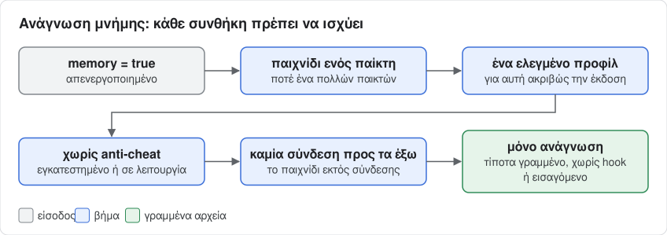

# Ανάγνωση μνήμης {#reading-memory}

Ορισμένα παιχνίδια ενός παίκτη δεν λένε τίποτα σε άλλα προγράμματα. Για αυτά, ο παρακολουθητής μπορεί - αν το ανοίξετε και
γράψετε ο ίδιος ένα προφίλ - να αναζητά πού βρίσκεστε στη μνήμη του παιχνιδιού, μόνο για ανάγνωση.

Για παιχνίδια ενός παίκτη που δεν δημοσιεύουν τίποτα, ο παρακολουθητής μπορεί να διαβάζει θέσεις και τιμές από τη μνήμη του
παιχνιδιού, μέσω ενός **προφίλ** που γράφετε εσείς για τη δική σας έκδοση του παιχνιδιού. Από όλες τις πηγές, αυτή είναι η
μόνη που το παιχνίδι δεν την έδωσε μόνο του, και γι' αυτό είναι πιο περιορισμένη από τις άλλες:

- είναι **κλειστή από προεπιλογή** (`python -m heat3d_watch config --set memory=true` την ανοίγει)·
- διαβάζει, και δεν έχει τρόπο να γράψει·
- **κανένα προφίλ δεν συνοδεύει τα εργαλεία.**

Τα προφίλ δεν συνοδεύουν τα εργαλεία επειδή μια διεύθυνση είναι σωστή μόνο για την έκδοση στην οποία βρέθηκε. Μετά από
ενημέρωση, ένα προφίλ που ήταν σωστό πριν διαβάζει σκουπίδια, και τα σκουπίδια μοιάζουν ακριβώς με αριθμούς. Ένα προφίλ πρέπει
να ελέγχεται στην έκδοση που έχει ο παίκτης, από τον ίδιο τον παίκτη.

## Οι έλεγχοι, με τη σειρά {#the-checks-in-order}




Κάθε έλεγχος παρακάτω πρέπει να περάσει. Οι πρώτοι τέσσερις γίνονται **πριν** ανοιχτεί το παιχνίδι, γιατί το άνοιγμα ενός
προστατευμένου παιχνιδιού για ανάγνωση είναι αυτό ακριβώς που προσέχει το anti-cheat, και το να αρνηθεί κανείς μετά θα ήταν
πολύ αργά.

1. **Η ρύθμιση**: το `memory` είναι αληθές. Αλλιώς οι προσαρμογείς μνήμης δεν ξεκινούν ποτέ.
2. **Ένα προφίλ για το παιχνίδι**, του οποίου το `exe` ονομάζει τη διεργασία που τρέχει. Ένα προφίλ δηλώνει αν το παιχνίδι
   μπορεί να παιχτεί online καθόλου (`"online"`)· ένα που το παραλείπει απορρίπτεται.
3. **Κανένα anti-cheat εκεί κοντά**:
   - κανένα αρχείο anti-cheat στον φάκελο του παιχνιδιού ή μέχρι τρεις φακέλους πιο πάνω (σταματώντας στον φάκελο
     `common` μιας βιβλιοθήκης του Steam, ή σε φάκελο που έχει `steamapps`, αφού πάνω από αυτόν υπάρχουν άλλα παιχνίδια):
     `EasyAntiCheat`, `EasyAntiCheat_EOS_Setup.exe`, `start_protected_game.exe`, `BattlEye`,
     `BEClient_x64.dll`, `BEService_x64.exe`, `EAAntiCheat.GameServiceLauncher.exe`, `AntiCheatExpert`,
     `SGuard64.exe`, `GameGuard`, `GameMon.des`, `XIGNCODE`, `xhunter1.sys`, `Vanguard`, `FACEIT`
     (συγκρίνονται με πεζά γράμματα, και ως αρχή ονόματος). Αν ο φάκελος του παιχνιδιού είναι άγνωστος, το παιχνίδι
     απορρίπτεται·
   - κανένας οδηγός ή υπηρεσία anti-cheat που τρέχει στον υπολογιστή, όπως φαίνονται από το
     `sc query type= driver state= active` και το `sc query type= service state= active`: EasyAntiCheat,
     EasyAntiCheat_EOS, BEService, BEDaisy, vgk, vgc, ACE-BASE, ACE-GAME, xhunter1, FACEIT,
     FACEITService, EAAntiCheatService, Denuvo Anti-Cheat, npggsvc, Ricochet. Ένα anti-cheat πυρήνα που έχει
     εγκατασταθεί για άλλο παιχνίδι παρακολουθεί ακόμη κάθε διεργασία. Αν δεν μπορούν να καταγραφούν οι υπηρεσίες, το
     παιχνίδι απορρίπτεται.
4. **Όχι online**: ένα παιχνίδι του οποίου το προφίλ λέει `"online": true` διαβάζεται μόνο όσο δεν έχει σύνδεση με τίποτα
   άλλο εκτός από αυτόν τον υπολογιστή (οποιαδήποτε απομακρυσμένη διεύθυνση εκτός από `127.x`, `::1`). Αν δεν μπορούν να
   διαβαστούν οι συνδέσεις του, απορρίπτεται.
5. Μετά, καθώς ξεκινά ο προσαρμογέας:
   - **η ακριβής έκδοση**: το μέγεθος του εκτελέσιμου, ή το SHA-256 του, πρέπει να ταιριάζει με μια έκδοση που λίστάρει το
     προφίλ. Μια άγνωστη έκδοση δεν διαβάζεται·
   - **οι μονάδες ακόμη μία φορά**: καταγράφονται οι φορτωμένες μονάδες του παιχνιδιού (ένα στιγμιότυπο Toolhelp, που δεν
     ζητά δικά του δικαιώματα πρόσβασης) και ελέγχονται για πελάτη anti-cheat (`BEClient_x64.dll`, `BEClient.dll`,
     `EasyAntiCheat_x64.dll`, `EasyAntiCheat.dll`, `EOSAntiCheat...`). Μια προστατευμένη διεργασία αρνείται το στιγμιότυπο,
     κάτι που επίσης είναι άρνηση·
   - μόνο τότε ανοίγεται η διεργασία, με `PROCESS_VM_READ | PROCESS_QUERY_LIMITED_INFORMATION` και τίποτα άλλο.

Οι έλεγχοι 1 έως 4 επαναλαμβάνονται σε κάθε σάρωση (κάθε 2 δευτερόλεπτα) όσο τρέχει το παιχνίδι. Αν αρχίσει να αποτυγχάνει
ένας από αυτούς (το παιχνίδι συνδέεται σε διακομιστή, ξεκινά μια υπηρεσία anti-cheat), ο προσαρμογέας σταματά στην επόμενη
σάρωση. Μια άρνηση καταγράφεται: `mem-<id>: not reading memory: <reason>`. Μια αποτυχία κατά την εκκίνηση (άγνωστη έκδοση,
μονάδα anti-cheat, ένα μοτίβο που δεν βρέθηκε) καταγράφεται ως `mem-<id>: could not start`, και ο προσαρμογέας δεν
δοκιμάζεται ξανά μέχρι να ξεκινήσει ξανά το παιχνίδι.

Δεν υπάρχει εγγραφή, καμία δέσμευση μνήμης στην άλλη διεργασία, κανένα νήμα που ξεκινά μέσα της, καμία βιβλιοθήκη που
φορτώνεται σε αυτήν, κανένα δικαίωμα αποσφαλμάτωσης και καμία ανύψωση δικαιωμάτων. Ένα τεστ (`test_memory_reading_cannot_write`
στο `tests/test_core.py`) αποτυγχάνει αν κάποια κλήση που γράφει σε άλλη διεργασία, δεσμεύει μνήμη μέσα της ή εκτελεί κώδικα
σε αυτήν - `WriteProcessMemory`, `VirtualAllocEx`, `CreateRemoteThread`, `PROCESS_VM_WRITE`, `SeDebugPrivilege`,
`LoadLibrary`, ... - εμφανίζεται πουθενά στο πακέτο.

Ποτέ δεν διαβάζονται, ό,τι κι αν λέει ένα προφίλ: παιχνίδια που παίζονται online, και παιχνίδια των οποίων η λειτουργία ενός
παίκτη τρέχει κάτω από anti-cheat, όπως το GTA V, ή το Elden Ring ξεκινημένο μέσω του launcher του. Οι έλεγχοι παραπάνω τα
απορρίπτουν ούτως ή άλλως.

## Η μορφή του προφίλ {#the-profile-format}

Ένα προφίλ είναι αρχείο JSON στο `<data>\profiles\` (το `<data>` είναι ο φάκελος δεδομένων, βλ.
[Εγκατάσταση και εκτέλεση](installing-and-running.md#where-everything-is)), ένα για κάθε παιχνίδι, με οποιοδήποτε όνομα
αρχείου που τελειώνει σε `.json`. Ένα φανταστικό παράδειγμα:

```json
{
  "schema": "heat3d.memprofile/1",
  "id": "mygame",
  "game": "My Game",
  "exe": "MyGame.exe",
  "online": false,
  "versions": [ { "label": "1.06", "size": 123456789 } ],
  "anchors": {
    "World": { "aob": "48 8B 05 ?? ?? ?? ?? 48 85 C0", "rip": [3, 7] }
  },
  "values": {
    "pos": { "type": "vec3f", "base": "World", "chain": ["0x10", "0x68", "0x70"] },
    "hp":  { "type": "i32",   "base": "World", "chain": ["0x10", "0x138"] },
    "map": { "type": "u32",   "base": "World", "chain": ["0x10", "0x1C0"] }
  },
  "events": [
    { "event": "death", "value": "hp",  "when": "to_zero" },
    { "event": "zone",  "value": "map", "when": "change" }
  ],
  "axes": { "up": "y", "units": "metres" },
  "rate": 10,
  "provenance": [ { "source": "https://example.com/my-notes", "verified_on": "1.06" } ]
}
```

| Κλειδί | Υποχρεωτικό | Τι είναι |
|---|---|---|
| `schema` | ναι | ακριβώς `heat3d.memprofile/1` |
| `id` | ναι | σύντομο και σταθερό· ο προσαρμογέας λέγεται `mem-<id>` |
| `game` | ναι | το όνομα του παιχνιδιού, από το οποίο παίρνει όνομα ο φάκελος της συνεδρίας |
| `exe` | ναι | το όνομα αρχείου του εκτελέσιμου, που λέει επίσης ότι το παιχνίδι τρέχει |
| `online` | ναι | `true` αν το παιχνίδι μπορεί να παιχτεί online καθόλου· τότε διαβάζεται μόνο όσο είναι offline |
| `versions` | ναι | οι εκδόσεις στις οποίες ελέγχθηκε το προφίλ: καθεμία με `label`, και `size` (το μέγεθος του εκτελέσιμου σε bytes) ή/και `sha256`. Όταν δίνονται και τα δύο, πρέπει να ταιριάζουν και τα δύο. Μια καταχώρηση χωρίς κανένα δεν ταιριάζει με τίποτα. |
| `anchors` | ναι | ονομασμένες διευθύνσεις στην κύρια μονάδα. `aob`: ένα μοτίβο bytes, δεκαεξαδικά bytes χωρισμένα με κενό, με `?` ή `??` για οποιοδήποτε byte· πρέπει να εμφανίζεται **ακριβώς μία φορά** στην εικόνα της μονάδας (πολλαπλές εμφανίσεις μετράνε ως αποτυχία, όπως και καμία). `rip: [d, n]`: το μοτίβο δείχνει σε εντολή με μετατόπιση RIP-relative 32 bit στο byte `d` και μήκους `n`· η άγκυρα γίνεται η διεύθυνση στην οποία αναφέρεται η εντολή. `offset`: προστίθεται μετά (κείμενο δεκαεξαδικό ή δεκαδικό). Αντί για `aob`, το `module_offset` δίνει σταθερή μετατόπιση από τη βάση της μονάδας. |
| `values` | ναι | τι διαβάζεται σε κάθε ερώτημα: `type` (`i32`, `u32`, `i64`, `u64`, `u8`, `f32`, `f64`, `vec3f`, `vec3d`), `base` (το όνομα μιας άγκυρας), `chain` (μετατοπίσεις ως κείμενο δεκαεξαδικό ή δεκαδικό) |
| `events` | όχι | κανόνες που μετατρέπουν αλλαγές σε συμβάντα: `when` `change` (η τιμή διαφέρει από το τελευταίο ερώτημα) ή `to_zero` (ένας αριθμός πέφτει από πάνω από 0 σε 0 ή κάτω) |
| `axes` | όχι | `up` (προεπιλογή `y`), `units` (προεπιλογή `game units`), `scale` (η κλίμακα μονάδων του προβολέα, που πολλαπλασιάζει κάθε θέση· προεπιλογή 1, οι μονάδες του ίδιου του παιχνιδιού) |
| `rate` | όχι | ερωτήματα το δευτερόλεπτο, από 1 έως 60 (προεπιλογή 10) |
| `provenance` | όχι | από πού προέρχονται οι μετατοπίσεις και σε ποια έκδοση τις ελέγξατε· αντιγράφεται στο `meta.json` κάθε συνεδρίας |

**Πώς διαβάζεται μια τιμή.** Η διεύθυνση της άγκυρας είναι η αρχή. Αν το `chain` είναι άδειο, η τιμή διαβάζεται αμέσως εκεί.
Αλλιώς διαβάζεται πρώτα ο δείκτης που είναι αποθηκευμένος στην άγκυρα. Μετά, για κάθε μετατόπιση εκτός από την τελευταία,
διαβάζεται ο δείκτης στη διεύθυνση `address + offset`. Η τελευταία μετατόπιση προστίθεται για να δώσει τη διεύθυνση της τιμής.
Ένας μηδενικός δείκτης στη διαδρομή (το παιχνίδι είναι ανάμεσα σε πίστες ή σε μενού) αφήνει την τιμή κενή για εκείνο το
ερώτημα.

**Τι καταγράφεται.** Μια τιμή με όνομα `pos` (ένα `vec3f` ή `vec3d`) γίνεται γραμμή `position` του παίκτη `me` σε κάθε
ερώτημα. Κάθε κανόνας συμβάντος γράφει τη δική του γραμμή `event`, με τη νέα τιμή και, όπου είναι γνωστό το `pos`, τη θέση,
και προσθέτει 1 σε μια στατιστική με το ίδιο όνομα. Η εικόνα της μονάδας διαβάζεται μία φορά στην εκκίνηση για να βρεθούν οι
άγκυρες, σε μπλοκ των 64 KiB· τα μπλοκ που δεν μπορούν να διαβαστούν μετρούν ως μηδενικά. Το `meta.json` της συνεδρίας
ονομάζει το προφίλ, την ετικέτα της έκδοσης και την `provenance`.

Ένα προφίλ που δεν μπορεί να χρησιμοποιηθεί (λάθος JSON, λάθος `schema`, ένα υποχρεωτικό κλειδί λείπει) παραλείπεται και
καταγράφεται ως `profile <file> not used: <reason>`. Τα προφίλ φορτώνονται όταν ξεκινά ο παρακολουθητής, άρα κάντε
επανεκκίνηση του `run` αφού προσθέσετε ή αλλάξετε ένα.

## Γράψιμο και έλεγχος ενός προφίλ {#writing-and-verifying-a-profile}

1. **Μόνο για παιχνίδι ενός παίκτη χωρίς anti-cheat.** Αν το παιχνίδι έχει anti-cheat, ή το παίζετε online, σταματήστε εδώ:
   ο παρακολουθητής θα το αρνηθεί, και πρέπει.
2. **Βρείτε τις τιμές στη δική σας έκδοση.** Δουλέψτε offline. Χρησιμοποιήστε τα δικά σας εργαλεία αποσφαλμάτωσης, ή
   δημοσιευμένες σημειώσεις για το παιχνίδι, για να βρείτε τη θέση του παίκτη και τις τιμές που σας ενδιαφέρουν, και μια
   διαδρομή δεικτών προς καθεμία από μια στατική θέση στο εκτελέσιμο. Προτιμήστε ένα μοτίβο bytes (`aob`) από μια σταθερή
   `module_offset`: ένα μοτίβο εξακολουθεί να βρίσκει τη θέση του όταν ο κώδικας μετακινηθεί λίγο.
3. **Κάντε το μοτίβο μοναδικό.** Πρέπει να ταιριάζει ακριβώς μία φορά στη μονάδα. Βάλτε wildcards στα bytes που αλλάζουν
   (διευθύνσεις, μετατοπίσεις) και κρατήστε αρκετά σταθερά bytes γύρω τους.
4. **Κλειδώστε την έκδοση.** Βάλτε το ακριβές μέγεθος του εκτελέσιμου στο `versions`· το PowerShell
   `(Get-Item .\MyGame.exe).Length` το δίνει, και το `Get-FileHash .\MyGame.exe -Algorithm SHA256` δίνει το hash. Μετά από
   ενημέρωση, το προφίλ απλώς παύει να χρησιμοποιείται μέχρι να το ελέγξετε ξανά και να προσθέσετε τη νέα έκδοση.
5. **Πείτε αν το παιχνίδι πηγαίνει online** (`online`), ειλικρινά.
6. **Δοκιμάστε το**: ανοίξτε την ανάγνωση (`config --set memory=true`), βάλτε το αρχείο στο `<data>\profiles\`, και ελέγξτε
   ότι το `python -m heat3d_watch games` εμφανίζει το `mem-<id>`. Ξεκινήστε το παιχνίδι και τρέξτε
   `python -m heat3d_watch run -v`. Στο `watcher.log`, ψάξτε για `mem-<id>: starting`, ή για τον λόγο που αρνήθηκε ή δεν
   ξεκίνησε.
7. **Ελέγξτε τους αριθμούς με το παιχνίδι.** Περπατήστε σε ένα γνωστό σημείο και κοιτάξτε τις γραμμές `position` στο
   `events.jsonl` της συνεδρίας. Κινούνται όταν κινείστε, με τη σωστή απόσταση, στους σωστούς άξονες; Ανοίξτε το
   `heat.parquet` στον προβολέα και ελέγξτε ότι η διαδρομή ταιριάζει με το πού πήγατε. Ενεργοποιήστε κάθε συμβάν (χάστε όλη
   την υγεία σας, αλλάξτε ζώνη) και ελέγξτε ότι εμφανίζεται μία φορά. Τα σκουπίδια μοιάζουν με αριθμούς, και μόνο αυτή η
   σύγκριση τα ξεχωρίζει.
8. **Γράψτε τι ελέγξατε** στο `provenance`: την πηγή των μετατοπίσεων και την έκδοση στην οποία τις ελέγξατε.

Το κείμενο `verified` ενός προσαρμογέα μνήμης, όπως το εμφανίζει το `games`, είναι πάντα "by the profile's author, for the
builds it lists". Ο παρακολουθητής δεν μπορεί να ξέρει περισσότερα από αυτό.
