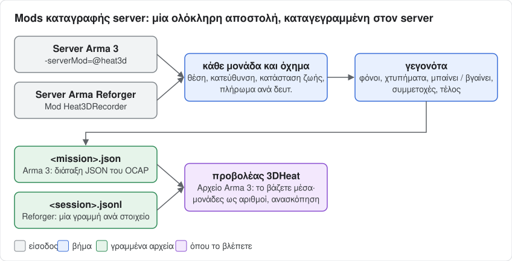

# Mod καταγραφής για servers (Arma 3, Arma Reforger) {#server-recorder-mods-arma-3-arma-reforger}

Τα περισσότερα παιχνίδια καταγράφονται από τον watcher στον δικό σας υπολογιστή. Το Arma είναι διαφορετικό: ένας server μπορεί να καταγράψει ολόκληρη αποστολή - κάθε μονάδα και όχημα, όχι μόνο το δικό σας - με ένα mod που τρέχει στον server. Οι παίκτες δεν ρυθμίζουν τίποτα: το mod του Arma 3 είναι μόνο για τον server, και το Reforger κατεβάζει μόνο του στους παίκτες τα mods ενός server όταν μπαίνουν σε αυτόν (το mod δεν κάνει τίποτα στους υπολογιστές τους). Το αποθετήριο περιέχει δύο τέτοια mods, στο
[`mods/arma3`](https://github.com/Holdi601/3DHeat-Watcher/tree/main/mods/arma3)
και στο [`mods/reforger`](https://github.com/Holdi601/3DHeat-Watcher/tree/main/mods/reforger).
Τα READMEs τους είναι η πλήρης τεκμηρίωση· αυτή η σελίδα είναι η επισκόπηση.

**Κατάσταση: και τα δύο δεν έχουν δοκιμαστεί ακόμα μέσα στο παιχνίδι.** Η επέκταση του Arma 3 χτίστηκε και οδηγήθηκε με τον τρόπο που καλεί το Arma τις επεκτάσεις, και η έξοδός της διαβάστηκε από το 3DHeat· τα σενάρια SQF της δεν έχουν τρέξει ακόμα στο Arma 3. Το mod του Reforger γράφτηκε από το δημοσιευμένο API σεναρίων της Bohemia και δεν έχει μεταγλωττιστεί ποτέ. Μην τα βάλετε σε δημόσιο server πριν περάσετε τα βήματα δοκιμής στο README του.

## Arma 3 {#arma-3}

1. Χτίστε την επέκταση μία φορά για κάθε πλατφόρμα (`mods/arma3/extension`). Χρειάζεται μεταγλωττιστής C: Visual Studio Build Tools στα Windows, gcc στο Linux· αν δεν έχετε μεταγλωττίσει ποτέ κάτι, ρωτήστε τον φιλοξενητή του server σας.
   - Windows, σε "x64 Native Tools Command Prompt for VS":
     `cl /nologo /O2 /LD heat3d.c /Fe:heat3d_x64.dll`
   - Linux: `gcc -O2 -shared -fPIC -o heat3d_x64.so heat3d.c -ldl`
2. Χτίστε το mod: `python mods/arma3/build.py` γράφει το `mods/arma3/@heat3d/` (δεν χρειάζονται τα Arma 3 Tools).
3. Αντιγράψτε το `@heat3d` στον φάκελο του server και ξεκινήστε τον server με `-serverMod=@heat3d`.
4. Το αρχείο καταγραφής `.rpt` του server γράφει `Heat3D recorder 0.1.0: recording <file> every 1 s`.

| Ρύθμιση | Προεπιλογή | Τι κάνει |
|---|---|---|
| `captureDelay` | 1 | δευτερόλεπτα ανάμεσα σε καρέ |
| `recordHits` | 1 | το 0 κλείνει τα γεγονότα χτυπημάτων |
| `recordShots` | 1 | το 0 κλείνει το μέτρημα βολών |
| `minPlayers` | 0 | καταγραφή μόνο όταν είναι συνδεδεμένοι τόσοι παίκτες |

Μια αποστολή αντικαθιστά μία από αυτές στο `init.sqf` της (`heat3d_captureDelay = 0.5;`).
Οι καταγραφές πηγαίνουν στον φάκελο `recordings/` μέσα στο `@heat3d`, ή στο `HEAT3D_DIR`.

**Έξοδος:** ένα αρχείο ανά αποστολή στη μορφή JSON του OCAP (τη μορφή του καταγραφέα OCAP2), με όνομα `<date>__<time>_<mission>.json`. Κατά τη διάρκεια της αποστολής είναι ημερολόγιο (`.heat3d.part`), που γράφεται στον δίσκο σε κάθε εγγραφή· το ημερολόγιο μιας αποστολής που κόπηκε ολοκληρώνεται την επόμενη φορά που ξεκινά αποστολή.

## Arma Reforger {#arma-reforger}

Το mod (`Heat3DRecorder.gproj`) ανοίγεται και χτίζεται στο Workbench της Bohemia (Arma Reforger Tools), δοκιμάζεται σε τοπικό dedicated server, δημοσιεύεται από το Workbench (μη καταχωρισμένο όσο δοκιμάζεται) και προστίθεται στη λίστα `mods` του `config.json` του server· βήμα προς βήμα στο README του. Κάθε δευτερόλεπτο γράφει τη θέση, την κατεύθυνση, την κατάσταση ζωής, το όχημα και το αναγνωριστικό παίκτη κάθε χαρακτήρα, και τη θέση, την κατεύθυνση, την κατάσταση και το πλήρωμα κάθε οχήματος· και τους φόνους (ο δολοφόνος, το όπλο, η απόσταση), τα χτυπήματα, την είσοδο και την έξοδο από οχήματα, τους παίκτες που μπαίνουν και βγαίνουν, και το τέλος της αποστολής.

**Έξοδος:** ένα αντικείμενο JSON ανά γραμμή, στο `$profile:heat3d/<UTC date>_<UTC time>_<world>.jsonl`: μια γραμμή `header` (μορφή `heat3d-reforger`, άξονες x ανατολή, y πάνω, z βορράς), και έπειτα γραμμές `entity`, `frame` και `event` καθώς συμβαίνουν, και μια γραμμή `end`. Οι γραμμές μονάδων είναι `[id, x, y, z, dir, alive, vehicleId, playerId]`, οι γραμμές οχημάτων `[id, x, y, z, dir, alive, [crew ids]]`· τα γεγονότα ακολουθούν τη διάταξη γεγονότων του OCAP2.

## Στον προβολέα {#in-the-viewer}

Ρίξτε μια καταγραφή του Arma 3 στον [προβολέα 3DHeat](https://holdi601.github.io/3DHeat/): μία αποστολή είναι μία συνεδρία, οι μονάδες γίνονται στρατιώτες, τα οχήματα τον τύπο τους, και οι φόνοι και τα χτυπήματα μπαίνουν στη λίστα ενημέρωσης. Η εφαρμογή του OCAP2 για τον web παίζει επίσης την καταγραφή. Το αρχείο του Reforger είναι η δική του γραμμική μορφή του mod, με τη διάταξη γεγονότων του OCAP2.
