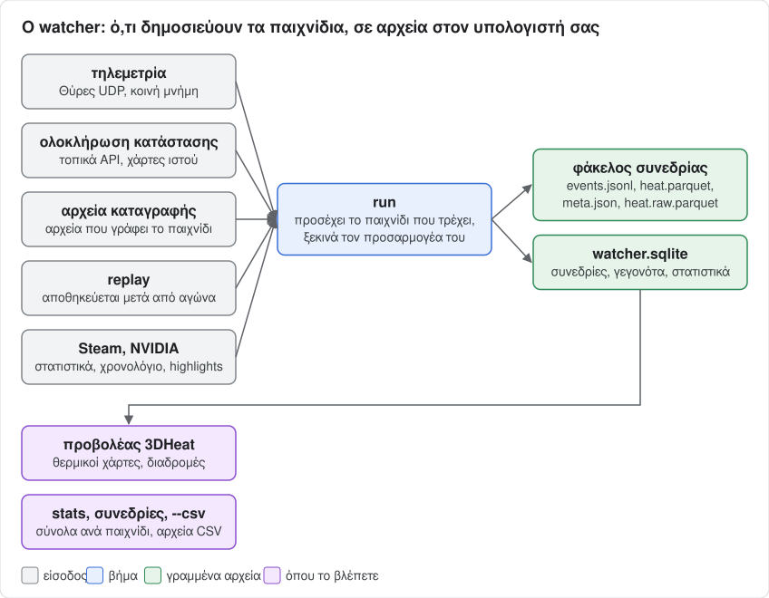

# Πηγές και κανόνες {#sources-and-rules}

Ο watcher καταγράφει μόνο όσα δίνουν τα παιχνίδια και οι πλατφόρμες στον παίκτη. Αυτή η σελίδα εξηγεί ποιες πηγές καλύπτει αυτό, τι επιτρέπεται να κάνει ο watcher με καθεμία, και ποια παιχνίδια ή μέρη παιχνιδιών αφήνει σκόπιμα έξω.

## Τα έξι είδη πηγών {#the-six-kinds-of-source}

Κάθε adapter έχει ένα `kind`, και το είδος αποφασίζει τι επιτρέπεται να κάνει ο adapter:

| Είδος | Τι είναι | Παιχνίδια πολλαπλού παίκτη |
|---|---|---|
| `telemetry` | μια θύρα UDP ή κοινή μνήμη που δημοσιεύει το παιχνίδι για ταμπλό, κινητήρες κίνησης και τιμόνια (Forza Data Out, F1 UDP, κοινή μνήμη της Kunos και του iRacing, SimConnect, η διεπαφή UDP του X-Plane, το πρόσθετο SCS SDK) | ναι - είναι η δική έξοδος του παιχνιδιού |
| `gsi` | ένα game-state integration ή τοπικό web API που σερβίρει το παιχνίδι στον υπολογιστή του παίκτη (Valve GSI, Live Client Data API του League, Stats API του Rocket League, web map του War Thunder) | ναι, μέσα σε όσα δείχνει το API στον παίκτη |
| `log` | αρχεία που γράφει το παιχνίδι όσο τρέχει: ημερολόγια, αρχεία καταγραφής, στατιστικά, αποθηκεύσεις (Elite Dangerous, Minecraft, Path of Exile, Hearthstone, Star Citizen, EVE Online) | ναι |
| `replay` | demos και replays που αποθηκεύει το παιχνίδι για τους παίκτες του, μετατρέπονται μετά τον αγώνα (CS2, Dota 2, osu!, War Thunder, World of Tanks, World of Warships, Squad, League of Legends, VALORANT, IL-2 Tacview) | ναι, εκτός αν είναι κρυπτογραφημένα, και μόνο τα μέρη που είναι ανοιχτά |
| `platform` | όσα κρατούν το Steam και το πρόγραμμα οδήγησης της κάρτας γραφικών: στατιστικά, επιτεύγματα, χρονολογίες, κλιπ και highlights | ναι |
| `memory` | η μνήμη του παιχνιδιού, μόνο για ανάγνωση, από ένα προφίλ που έγραψες εσύ | **ποτέ** - μόνο για single player |

Μόνο το `memory` ανοίγει άλλη διεργασία, και μόνο για ανάγνωση. Τα άλλα πέντε είδη διαβάζουν ό,τι έχει ήδη γράψει ή στείλει το παιχνίδι, το Steam ή η NVIDIA App.

## Πώς διαβάζονται οι πηγές {#how-the-sources-are-read}

- **Τίποτα δεν εγχέεται, δεν υποκλέπτεται και δεν αλλάζει μέσα σε ένα παιχνίδι.** Δεν φορτώνεται κώδικας στο παιχνίδι, δεν υποκλέπτεται παράθυρο ή είσοδος, δεν αλλάζεται κανένα αρχείο του παιχνιδιού. Τα μόνα αρχεία που γράφει ο watcher έξω από τον δικό του φάκελο δεδομένων είναι αυτά που γράφει το [`setup --apply`](commands.md#setup) όταν του το ζητήσεις: το αρχείο ρυθμίσεων ενός παιχνιδιού (με το αρχικό αποθηκευμένο ως `<file>.heat3d-backup`), ένα αρχείο cfg game-state, το script του hook του DCS, το mod πρωτοκόλλου του BeamNG.
- **Η κοινή μνήμη ανοίγει μόνο για ανάγνωση και δεν δημιουργείται ποτέ.** Ο συνηθισμένος τρόπος του Python για να ανοίξετε μια ονομασμένη περιοχή μνήμης τη δημιουργεί όταν δεν υπάρχει ακόμα. Ένα παιχνίδι που ξεκινά αργότερα θα έβρισκε τότε την άδεια, μόνο για ανάγνωση περιοχή του watcher αντί να φτιάξει τη δική του, και η τηλεμετρία του θα ήταν νεκρή. Ο watcher ανοίγει περιοχές μόνο με το `OpenFileMappingW` (που βρίσκει μόνο υπάρχουσα), τις αντιστοιχίζει με `FILE_MAP_READ`, και δοκιμάζει ξανά αργότερα αν το παιχνίδι δεν τις έχει φτιάξει ακόμα.
- **Οι θύρες δανείζονται, δεν αρπάζονται.** Μια θύρα UDP τηλεμετρίας που ακούει ήδη άλλο πρόγραμμα (FH Companion, SimHub, μια εφαρμογή ταμπλό) μένει σε εκείνο το πρόγραμμα. Αν άλλο πρόγραμμα αρχίσει να ακούει θύρα που κρατά ο watcher, ο watcher την αφήνει μέσα σε λίγα δευτερόλεπτα. Οι adapters του Forza περιμένουν 15 s μετά την εκκίνηση του παιχνιδιού πριν πάρουν τη θύρα 5300, και προωθούν κάθε πακέτο αμετάβλητο στο 127.0.0.1:5301, ώστε μια δεύτερη εφαρμογή Data Out να μπορεί ακόμα να καταγράφει.
- **Μόνο τοπικά.** Οι διακομιστές game-state που τρέχει ο watcher (CS2, Dota 2) ακούν στο 127.0.0.1 και πουθενά αλλού. Όταν το αρχείο cfg του παιχνιδιού έχει διακριτικό (αυτό που γράφει το `setup`), κάθε αποστολή πρέπει να το φέρει· αποστολές χωρίς αυτό μετρώνται ως `bad_auth` και πετιούνται. Χωρίς αρχείο cfg με διακριτικό, κάθε τοπική αποστολή γίνεται δεκτή, και το αρχείο καταγραφής το λέει. Τα τοπικά API που ζητά ο watcher (League στη θύρα 2999, War Thunder στη 8111, Rocket League στη 49123, X-Plane στη 49000) είναι όλα στο 127.0.0.1.
- **Τα αρχεία καταγραφής μοιράζονται, δεν κλειδώνονται ποτέ.** Κάθε ανάγνωση ανοίγει το αρχείο με όλες τις σημαίες κοινής χρήσης που έχουν τα Windows και το κλείνει ξανά, ώστε το παιχνίδι να μπορεί να συνεχίσει να γράφει, να μετονομάζει ή να αντικαθιστά το αρχείο καταγραφής του.
- **Δύο εξωτερικές υπηρεσίες, και μόνο σε αυτές τις περιπτώσεις.** Ο έλεγχος για νέα έκδοση ρωτά το GitHub (`api.github.com`) το πολύ κάθε έξι ώρες, και μπορεί να απενεργοποιηθεί (βλ. [Updates](updates.md)). Ο adapter των replays του League ρωτά το Match-V5 API της Riot μόνο όταν έχετε βάλει το δικό σας `riot_api_key`. Τίποτα άλλο δεν στέλνεται πουθενά.
- **Η ενεργοποίηση μιας πηγής είναι δική σας απόφαση.** Το `setup` χωρίς `--apply` απλώς λέει τι θα άλλαζε.

## Κανόνες για πολλαπλό παίκτη {#multiplayer-rules}

- Ένα παιχνίδι που παίζεται online καταγράφεται μόνο μέσω όσων δημοσιεύει: τηλεμετρία, API game-state, αρχεία καταγραφής, replays, αρχεία πλατφόρμας. Μέσα σε αυτά, ο watcher καταγράφει ό,τι δείχνει το παιχνίδι στον παίκτη, και τίποτα υπολογισμένο πέρα από αυτό:
  - **Το game-state integration του CS2** στέλνει τον παίκτη που παρακολουθείτε (τον εαυτό σας όσο είστε ζωντανός, έναν συμπαίκτη μετά τον θάνατο). Οι θέσεις των άλλων παικτών (`allplayers_*`) στέλνονται μόνο σε θεατές και GOTV, οπότε ο watcher δεν τις ζητά.
  - **Το Live Client Data API του League of Legends** δεν έχει θέσεις. Η πολιτική της Riot επιτρέπει σε εργαλεία να δείχνουν ό,τι μπορεί να ξέρει ο παίκτης από το ίδιο το παιχνίδι, και τίποτα υπολογισμένο πέρα από αυτό (χωρίς χρονόμετρα αντιπάλων). Ο watcher καταγράφει το kill feed και το σκορ που βλέπει ο παίκτης, και τα δικά του νούμερα.
  - **Το Stats API του Rocket League** δεν έχει θέσεις αυτοκινήτων (η κατάσταση των αυτοκινήτων στέλνεται μόνο σε θεατές). Αυτό που έχει τόπο είναι η μπάλα, εκεί όπου χτυπήθηκε, έγινε γκολ ή χτύπησε την οριζόντια δοκό.
  - **Το web map του War Thunder** δείχνει ό,τι δείχνει ο μικρός χάρτης, χωρίς ονόματα ή αναγνωριστικά.
  - **Τα F1 23/24/25** βάζουν τη θέση κάθε αυτοκινήτου στο πακέτο Motion τους, και στο online. Τα δίνει το ίδιο το παιχνίδι, και κρατά πίσω μόνο τα δεδομένα των παικτών με περιορισμένο "Your Telemetry".
  - **DCS World**: ένας διακομιστής πολλαπλού παίκτη μπορεί να απαγορεύσει την εξαγωγή των δικών σας δεδομένων αεροσκάφους· η συνεδρία τότε έχει γεγονότα χωρίς θέσεις, και το λέει.
- **Η μνήμη δεν διαβάζεται ποτέ σε παιχνίδι πολλαπλού παίκτη.** Ένας adapter μνήμης για παιχνίδι που παίζεται online απορρίπτεται, και ένα προφίλ πρέπει να δηλώνει αν το παιχνίδι του μπορεί να παιχτεί online καθόλου. Ένα single player παιχνίδι που έχει και online λειτουργία διαβάζεται μόνο όσο δεν έχει σύνδεση με τίποτα άλλο πέρα από αυτό το μηχάνημα. Τα παιχνίδια των οποίων η single player λειτουργία τρέχει κάτω από anti-cheat δεν διαβάζονται ποτέ. Βλ. [Reading memory](memory-reading.md).
- Η σήμανση `multiplayer` σε έναν adapter (που το `games --markdown` δείχνει ως "Online play") αποφασίζει μόνο για την ανάγνωση μνήμης. Δεν εμποδίζει τα άλλα είδη να καταγράφουν online παιχνίδι.

## Τι απορρίπτεται και γιατί {#what-is-declined-and-why}

Μερικά παιχνίδια, και μερικά μέρη παιχνιδιών, δεν καταγράφονται: τα δεδομένα τους είναι προστατευμένα, δεν δημοσιεύονται ή δεν βρίσκονται καθόλου στον υπολογιστή του παίκτη:

| Παιχνίδι | Τι αφήνεται έξω | Γιατί |
|---|---|---|
| VALORANT | θέσεις, ονόματα, σκορ στα replays· τα endpoints του lockfile του client | Η ροή του παιχνιδιού στα replays είναι θολωμένη με τιμές που παίρνονται από το εκτελέσιμο κάθε έκδοσης. Το παιχνίδι τρέχει κάτω από το Vanguard. Τα endpoints του lockfile του Riot client δεν είναι δημοσιευμένο API. **Διαβάζεται:** ό,τι φέρει το replay χωρίς κρυπτογράφηση - χάρτης, αναγνωριστικό αγώνα, πράκτορες, η χρονολογία γύρων και φόνων του διακομιστή. |
| League of Legends | το μέρος των `.rofl` replays που αφορά κίνηση λεπτό προς λεπτό· τα endpoints του lockfile του client | Θολωμένο ενάντια στην εξαπάτηση, διαφορετικά σε κάθε έκδοση, και δεν αποκωδικοποιείται. **Διαβάζεται:** η τελική κατάσταση του αγώνα που κάθε replay φέρει ως απλό JSON, το Live Client Data API κατά τη διάρκεια αγώνα, και - με δικό σας κλειδί προγραμματιστή - η επίσημη χρονολογία Match-V5 (θέσεις κάθε λεπτό, φόνοι εκεί που έγιναν). |
| Fortnite | replays | Κρυπτογραφημένα. |
| World of Tanks, World of Warships | replays, μέσα στον watcher | Κρυπτογραφημένα. Ο watcher δεν τα διαβάζει· τα διαβάζουν χωριστοί μετατροπείς έξω από αυτόν (`exporters/ext/wot-replay`, `exporters/ext/wows-replay`), ο καθένας ένα αυτόνομο έργο. **Διαβάζεται, με εγκατεστημένο μετατροπέα:** η θέση κάθε οχήματος ή πλοίου όσο το ήξερε ο παίκτης που έγραφε, και οι φόνοι. |
| Gran Turismo 7 | telemetry | Μόνο για κονσόλα, και η τηλεμετρία του είναι κρυπτογραφημένη με κλειδί που ανακτήθηκε από το παιχνίδι. |
| Apex Legends | τα πάντα | Το LiveAPI του στέλνει πλήρη γεγονότα μόνο σε ιδιωτικά και προσαρμοσμένα λόμπι· αλλιώς δεν υπάρχει τίποτα τοπικά. |
| Overwatch 2, Call of Duty, Battlefield 6, Hunt: Showdown 1896 | live data | Δεν υπάρχει τοπικό replay, αρχείο καταγραφής ή έξοδος game-state να διαβαστεί. Τα στατιστικά τους έρχονται εκεί που τα κρατά το Steam ([Steam statistics](game-steam-stats.md), [Steam Timeline](game-steam-timeline.md)), και τα κλιπ τους ως [NVIDIA highlights](nvidia-highlights.md). |
| Star Citizen | οτιδήποτε πέρα από το `Game.log` | Τρέχει το Easy Anti-Cheat· ο watcher διαβάζει μόνο το αρχείο καταγραφής που γράφει το παιχνίδι και δεν πλησιάζει ποτέ τη διεργασία του παιχνιδιού. |
| osu!lazer | replays | Κρατιούνται στο δικό του αποθετήριο του παιχνιδιού· διαβάζονται μόνο τα αρχεία `.osr` του osu! (παλιά έκδοση). |
| Οποιοδήποτε παιχνίδι πολλαπλού παίκτη | μνήμη | Ποτέ. Τα single player παιχνίδια των οποίων η λειτουργία τρέχει κάτω από anti-cheat (GTA V, Elden Ring μέσω του launcher) δεν διαβάζονται επίσης. |

Τα κρυπτογραφημένα replays δεν ανοίγονται: ο αναγνώστης του VALORANT ελέγχει τη σημαία κρυπτογράφησης του replay και αρνείται ένα κρυπτογραφημένο αρχείο ("this replay is encrypted; it is not read").

Παιχνίδια που έχουν μελετηθεί αλλά δεν έχουν ακόμα υλοποιηθεί (Deadlock replays, αρχεία `.replay` του Rocket League, StarCraft II, Team Fortress 2, Rainbow Six Siege, Beat Saber, Trackmania, αρκετά racing sims) αναφέρονται με τις πηγές τους στο [All games in one table](watcher.md#researched-not-yet-built). Καθένα χρειάζεται δείγματα αρχείων για να ελεγχθεί πριν κυκλοφορήσει.
