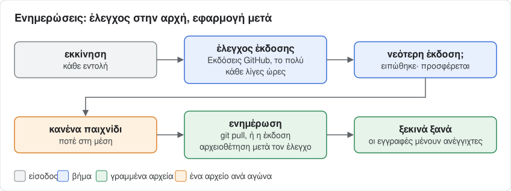

# Ενημερώσεις {#updates}

Ο watcher κρατά τον εαυτό του ενημερωμένο από τις εκδόσεις του
[Holdi601/3DHeat-Watcher](https://github.com/Holdi601/3DHeat-Watcher/releases). Το πρόγραμμα ενημέρωσης είναι το πακέτο `heat3d_update`, δίπλα στο `heat3d_watch` στο αποθετήριο.

## Ο έλεγχος {#the-check}

- **Πότε**: κάθε εντολή εκτός από το `update` ελέγχει όταν ξεκινά. Το `run` ελέγχει επίσης ενώ τρέχει, το πολύ μία φορά την ώρα και μόνο όταν δεν τρέχει κανένα παιχνίδι.
- **Πώς**: ένα αίτημα HTTPS προς `https://api.github.com/repos/Holdi601/3DHeat-Watcher/releases/latest`, με χρονικό όριο 5 δευτερόλεπτα. Η απάντηση αποθηκεύεται για έξι ώρες στο `%LOCALAPPDATA%\3DHeat\update-check-3DHeat-Watcher.json`, ώστε τις περισσότερες εκκινήσεις να μην ρωτά τίποτα. Το «δεν υπάρχει ακόμα έκδοση» (HTTP 404) αποθηκεύεται σαν απάντηση. Όταν δεν υπάρχει σύνδεση, ή έχει όριο ο αριθμός αιτημάτων, ή υπάρχει διαμεσολαβητής (proxy), ο έλεγχος αποτυγχάνει χωρίς θόρυβο και η εντολή συνεχίζει με την έκδοση που έχει.
- **Εκδόσεις**: η εγκατεστημένη έκδοση είναι το αρχείο `VERSION` στον φάκελο του αποθετηρίου. Η ετικέτα μιας έκδοσης (`v1.2.0` ή `1.2.0`) συγκρίνεται ως αριθμοί, μέρος προς μέρος· ό,τι βρίσκεται μετά από `-` ή `+` αγνοείται.
- **Κλείσιμο**: το `HEAT3D_NO_UPDATE=1` (οποιαδήποτε τιμή εκτός από κενό, `0`, `false` ή `no`) κλείνει και τον έλεγχο και την αυτόματη ενημέρωση. Κάθε εργαλείο 3DHeat κρατά το δικό του αρχείο προσωρινής μνήμης, ώστε η απάντηση ενός εργαλείου να μην παίρνει τη θέση της απάντησης ενός άλλου.

## Τι γίνεται όταν βγει νεότερη έκδοση {#what-happens-when-a-newer-release-is-out}

- **`run`** εμφανίζει ειδοποίηση όταν ξεκινά, και συνεχίζει να τρέχει: `[heat3d_watch] 3DHeat Watcher 1.2.0 is out (this is 1.0.2). <release page>`. Ενώ τρέχει, με ενεργό το `auto_update` (η προεπιλογή) και χωρίς παιχνίδι να τρέχει, ενημερώνει τον εαυτό του: τη γραμμή καταγραφής `3DHeat Watcher 1.2.0 is out (this is 1.0.2); updating`, μια ειδοποίηση των Windows «Updating to 1.2.0», την ενημέρωση, να σταματούν όλοι οι προσαρμογείς και να κλείνουν οι συνεδρίες τους, και την ίδια εντολή να ξεκινά ξανά με τον νέο κώδικα. Ο watcher ποτέ δεν ενημερώνεται στη μέση ενός παιχνιδιού. Αν η ενημέρωση δεν μπορεί να εφαρμοστεί, η ειδοποίηση το λέει («1.2.0 is out; not updated: ...») και ο watcher συνεχίζει με την παλιά έκδοση. Με το `auto_update` κλειστό μένει μόνο η ειδοποίηση.
- **Οι άλλες εντολές** ρωτούν `Update now? [Y/n]` όταν τρέχουν σε τερματικό. Enter, `y`, `yes`, `j` ή `ja` ενημερώνει και μετά τρέχει ξανά την ίδια εντολή με τη νέα έκδοση. Χωρίς τερματικό (ένα προγραμματισμένο τρέξιμο, μια σωλήνωση), τυπώνουν πώς να ενημερώσετε και συνεχίζουν.
- **Όταν το ζητήσετε**: το `python -m heat3d_watch update` (ή `python -m heat3d_update`) ρωτά το GitHub χωρίς την προσωρινή μνήμη και ενημερώνει. Το `--check` λέει μόνο αν βγήκε νεότερη έκδοση. Αυτό δουλεύει ακόμα και με ορισμένο το `HEAT3D_NO_UPDATE`.

## Πώς εφαρμόζεται μια ενημέρωση {#how-an-update-is-applied}

Εξαρτάται από το πώς εγκαταστάθηκε το αντίγραφο:

- **Κλώνος git** (ο φάκελος έχει `.git` και το `git` είναι στο PATH): `git pull --ff-only`. Αρνείται όσο ο κλώνος έχει αλλαγές σε αρχεία υπό παρακολούθηση (το `git status --porcelain --untracked-files=no` δεν είναι άδειο)· αυτές οι αλλαγές είναι δουλειά κάποιου, και η ενημέρωση δεν αποφασίζει τι γίνεται μ' αυτές. Κάντε commit ή stash, και μετά pull.
- **Ένα αντίγραφο που κατέβηκε**: το αρχείο πηγαίου κώδικα της έκδοσης κατεβαίνει και αποσυμπιέζεται σε προσωρινό φάκελο. Οι καταχωρίσεις που θα έβγαιναν έξω από αυτόν παραλείπονται. Το `VERSION` του αρχείου πρέπει να είναι η έκδοση που δηλώνει η έκδοση, αλλιώς δεν αντιγράφεται τίποτα. Μετά τα αρχεία του αντιγράφονται πάνω στον φάκελο του αποθετηρίου. Τα αρχεία που δεν ανήκουν σε μια έκδοση - καταγραφές, ρυθμίσεις, εικονικά περιβάλλοντα, εξαγωγές, ό,τι φτιάξατε εσείς - δεν αγγίζονται. Ένα μονάδα Python που είχε μια παλαιότερη έκδοση και την έχει αφαιρέσει η νέα αφαιρείται από τα πακέτα της έκδοσης (`heat3d_watch`, `heat3d_update`), ώστε να μη φορτώνεται παλιός προσαρμογέας μετά την ενημέρωση· έξω από αυτά τα πακέτα δεν αφαιρείται τίποτα.

Οι καταγραφές και οι ρυθμίσεις βρίσκονται συνήθως έξω από τον φάκελο του αποθετηρίου (`%LOCALAPPDATA%\3DHeat\Watcher`), οπότε μια ενημέρωση δεν τις πλησιάζει ποτέ.

Μετά από ενημέρωση, ξεκινά ξανά η ίδια εντολή. Στα Windows, ο watcher ξεκινά τη νέα διεργασία, περιμένει να τελειώσει και της περνά τον κωδικό εξόδου της, ώστε το τερματικό να συμπεριφέρεται σαν να είχε κάνει τη δουλειά η πρώτη διεργασία.
