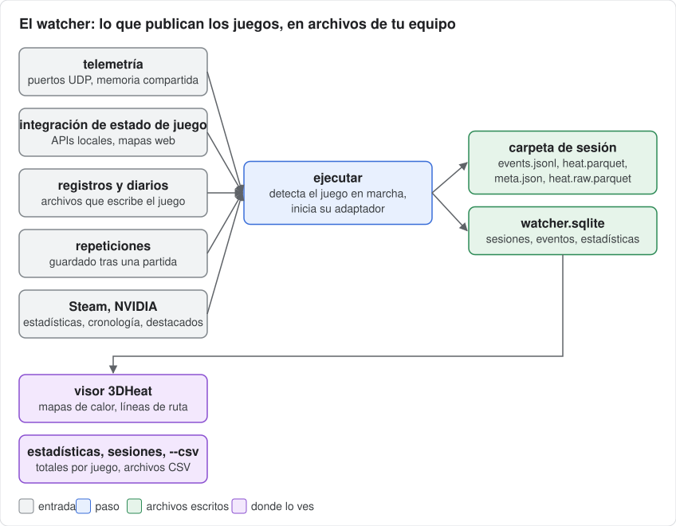
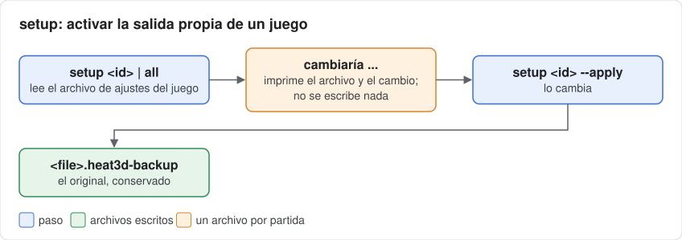
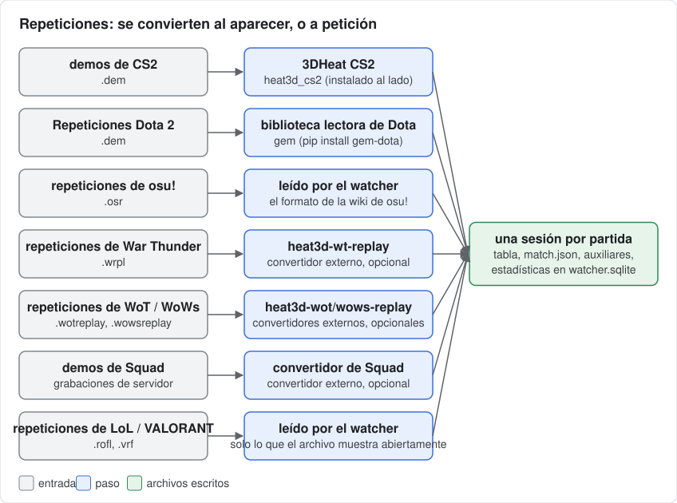
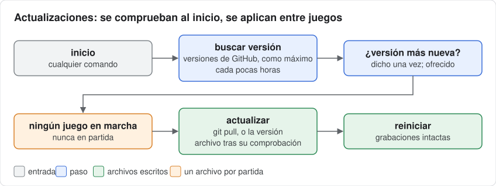

# Comandos {#commands}

¿Nuevo en la línea de comandos? Lee primero [Antes de empezar](before-you-start.md). Cada comando se escribe
en una terminal abierta en la carpeta que descomprimiste o clonaste (en el Explorador de archivos, escribe
`powershell` en la barra de direcciones), así:

```bash
python -m heat3d_watch <command> [options]
```


| Comando | Qué hace |
|---|---|
| [`run`](#run) | vigila en segundo plano y graba cada juego que se ejecuta |
| [`games`](#games) | qué da cada juego y de dónde |
| [`setup`](#setup) | activa la salida propia de un juego |
| [`status`](#status) | qué juegos se están ejecutando ahora, y qué adaptadores se ejecutarían |
| [`sessions`](#sessions) | las grabaciones hasta ahora |
| [`stats`](#stats) | totales por juego, o las tablas en CSV |
| [`table`](#table) | reconstruye el `heat.parquet` de una sesión a partir de su `events.jsonl` |
| [`replays`](#replays) | convierte las repeticiones que ya están en el disco |
| [`dota-replay`](#dota-replay) | descarga la repetición de una partida pública de Dota 2 por su id |
| [`update`](#update) | actualiza a la versión más reciente |
| [`config`](#config) | muestra o cambia los ajustes |

Opciones de todos los comandos: `-h` / `--help` muestra la ayuda, y `python -m heat3d_watch --version`
muestra la versión (el archivo `VERSION`).

Las imágenes de esta página son ejecuciones sobre sesiones de ejemplo sintéticas (`Example Racer`,
`Example Arena`), no grabaciones reales.

Todos los comandos excepto `update` buscan primero una versión más nueva (como máximo cada seis horas;
se omite con `HEAT3D_NO_UPDATE=1`, véase [Actualizaciones](updates.md)). `run` solo muestra un aviso. Los
demás comandos preguntan `Update now? [Y/n]` cuando se ejecutan en una terminal, y muestran cómo actualizar
cuando no. La salida es UTF-8, así que los nombres de juegos en cualquier alfabeto se muestran en cualquier
consola.

## run {#run}

```bash
python -m heat3d_watch run [--once] [-v]
```



Vigila hasta que se detiene (Ctrl+C): cada `scan_seconds` lee la lista de procesos y ejecuta un adaptador
por cada juego que encuentra, además de los adaptadores siempre activos. Antes de la primera revisión
termina las sesiones que dejó abiertas una ejecución anterior. Mientras no hay ningún juego en marcha,
puede actualizarse a sí mismo (con `auto_update` activado). Los detalles están en
[Instalación y ejecución](installing-and-running.md#running).

| Opción | Efecto |
|---|---|
| `--once` | una sola revisión de los juegos en marcha, y después sale. Se arrancan los adaptadores de los juegos que están en marcha ahora (y los siempre activos), cada uno consulta una vez (se esperan como máximo 10 segundos para ello), y luego se detienen todos igual que cuando termina un juego: sus sesiones se cierran, se escriben y se cuentan. Sirve para comprobar la detección, no para grabar. |
| `-v`, `--verbose` | líneas de depuración en `watcher.log` y en la consola |

`run` escribe `<data>\watcher.lock` y no arranca una segunda vez para la misma carpeta de datos (código de
salida 1); véase [El archivo de bloqueo](installing-and-running.md#the-lock-file).

## games {#games}

```bash
python -m heat3d_watch games [--markdown]
```


Muestra todos los adaptadores ordenados por juego: su nombre, id y tipo, de dónde lee, qué graba y cómo se
activa. Un adaptador que no puede ejecutarse en esta máquina se marca como `[unavailable: <motivo>]`: no se
encuentra SimConnect.dll, no hay carpeta de Minecraft, 3DHeat CS2 no está instalado, no se encuentra Steam
o la app de NVIDIA. Un módulo de adaptador que no se pudo importar aparece al final con el error.

```text
EA SPORTS F1 25  (f1-25, telemetry)
    from: UDP telemetry 127.0.0.1:20777 (Documents\My Games\F1 25\hardwaresettings\hardware_settings_config.xml)
    - every car's position (world XYZ, m) at 10 Hz, by driver name, team, own car marked, ...
    switch on: In the game: Settings > Telemetry Settings > UDP Telemetry On, IP 127.0.0.1, port 20777 - ...
```

`--markdown` muestra lo mismo como una sola tabla de Markdown (juego, qué se graba, de dónde, cómo activarlo,
juego en línea, verificado). La tabla de [Todos los juegos en una tabla](watcher.md) es esa salida. Las
celdas están escapadas para Markdown: el texto entre comillas invertidas sigue siendo código, y fuera de
ellas los caracteres `<`, `>`, `&`, `*`, `|` y una barra invertida delante de un signo de puntuación se
escriben para que se vean como se escribieron (`<CS2>` desaparecería como etiqueta HTML en kramdown). Lo
único de HTML es el `<br>` entre los elementos de "Qué se graba".

## setup {#setup}

```bash
python -m heat3d_watch setup <adapter id | all> [--apply]
```




Activa la salida propia de un juego, cuando el juego necesita cambiar un archivo para ello. Sin `--apply` no
se cambia nada: cada línea dice qué cambiaría, y cuando hay algo que cambiar, la última línea dice
`Nothing was changed. Run again with --apply to make these changes.` Cuando no hay nada que cambiar, dice
`<id>: nothing to change` (`Nothing to change.` para `all`). Con `--apply` se hacen los cambios, y antes de
cambiar un archivo por primera vez, su original se guarda como `<file>.heat3d-backup`. Una copia de seguridad
que ya existe nunca se sobrescribe, así que siempre contiene el archivo tal como estaba antes de que el
watcher lo tocara por primera vez.

```text
f1-25: would change: hardware_settings_config.xml <udp>: enabled="false" -> "true"
Nothing was changed. Run again with --apply to make these changes.
```

`all` ejecuta la configuración de todos los adaptadores que tienen una. Un adaptador sin configuración,
nombrado por separado, muestra `<id>: nothing for setup to change; ` seguido de cómo se activa el juego (su
texto `enable`, o que no necesita nada). Un id desconocido muestra `no adapter '<id>'; games lists them` y
sale con código 2. Los adaptadores que tienen algo que configurar:

| Adaptador | Qué cambia `--apply` |
|---|---|
| `beamng` | instala el mod de protocolo `heat3d` en la carpeta `mods` del usuario de BeamNG (solo si no está); luego activa en el juego Options > Other > Protocols > "others" |
| `cs2-gsi` | escribe `<CS2>\game\csgo\cfg\gamestate_integration_heat3d.cfg`: envía el estado del juego a `http://127.0.0.1:3311/` con un token aleatorio que el watcher exige después (si el archivo ya tiene un token, se conserva); CS2 lo lee al arrancar |
| `dota2-gsi` | lo mismo para Dota 2: `<Dota>\game\dota\cfg\gamestate_integration\gamestate_integration_heat3d.cfg`, puerto 3312 |
| `dcs` | añade `Scripts\Hooks\heat3d-watch.lua` a cada carpeta `%USERPROFILE%\Saved Games\DCS*`. Su propia copia anterior se actualiza; un archivo con ese nombre que el watcher no escribió se deja intacto. Reinicia DCS. |
| `dirt-rally-2` | `hardware_settings_config.xml`: `<udp enabled="true" extradata="3" ip="127.0.0.1" port="20777">`; arranca antes el juego una vez para que exista el archivo |
| `ea-wrc` | `Documents\My Games\WRC\telemetry\config.json`: activa el paquete `session_update` de la estructura `wrc`, hacia esta máquina |
| `f1-23`, `f1-24`, `f1-25` | `hardware_settings_config.xml`: `<udp enabled="true" ip="127.0.0.1" port="20777">`; el juego debe estar cerrado |
| `hearthstone` | añade una sección `[Power]` (`LogLevel=1`, `FilePrinting=true`) a `%LOCALAPPDATA%\Blizzard\Hearthstone\log.config`; reinicia el juego |
| `il2` | `<game>\data\startup.cfg`, `[KEY = telemetrydevice]`: un destino más `addrN = "127.0.0.1:41995"` y `enable = true` (si no hay sección, se añade, a 10 Hz); reinicia IL-2 |
| `il2-tacview` | `<game>\data\startup.cfg`, `[KEY = track_record]`: `tacviewrecord = 1` |
| `rocketleague-stats` | `TAStatsAPI.ini` (o `DefaultStatsAPI.ini` si ese no existe) en `<RL>\TAGame\Config`: `PacketSendRate=30` cuando la API está desactivada, y `Port` cuando no hay ninguno; se lee al arrancar Rocket League |

`richard-burns-rally` no tiene configuración: su telemetría es la del complemento RSF/NGP, que se activa a mano
en `RichardBurnsRally.ini` (véase [su página](game-richard-burns-rally.md)); `setup richard-burns-rally` lo
indica. Todos los demás juegos no necesitan nada o se activan en el propio juego; la página de cada juego
explica cómo.

## status {#status}

```bash
python -m heat3d_watch status
```

```text
3DHeat Watcher 1.0.2; data in C:\Users\...\AppData\Local\3DHeat\Watcher
Games running: EA SPORTS F1 25 (f1-25)
Always on: il2-tacview, steam-stats, steam-timeline, nvidia-highlights, cs2-demos, osu-replays, lol-replays, valorant-replays
```

Indica qué adaptadores arrancaría ahora un `run`, con las mismas reglas: el proceso del juego está en marcha,
el adaptador no está en `disabled`, no falta nada de lo que necesita, los adaptadores de repeticiones solo
con `replays` activado, los de memoria solo con `memory` activado y superadas todas las comprobaciones de
memoria. No arranca nada.

## sessions {#sessions}

```bash
python -m heat3d_watch sessions [--game NAME] [--limit N]
```


Las sesiones más recientes de `watcher.sqlite`, una línea cada una: inicio (hora local), juego, minutos,
eventos, posiciones, carpeta.

| Opción | Efecto |
|---|---|
| `--game NAME` | solo este juego, por su nombre exacto tal como aparece en la lista (`"EA SPORTS F1 25"`) |
| `--limit N` | como máximo N sesiones (por defecto 40) |

## stats {#stats}

```bash
python -m heat3d_watch stats [--game NAME] [--csv DIR]
```


Sin opciones: una tabla de todos los juegos (sesiones, horas, eventos, posiciones, última vez jugado), del
más jugado al menos, y luego, para cada juego, sus 25 eventos más frecuentes y cada estadística numérica con
el número de sesiones que la tienen, el total, el mejor valor (`best`) y la media. `best` sabe qué sentido
es el mejor: el valor más bajo para los tiempos guardados como mejor (`best_lap`, `best_stage` y cualquier
otra clave que empiece por `best_`) y para los puestos (`race_position`, `grid_position`, cualquier clave que
termine en `_position`), y el más alto para todo lo demás (eliminaciones, distancia, velocidad máxima, los
contadores propios de un juego).

| Opción | Efecto |
|---|---|
| `--game NAME` | solo los eventos y estadísticas de este juego, sin el resumen general |
| `--csv DIR` | escribe `sessions.csv`, `events.csv` y `stats.csv` (todas las filas de las tres tablas) en `DIR`; `--game` no lo limita |

## table {#table}

```bash
python -m heat3d_watch table <session folder>
```


Reconstruye `heat.parquet` en una carpeta de sesión a partir de su `events.jsonl`, con los ejes de su
`meta.json`. Muestra la ruta de la tabla, o `no positions in this session`. Úsalo para una sesión grabada
mientras faltaba `pyarrow`, o después de editar a mano `events.jsonl`.

## replays {#replays}

```bash
python -m heat3d_watch replays <adapter id> [folder] [-v]
```



Convierte ahora, una tras otra, las repeticiones que ya están en el disco, cada una en una sesión, igual que
lo haría la vigilancia de carpetas. La primera vez que el watcher ve una carpeta de repeticiones solo anota
lo que hay en ella (véase [Instalación y ejecución](installing-and-running.md#replays-already-on-disk)); así
se convierten esas bajo petición. Sin `folder` se leen las carpetas propias del adaptador (las del juego, más
`replay_folders`); con él, las repeticiones de esa carpeta. Cada una convertida se anota como vista, para que
el watcher en marcha no la convierta otra vez. Una repetición que no se puede convertir se registra en el
log y se omite.

| Adaptador | Repeticiones |
|---|---|
| `cs2-demos` | demos de Counter-Strike 2 (`*.dem`), mediante 3DHeat CS2 |
| `lol-replays` | repeticiones de League of Legends (`*.rofl`) |
| `osu-replays` | repeticiones de osu! (`*.osr`) |
| `valorant-replays` | repeticiones de VALORANT (`*.vrf`) |
| `warthunder-replays` | repeticiones de War Thunder (`*.wrpl`), mediante el conversor externo `heat3d-wt-replay` (exporters/ext/warthunder-replay) |
| `wot-replays` | repeticiones de World of Tanks (`*.wotreplay`), mediante el conversor externo `heat3d-wot-replay` (exporters/ext/wot-replay) |
| `wows-replays` | repeticiones de World of Warships (`*.wowsreplay`), mediante el conversor externo `heat3d-wows-replay` (exporters/ext/wows-replay) |
| `dota-replays` | repeticiones de Dota 2 (`*.dem`), mediante gem (`pip install gem-dota`) |

```text
osu-replays: converted 12 replay(s); `sessions --game` lists them
```

Un id que no es ninguno de estos muestra `no replay adapter '<id>'` con la lista y sale con código 2; lo
mismo ocurre con una `folder` que no existe. Un adaptador que no puede ejecutarse aquí (3DHeat CS2 no
instalado) muestra el motivo y sale con código 1. Las pistas Tacview de IL-2 no están en la lista: ese
adaptador convierte por sí mismo cada pista terminada que encuentra.

## dota-replay {#dota-replay}

```bash
python -m heat3d_watch dota-replay <match id> [<match id> ...] [-o FOLDER] [--convert] [-v]
```

Descarga la repetición de una partida pública de Dota 2 desde los servidores de repeticiones de Valve.
Necesita internet. El id de la partida es el número de la página de la partida en el cliente de Dota (los
detalles de la partida) o en la web de OpenDota; Valve guarda una repetición durante unas semanas, después
de las cuales la descarga falla. El servidor y el salt de la repetición salen del registro de la partida en
OpenDota (`api.opendota.com/api/matches/<id>`, sin clave), y el archivo de
`replay<cluster>.valve.net/570/<id>_<salt>.dem.bz2`; se descomprime según llega (Valve sirve tanto bzip2 como
Zstandard con ese nombre) y se guarda como `<match id>.dem`. Sin `-o` se guarda en la carpeta de repeticiones
de Dota cuando Dota 2 está instalado (donde un watcher en marcha la convierte), y si no en
`<data>/replays/dota`. Un archivo que ya esté allí se conserva. `--convert` convierte las repeticiones
descargadas enseguida, igual que lo haría `replays dota-replays`, y las anota como vistas.

```text
match 9000000000: C:\Program Files (x86)\Steam\steamapps\common\dota 2 beta\game\dota\replays\9000000000.dem
```

Valve guarda las repeticiones unas semanas; una partida más antigua muestra `Valve no longer has the replay of match <id>`
y sale con código 1. Una partida que OpenDota todavía no ha visto no tiene salt: el mensaje indica pedírselo a
OpenDota (`curl -X POST https://api.opendota.com/api/request/<id>`) y volver a intentarlo unos minutos después.
Las salas privadas y las partidas con perfil oculto no están en los servidores de repeticiones.

## update {#update}

```bash
python -m heat3d_watch update [--check]
```



Pide a GitHub la versión más reciente, ignorando la respuesta guardada en caché, y actualiza esta copia si es
más nueva (véase [Actualizaciones](updates.md)). `--check` solo indica si hay una versión más nueva. Este
comando se ejecuta incluso con `HEAT3D_NO_UPDATE` definido: pedirlo es la decisión.
`python -m heat3d_update [--check]` hace lo mismo.

## config {#config}

```bash
python -m heat3d_watch config [--set KEY=VALUE ...]
```


Muestra cada ajuste como `key = value`. Con `--set`, primero cambia los indicados y guarda `settings.json`
(`saved <path>`). Los valores se leen según el tipo del ajuste:

- ajustes verdadero/falso: `1`, `true`, `yes`, `on` o `ja` es verdadero; `0`, `false`, `no`, `off`, `nein` o
  nada es falso;
- números: un número decimal (`scan_seconds=5`);
- listas: separadas por comas o una lista JSON (`disabled=steam-stats,steam-timeline`; un valor vacío vacía la
  lista);
- diccionarios (`replay_folders`, `player_names`): el diccionario completo como JSON, o una entrada como
  `KEY.ID=VALUE`: `replay_folders.cs2-demos=D:\Demos,E:\More Demos` fija las carpetas de ese adaptador
  (separadas por comas), `player_names.warthunder-webmap=Name` el nombre de ese adaptador; un valor vacío
  elimina la entrada;
- texto: tal cual se escribe (`data=D:\Heat`, `riot_id=Name#TAG`).

```bash
python -m heat3d_watch config --set memory=true scan_seconds=5
python -m heat3d_watch config --set riot_id=Name#TAG riot_platform=EUW1
python -m heat3d_watch config --set replay_folders.cs2-demos=D:\Demos player_names.rocketleague-stats=Name
```

Una clave desconocida muestra `no setting '<key>'`, y un valor que no es del tipo del ajuste (`memory=perhaps`,
`scan_seconds=often`, un diccionario que no es JSON) muestra `not saved: ...`; ambos salen con código 2 sin
guardar nada. Un `settings.json` editado a mano se lee de la misma forma: un valor escrito como texto donde el
ajuste es un número, un verdadero/falso o un diccionario se lee tal como se escribió, y uno que no se puede
leer se deja con su valor por defecto. Cada ajuste se describe en
[Instalación y ejecución](installing-and-running.md#settings).
