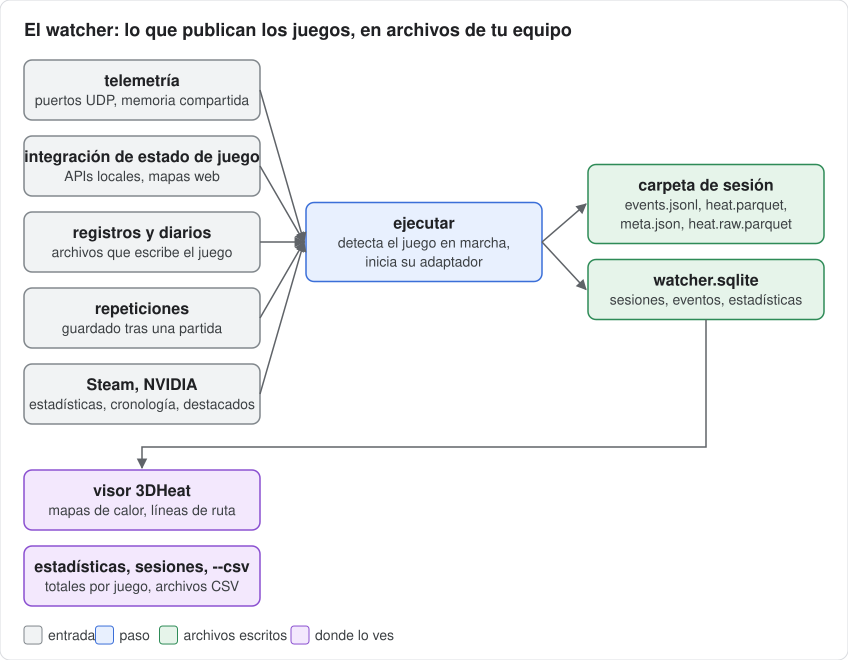

# 3DHeat Watcher {#dheat-watcher}

**¿Qué es?** Tú juegas a un juego. Este programa anota en silencio dónde fuiste y qué pasó.
Después puedes verlo como un mapa de colores en el visor 3DHeat.

**¿Para qué lo usaría?** Para llevar tu propio registro de cada sesión - por dónde condujiste, volaste o
luchaste, y tus totales por juego - sin ninguna web y sin cambiar el juego.

**Ejemplo:** conduces una vuelta en un juego de carreras con el watcher en marcha; después, un archivo en
`sessions\<game>\` contiene la línea que seguiste, y el visor la dibuja.

Con más detalle: 3DHeat Watcher es un programa en segundo plano que registra lo que los juegos publican
sobre tu juego - dónde estuviste, qué pasó en cada lugar, y los números que hay detrás - en archivos de tu
propio equipo. Los archivos sirven para tus estadísticas y para los mapas de calor y las líneas de ruta
del visor 3DHeat.

Funciona en silencio, detecta qué juego arrancaste, y lee lo que publica ese juego: un puerto de
telemetría o memoria compartida que el juego publica para paneles, una integración de estado de juego, el
diario o el registro que escribe el juego, la repetición que guarda tras una partida, las estadísticas que
guarda Steam, los clips que guarda NVIDIA App. Las grabaciones se quedan en tu equipo. El programa solo
contacta con dos servicios externos, y únicamente en estos casos: GitHub, para buscar una versión nueva
(ver [Actualizaciones](../updates.md)), y la API Match-V5 de Riot, y solo si introduces tu propia clave de API
de Riot (ver [Repeticiones de League of Legends](../game-lol-replays.md)).



## Qué registra {#what-it-records}

- **Posiciones**: el coche, avión, héroe o jugador, varias veces por segundo donde el juego las publica,
  con velocidad, rumbo y lo demás que el juego envíe junto a ellas.
- **Eventos**: apariciones, muertes, bajas, vueltas, tramos, rondas, goles, trabajos, despegues y
  aterrizajes, cambios de zona, logros, momentos destacados. Cada evento se guarda con su hora y, cuando
  el juego la da, con su lugar.
- **Estadísticas por sesión**: bajas, muertes, vueltas, mejor vuelta, distancia, velocidad máxima, tiempo
  de juego, y las estadísticas propias del juego cuando las guarda.

Lo que da cada juego, y de dónde, está en su propia página dentro de [Juegos](../games.md). Una sola fuente no
puede registrarlo todo: los juegos multijugador solo se registran por lo que publican, y el watcher nunca
lee su memoria (ver [Fuentes y normas](../sources-and-rules.md)).

## Instalación {#install}

¿Nuevo en la línea de comandos? Lee primero [Antes de empezar](before-you-start.md).

El watcher es un programa de Python para Windows (Python 3.10 o posterior). Muchas de sus fuentes solo
existen en Windows: memoria compartida, el registro, las notificaciones de Windows.

```bash
git clone https://github.com/Holdi601/3DHeat-Watcher.git
cd 3DHeat-Watcher
pip install -r requirements.txt
```

Una versión descargada en archivo funciona igual: descomprímela y ejecuta `pip install -r requirements.txt`
dentro de la carpeta. Los detalles, y los extras que necesitan algunos juegos, están en
[Instalación y ejecución](../installing-and-running.md).

## Inicio rápido {#quick-start}

```bash
python -m heat3d_watch games            # lo que da cada juego, y de dónde
python -m heat3d_watch setup all        # lo que habría que activar (no se cambia nada)
python -m heat3d_watch setup f1-25 --apply   # activar la salida de un juego (el archivo original se guarda)
python -m heat3d_watch run              # observar; déjalo en marcha mientras juegas
python -m heat3d_watch stats            # totales por juego
python -m heat3d_watch stats --csv out  # sesiones, eventos y estadísticas como archivos CSV
```

Deberías ver: tras `games`, una tabla con una línea por juego; `run` sigue hasta que pulses Ctrl+C o
cierres la ventana.

Todo se escribe en `%LOCALAPPDATA%\3DHeat\Watcher`. Para usar otra carpeta, define la variable de entorno
`HEAT3D_WATCH_HOME` o ejecuta `python -m heat3d_watch config --set data=D:\somewhere`.

- `sessions\<game>\<date>_<adapter>\` - una carpeta por sesión, con `events.jsonl` (cada evento según
  ocurre), `heat.parquet` (las filas con posición, listas para el visor 3DHeat) y `meta.json` (juego,
  fuente, ejes, recuentos, estadísticas)
- `watcher.sqlite` - las estadísticas de cada sesión, en tres tablas simples
- `watcher.log` - lo que hizo el watcher

El visor abre directamente el `heat.parquet` de una sesión, sin configurar nada (sus ejes y unidades están
en el archivo). Las repeticiones convertidas se escriben como tablas y documentos de partida junto a él;
el formato de un archivo por partida del visor está descrito en su página
[contenedor `.3dheat`](https://holdi601.github.io/3DHeat/container.html), y las columnas de cada tabla en
[Los datos](../the-data.md).

## La documentación {#the-documentation}

| Página | Qué cubre |
|---|---|
| [Antes de empezar](before-you-start.md) | Python, una terminal, marcadores, cómo se ven el éxito y los errores habituales |
| [Instalación y ejecución](../installing-and-running.md) | requisitos, ejecución en segundo plano, arranque con Windows, el archivo de bloqueo, el registro, cada ajuste y variable de entorno |
| [Juegos](../games.md) | una página por juego: qué se registra, de dónde, cómo activarlo, cómo funciona, ejes, estadísticas, qué se ha verificado |
| [Los datos](../the-data.md) | carpetas de sesión, `events.jsonl`, `heat.parquet` y su pie, `meta.json`, `watcher.sqlite`, recuperación tras un fallo, exportación CSV, abrir una sesión en el visor 3DHeat |
| [Comandos](../commands.md) | cada comando y opción de `python -m heat3d_watch` |
| [Fuentes y normas](../sources-and-rules.md) | los seis tipos de fuente, las normas multijugador, qué juegos quedan fuera y por qué |
| [NVIDIA Highlights](../nvidia-highlights.md) | lo que NVIDIA Highlights puede y no puede dar, y cómo un momento destacado obtiene una posición |
| [Mods de servidor grabador](../server-mods.md) | los mods de servidor de Arma 3 y Arma Reforger que graban misiones completas para el visor |
| [Lectura de memoria](../memory-reading.md) | perfiles de memoria de un jugador: el formato, las comprobaciones, cómo escribir y verificar uno |
| [Actualizaciones](../updates.md) | cómo busca el watcher versiones nuevas y se actualiza solo |
| [Desarrollo](../development.md) | escribir un adaptador: la API, las pruebas, un `verified` honesto, regenerar las páginas de juegos |
| [Todos los juegos en una tabla](../watcher.md) | cada juego en una tabla, tal como lo imprime `games --markdown`, más los juegos investigados pero aún no construidos |
| [Referencia de comandos](../cli-reference.md) | el `--help` de cada comando, generado desde el código |
| [Mantenimiento](../maintaining.md) | la lista de comprobación de cada versión de estas páginas |

## Parte de 3DHeat {#part-of-3dheat}

3DHeat Watcher es una de las herramientas gratuitas que rodean al visor 3DHeat (el watcher usa 3DHeat CS2
para convertir las demos de CS2). Cada una es un proyecto propio, con sus versiones y su licencia:

| Herramienta | Qué hace | Documentación |
|---|---|---|
| [3DHeat](https://github.com/Holdi601/3DHeat) | el visor: mapas de calor, análisis de carreras y revisión de partidas en 3D | [sitio](https://holdi601.github.io/3DHeat/) |
| [GameFiles](https://github.com/Holdi601/3DHeat-GameFiles) | circuitos y niveles a partir de los archivos que traen los juegos, como modelos 3D | [sitio](https://holdi601.github.io/3DHeat-GameFiles/) |
| [GameCapture](https://github.com/Holdi601/3DHeat-GameCapture) | telemetría de vueltas de juegos de carreras; niveles reconstruidos a partir de vídeo de juego | [sitio](https://holdi601.github.io/3DHeat-GameCapture/) |
| [Unreal Exporter](https://github.com/Holdi601/3DHeat-UnrealExporter) | un plugin del editor de Unreal que exporta un nivel como un modelo 3D | [sitio](https://holdi601.github.io/3DHeat-UnrealExporter/) |
| [CS2](https://github.com/Holdi601/3DHeat-CS2) | demos de Counter-Strike 2 en tablas y documentos de partida; mapas en modelos 3D | [sitio](https://holdi601.github.io/3DHeat-CS2/) |
| [Watcher](https://github.com/Holdi601/3DHeat-Watcher) | registra lo que publican los juegos sobre tu juego, en segundo plano | [sitio](https://holdi601.github.io/3DHeat-Watcher/) |
| [Ext-WarThunder](https://github.com/Holdi601/3DHeat-Ext-WarThunder) | repeticiones de War Thunder en tablas y documentos de partida | [sitio](https://holdi601.github.io/3DHeat-Ext-WarThunder/) |
| [Ext-WoT](https://github.com/Holdi601/3DHeat-Ext-WoT) | repeticiones de World of Tanks en tablas y documentos de partida | [sitio](https://holdi601.github.io/3DHeat-Ext-WoT/) |
| [Ext-WoWs](https://github.com/Holdi601/3DHeat-Ext-WoWs) | repeticiones de World of Warships en tablas y documentos de partida | [sitio](https://holdi601.github.io/3DHeat-Ext-WoWs/) |
| [Ext-Squad](https://github.com/Holdi601/3DHeat-Ext-Squad) | demos de servidores de Squad en tablas y documentos de partida | [sitio](https://holdi601.github.io/3DHeat-Ext-Squad/) |
| [Ext-DCS](https://github.com/Holdi601/3DHeat-Ext-DCS) | mapas de DCS World en modelos 3D | [sitio](https://holdi601.github.io/3DHeat-Ext-DCS/) |
| [Ext-IL2](https://github.com/Holdi601/3DHeat-Ext-IL2) | mapas de IL-2 Sturmovik en modelos 3D | [sitio](https://holdi601.github.io/3DHeat-Ext-IL2/) |

Licencia: MIT ([LICENSE](https://github.com/Holdi601/3DHeat-Watcher/blob/main/LICENSE)). Las licencias de los
paquetes de terceros que usa, y lo que exigen los juegos que lee, están en
[LICENSES.md](https://github.com/Holdi601/3DHeat-Watcher/blob/main/LICENSES.md).
