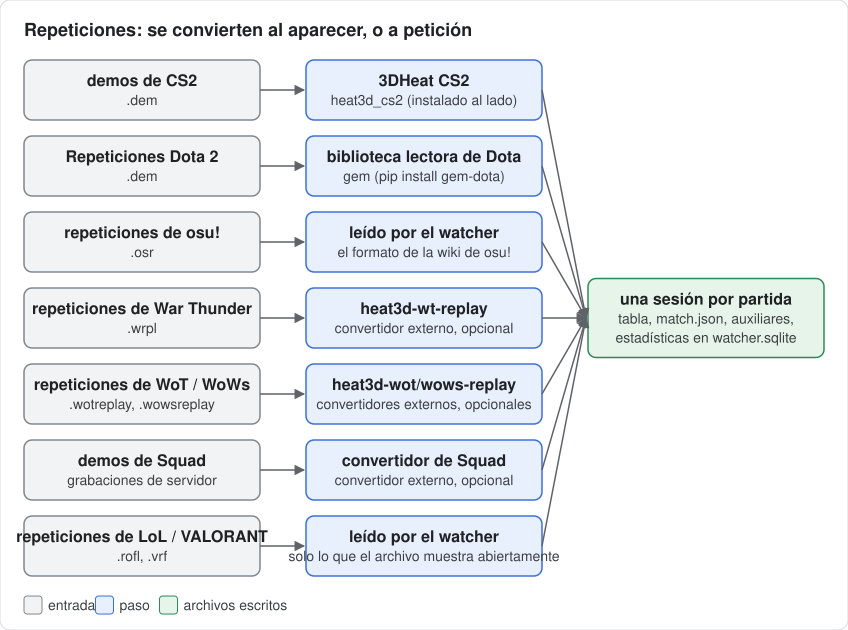

# Instalación y ejecución {#installing-and-running}

## Requisitos {#requirements}

- **Windows.** El watcher está escrito para Windows, y la mayoría de sus fuentes solo existen allí: la memoria
  compartida que crean los juegos (asignaciones `Local\...`), el registro (donde está Steam), las notificaciones
  de Windows, la lista de procesos con las rutas de los ejecutables. En otro sistema el programa arranca, pero esas
  fuentes no encuentran nada, las notificaciones solo se registran, y la lectura de memoria se niega ("only
  implemented on Windows").
- **Python 3.10 o posterior**, desde <https://www.python.org/downloads/>: marca **Add python.exe to PATH** en el
  instalador y luego compruébalo con `python --version` en una terminal nueva. ¿Es nuevo para ti? Lee primero
  [Antes de empezar](before-you-start.md).
- **Paquetes** (`requirements.txt`): `psutil>=6.0` (qué juegos están en marcha, qué programa ocupa un puerto, las
  conexiones de un juego; un psutil más antiguo sigue funcionando, mediante su nombre anterior para las conexiones
  de un proceso), `pyarrow>=15` (escribir `heat.parquet`), `numpy>=1.24`, y `pytest>=8.0` para las pruebas.
  `requirements-optional.txt` no enumera ahora mismo ningún paquete.

Sin `pyarrow` las sesiones se siguen grabando: `events.jsonl` es el registro, y la tabla se puede construir después
con [`table`](commands.md#table).

### Extras que necesitan algunos juegos {#extras-some-games-need}

| Juego | Qué necesita |
|---|---|
| Demos de Counter-Strike 2 | [3DHeat CS2](https://github.com/Holdi601/3DHeat-CS2) y sus requisitos (`demoparser2`). El watcher lo busca en `HEAT3D_CS2`, luego en una carpeta `3DHeat-CS2` o `cs2` junto a la carpeta propia del watcher, y luego en cualquier lugar desde donde Python pueda importar `heat3d_cs2`. Sin él, `games` indica el adaptador como no disponible. |
| Microsoft Flight Simulator 2020 / 2024 | `SimConnect.dll`: no se incluye. MSFS 2020 tiene uno en su carpeta de instalación; para MSFS 2024, instala el SDK de MSFS 2024. `MSFS_SDK` / `MSFS2024_SDK` apuntan a la carpeta del SDK. |
| Euro Truck Simulator 2, American Truck Simulator | el complemento `scs-telemetry.dll` de RenCloud (revisión 12) en `<game>\bin\win_x64\plugins` |
| BeamNG.drive | el mod de protocolo `heat3d`, que instala `python -m heat3d_watch setup beamng --apply` |
| League of Legends (en vivo) | opcional: el certificado raíz de Riot como `<data>\riotgames.pem`, para verificar la conexión local |
| Minecraft | una carpeta `%APPDATA%\.minecraft` (edición Java) |

La página de cada juego en [Juegos](games.md) dice qué hay que activar en el propio juego.
`python -m heat3d_watch games` marca un adaptador como `[unavailable: ...]` cuando falta algo que necesita en
esta máquina.

## Instalar {#installing}

¿Nuevo en la línea de comandos? Lee primero [Antes de empezar](before-you-start.md). Si no se encuentra `pip`,
usa en su lugar `python -m pip install -r requirements.txt`.

Desde un clon:

```bash
git clone https://github.com/Holdi601/3DHeat-Watcher.git
cd 3DHeat-Watcher
pip install -r requirements.txt
```

Desde una versión publicada: descarga el archivo desde las versiones del repositorio, descomprímelo y luego
ejecuta `pip install -r requirements.txt` dentro de la carpeta. Los dos tipos de copia se actualizan solas
(véase [Actualizaciones](updates.md)).

Ejecuta cada comando desde la carpeta del repositorio: `python -m heat3d_watch` importa el paquete desde allí, y
el actualizador (`heat3d_update`) está junto a él.

## Ejecutar {#running}

```bash
python -m heat3d_watch run        # watch until stopped
python -m heat3d_watch run -v     # the same, with debug lines in the log
python -m heat3d_watch run --once # one look at the games running now, then stop and exit
```

Al arrancar, `run`:

1. escribe el [archivo de bloqueo](#the-lock-file);
2. termina las sesiones que dejó abiertas una ejecución anterior, por ejemplo tras un fallo (véase
   [Recuperación](the-data.md#recovery-after-a-crash));
3. cada `scan_seconds` (2 s), lee la lista de procesos (solo nombres y rutas, no se abre ningún proceso) y arranca
   un adaptador, en un hilo propio, por cada juego que encuentra. Cuando el proceso de un juego desaparece, su
   adaptador se detiene y las sesiones que tenía abiertas se cierran, lo que escribe su tabla y su línea en las
   estadísticas. Los adaptadores que no esperan a ningún juego (estadísticas de Steam, Steam Timeline, destacados
   de NVIDIA, las carpetas de repeticiones) funcionan todo el tiempo;
4. mientras no hay ningún juego en marcha, busca una versión más nueva como máximo una vez por hora (la respuesta
   en sí se guarda en caché durante seis horas) y, con `auto_update` activado, la instala y vuelve a arrancar
   (véase [Actualizaciones](updates.md)).

Un adaptador que falla se registra y no detiene a los demás. Si la consulta de un adaptador falla 20 veces
seguidas, o falla su arranque, el adaptador se detiene y no se reinicia hasta que el juego se vuelva a arrancar
(un nuevo id de proceso).

Detén el watcher con Ctrl+C. Los adaptadores cierran sus sesiones antes de salir. Si el watcher se mata en su
lugar (Administrador de tareas, un fallo, un corte de luz), no se pierde nada de lo ya escrito: el siguiente `run`
termina esas sesiones.

`--once` hace una única revisión: arranca los adaptadores de los juegos en marcha en ese momento (y los
siempre activos), deja que cada uno consulte una vez —esperando como máximo 10 segundos para ello— y luego los
detiene igual que cuando termina un juego, de modo que las sesiones que abrieron se cierran, sus tablas se
escriben y sus líneas se cuentan en las estadísticas antes de salir. Úsalo para comprobar que un juego se
detecta, no para grabar.

### Repeticiones que ya están en el disco {#replays-already-on-disk}



La primera vez que un adaptador de repeticiones ve una de sus carpetas, solo anota las repeticiones que ya hay en
ella: un jugador con años de demos encontraría si no al watcher ocupado convirtiendo durante un día. A partir de
entonces, cada repetición nueva se convierte cuando el juego ha terminado de escribirla. Las antiguas se convierten
bajo petición con [`replays`](commands.md#replays):

```bash
python -m heat3d_watch replays cs2-demos              # every demo in CS2's folders and replay_folders
python -m heat3d_watch replays osu-replays D:\Old     # the replays in one folder
```

### Ejecutar en segundo plano {#running-in-the-background}

El watcher no tiene ventana propia; es un programa de consola que se ejecuta hasta que se detiene. Escribe todo
en `watcher.log`, así que no necesita una consola visible. Formas de tenerlo fuera de en medio:

- arrancarlo en una consola y minimizar la consola: `start "" /min python -m heat3d_watch run` desde `cmd`, en la
  carpeta del repositorio;
- arrancarlo sin consola: `pythonw -m heat3d_watch run`. Se pierde la salida de la consola, pero `watcher.log` se
  sigue escribiendo. Para detenerlo, termina el proceso `pythonw.exe`; el siguiente arranque termina entonces las
  sesiones que dejó abiertas. El proyecto no ha probado esta forma de ejecución.

### Arrancar con Windows (una idea) {#starting-with-windows-an-idea}

El watcher no se instala solo para arrancar con Windows. Para arrancarlo automáticamente:

- **Programador de tareas**: crea una tarea con el desencadenador *Al iniciar sesión* y la acción *Iniciar un
  programa*, programa `pythonw.exe` (o `python.exe`), argumentos `-m heat3d_watch run`, y *Iniciar en* con la
  carpeta del repositorio;
- **Carpeta de inicio**: pon un acceso directo en `shell:startup` con el mismo programa, argumentos y carpeta
  *Iniciar en*.

Ninguna de las dos forma parte del watcher ni la prueba. El [archivo de bloqueo](#the-lock-file) asegura que una
segunda copia iniciada por error salga enseguida.

## El archivo de bloqueo {#the-lock-file}

`<data>\watcher.lock` guarda el id del proceso del watcher en marcha. Cuando `run` arranca y el archivo de
bloqueo nombra un proceso que todavía existe y cuyo nombre contiene `python`, muestra

```text
A watcher is already running (process 12345) for C:\Users\...\3DHeat\Watcher.
```

y sale con código 1. Dos watchers en una misma carpeta de datos grabarían cada juego dos veces, y el segundo
trataría las sesiones abiertas del primero como restos de un fallo. Un archivo de bloqueo cuyo proceso ya no
existe, o pertenece a otro programa, se sobrescribe. Cuando `run` termina, borra el archivo de bloqueo si todavía
nombra su propio proceso.

## El registro {#the-log}

`<data>\watcher.log` lo escribe solo `run`; los demás comandos muestran su salida en la consola. Cada línea tiene la
hora, el nivel y un mensaje:

```text
2026-05-01 20:15:01,123 INFO watching; data in C:\Users\...\AppData\Local\3DHeat\Watcher
2026-05-01 20:15:03,456 INFO f1-25: starting (EA SPORTS F1 25)
2026-05-01 21:02:11,789 INFO f1-25: stopping
```

Los adaptadores registran lo que no pueden hacer y por qué: "UDP 20777 is in use by ...; not taking it from that
program", "not reading memory: the game is played online", "could not start", "poll failed (3)" con el traceback.
`run -v` añade líneas de depuración. El archivo se va añadiendo al final y el watcher nunca lo rota ni lo vacía;
bórralo cuando quieras. Las mismas líneas también van a la consola.

## Dónde está todo {#where-everything-is}

La carpeta de inicio es `%LOCALAPPDATA%\3DHeat\Watcher`, o `HEAT3D_WATCH_HOME` cuando está definido (sin
`LOCALAPPDATA`, por ejemplo en otro sistema, `~/.local/share/3DHeat/Watcher`). `settings.json` está siempre en la
carpeta de inicio. Todo lo demás va a la carpeta de datos, que es la carpeta de inicio salvo que el ajuste `data`
indique otra:

| Ruta | Qué es |
|---|---|
| `<home>\settings.json` | los ajustes |
| `<data>\sessions\` | las grabaciones, una carpeta por sesión ([Los datos](the-data.md)) |
| `<data>\watcher.sqlite` | la base de datos de estadísticas |
| `<data>\watcher.log` | el registro de `run` |
| `<data>\watcher.lock` | el archivo de bloqueo, mientras `run` se ejecuta |
| `<data>\state\` | lo que ya han visto los adaptadores siempre activos y de repeticiones (`steam-stats.json`, `replays-cs2-demos.json`, ...), para que un reinicio no grabe nada dos veces |
| `<data>\profiles\*.json` | perfiles de memoria que escribiste ([Lectura de memoria](memory-reading.md)) |
| `<data>\riotgames.pem` | opcional, el certificado raíz de Riot para el adaptador en vivo de League of Legends |
| `%LOCALAPPDATA%\3DHeat\update-check-3DHeat-Watcher.json` | la respuesta guardada en caché de la última comprobación de versión |

El watcher no borra nada en estas carpetas, salvo una carpeta de sesión en la que no se grabó nada (un juego que
se quedó en sus menús).

## Ajustes {#settings}


`python -m heat3d_watch config` muestra los ajustes; `config --set key=value ...` los cambia y guarda
`settings.json` (véase [config](commands.md#config)). El archivo es JSON plano y también se puede editar a mano
mientras el watcher no está en marcha. Las claves desconocidas que contenga se ignoran. Los ajustes se leen al
arrancar un comando, así que reinicia `run` después de cambiarlos.

| Ajuste | Por defecto | Qué hace |
|---|---|---|
| `data` | `""` | La carpeta de datos. Vacío: la carpeta de inicio. |
| `disabled` | `[]` | Ids de adaptadores que nunca se ejecutan, por ejemplo `config --set disabled=steam-stats,nvidia-highlights`. Cualquier otro adaptador se ejecuta cuando encuentra su juego. |
| `auto_update` | `true` | Mientras no hay ningún juego en marcha, instala una versión más nueva y reinicia (véase [Actualizaciones](updates.md)). `false`: solo un aviso en el registro. |
| `scan_seconds` | `2.0` | Segundos entre revisiones de la lista de procesos. |
| `memory` | `false` | Permite que se ejecuten los adaptadores de memoria (juegos para un jugador con un perfil que escribiste). Desactivado por defecto; véase [Lectura de memoria](memory-reading.md). |
| `replays` | `true` | Ejecuta los adaptadores `replay`: todos ellos (véase `python -m heat3d_watch replays` y [Juegos](games.md)): demos de CS2, Dota 2, osu!, War Thunder, World of Tanks, World of Warships, Squad, repeticiones de League of Legends y VALORANT, grabaciones Tacview de IL-2. |
| `replay_folders` | `{}` | Carpetas extra por id de adaptador, por ejemplo `{"cs2-demos": ["D:\\Demos"]}`. Los adaptadores de repeticiones las vigilan además de las carpetas propias del juego; `il2-tacview` acepta también carpetas de instalación (entonces busca en su `data\Tracks`); para `elite`, la primera carpeta sustituye a la carpeta del diario. Fija las carpetas de un adaptador con `config --set replay_folders.cs2-demos=D:\Demos,E:\More`, o el diccionario completo como JSON. |
| `riot_id` | `""` | Tu Riot ID (`Name#TAG`), para que tu propia línea en una repetición de League of Legends se convierta en tus estadísticas. Vacío: se guarda la línea de cada jugador, y ninguna se marca como tuya. |
| `riot_api_key` | `""` | Tu propia clave de API de desarrollador de Riot, para obtener la cronología oficial de cada partida de League repetida (posiciones cada minuto, eliminaciones donde ocurrieron). Vacío: no se obtiene nada. |
| `riot_platform` | `"EUW1"` | El id de plataforma de tu servidor de League (`EUW1`, `EUN1`, `NA1`, `KR`, ...), que se usa para encontrar el servidor regional de Match-V5. |
| `player_names` | `{}` | Tu nombre en juegos cuya interfaz nombra a todos los jugadores pero no dice cuál eres tú, por id de adaptador: `warthunder-webmap` (las líneas del feed de eliminaciones sobre ti pasan a ser tus eliminaciones y muertes) y `rocketleague-stats` (tus filas pasan a ser `me`; sin él, el jugador que sigue la cámara del juego). Se fija con `config --set player_names.warthunder-webmap=Name`. |

Un `settings.json` con todos los valores por defecto:

```json
{
  "data": "",
  "disabled": [],
  "auto_update": true,
  "scan_seconds": 2.0,
  "memory": false,
  "replays": true,
  "replay_folders": {},
  "riot_id": "",
  "riot_api_key": "",
  "riot_platform": "EUW1",
  "player_names": {}
}
```

## Variables de entorno {#environment-variables}

| Variable | Efecto |
|---|---|
| `HEAT3D_WATCH_HOME` | la carpeta de inicio (ajustes, y los datos salvo que `data` indique otra cosa) |
| `HEAT3D_NO_UPDATE` | cualquier valor salvo vacío, `0`, `false` o `no` desactiva la comprobación de versiones y la actualización automática |
| `HEAT3D_NO_TOAST` | cualquier valor no vacío: sin notificaciones de Windows, solo líneas de registro |
| `HEAT3D_CS2` | la carpeta de 3DHeat CS2, para las demos de CS2 |
| `HEAT3D_CS2_GSI_PORT` | el puerto de estado del juego de CS2 (por defecto 3311); el archivo cfg que escribe `setup` lo usa |
| `HEAT3D_DOTA_GSI_PORT` | el puerto de estado del juego de Dota 2 (por defecto 3312) |
| `MSFS_SDK`, `MSFS2024_SDK` | las carpetas del SDK de MSFS, donde se busca `SimConnect SDK\lib\SimConnect.dll` |

Las notificaciones de Windows se usan solo para las actualizaciones: "Updating to 1.2.0", o "1.2.0 is out; not
updated: ..." cuando no se pudo aplicar la actualización. Se muestran mediante la API de notificaciones propia de
PowerShell, así que no hay que instalar nada. El título y el texto se pasan a PowerShell como variables de entorno,
nunca como parte del script.
