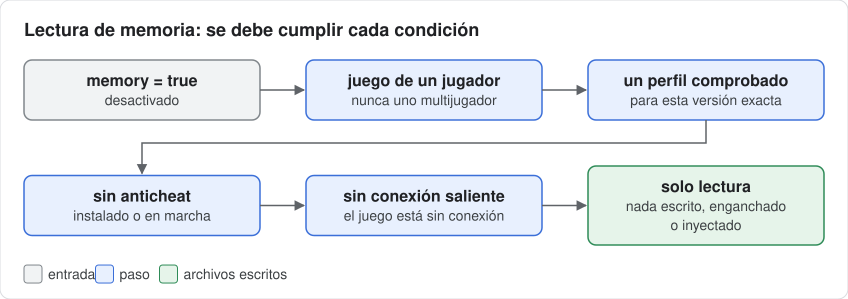

# Lectura de memoria {#reading-memory}

Algunos juegos para un jugador no dan información a otros programas. Para esos, el watcher puede —si lo activas
y escribes tú un perfil— buscar dónde estás en la memoria del juego, solo leyendo.

Para los juegos para un jugador que no publican nada, el watcher puede leer posiciones y valores de la memoria
del juego, mediante un **perfil** que escribes para tu propia versión del juego. De todas las fuentes, esta es la
única que el juego no entregó, así que está más cercada que las demás:

- está **desactivada por defecto** (`python -m heat3d_watch config --set memory=true` la activa);
- solo lee, y no tiene forma de escribir;
- **ningún perfil viene con las herramientas.**

Los perfiles no se incluyen porque un desplazamiento solo es correcto para la versión en la que se encontró. Tras
un parche, un perfil que era correcto antes lee basura, y la basura parece exactamente igual que los números. Un
perfil debe comprobarlo en la versión que tiene el jugador, el propio jugador.

## Las comprobaciones, en orden {#the-checks-in-order}



Cada comprobación siguiente debe superarse. Las cuatro primeras se hacen **antes** de abrir el juego, porque abrir
un juego protegido para leerlo es justo lo que detecta un anticheat, y rechazarlo después llegaría demasiado tarde.

1. **El ajuste**: `memory` es verdadero. Si no, los adaptadores de memoria nunca se arrancan.
2. **Un perfil para el juego**, cuyo `exe` nombre el proceso en marcha. Un perfil indica si el juego se puede jugar
   en línea (`"online"`); uno que omite esto se rechaza.
3. **Ningún anticheat cerca**:
   - ningún archivo de anticheat en la carpeta del juego ni hasta tres carpetas por encima (deteniéndose en la carpeta
     `common` de una biblioteca de Steam, o en una carpeta que contenga `steamapps`, ya que otros juegos viven por
     encima de eso): `EasyAntiCheat`, `EasyAntiCheat_EOS_Setup.exe`, `start_protected_game.exe`, `BattlEye`,
     `BEClient_x64.dll`, `BEService_x64.exe`, `EAAntiCheat.GameServiceLauncher.exe`, `AntiCheatExpert`, `SGuard64.exe`,
     `GameGuard`, `GameMon.des`, `XIGNCODE`, `xhunter1.sys`, `Vanguard`, `FACEIT` (comparado en minúsculas, también
     como inicio de un nombre). Si se desconoce la carpeta del juego, el juego se rechaza;
   - ningún controlador o servicio de anticheat en ejecución en la máquina, según lo que listan
     `sc query type= driver state= active` y `sc query type= service state= active`: EasyAntiCheat,
     EasyAntiCheat_EOS, BEService, BEDaisy, vgk, vgc, ACE-BASE, ACE-GAME, xhunter1, FACEIT, FACEITService,
     EAAntiCheatService, Denuvo Anti-Cheat, npggsvc, Ricochet. Un anticheat de kernel instalado para otro juego sigue
     vigilando todos los procesos. Si no se pueden listar los servicios, el juego se rechaza.
4. **Sin conexión en línea**: un juego cuyo perfil diga `"online": true` solo se lee mientras no tiene conexión con
   nada que no sea esta máquina (cualquier dirección remota distinta de `127.x`, `::1`). Si no se pueden leer sus
   conexiones, se rechaza.
5. Después, al arrancar el adaptador:
   - **la versión exacta**: el tamaño del ejecutable, o su SHA-256, debe coincidir con una versión que liste el
     perfil. Una versión desconocida no se lee;
   - **los módulos otra vez**: se listan los módulos cargados del juego (una instantánea de Toolhelp, que no pide
     derechos de acceso propios) y se comprueba si hay un cliente de anticheat (`BEClient_x64.dll`, `BEClient.dll`,
     `EasyAntiCheat_x64.dll`, `EasyAntiCheat.dll`, `EOSAntiCheat...`). Un proceso protegido rechaza la instantánea,
     lo que también es un rechazo;
   - solo entonces se abre el proceso, con `PROCESS_VM_READ | PROCESS_QUERY_LIMITED_INFORMATION` y nada más.

Las comprobaciones 1 a 4 se repiten en cada revisión (cada 2 s) mientras el juego se ejecuta. Si una empieza a fallar
(el juego se conecta a un servidor, arranca un servicio de anticheat), el adaptador se detiene en la siguiente
revisión. Un rechazo se registra: `mem-<id>: not reading memory: <reason>`. Un fallo al arrancar (versión desconocida,
un módulo de anticheat, un patrón no encontrado) se registra como `mem-<id>: could not start`, y el adaptador no se
vuelve a intentar hasta que el juego se arranque de nuevo.

No hay escritura, ni reserva en el otro proceso, ni hilo iniciado en él, ni biblioteca cargada en él, ni privilegio de
depuración ni elevación. Una prueba (`test_memory_reading_cannot_write` en `tests/test_core.py`) falla si aparece en
cualquier parte del paquete alguna llamada que escriba en otro proceso, reserve memoria en él o ejecute código en
él —`WriteProcessMemory`, `VirtualAllocEx`, `CreateRemoteThread`, `PROCESS_VM_WRITE`, `SeDebugPrivilege`,
`LoadLibrary`, ...—.

Nunca se lee, diga lo que diga un perfil: los juegos jugados en línea, y los juegos cuyo modo para un jugador funciona
bajo un anticheat, como GTA V, o Elden Ring iniciado a través de su lanzador. Las comprobaciones anteriores los
rechazan de todos modos.

## El formato del perfil {#the-profile-format}

Un perfil es un archivo JSON en `<data>\profiles\` (`<data>` es la carpeta de datos, véase
[Instalación y ejecución](installing-and-running.md#where-everything-is)), uno por juego, con cualquier nombre de
archivo que termine en `.json`. Un ejemplo sintético:

```json
{
  "schema": "heat3d.memprofile/1",
  "id": "mygame",
  "game": "My Game",
  "exe": "MyGame.exe",
  "online": false,
  "versions": [ { "label": "1.06", "size": 123456789 } ],
  "anchors": {
    "World": { "aob": "48 8B 05 ?? ?? ?? ?? 48 85 C0", "rip": [3, 7] }
  },
  "values": {
    "pos": { "type": "vec3f", "base": "World", "chain": ["0x10", "0x68", "0x70"] },
    "hp":  { "type": "i32",   "base": "World", "chain": ["0x10", "0x138"] },
    "map": { "type": "u32",   "base": "World", "chain": ["0x10", "0x1C0"] }
  },
  "events": [
    { "event": "death", "value": "hp",  "when": "to_zero" },
    { "event": "zone",  "value": "map", "when": "change" }
  ],
  "axes": { "up": "y", "units": "metres" },
  "rate": 10,
  "provenance": [ { "source": "https://example.com/my-notes", "verified_on": "1.06" } ]
}
```

| Clave | Obligatoria | Qué es |
|---|---|---|
| `schema` | sí | exactamente `heat3d.memprofile/1` |
| `id` | sí | corto y estable; el adaptador se llama `mem-<id>` |
| `game` | sí | el nombre del juego, con el que se nombra la carpeta de la sesión |
| `exe` | sí | el nombre de archivo del ejecutable, que también indica que el juego está en marcha |
| `online` | sí | `true` si el juego se puede jugar en línea; entonces solo se lee sin conexión |
| `versions` | sí | las versiones en las que se comprobó el perfil: cada una con una `label`, y un `size` (el tamaño del ejecutable en bytes) y/o un `sha256`. Si se dan ambos, deben coincidir los dos. Una entrada sin ninguno no coincide con nada. |
| `anchors` | sí | direcciones con nombre en el módulo principal. `aob`: un patrón de bytes, bytes hexadecimales separados por espacios, `?` o `??` para cualquier byte; debe aparecer **exactamente una vez** en la imagen del módulo (varias coincidencias cuentan como fallo, igual que ninguna). `rip: [d, n]`: el patrón apunta a una instrucción con un desplazamiento RIP relativo de 32 bits en el byte `d` y de longitud `n`; el anclaje pasa a ser la dirección a la que se refiere esa instrucción. `offset`: se suma después (texto hexadecimal o decimal). En lugar de `aob`, `module_offset` da un desplazamiento fijo desde la base del módulo. |
| `values` | sí | lo que se lee en cada consulta: `type` (`i32`, `u32`, `i64`, `u64`, `u8`, `f32`, `f64`, `vec3f`, `vec3d`), `base` (el nombre de un anclaje), `chain` (desplazamientos como texto hexadecimal o decimal) |
| `events` | no | reglas que convierten cambios en eventos: `when` `change` (el valor difiere de la última consulta) o `to_zero` (un número baja de más de 0 a 0 o menos) |
| `axes` | no | `up` (por defecto `y`), `units` (por defecto `game units`), `scale` (la escala de unidades del visor, que multiplica cada posición; por defecto 1, las unidades propias del juego) |
| `rate` | no | consultas por segundo, de 1 a 60 (por defecto 10) |
| `provenance` | no | de dónde vienen los desplazamientos y en qué versión los comprobaste; se copia en el `meta.json` de cada sesión |

**Cómo se lee un valor.** La dirección del anclaje es el punto de partida. Si `chain` está vacío, el valor se lee
justo allí. Si no, primero se lee el puntero guardado en el anclaje. Luego, para cada desplazamiento menos el último,
se lee el puntero en `address + offset`. Al último desplazamiento se le suma para obtener la dirección del valor. Un
puntero nulo en el camino (el juego está entre niveles o en un menú) deja el valor vacío en esa consulta.

**Qué se graba.** Un valor llamado `pos` (un `vec3f` o `vec3d`) se convierte en una fila `position` del jugador `me`
en cada consulta. Cada regla de evento escribe su fila `event`, con el valor nuevo y, cuando se conoce `pos`, la
posición, y suma 1 a una estadística del mismo nombre. La imagen del módulo se lee una vez al arrancar para encontrar
los anclajes, en bloques de 64 KiB; los bloques que no se pueden leer cuentan como ceros. El `meta.json` de la sesión
nombra el perfil, la etiqueta de la versión y la procedencia.

Un perfil que no se puede usar (JSON incorrecto, `schema` equivocado, una clave obligatoria que falta) se omite y se
registra como `profile <file> not used: <reason>`. Los perfiles se cargan cuando arranca el watcher, así que reinicia
`run` después de añadir o cambiar uno.

## Escribir y comprobar un perfil {#writing-and-verifying-a-profile}

1. **Solo para un juego para un jugador sin anticheat.** Si el juego tiene un anticheat, o lo juegas en línea, para
   aquí: el watcher lo rechazará, y debe hacerlo.
2. **Encuentra los valores en tu propia versión.** Trabaja sin conexión. Usa tus propias herramientas de depuración,
   o notas publicadas sobre el juego, para encontrar la posición del jugador y los valores que te interesan, y una
   ruta de punteros a cada uno desde un lugar estático del ejecutable. Prefiere un patrón de bytes (`aob`) a un
   `module_offset` fijo: un patrón sigue encontrando su lugar cuando el código se mueve un poco.
3. **Haz que el patrón sea único.** Debe coincidir exactamente una vez en el módulo. Pon comodines en los bytes que
   cambian (direcciones, desplazamientos) y deja suficientes bytes fijos alrededor.
4. **Fija la versión.** Pon el tamaño exacto del ejecutable en `versions`; PowerShell `(Get-Item .\MyGame.exe).Length`
   lo da, y `Get-FileHash .\MyGame.exe -Algorithm SHA256` da el hash. Tras un parche, el perfil simplemente deja de
   usarse hasta que lo compruebes de nuevo y añadas la versión nueva.
5. **Di si el juego va en línea** (`online`), con honestidad.
6. **Pruébalo**: activa la lectura (`config --set memory=true`), pon el archivo en `<data>\profiles\`, y comprueba que
   `python -m heat3d_watch games` lista `mem-<id>`. Arranca el juego y ejecuta `python -m heat3d_watch run -v`. En
   `watcher.log`, busca `mem-<id>: starting`, o el motivo por el que se rechazó o no pudo arrancar.
7. **Comprueba los números contra el juego.** Ve a un lugar conocido y mira las filas `position` del `events.jsonl` de
   la sesión. ¿Se mueven cuando tú te mueves, con la cantidad correcta, por los ejes correctos? Abre `heat.parquet` en
   el visor y comprueba que la ruta coincide con por dónde fuiste. Dispara cada evento (pierde toda la vida, cambia de
   zona) y comprueba que aparece una vez. La basura parece números, y solo esta comparación distingue una cosa de la
   otra.
8. **Apunta lo que comprobaste** en `provenance`: la fuente de los desplazamientos y la versión en la que los
   comprobaste.

El texto `verified` de un adaptador de memoria, tal como lo muestra `games`, es siempre "by the profile's author, for
the builds it lists". El watcher no puede saber más que eso.
